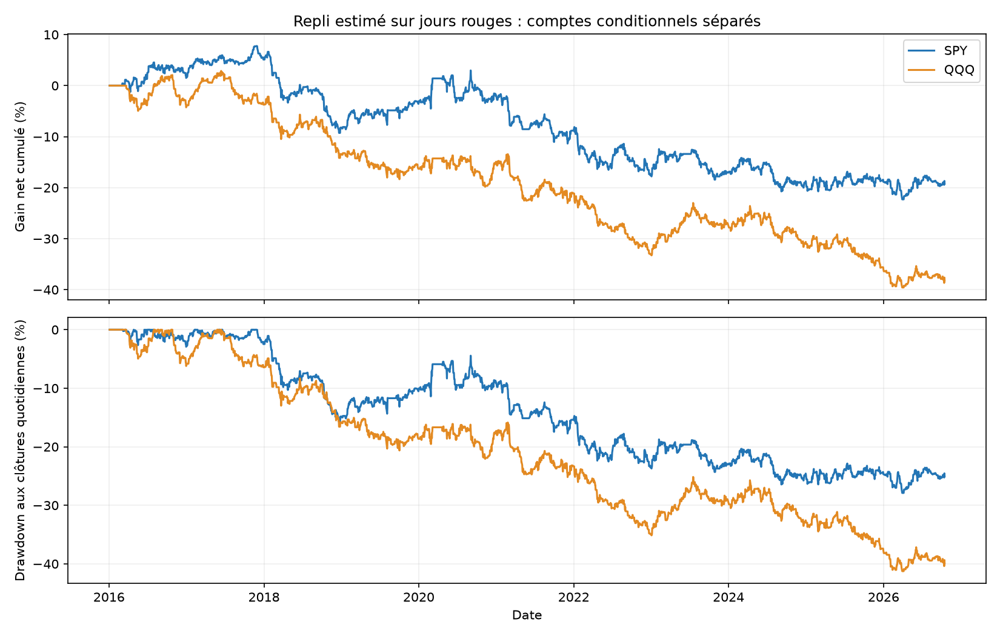
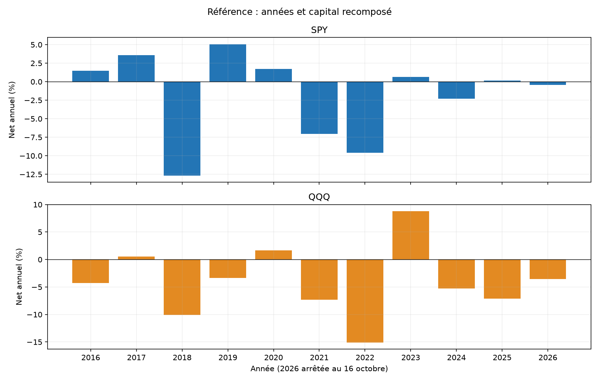
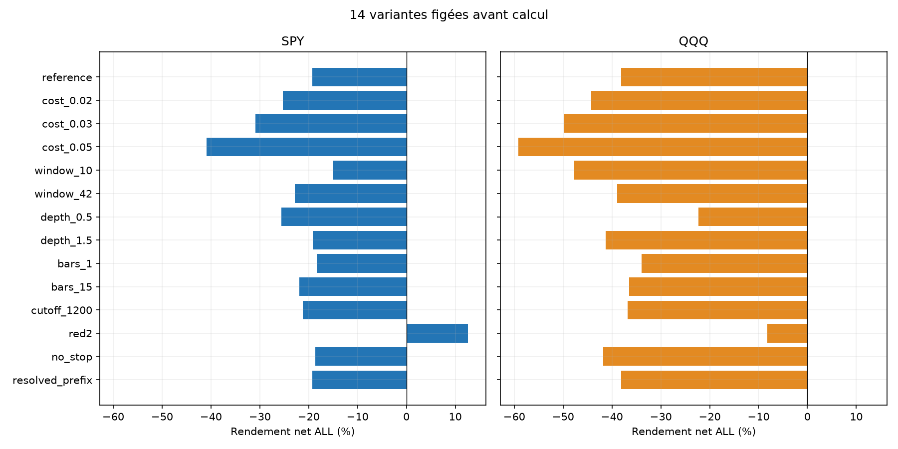
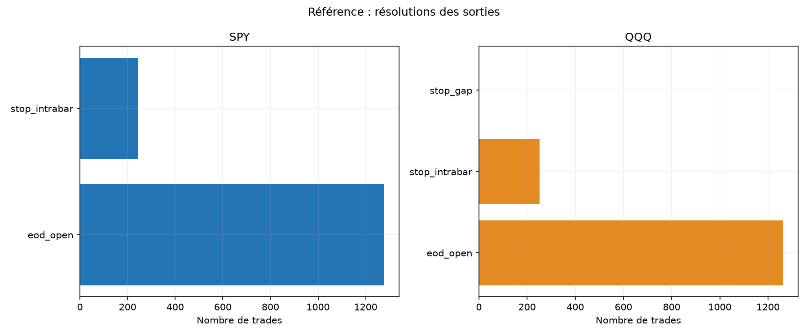

# Repli estimé sur les séances rouges — SPY et QQQ

Calcul le 31 octobre 2026 (date locale), historique du 4 janvier 2016 au 16 octobre 2026. Deux comptes indépendants de 100 000 USD. Piste écartée pour un nouveau bot : les critères fixés avant les résultats ne sont pas tous satisfaits.

## Hypothèse et sources

Chaque matin, estimer la profondeur du repli par la moyenne des max(Open−Close,0) des 21 séances précédentes : les jours verts comptent zéro. Le niveau fixe est ouverture du jour moins cette moyenne, arrondi au cent inférieur. Ce n’est ni Open−Low, ni une moyenne conditionnée aux seuls jours rouges, ni une information du jour courant.

[Daniel Peer, code primaire](https://raw.githubusercontent.com/daniel100peer/stocks_master/main/strategies/dip_buying_clean/quick_dip_check.py) est la source de cette hypothèse. Son code utilise des OHLC quotidiens pour supposer un ordre limite rempli au niveau dès que le low le touche, des fractions d’actions et un capital fixe sans nos coûts. Notre adaptation confirme le repli puis utilise une entrée au marché différée, des minutes, un stop et un capital recomposé. Ses chiffres ne sont pas nos résultats. [Recherche élargie et alternatives](../../RESEARCH.md).

## Règles et mêmes frais

Première clôture de 5 minutes strictement sous le niveau, décisions de 09:35 à 15:30 New York. Entrée LONG à l’open une minute après décision : 09:35 → 09:36. Le rebond au-dessus du niveau n’annule pas l’entrée au marché. Si la première clôture candidate est déjà sous/égale au stop, aucune transaction ce jour et aucune seconde candidate sélectionnée.

Stop fixe = niveau − moyenne des ranges High−Low des 14 séances immédiatement précédentes. Moyennes quantifiées à 1e−8 et niveaux arrondis au cent inférieur avant les comparaisons. Pas de TP, de trailing, de break-even ou d’overnight. Sortie sinon à l’open 15:59 ; ses mèches ne sont pas détenues. Demi-séances passées incluses à leur vraie longueur, journée actuelle de 210 minutes sans entrée.

Quantité entière avant fill = min(capital/close signal, budget 1 %/(close signal−stop)). Objectif 1× avant fill et frais ; gap et coûts peuvent dépasser ce plafond ou le budget. Aucun redimensionnement au prix futur. Gap sous stop : sortie au mauvais open, y compris entrée déjà sous le stop avec tous les frais. Sinon low touchant le stop : sortie au niveau, séquence exacte intraminute inconnue.

Commission 0,0035 USD/action/côté, minimum 0,35 USD ; friction adverse 0,01 USD/action/côté ajoutée à l’entrée et retirée à la sortie, stresses 0,02/0,03/0,05. Comptées une seule fois. LONG donc emprunt nul ; trésorerie non rémunérée. Pas de fiscalité, financement, carnet, partiels ni latence variable.

## Résultats de référence

| ETF | Période | Trades | Net % | Annualisé % | PF | Gagnants % | DD minute observé % |
|---|---|---|---|---|---|---|---|
| SPY | ALL | 1520 | -19.21 | -1.96 | 0.93 | 49.80 | 28.24 |
| SPY | A | 1149 | -16.60 | -2.16 | 0.92 | 50.91 | 24.62 |
| SPY | B | 371 | -3.18 | -1.30 | 0.96 | 46.36 | 8.95 |
| QQQ | ALL | 1513 | -38.15 | -4.36 | 0.87 | 49.04 | 41.69 |
| QQQ | A | 1155 | -25.84 | -3.53 | 0.89 | 49.52 | 35.61 |
| QQQ | B | 358 | -16.61 | -7.11 | 0.81 | 47.49 | 20.10 |

ALL couvre 2016–16/10/2026 ; A s’arrête au 30/04/2024 et B couvre 01/05/2024–16/10/2026. Chaque compte/période repart de 100 000 USD, avec historique antérieur des caractéristiques conservé. A et B déjà réutilisées dans de nombreuses études : aucun nouvel OOS aveugle. SPY et QQQ sont corrélés.

## Fragilité récente : coût et concentration

| ETF | Variante B | Net B % | PF B | B sans top3 % |
|---|---|---|---|---|
| SPY | reference | -3.18 | 0.96 | -8.82 |
| SPY | cost_0.02 | -4.23 | 0.94 | -9.79 |
| QQQ | reference | -16.61 | 0.81 | -21.26 |
| QQQ | cost_0.02 | -17.43 | 0.80 | -22.03 |

Ces diagnostics sont publiés sans déplacer les critères préétablis, qui imposaient top3 et IC sur ALL et friction doublée sur A. Une variante positive isolée ne remplace pas la référence.

## Décomposition, pertes et risque

| ETF | Prix USD | Friction USD | Commissions USD | Net USD | Sans top3 % | Top3/gains % | Pire trade USD | Pire MAE prix USD | Temps RTH comptabilisé % |
|---|---|---|---|---|---|---|---|---|---|
| SPY | -9251.25 | 7373.30 | 2587.81 | -19212.36 | -24.86 | 2.63 | -1080.04 | -1078.44 | 40.26 |
| QQQ | -25819.05 | 9106.66 | 3228.23 | -38153.94 | -42.49 | 2.47 | -1063.89 | -1058.40 | 41.16 |

Décomposition avec les quantités de la trajectoire nette ; pas un portefeuille gratuit recalculé. Sans top3 = rendements de ces journées mis à zéro, sans nouvelles quantités. DD aux frais d’entrée, clôtures entièrement détenues et sortie nette, pas au pire tick. MAE/MFE prix incluent fills et extrêmes des seules minutes entièrement détenues, hors commissions et mèches terminales. Durée du stop intrabar : borne supérieure d’une minute.

## Toutes les sensibilités prédéclarées

| ETF | Variante | Trades | Net % | PF | DD minute % |
|---|---|---|---|---|---|
| SPY | reference | 1520 | -19.21 | 0.93 | 28.24 |
| SPY | cost_0.02 | 1520 | -25.27 | 0.90 | 31.83 |
| SPY | cost_0.03 | 1520 | -30.94 | 0.88 | 35.81 |
| SPY | cost_0.05 | 1520 | -40.88 | 0.83 | 44.13 |
| SPY | window_10 | 1559 | -15.12 | 0.95 | 26.24 |
| SPY | window_42 | 1436 | -22.86 | 0.91 | 30.77 |
| SPY | depth_0.5 | 1857 | -25.59 | 0.92 | 34.77 |
| SPY | depth_1.5 | 1188 | -19.19 | 0.91 | 28.49 |
| SPY | bars_1 | 1605 | -18.38 | 0.94 | 28.11 |
| SPY | bars_15 | 1415 | -21.93 | 0.91 | 30.16 |
| SPY | cutoff_1200 | 1250 | -21.17 | 0.91 | 29.82 |
| SPY | red2 | 314 | 12.65 | 1.20 | 6.98 |
| SPY | no_stop | 1520 | -18.66 | 0.93 | 27.15 |
| SPY | resolved_prefix | 1520 | -19.21 | 0.93 | 28.24 |
| QQQ | reference | 1513 | -38.15 | 0.87 | 41.69 |
| QQQ | cost_0.02 | 1513 | -44.23 | 0.84 | 46.02 |
| QQQ | cost_0.03 | 1513 | -49.76 | 0.81 | 50.95 |
| QQQ | cost_0.05 | 1513 | -59.19 | 0.75 | 60.01 |
| QQQ | window_10 | 1527 | -47.71 | 0.83 | 50.40 |
| QQQ | window_42 | 1478 | -38.98 | 0.87 | 45.57 |
| QQQ | depth_0.5 | 1883 | -22.26 | 0.95 | 31.91 |
| QQQ | depth_1.5 | 1209 | -41.29 | 0.82 | 45.74 |
| QQQ | bars_1 | 1603 | -33.98 | 0.89 | 41.04 |
| QQQ | bars_15 | 1404 | -36.50 | 0.86 | 41.04 |
| QQQ | cutoff_1200 | 1316 | -36.84 | 0.87 | 40.92 |
| QQQ | red2 | 298 | -8.26 | 0.90 | 11.89 |
| QQQ | no_stop | 1513 | -41.83 | 0.86 | 45.80 |
| QQQ | resolved_prefix | 1513 | -38.15 | 0.87 | 41.69 |

14 variantes × 2 ETF × 3 périodes = 84 comptes. Fenêtres 10/42, profondeur ×0,5/1,5, bougies 1/15 min, cutoff 12:00, red2, no_stop, resolved_prefix et trois stresses de coûts. red2 exige les deux séances précédentes close<open ; le compteur est plafonné à deux. no_stop conserve le stop notionnel de sizing mais ne borne pas les pertes. Les grilles de décision gardent la même fenêtre commune. Aucune variante promue après calcul.

Comptes ALL positifs parmi les variantes : SPY/red2 +12.65 %. Ces résultats ne changent pas les critères ni la référence.

## Incertitude et critères fixés avant PnL

| ETF | Période | IC95 bas quotidien bps | IC95 haut bps |
|---|---|---|---|
| SPY | ALL | -2.04 | 0.64 |
| SPY | A | -2.40 | 0.79 |
| SPY | B | -3.28 | 2.25 |
| QQQ | ALL | -3.12 | -0.11 |
| QQQ | A | -2.96 | 0.30 |
| QQQ | B | -6.13 | 0.35 |

Bootstrap descriptif : 3 000 tirages seed 20261031, blocs circulaires 5/20 séances et clusters annuels. Ces IC ne corrigent ni les nombreux essais du dépôt ni la sélection de la source ; aucune garantie de rentabilité. Les jours exclus restent au zéro comptable du chaînage.

| ETF | >=100 ALL | Références A/B/ALL positives | Sans top3 positif | A frais doublés positif | IC95 blocs20 bas>0 |
|---|---|---|---|---|---|
| SPY | passe | échoue | échoue | échoue | échoue |
| QQQ | passe | échoue | échoue | échoue | échoue |

## Couverture et vérifications

| ETF | Période | Séances inconnues/exclues | Trades non résolus | Levier max fill | Risque net stop modélisé max % |
|---|---|---|---|---|---|
| SPY | ALL | 116 | 0 | 1.0013 | 1.79 |
| SPY | A | 116 | 0 | 1.0013 | 1.79 |
| SPY | B | 0 | 0 | 1.0007 | 1.13 |
| QQQ | ALL | 64 | 0 | 1.0038 | 1.23 |
| QQQ | A | 64 | 0 | 1.0038 | 1.23 |
| QQQ | B | 0 | 0 | 1.0008 | 1.22 |

Premières et dernières transactions de référence effectivement résolues : SPY 2016-03-04 au 2026-10-16; QQQ 2016-03-23 au 2026-10-16. Le compte commence au 4 janvier 2016, y compris warmup et exclusions ; aucune exposition inventée avant ces transactions.

Les fenêtres d’historique exigent toutes les séances consécutives valides ; aucun trou sauté. Le scan exige toutes les minutes depuis l’ouverture jusqu’au premier signal. Une lacune de l’après-midi courant n’altère pas le signal matinal. Ensuite complete_days impose la validité de toute la journée courante : c’est un filtre futur de disponibilité, et les performances sont explicitement conditionnelles, pas un portefeuille continu observé.

resolved_prefix retire ce filtre de journée entière. Lacune dans le scan ou la trajectoire active : trade entier omis si issue inconnue, observed_return manquant, frais d’entrée connus archivés dans unresolved.csv. Le zéro de chaînage d’une exclusion ne signifie pas journée de cash réellement observée. Une minute de délai non détenue peut manquer sans empêcher une exécution autrement résolue.

| ETF | Sortie | Trades |
|---|---|---|
| SPY | eod_open | 1276 |
| SPY | stop_intrabar | 244 |
| QQQ | eod_open | 1261 |
| QQQ | stop_intrabar | 251 |
| QQQ | stop_gap | 1 |

46 tests passent. Oracle scalaire : 9,175,504 contrôles, 84 comptes, 79,080 lignes de trades et 151,928 lignes quotidiennes recouvrantes. 864 vérifications agrégées et six comptes bootstrap blocs 5/20 reproduits. Les variantes et périodes se recouvrent, ces lignes ne sont pas indépendantes.

Sources SIP/calendrier XNYS/caches/acquisitions vérifiés par empreintes. L’oracle recalcule les caractéristiques et ledgers sans importer le moteur, mais partage le chargeur et le fournisseur : pas une deuxième source. Les notes de rapprochement dividendes héritées du profil concernent l’étude originale ; ici corps et ranges utilisent les prix bruts, sans cet ajustement. Aucun split renvoyé dans l’acquisition archivée, complétude non certifiée. Prix révisables, absence de quotes/depth/partiels/rejets, pas d’exécution réelle démontrée.

## Décision et reproduction

Piste écartée pour un nouveau bot : les critères fixés avant les résultats ne sont pas tous satisfaits. Aucun nouveau bot ni passage au réel. Les simulations QQQ Noise Area et ORB ne sont pas modifiées par cette étude. Risques et leviers différents : ne pas classer les stratégies sur les seuls rendements bruts.

[84 comptes](comparison_all.csv) · [Critères](SCREENING.json) · [Gel avant PnL](PRE_EXECUTION_PROTOCOL.json) · [Source](DATA_SOURCE_PROFILE.json) · [Tests](TESTS.json) · [Audit](../../audit/AUDIT_RESULTS.json) · [Agrégats](../../audit/ADDITIONAL_CHECKS.json) · [Protocole](../../PROTOCOL_EXECUTION.md) · [Reproduction](../../README.md). Trades/daily/unresolved/by_year/summary par compte, caractéristiques/gaps par ETF, snapshots et manifest. Archives brutes et secrets exclus de Git.
