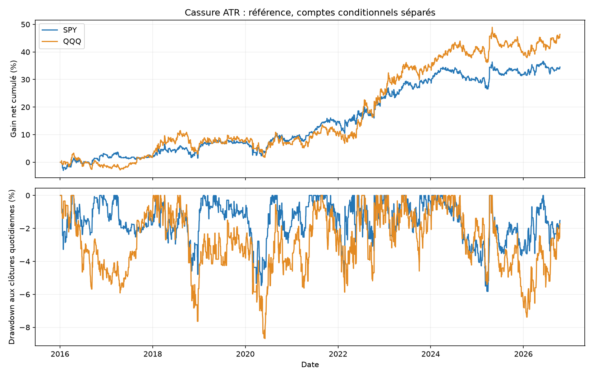
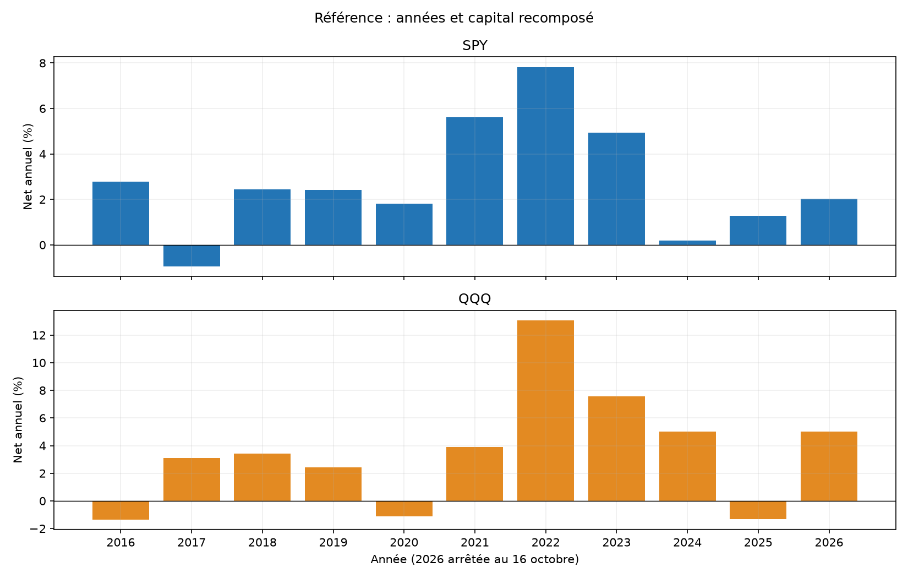
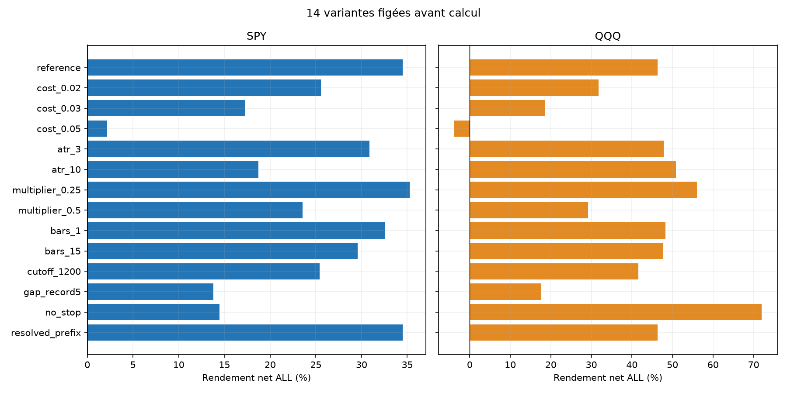
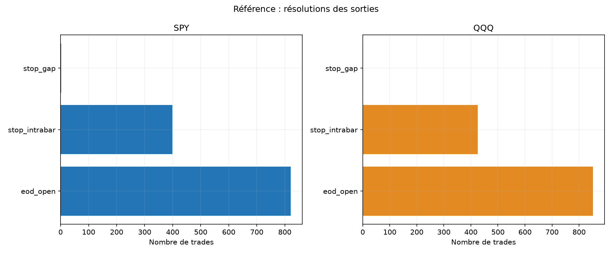

# Cassure ATR autour de l’ouverture — SPY et QQQ

Calcul du 31 octobre 2026 ; historique du 4 janvier 2016 au 16 octobre 2026. Deux comptes indépendants de 100 000 USD. Candidat historique seulement, aucun lancement automatique.

## Hypothèse et différences avec les sources

Niveau fixe pour la séance : open 09:30 + 0,33 × moyenne arithmétique des cinq True Ranges des séances immédiatement précédentes. Le TR inclut les gaps contre la clôture RTH précédente. Ni ATR du jour courant, ni lissage Wilder, ni moyenne d’un nombre de jours valides pris en sautant les trous.

[AndrBene, dépôt primaire ETF](https://github.com/AndrBene/Volatility-Breakouts-Trading-ETFs/blob/master/readme.md) et [Albert, étude publique](https://mistakesoninvesting.substack.com/p/intraday-volatility-breakouts-an) décrivent cette famille, avec conventions différentes. Notre version LONG seulement, une tentative, confirmation par close, entrée retardée, capitalisation et plafond 1× diffèrent des stop-orders LONG/SHORT et paniers externes. Aucun de leurs rendements n’est importé. [Recherche élargie et alternatives](../../RESEARCH.md).

## Règle, exécution et frais

Décisions sur bougies de 5 min terminées de 09:35 à 15:30 New York. Acheter après la première clôture strictement au-dessus du niveau, à l’open une minute après décision : exemple 09:35 → 09:36. Stop fixe au cent inférieur de l’ouverture 09:30, aucun TP, trailing ou break-even ; sortie sinon à l’open 15:59. Demi-séances courantes exclues, demi-séances passées correctement agrégées dans l’historique.

ATR normalisé à 1e-8 décimal, seuil au cent supérieur. Quantité entière avant fill = min du plafond notionnel 1× et du budget 1 % divisé par la distance close signal–stop. Ni taille ni stop recalculés au fill futur. Gap sous stop => entrée et sortie au même open avec tous les coûts ; autre gap au stop => mauvais open observé. Sinon stop au niveau si low le touche, ordre intraminute inconnu. EOD avant ses mèches.

Commission 0,0035 USD/action/côté, minimum 0,35 USD ; friction adverse 0,01 USD/action/côté, stresses 0,02/0,03/0,05 USD. Comptées exactement une fois via fills et commissions. LONG, donc emprunt 0 ; cash sans intérêt. Risque de sizing1 % et notionnel 1× sont des cibles avant frais ; gap, coûts et prix de fill peuvent augmenter l’exposition/perte. Financement, fiscalité, quotes/partiels/latence hors modèle.

## Référence A, B et ALL

| ETF | Période | Trades | Net % | Annualisé % | PF | Gagnants % | DD minute observé % |
|---|---|---|---|---|---|---|---|
| SPY | ALL | 1222 | 34.51 | 2.79 | 1.15 | 50.82 | 6.75 |
| SPY | A | 936 | 34.30 | 3.61 | 1.20 | 51.39 | 6.67 |
| SPY | B | 286 | 0.12 | 0.05 | 1.00 | 48.95 | 6.74 |
| QQQ | ALL | 1277 | 46.38 | 3.60 | 1.14 | 49.26 | 8.92 |
| QQQ | A | 987 | 40.40 | 4.16 | 1.16 | 49.34 | 8.92 |
| QQQ | B | 290 | 4.24 | 1.70 | 1.07 | 48.97 | 7.49 |

A se termine au 30 avril 2024 ; B du 1er mai 2024 au 16 octobre 2026. Capitaux remis à 100 000 USD pour chaque période, historique des features conservé strictement antérieur. A/B déjà explorées dans de nombreuses études : pas de nouvel OOS aveugle. ETF corrélés, pas deux validations indépendantes.

## Fragilité de la période récente

| ETF | Variante B | Net B % | PF B | B sans top3 % |
|---|---|---|---|---|
| SPY | reference | 0.12 | 1.00 | -5.22 |
| SPY | cost_0.02 | -0.76 | 0.98 | -6.05 |
| QQQ | reference | 4.24 | 1.07 | -1.96 |
| QQQ | cost_0.02 | 3.19 | 1.05 | -2.96 |

SPY B est presque à l’équilibre et devient négatif à friction doublée. En référence, retirer les trois meilleurs jours de B rend le résultat négatif pour les DEUX ETF ; les IC95 blocs20 de moyenne quotidienne B comprennent zéro sur les deux. Les cinq critères initiaux passent car ils imposaient top3 et IC sur ALL, et coûts doublés sur A. Ils n’ont pas été déplacés après résultats. Cela reste un candidat historique à évaluer prospectivement, pas une robustesse récente démontrée.

## Coûts, concentration et risque

| ETF | Mouvement de prix USD | Friction USD | Commissions USD | Net USD | Sans top3 % | Top3/gains % | Pire trade USD | Pire MAE prix USD | Exposition RTH max % |
|---|---|---|---|---|---|---|---|---|---|
| SPY | 44861.34 | 7666.94 | 2683.43 | 34510.97 | 21.18 | 4.72 | -1315.66 | -1313.76 | 24.25 |
| QQQ | 62122.02 | 11658.28 | 4080.40 | 46383.34 | 31.32 | 3.65 | -1575.89 | -1573.68 | 26.52 |

La décomposition utilise les quantités de la trajectoire nette originale, pas un nouveau portefeuille sans frais redimensionné. Retrait top3 : mettre ces retours à zéro, sans nouvelles quantités. DD aux coûts d’entrée, closes entièrement détenus et sortie nette ; pas pire tick. MAE/MFE de prix incluent les fills après friction et les extrêmes entièrement détenus, hors commissions et mèches terminales. Durée intrabar en borne supérieure.

## Sensibilités fixées avant PnL

| ETF | Variante | Trades | Net % | PF | DD minute % |
|---|---|---|---|---|---|
| SPY | reference | 1222 | 34.51 | 1.15 | 6.75 |
| SPY | cost_0.02 | 1222 | 25.56 | 1.11 | 7.20 |
| SPY | cost_0.03 | 1222 | 17.22 | 1.08 | 7.87 |
| SPY | cost_0.05 | 1222 | 2.19 | 1.01 | 13.14 |
| SPY | atr_3 | 1228 | 30.89 | 1.14 | 8.18 |
| SPY | atr_10 | 1200 | 18.73 | 1.08 | 7.40 |
| SPY | multiplier_0.25 | 1485 | 35.25 | 1.12 | 6.13 |
| SPY | multiplier_0.5 | 746 | 23.54 | 1.19 | 8.85 |
| SPY | bars_1 | 1272 | 32.55 | 1.13 | 6.48 |
| SPY | bars_15 | 1156 | 29.57 | 1.14 | 6.31 |
| SPY | cutoff_1200 | 857 | 25.40 | 1.15 | 6.01 |
| SPY | gap_record5 | 232 | 13.80 | 1.34 | 4.43 |
| SPY | no_stop | 1222 | 14.46 | 1.06 | 15.91 |
| SPY | resolved_prefix | 1222 | 34.51 | 1.15 | 6.75 |
| QQQ | reference | 1277 | 46.38 | 1.14 | 8.92 |
| QQQ | cost_0.02 | 1277 | 31.82 | 1.10 | 10.83 |
| QQQ | cost_0.03 | 1277 | 18.64 | 1.06 | 13.23 |
| QQQ | cost_0.05 | 1277 | -3.85 | 0.99 | 23.58 |
| QQQ | atr_3 | 1279 | 47.80 | 1.14 | 8.34 |
| QQQ | atr_10 | 1245 | 50.86 | 1.15 | 9.76 |
| QQQ | multiplier_0.25 | 1504 | 56.05 | 1.13 | 10.19 |
| QQQ | multiplier_0.5 | 813 | 29.18 | 1.17 | 6.87 |
| QQQ | bars_1 | 1332 | 48.22 | 1.13 | 9.58 |
| QQQ | bars_15 | 1210 | 47.65 | 1.15 | 8.35 |
| QQQ | cutoff_1200 | 991 | 41.57 | 1.15 | 10.76 |
| QQQ | gap_record5 | 247 | 17.60 | 1.28 | 7.93 |
| QQQ | no_stop | 1277 | 72.03 | 1.18 | 7.59 |
| QQQ | resolved_prefix | 1277 | 46.38 | 1.14 | 8.92 |

84 comptes publiés. ATR 3/10, multiplicateurs 0.25/0.50, grilles 1/15 minutes, cutoff12:00, gap_record5, no_stop et resolved_prefix sont des sensibilités, pas de nouveaux gagnants promus après observation. Les grilles gardent une fenêtre commune mais des instants de décision différents.

gap_record5 utilise abs(log(openCourant/closePrécédent)) > maximum des cinq gaps immédiatement précédents ; aucun open futur et pas la formule ambiguë abs(open/close) du dépôt externe. Prix raw : dividendes non ajustés, donc effet possible sur gap et TR. no_stop conserve le stop hypothétique pour le sizing mais supprime son exécution ; les risques au stop y sont hypothétiques et ne bornent aucune perte.

## Incertitude et critères préétablis

| ETF | Période | IC95 bas quotidien bps | IC95 haut bps |
|---|---|---|---|
| SPY | ALL | 0.19 | 2.14 |
| SPY | A | 0.35 | 2.56 |
| SPY | B | -2.05 | 2.49 |
| QQQ | ALL | 0.18 | 2.89 |
| QQQ | A | 0.19 | 3.28 |
| QQQ | B | -2.09 | 3.84 |

Bootstrap descriptif : 3 000 tirages, seed 20261031, blocs circulaires de 5/20 séances et clusters annuels ; pas correction des recherches multiples. Jours exclus au zéro de chaînage et non cash observé. La réutilisation de A/B et les choix de nombreuses études limitent toute inférence.

| ETF | >=100 ALL | Références A/B/ALL positives | Sans top3 positif | A frais doublés positif | IC95 blocs20 bas>0 |
|---|---|---|---|---|---|
| SPY | passe | passe | passe | passe | passe |
| QQQ | passe | passe | passe | passe | passe |

## Couverture et vérifications

| ETF | Période | Séances inconnues/exclues | Trades non résolus | Levier max fill | Risque net stop modélisé max % |
|---|---|---|---|---|---|
| SPY | ALL | 43 | 0 | 1.0021 | 1.23 |
| SPY | A | 43 | 0 | 1.0021 | 1.23 |
| SPY | B | 0 | 0 | 1.0011 | 1.20 |
| QQQ | ALL | 29 | 0 | 1.0019 | 1.29 |
| QQQ | A | 29 | 0 | 1.0019 | 1.29 |
| QQQ | B | 0 | 0 | 1.0007 | 1.19 |

ATR exige des séances antérieures entières valides, sans sauter un trou. Le scan exige toutes les minutes de l’ouverture à la première sélection. Une lacune future courante ne change pas le signal, mais complete_days impose ensuite la séance entière : filtre de couverture connu après coup, explicitement conditionnel. resolved_prefix retire ce filtre ; trou actif/fill inconnu omet tout le PnL et archive les coûts connus d’entrée. Pas de portefeuille continuellement observé.

| ETF | Sortie | Trades |
|---|---|---|
| SPY | eod_open | 821 |
| SPY | stop_intrabar | 399 |
| SPY | stop_gap | 2 |
| QQQ | eod_open | 851 |
| QQQ | stop_intrabar | 425 |
| QQQ | stop_gap | 1 |

40 tests passent ; oracle scalaire :8509072contrôles,84 comptes,63582lignes de trades,151928quotidiennes recouvrantes. 864contrôles agrégés supplémentaires et 6 comptes bootstrap reproduits. Les lignes entre variantes/périodes se chevauchent et ne sont pas des observations indépendantes.

Même source et chargeur, pas deuxième fournisseur. Hashes des acquisitions/caches/calendrier vérifiés, aucune clé/API. Données révisables ; absence de quotes, profondeur, exécution partielle, rejets broker ou ordre exact des ticks. Aucun split renvoyé par l’acquisition archivée, complétude non certifiée. Pas de comparaison directe avec les bots sur les seuls rendements : expositions/risques différents.

## Décision et reproduction

Candidat historique seulement, aucun lancement automatique. Aucun nouveau bot ni passage au réel. Noise Area et ORB restent inchangés en simulation.

[84 comptes](comparison_all.csv) · [Critères](SCREENING.json) · [Gel avant PnL](PRE_EXECUTION_PROTOCOL.json) · [Source](DATA_SOURCE_PROFILE.json) · [Tests](TESTS.json) · [Audit](../../audit/AUDIT_RESULTS.json) · [Agrégats](../../audit/ADDITIONAL_CHECKS.json) · [Protocole](../../PROTOCOL_EXECUTION.md). Trades/daily/unresolved/by_year/summary par compte, features/gaps par ETF, snapshots et manifest. Archives brutes et secrets exclus de Git.
