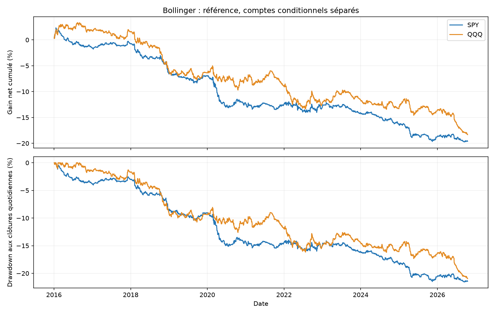
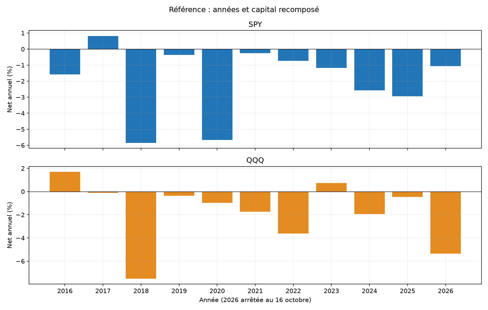
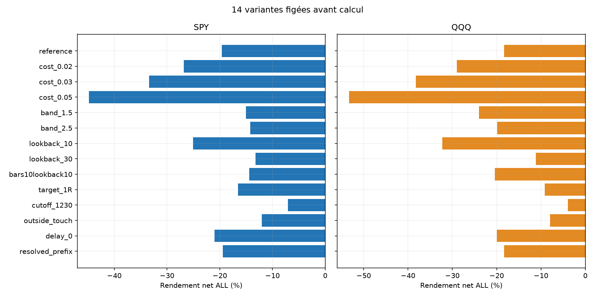
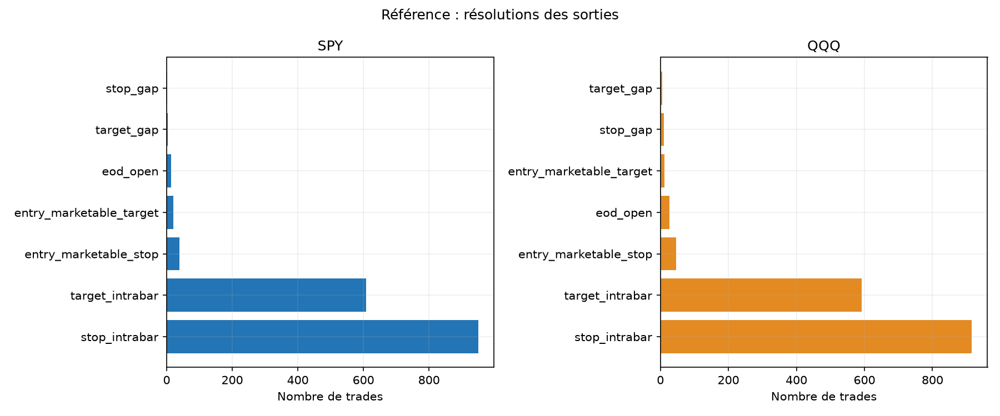

# Bollinger : réintégration intraday — SPY et QQQ

Calcul du 31 octobre 2026. Historique du 4 janvier 2016 au 16 octobre 2026. Deux comptes indépendants de 100 000 USD. Piste écartée pour un nouveau bot : les critères fixés avant les résultats ne sont pas tous satisfaits.

## Hypothèse, sources et règles

Barres RTH de 5 minutes, SMA 20 et écart-type population, bandes à ±2 écarts-types. Entre 11:15 et 14:30 New York, attendre un close sous la bande basse puis un close revenu au-dessus. Choisir le premier setup de géométrie valide. Achat à l’open une minute après la décision, stop sous les deux dernières bougies, objectif à la moyenne figée. Une tentative par jour, aucune nuit, sortie au plus tard à l’open de 15:59.

[Bollinger, règles primaires](https://www.bollingerbands.com/bollinger-band-rules) et [StockCharts, formules](https://chartschool.stockcharts.com/table-of-contents/technical-indicators-and-overlays/technical-overlays/bollinger-bands) décrivent les bandes sans garantir un retour à la moyenne. [Recherche et alternatives](../../RESEARCH.md) : dépôts QQQ/SPY, forum, étude académique repérée mais texte inaccessible, exemple de réintégration sur futures. Aucune performance externe n’est importée. Notre intraday avec reset quotidien et stop diffère matériellement des versions swing et multi-indicateurs.

## Exécution, coûts et risque

Taille entière décidée au close du signal : minimum du plafond notionnel 1× et du budget 1 % divisé par la distance au stop. Stop et TP figés avant le fill. TP moyen normalisé à 1e-8 puis arrondi au cent inférieur ; stop au cent inférieur des deux plus bas moins 0,01 USD. Aucune garantie de perte maximale de 1 % : gap, friction et commissions peuvent augmenter le risque réalisé.

Commission de 0,0035 USD/action/côté, minimum 0,35 USD, friction adverse de 0,01 USD/action/côté, comptées une seule fois. Stress à 0,02/0,03/0,05 USD. LONG uniquement, emprunt nul, cash sans intérêt. Hypothèses communes aux autres études, sans prétendre certifier un tarif ou fill broker.

Gap sous stop : sortie à l’open observé ; gap au-dessus du TP : sortie à cet open, même dès l’entrée avec aller-retour de coûts. Stop et TP dans la même minute : stop prioritaire, ambiguïté exportée. Aucun prix de clôture de signal utilisé comme fill. Les mèches de la minute terminale ne sont pas ajoutées artificiellement aux excursions.

## Référence : A, B et ALL

| ETF | Période | Trades | Net % | Annualisé % | PF | Gagnants % | DD minute observé % |
|---|---|---|---|---|---|---|---|
| SPY | ALL | 1637 | -19.61 | -2.00 | 0.78 | 37.57 | 21.64 |
| SPY | A | 1270 | -14.39 | -1.85 | 0.80 | 38.35 | 16.51 |
| SPY | B | 367 | -6.10 | -2.53 | 0.71 | 34.88 | 6.25 |
| QQQ | ALL | 1608 | -18.32 | -1.86 | 0.85 | 38.18 | 20.99 |
| QQQ | A | 1251 | -12.55 | -1.60 | 0.87 | 38.21 | 16.30 |
| QQQ | B | 357 | -6.62 | -2.74 | 0.77 | 38.10 | 7.98 |

A se termine le 30 avril 2024 ; B couvre le 1er mai 2024 au 16 octobre 2026. Comptes séparés de 100 000 USD pour chaque période. Les bandes n’utilisent aucun jour antérieur. A/B sont déjà réutilisées dans de nombreuses recherches : aucun nouvel OOS aveugle et pas deux validations indépendantes sur des ETF corrélés.

## Coûts, pertes et concentration

| ETF | Mouvement de prix USD | Friction USD | Commissions USD | Net USD | Sans top3 % | Top3/gains % | Pire trade USD | Pire MAE prix USD | Exposition RTH max % |
|---|---|---|---|---|---|---|---|---|---|
| SPY | -7940.00 | 8642.46 | 3024.86 | -19607.33 | -21.64 | 3.19 | -682.63 | -679.96 | 3.24 |
| QQQ | -268.71 | 13371.24 | 4679.93 | -18319.89 | -20.96 | 2.90 | -652.42 | -650.33 | 3.77 |

Le retrait des trois meilleurs jours met leurs retours à zéro sur la trajectoire initiale ; il ne redimensionne pas les quantités ultérieures. MAE/MFE incluent les deux fills après friction et les seules minutes entièrement détenues, hors commissions. L’exposition inclut une borne supérieure pour la minute de sortie intrabar. Le DD aux closes minute n’est pas le pire tick.

## Sensibilités préétablies

| ETF | Variante | Trades | Net % | PF | DD minute % |
|---|---|---|---|---|---|
| SPY | reference | 1637 | -19.61 | 0.78 | 21.64 |
| SPY | cost_0.02 | 1637 | -26.81 | 0.70 | 28.55 |
| SPY | cost_0.03 | 1637 | -33.38 | 0.63 | 34.87 |
| SPY | cost_0.05 | 1637 | -44.79 | 0.51 | 45.86 |
| SPY | band_1.5 | 2084 | -15.03 | 0.87 | 15.95 |
| SPY | band_2.5 | 874 | -14.23 | 0.73 | 15.13 |
| SPY | lookback_10 | 1944 | -25.05 | 0.66 | 25.37 |
| SPY | lookback_30 | 1063 | -13.20 | 0.81 | 13.57 |
| SPY | bars10lookback10 | 1170 | -14.39 | 0.80 | 16.04 |
| SPY | target_1R | 1648 | -16.54 | 0.79 | 17.82 |
| SPY | cutoff_1230 | 753 | -7.06 | 0.86 | 9.64 |
| SPY | outside_touch | 1693 | -12.03 | 0.75 | 12.79 |
| SPY | delay_0 | 1637 | -20.96 | 0.78 | 22.93 |
| SPY | resolved_prefix | 1638 | -19.44 | 0.79 | 21.48 |
| QQQ | reference | 1608 | -18.32 | 0.85 | 20.99 |
| QQQ | cost_0.02 | 1608 | -28.96 | 0.75 | 30.64 |
| QQQ | cost_0.03 | 1608 | -38.22 | 0.67 | 39.32 |
| QQQ | cost_0.05 | 1608 | -53.28 | 0.52 | 53.85 |
| QQQ | band_1.5 | 2051 | -24.03 | 0.83 | 25.62 |
| QQQ | band_2.5 | 827 | -19.91 | 0.69 | 21.83 |
| QQQ | lookback_10 | 1930 | -32.26 | 0.65 | 32.49 |
| QQQ | lookback_30 | 1030 | -11.18 | 0.88 | 14.58 |
| QQQ | bars10lookback10 | 1152 | -20.38 | 0.76 | 20.88 |
| QQQ | target_1R | 1615 | -9.17 | 0.91 | 10.59 |
| QQQ | cutoff_1230 | 708 | -3.91 | 0.94 | 9.08 |
| QQQ | outside_touch | 1650 | -7.98 | 0.87 | 11.87 |
| QQQ | delay_0 | 1608 | -19.94 | 0.84 | 22.56 |
| QQQ | resolved_prefix | 1608 | -18.32 | 0.85 | 20.99 |

Les 84 comptes sont publiés. Les variantes changent largeur, fenêtre, cible 1R, horaire, confirmation, délai et couverture. bars10lookback10 garde un horizon nominal de 100 minutes mais change la grille et les premières décisions. outside_touch achète sous la bande sans attendre le retour. delay_0 entre immédiatement à l’open suivant et suppose une exécution plus optimiste. Différences de fréquence, géométrie et capitalisation : aucun contraste causal isolé.

## Incertitude et critères fixés avant résultats

| ETF | Période | IC95 bas moyen quotidien bps | IC95 haut bps |
|---|---|---|---|
| SPY | ALL | -1.28 | -0.36 |
| SPY | A | -1.27 | -0.21 |
| SPY | B | -2.01 | -0.15 |
| QQQ | ALL | -1.36 | -0.12 |
| QQQ | A | -1.36 | 0.08 |
| QQQ | B | -2.49 | 0.21 |

Bootstrap descriptif de 3 000 tirages, seed 20261031, blocs circulaires de 5/20 séances et clusters annuels. Les exclusions restent à zéro de chaînage, pas des observations de cash. Pas de correction des essais multiples ; les rendements conditionnels ne prouvent pas un avantage prospectif.

| ETF | >=100 ALL | A/B/ALL positifs | Sans top3 positif | A frais doublés positif | IC95 blocs20 bas>0 |
|---|---|---|---|---|---|
| SPY | passe | échoue | échoue | échoue | échoue |
| QQQ | passe | échoue | échoue | échoue | échoue |

## Couverture, sorties et vérifications

| ETF | Période | Séances exclues/inconnues | Trades non résolus | Minutes stop+TP | Levier max au fill | Risque net stop modélisé max % |
|---|---|---|---|---|---|---|
| SPY | ALL | 8 | 0 | 2 | 1.00 | 0.75 |
| SPY | A | 8 | 0 | 2 | 1.00 | 0.75 |
| SPY | B | 0 | 0 | 0 | 1.00 | 0.48 |
| QQQ | ALL | 6 | 0 | 0 | 1.00 | 0.92 |
| QQQ | A | 6 | 0 | 0 | 1.00 | 0.92 |
| QQQ | B | 0 | 0 | 0 | 1.00 | 0.75 |

complete_days impose une séance complète après sélection : condition future de couverture explicitement reconnue. resolved_prefix retire ce filtre et exige le scan causal et le trajet jusqu’à sortie. Un trou avant le premier signal interdit de choisir un signal ultérieur. Trou actif/fill inconnu : PnL entier omis avec coûts d’entrée connus archivés. Cela ne constitue pas un portefeuille continuellement observé.

| ETF | Sortie | Trades |
|---|---|---|
| SPY | stop_intrabar | 950 |
| SPY | target_intrabar | 608 |
| SPY | entry_marketable_stop | 39 |
| SPY | entry_marketable_target | 20 |
| SPY | eod_open | 14 |
| SPY | target_gap | 4 |
| SPY | stop_gap | 2 |
| QQQ | stop_intrabar | 916 |
| QQQ | target_intrabar | 592 |
| QQQ | entry_marketable_stop | 46 |
| QQQ | eod_open | 26 |
| QQQ | entry_marketable_target | 12 |
| QQQ | stop_gap | 10 |
| QQQ | target_gap | 6 |

39 tests passent. Rejeu scalaire indépendant : 9,046,744 contrôles, 84 comptes, 83,326 lignes de trades et 151,928 lignes quotidiennes recouvrantes. 864 contrôles agrégés supplémentaires et six comptes bootstrap vérifiés. Ces lignes ne sont pas des observations indépendantes.

Même fournisseur et chargeur vérifié, pas une seconde source. Hashes des acquisitions/caches/calendrier vérifiés, aucune clé ni API. Historique révisable ; absence de quotes, profondeur, fills partiels, rejets broker et séquence intraminute. Financement, fiscalité et frais réglementaires distincts non ajoutés. Les risques et expositions diffèrent des bots existants, donc aucun classement sur les seuls rendements.

## Décision et reproduction

Piste écartée pour un nouveau bot : les critères fixés avant les résultats ne sont pas tous satisfaits. Les bots Noise Area et ORB restent inchangés, exclusivement en simulation. Aucun nouveau bot ni passage au réel.

[84 comptes](comparison_all.csv) · [Critères](SCREENING.json) · [Gel avant PnL](PRE_EXECUTION_PROTOCOL.json) · [Source](DATA_SOURCE_PROFILE.json) · [Tests](TESTS.json) · [Audit](../../audit/AUDIT_RESULTS.json) · [Agrégats](../../audit/ADDITIONAL_CHECKS.json) · [Protocole](../../PROTOCOL_EXECUTION.md). Dossiers : trades/daily/unresolved/by_year/summary ; features/gaps par ETF, snapshots et manifest final. Archives brutes et secrets exclus de Git.
