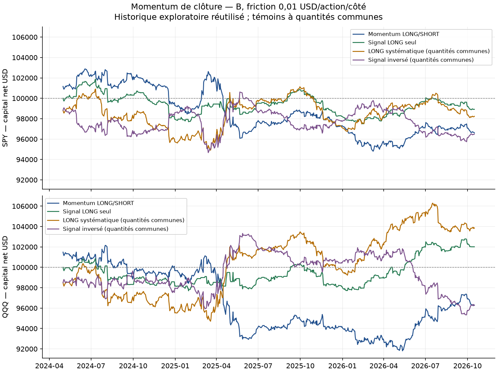
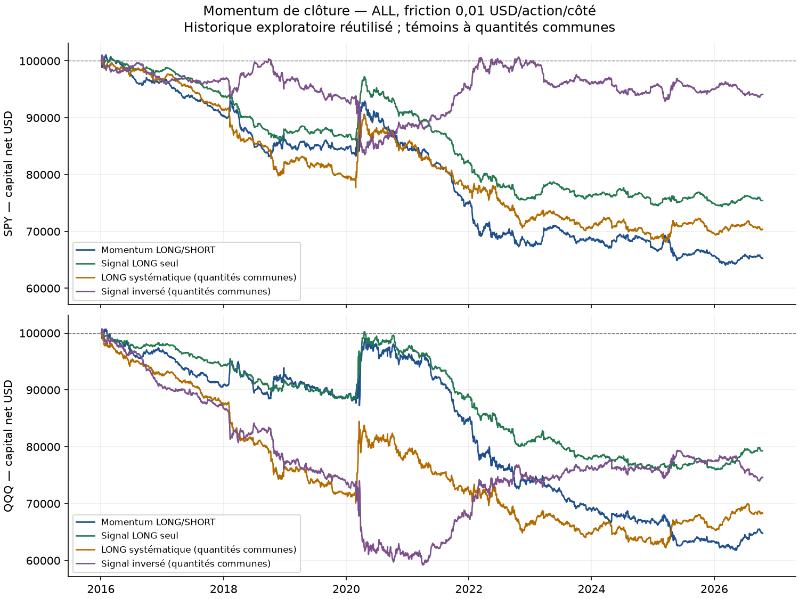
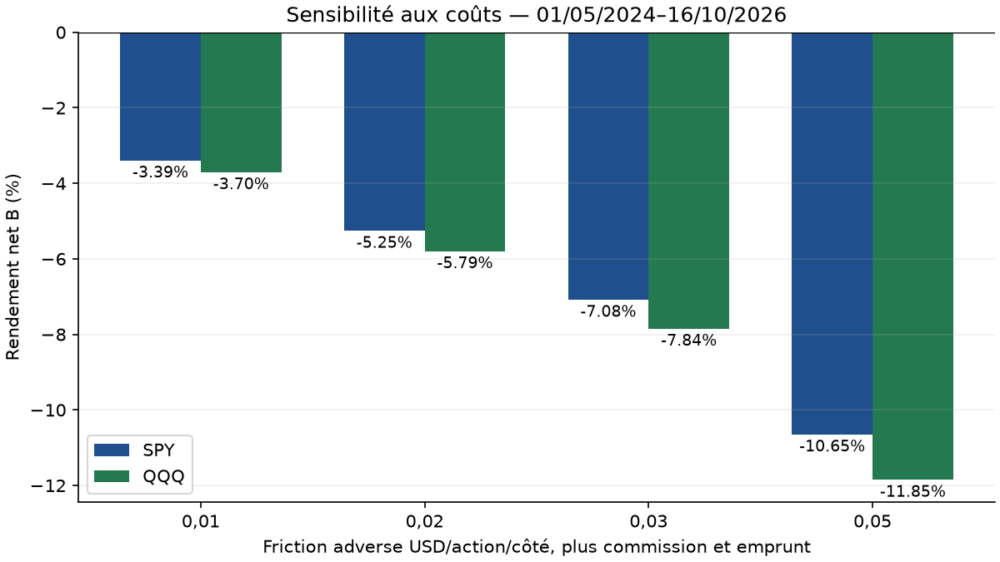
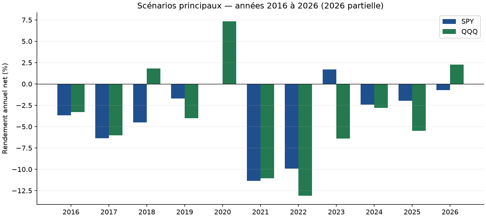

# Momentum de clôture — rapport final, référence v2

**Décision : cette version LONG/SHORT ne justifie pas un nouveau bot.** Les deux scénarios principaux perdent après frais en A et B, et sur ALL. La variante LONG seule de QQQ devient positive en B, mais reste négative sur ALL et ne surpasse pas le témoin LONG sur ce même créneau. Aucun paramètre n’est ajusté après observation. Le bot Noise Area actif est indépendant de cette étude.

## Question, source et exécution

Tester le signe du rendement entre la clôture NYSE précédente corrigée du dividende et la clôture 09:59, puis prendre ce sens à l’open 15:30 et sortir à l’open 15:59. Demi-séances : 12:30–12:59. Maintien réel de **29 minutes**. Quantité entière à cible 1x selon le capital net et la clôture de la minute précédant l’entrée. Le signal inclut l’overnight ; aucun stop ni objectif. [Protocole figé et précisions](../../PROTOCOL_EXECUTION.md).

La littérature motive l’hypothèse de momentum intrajournalier ; notre sortie avant clôture et les ETF ne constituent pas une réplication exacte des enchères ou des futures étudiés. [Source primaire des auteurs](https://academicweb.nd.edu/~zda/intramom.pdf). Le délai de publication de 15:29 peut empêcher d’obtenir exactement l’open 15:30 ; la friction adverse ne prouve pas cette faisabilité.

## Données et qualité

Alpaca SIP raw, acquisitions locales vérifiées : les six empreintes des caches et les six CSV bruts concordent avec DATA_VALIDATION de Noise Area. Calendrier XNYS continu, tableaux float64, heures et demi-séances contrôlées. Les dividendes SPY proviennent de l’émetteur rapproché dans la validation précédente ; QQQ utilise les événements Alpaca dédoublonnés. Le journal d’actions d’origine, interrogé sans filtre de type, ne retourne aucun split ; sa complétude n’a pas été confirmée par un audit indépendant de l’émetteur. [Profil et empreintes](DATA_SOURCE_PROFILE.json).

Les minutes du matin, la clôture précédente immédiate et la minute de taille doivent être valides. Les trous intermédiaires inutiles au signal n’excluent pas le jour. Une sortie requise manquante fait échouer le calcul plutôt que fabriquer du cash. Les trous pendant le maintien sont conservés et limitent le drawdown observé. [Qualité SPY](SPY_quality.csv), [qualité QQQ](QQQ_quality.csv).

| Instrument | Seances | Admissibles | Exclues | Signaux_nuls_admissibles |
|---|---|---|---|---|
| SPY | 2713 | 2706 | 7 | 5 |
| QQQ | 2713 | 2709 | 4 | 4 |

| Instrument | Date | Motif causal |
|---|---|---|
| SPY | 2016-01-04 | invalid_previous_close |
| SPY | 2019-08-12 | invalid_sizing_minute |
| SPY | 2019-08-13 | invalid_previous_close |
| SPY | 2020-03-09 | invalid_morning_window |
| SPY | 2020-03-12 | invalid_morning_window |
| SPY | 2020-03-16 | invalid_morning_window |
| SPY | 2023-06-05 | invalid_morning_window |
| QQQ | 2016-01-04 | invalid_previous_close |
| QQQ | 2020-03-09 | invalid_morning_window |
| QQQ | 2020-03-12 | invalid_morning_window |
| QQQ | 2020-03-16 | invalid_morning_window |

La première séance 2016 est exclue faute de clôture précédente exploitable. Les journées avec interruption du matin restent exclues sans minute interpolée. Les signaux strictement nuls sont des jours admissibles mais plats pour le principal ; ils expliquent l’écart de comptage avec le témoin LONG. [Exclusions exportées](EXCLUSIONS.csv).

## Périodes et coûts

ALL : 04/01/2016–16/10/2026 ; A : jusqu’au 30/04/2024 ; B : 01/05/2024–16/10/2026. Chaque période repart séparément de 100 000 USD. A/B/ALL se recouvrent et ne sont pas des validations indépendantes. B réutilise un historique déjà analysé ; **ce n’est pas un nouvel échantillon aveugle**. Aucun résultat prospectif n’est produit ici.

Commission 0,0035 USD/action/côté, minimum 0,35 USD/ordre ; friction adverse 0,01 USD/action/côté, stress 0,02/0,03/0,05 ; SHORT 1 %/360 sur l’entrée après friction, un jour minimum. Pas d’intérêt sur cash ni tarif réglementaire distinct. Disponibilité du prêt, rejets et fills réels non observés. Ces coûts restent hypothétiques.

## Résultats principaux

| Instrument | Période | Trades | Net % | CAGR % | Net USD | DD quotidien % | DD minute observé % | Sharpe | Profit factor |
|---|---|---|---|---|---|---|---|---|---|
| SPY | ALL | 2701 | -34.72 | -3.88 | -34 722.16 | 36.60 | 36.71 | -0.88 | 0.82 |
| SPY | A | 2085 | -32.42 | -4.60 | -32 422.39 | 33.64 | 33.68 | -1.00 | 0.80 |
| SPY | B | 616 | -3.39 | -1.39 | -3 391.28 | 7.85 | 8.23 | -0.39 | 0.93 |
| QQQ | ALL | 2705 | -35.19 | -3.94 | -35 194.93 | 38.63 | 38.70 | -0.78 | 0.85 |
| QQQ | A | 2087 | -32.73 | -4.65 | -32 732.13 | 33.80 | 33.85 | -0.90 | 0.83 |
| QQQ | B | 618 | -3.70 | -1.52 | -3 702.65 | 10.12 | 10.56 | -0.34 | 0.93 |

Le drawdown minute utilise les clôtures observées pendant la position, la friction d’entrée, la commission puis la sortie nette. Il n’est ni un drawdown tick par tick ni une garantie sur le risque maximal. La MAE par highs/lows est fournie dans les trades ; ces extrema ne constituent pas un chemin de prix ordonné.

## Frictions et variantes prédéfinies

| Instrument | Règle | Friction | Trades | Net B % | Net USD |
|---|---|---|---|---|---|
| SPY | momentum | 0.01 | 616 | -3.39 | -3 391.28 |
| SPY | momentum | 0.02 | 616 | -5.25 | -5 254.81 |
| SPY | momentum | 0.03 | 616 | -7.08 | -7 079.65 |
| SPY | momentum | 0.05 | 616 | -10.65 | -10 646.33 |
| SPY | long_only | 0.01 | 356 | -1.08 | -1 083.89 |
| QQQ | momentum | 0.01 | 618 | -3.70 | -3 702.65 |
| QQQ | momentum | 0.02 | 618 | -5.79 | -5 793.68 |
| QQQ | momentum | 0.03 | 618 | -7.84 | -7 844.18 |
| QQQ | momentum | 0.05 | 618 | -11.85 | -11 847.65 |
| QQQ | long_only | 0.01 | 342 | 2.01 | 2 012.03 |

## Témoins à mêmes quantités

| Instrument | Règle | Trades | Net B % | Net USD |
|---|---|---|---|---|
| SPY | momentum | 616 | -3.39 | -3 391.28 |
| SPY | always_long | 618 | -1.77 | -1 768.87 |
| SPY | opposite | 616 | -3.51 | -3 505.86 |
| QQQ | momentum | 618 | -3.70 | -3 702.65 |
| QQQ | always_long | 618 | 3.84 | 3 837.92 |
| QQQ | opposite | 618 | -3.73 | -3 728.76 |

Les quantités cibles du principal sont héritées par LONG systématique et signal inversé à friction 0,01. Leur capital propre ne redimensionne pas leurs entrées ; ces témoins isolent le sens, et ne sont pas des stratégies investissables maintenues chacune à 1x. Le LONG prend les séances à signal nul, l’inversé reste plat. Aucun chemin n’est insolvable dans l’audit. Aucune combinaison n’est optimisée.

## Coûts, sens et exposition

| Instrument | Période | Mouvement USD | Friction USD | Commission USD | Emprunt USD | Séances exposées % | Temps RTH exposé % | Levier effectif max |
|---|---|---|---|---|---|---|---|---|
| SPY | ALL | -14 760.48 | 12 832.20 | 4 506.85 | 2 622.63 | 99.56 | 7.43 | 1.000060 |
| SPY | A | -14 714.40 | 11 528.92 | 4 035.12 | 2 143.95 | 99.52 | 7.42 | 1.000034 |
| SPY | B | -74.46 | 1 931.26 | 675.94 | 709.62 | 99.68 | 7.45 | 0.999998 |
| QQQ | ALL | -5 262.41 | 20 140.96 | 7 059.10 | 2 732.46 | 99.71 | 7.44 | 1.000124 |
| QQQ | A | -5 247.11 | 18 702.82 | 6 545.99 | 2 236.21 | 99.62 | 7.43 | 1.000124 |
| QQQ | B | -74.49 | 2 140.46 | 749.16 | 738.54 | 100.00 | 7.47 | 1.000021 |

La cible 1x calculée avant entrée peut être légèrement dépassée après un changement de prix. Chaque dossier de scénario publie les ventilations par sens, année et demi-séance. Les coûts dégradent les résultats ; leur décomposition comptable ne démontre pas la cause économique d’une absence de prévisibilité.

## Régimes annuels et concentration

| Instrument | Période | Sans 3 meilleurs jours % | 3 meilleurs / profits positifs % | Pire trade USD | Trades demi-séance | Trades maintien incomplet |
|---|---|---|---|---|---|---|
| SPY | ALL | -40.39 | 4.99 | -2 337.44 | 21 | 0 |
| SPY | A | -38.29 | 6.06 | -2 337.44 | 15 | 0 |
| SPY | B | -6.58 | 8.07 | -1 044.76 | 6 | 0 |
| QQQ | ALL | -41.12 | 4.45 | -2 450.73 | 21 | 0 |
| QQQ | A | -38.88 | 5.41 | -2 450.73 | 15 | 0 |
| QQQ | B | -7.61 | 7.85 | -1 406.95 | 6 | 0 |

L’ablation met à zéro les rendements des trois meilleurs jours positifs, en conservant tous les autres rendements et tailles historiques ; elle ne simule pas un nouveau portefeuille redimensionné. Les 2026 annuelles sont partielles.

## Incertitude

SPY B : intervalle 95 % par années entières sur la moyenne nette par transaction **[-0.778, -0.354] bps**, avec seulement trois années partiellement ou totalement observées.

QQQ B : intervalle 95 % par années entières sur la moyenne nette par transaction **[-2.224, 1.154] bps**, avec seulement trois années partiellement ou totalement observées.

Le tableau suivant mesure la moyenne du **rendement quotidien du capital**, en points de base, et son écart quotidien au témoin LONG. Les intervalles annuels ci-dessus mesurent la moyenne **par transaction**, rapportée au notionnel engagé.

| Instrument | Bloc | Moyenne quotidienne basse (bps) | Moyenne quotidienne haute (bps) | Écart quotidien LONG bas (bps) | Écart quotidien LONG haut (bps) |
|---|---|---|---|---|---|
| SPY | 5 | -2.34 | 1.13 | -2.81 | 2.23 |
| SPY | 20 | -2.50 | 1.49 | -3.38 | 2.62 |
| QQQ | 5 | -2.62 | 1.30 | -4.51 | 1.98 |
| QQQ | 20 | -2.60 | 1.39 | -5.07 | 2.21 |

3 000 réplications, graine 20261020 ; blocs circulaires de 5/20 séances alignées et années entières. Les intervalles sont descriptifs, supposent des dépendances compatibles avec ces rééchantillonnages, sans correction pour les variantes examinées. B réutilisée, trois groupes annuels et changements de régime empêchent d’en tirer une garantie de rentabilité. Les chiffres négatifs ne sont pas transformés en preuve universelle contre le mécanisme publié.

## Audit et reproductibilité

Audit indépendant Decimal : **42 exécutions, 70,934 lignes de transactions et 2,274,918 points de capital contrôlés**, erreur monétaire maximale 1.93e-08 USD. Le nombre de lignes se recouvre entre A/B/ALL et variantes ; il ne mesure pas des événements indépendants. [Preuve](AUDIT_INDEPENDANT.json).

Les exemples détaillés contrôlent 16 transactions et 80 références relues dans les CSV bruts, écart maximal 0. [Examen explicite](EXAMEN_TRANSACTIONS.md), [extraits bruts limités](raw_ohlcv_excerpts.csv), [preuve](RAW_EXCERPT_AUDIT.json).

Les tests synthétiques ne sont pas des données de performance. Le moteur et l’audit n’envoient aucun ordre et ne modifient pas le bot. La première exécution reste conservée ; v2 corrige localement la durée du drawdown quand plusieurs pics sont identiques ou la période est plate. Les règles, transactions et P&L sont inchangés entre versions. Les résultats historiques Noise Area/FVG restent intacts.

Les 42 scénarios passent aussi les rapprochements secondaires des coûts totaux, ratios, exposition, ablation, CAGR, Sharpe, rendements/comptes annuels, sens, demi-séances et durée corrigée du drawdown. [Rapprochements](AGGREGATE_VALIDATION.json). Ces contrôles utilisent les exports déjà audités ; les intervalles Monte-Carlo disposent de tests contrôlés et de limites explicites, sans certification statistique indépendante. [42 comparaisons](comparison_all.csv), [gel avant exécution](PRE_EXECUTION_PROTOCOL.json), [manifest initial](MANIFEST.json).

## Conclusion pratique

Archiver cette version comme piste négative après coûts. Ne pas créer un bot de trading sur la base de ces résultats et ne pas retenir QQQ LONG seul uniquement parce que B est positive. Le protocole jusqu’à 15:29 décrit en extension reste une hypothèse distincte à geler avant son propre test ; il ne corrige pas rétroactivement cet essai. Le suivi prospectif Noise Area QQQ continue avec ses propres preuves.
