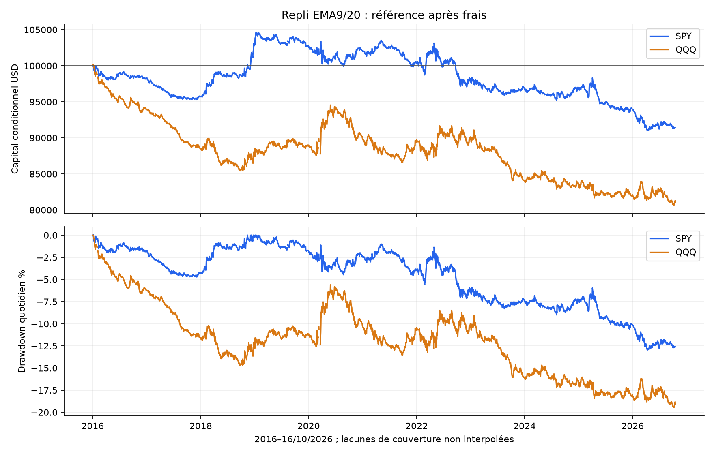
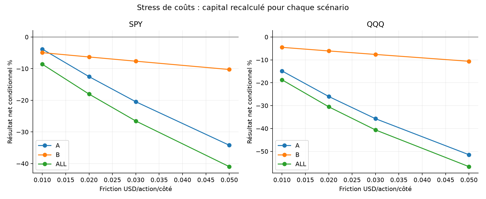
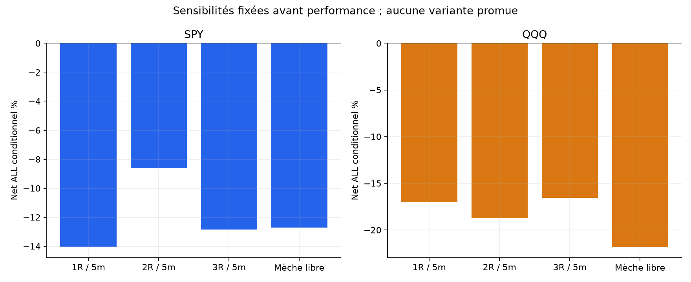
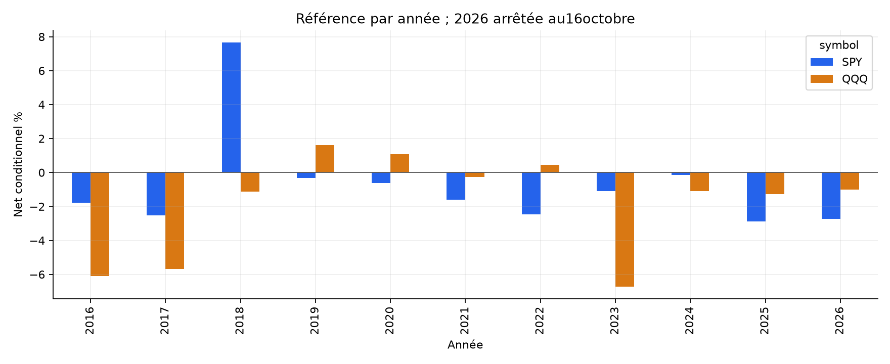

# Repli EMA9/20 puis reprise — rapport final SPY / QQQ

La référence ne reste pas positive sur les deux ETF et les deux périodes. Cette formalisation ne justifie pas un nouveau bot.

Capital initial 100000 USD indépendant par scénario. ALL : 4 janvier 2016–16 octobre 2026 ; A : jusqu’au 30 avril 2024 ; B : 1 mai 2024–16 octobre 2026. Ces marchés et B ont déjà été étudiés : découpage chronologique exploratoire, aucun nouvel échantillon aveugle.

## Recherche et choix

Recherche sur Reddit et GitHub : replis9/20, projets QQQ multi-échelles, validation de journaux discrétionnaires et comparaison QQQ5min. Les opinions divergent et plusieurs exemples omettent les coûts ou utilisent des prix trop favorables. Nous ne reprenons aucun rendement tiers. [Sources et différences de règles](../../RESEARCH.md).

Hypothèse : une tendance peut reprendre après un repli contrôlé dans la zone des moyennes. Elle ne dépend ni des extrêmes de veille, ni d’un RSI, ni d’une bande Noise Area. Aucune affirmation sur une pression institutionnelle ou un carnet observé.

## Définition mécanique figée

Bougies5min RTH. EMA9/20 des closes, seed premier close, alpha2/(période+1), continuité entre séances et cash ex-date soustrait aux états passés. Exiger60bougies valides consécutives. Trou OHLC=>reset et nouvelle chauffe ; aucune interpolation. Les prix overnight ne sont pas inventés.

Avant la bougie LONG : EMA9>EMA20, deux pentes sur3barres positives, close précédent>EMA9. Pendant la bougie : low entre EMA20 et EMA9, close>EMA9 et>open, clôture dans les30%hauts du range. SHORT inverse. Toutes les EMA du signal sont celles de la bougie précédente, avec tolérance arithmétique1e-10USD.

Premier signal seulement, entrée open suivant entre09:45incluse et14:00exclue NY. Une entrée/jour. Stop mèche±0,01USD arrondi au centime vers l’extérieur ; quantité fixée au close du signal, risque cible1%, plafond1x. TP2R depuis open d’entrée, arrondi défavorable. Stop prioritaire si SL/TP touchés ensemble ; gap stop au mauvais open, gap TP sans amélioration. Flat au dernier open15:59/12:59 avant sa mèche. Aucun trailing, break-even, ADX ou maintien overnight. [Protocole exhaustif](../../PROTOCOL_EXECUTION.md).

## Référence après frais

| ETF | Période | Trades | Net cumulé % | CAGR % | PF | WR % | DD marks % | Sans top3jours % |
| --- | --- | --- | --- | --- | --- | --- | --- | --- |
| SPY | ALL | 1929 | -8.61 | -0.83 | 0.942 | 34.68 | 13.13 | -12.54 |
| SPY | A | 1473 | -3.83 | -0.47 | 0.967 | 35.57 | 8.56 | -7.96 |
| SPY | B | 456 | -4.95 | -2.04 | 0.856 | 31.80 | 7.42 | -7.56 |
| QQQ | ALL | 1909 | -18.72 | -1.90 | 0.898 | 33.58 | 19.54 | -22.46 |
| QQQ | A | 1445 | -14.84 | -1.91 | 0.897 | 33.70 | 16.39 | -18.76 |
| QQQ | B | 464 | -4.53 | -1.87 | 0.901 | 33.19 | 5.79 | -6.82 |

Compte historique conditionnel aux données résolues. CAGR sur la période nominale, chauffe comprise. DD marks aux coûts d’entrée, closes1min entièrement détenus et sortie nette : il ne borne pas tous les ticks. Le graphique de DD quotidien est une mesure moins fine. ETF corrélés, pas deux preuves indépendantes. Aucun dépassement du passif à exposition équivalente revendiqué ; cash témoin0%, non rémunéré.

## Mêmes coûts et attribution

Commission0,0035USD/action/côté minimum0,35 ; friction adverse0,01USD/action/côté ; empruntSHORT1%annuel/360 minimum un jour. Friction déjà comprise dans les fills et soustraite une seule fois dans l’attribution. Modèle commun de recherche, pas tarif broker garanti. Sizing avant open : les gaps peuvent dépasser les plafonds effectifs1x/1%, frais exclus du risque cible.

| ETF | Période | Prix USD | Friction USD | Commission USD | Emprunt USD | Net USD | Exposition RTH bornehaute % |
| --- | --- | --- | --- | --- | --- | --- | --- |
| SPY | ALL | 8326.26 | 10804.18 | 3781.46 | 2349.46 | -8608.84 | 5.74 |
| SPY | A | 10741.49 | 9445.16 | 3305.81 | 1819.88 | -3829.36 | 5.65 |
| SPY | B | -2486.41 | 1413.28 | 494.65 | 550.81 | -4945.15 | 6.05 |
| QQQ | ALL | 2296.52 | 14103.38 | 4936.18 | 1978.62 | -18721.66 | 5.93 |
| QQQ | A | 3913.47 | 12741.64 | 4459.57 | 1555.19 | -14842.94 | 5.88 |
| QQQ | B | -1870.46 | 1600.20 | 560.07 | 497.48 | -4528.21 | 6.11 |

## Sensibilités prévues avant performance

| Variante ALL : trades / net% / PF | SPY | QQQ |
| --- | --- | --- |
| reference | 1929 / -8.61 / 0.942 | 1909 / -18.72 / 0.898 |
| cost_0.02 | 1929 / -18.05 / 0.876 | 1909 / -30.53 / 0.825 |
| cost_0.03 | 1929 / -26.55 / 0.813 | 1909 / -40.64 / 0.756 |
| cost_0.05 | 1929 / -40.98 / 0.699 | 1909 / -56.70 / 0.626 |
| long_only | 1067 / 1.17 / 1.016 | 1098 / -4.09 / 0.960 |
| short_only | 862 / -9.64 / 0.875 | 811 / -15.25 / 0.837 |
| rr1 | 1929 / -14.08 / 0.868 | 1909 / -16.99 / 0.877 |
| rr3 | 1929 / -12.86 / 0.923 | 1909 / -16.57 / 0.916 |
| no_slope | 2080 / -15.59 / 0.898 | 2092 / -23.42 / 0.881 |
| no_momentum | 2182 / -13.80 / 0.906 | 2185 / -19.76 / 0.893 |
| deep_pullback | 2135 / -12.70 / 0.923 | 2106 / -21.86 / 0.892 |
| resolved_prefix | 1931 / -9.72 / 0.934 | 1911 / -19.55 / 0.893 |

12variantes ×2ETF ×3périodes=72comptes recouvrants. Coûts0,02/0,03/0,05, LONG/SHORT, TP1R/3R, sans pente, sans force de clôture, mèche au-delà de l’EMA lente autorisée et resolved_prefix. Tous les résultats A/B/ALL figurent dans [comparison_all.csv](comparison_all.csv). Aucune variante sélectionnée après PnL.

## Couverture et corporate actions

Archives Alpaca SIP minute déjà acquises, SHA des données/préparations, calendrier NYSE et rapprochement des corporate actions vérifiés avant PnL.2714séances préparées dont padding2015-12-31,2713évaluées. SPY2705/QQQ2707séances complètes dans le cache total. Quelques minutes manquantes, notamment en2020 ; pas de deuxième flux ni d’interpolation. [Sources et empreintes](DATA_SOURCE_PROFILE.json).

Le signal/les EMA utilisent les OHLC, pas le volume. Soustraire le cash connu au changement d’ex-date conserve toutes les pentes dans la même échelle ; aucune correction future. L’intégrité/rapprochement de la table ne prouve pas l’exhaustivité absolue des corporate actions. Une lacune peut affecter plusieurs séances à cause des60barres de rechauffe.

complete_days applique après coup la qualité OHLCV du jour courant s’il produirait une entrée : filtre futur pouvant favoriser le résultat. resolved_prefix retire ce filtre mais reste conditionnel : historique nécessaire inconnu avant signal=>séance inconnue ; lacune active=>trade entier non résolu, frais d’entrée connus exportés. Zéro de chaînage d’une exclusion ne signifie pas cash observé. La chauffe initiale est une absence connue d’ordre, pas un rendement inconnu.

| ETF | Période | Exclues principal | Trades principal | Net principal % | Trades prefix | Non résolues | Net prefix % |
| --- | --- | --- | --- | --- | --- | --- | --- |
| SPY | ALL | 12 | 1929 | -8.61 | 1931 | 0 | -9.72 |
| SPY | A | 12 | 1473 | -3.83 | 1475 | 0 | -5.00 |
| SPY | B | 0 | 456 | -4.95 | 456 | 0 | -4.95 |
| QQQ | ALL | 9 | 1909 | -18.72 | 1911 | 0 | -19.55 |
| QQQ | A | 9 | 1445 | -14.84 | 1447 | 0 | -15.72 |
| QQQ | B | 0 | 464 | -4.53 | 464 | 0 | -4.53 |

## Incertitude, concentration et régimes

Bootstrap descriptif3000tirages seed20261026 : blocs circulaires5/20séances pour moyenne quotidienne, clusters annuels pour bps/trade. Intervalles conditionnels, exclusions au zéro comptable, peu de clusters et aucune correction des essais multiples. Ils ne prouvent pas une performance future.

| ETF | Période | IC95 moyenne quotidienne %, blocs5 | Blocs20 | IC95 bps/trade, années |
| --- | --- | --- | --- | --- |
| SPY | ALL | [-0.0092 ; 0.0029] | [-0.0087 ; 0.0028] | [-1.1665117476763125, 0.6799104643514927] |
| SPY | A | [-0.0088 ; 0.0055] | [-0.0081 ; 0.0051] | [-1.0622836846016008, 1.0547757756864713] |
| SPY | B | [-0.0196 ; 0.0041] | [-0.0197 ; 0.0031] | [-1.7717877931940893, 0.517549234773161] |
| QQQ | ALL | [-0.0156 ; 0.0006] | [-0.0151 ; 0.0004] | [-2.1127007894321324, -0.0817428010601262] |
| QQQ | A | [-0.0163 ; 0.0017] | [-0.0160 ; 0.0016] | [-2.460153479185398, 0.1544419697788756] |
| QQQ | B | [-0.0225 ; 0.0073] | [-0.0215 ; 0.0078] | [-1.9465369492443507, -0.5638654605461364] |

| ETF | Période | Sans top3 % | Sans2020 % | Pertes consécutives max |
| --- | --- | --- | --- | --- |
| SPY | ALL | -12.54 | -8.03 | 16 |
| SPY | A | -7.96 | -3.23 | 14 |
| SPY | B | -7.56 | -4.95 | 16 |
| QQQ | ALL | -22.46 | -19.58 | 15 |
| QQQ | A | -18.76 | -15.74 | 15 |
| QQQ | B | -6.82 | -4.53 | 15 |

Ablations : rendements concernés mis à zéro dans le compte original, sans nouveau sizing. Les CSV annual/monthly/directions/quality_reasons et features détaillent la concentration, le sens, les coûts et les motifs de non-entrée.

## Figures

## Contrôles, limites et décision

[Tests, revue et replay indépendant](../../VALIDATION.md). Protocole, code, audit, rapport et dépendances figés avant PnL. L’audit utilise des segments pandas EWM sur closes+cash cumulatif passé, distincts de la récurrence du moteur, puis vérifie décisions, fills, sizing, frais et comptes sans appeler la stratégie. Source commune : ce n’est pas une validation sur un autre fournisseur.

Limites : prix de trades consolidés plutôt que bid/ask/carnet, ordre des ticks inconnu, coûts fixes/shorts non garantis, crise incomplète, formalisation propre différente des recettes discrétionnaires, famille et paramètres examinés sur des données déjà explorées.

La référence ne reste pas positive sur les deux ETF et les deux périodes. Cette formalisation ne justifie pas un nouveau bot. Les deux bots QQQ existants ne sont pas modifiés ; aucun nouveau bot ni ordre réel.
