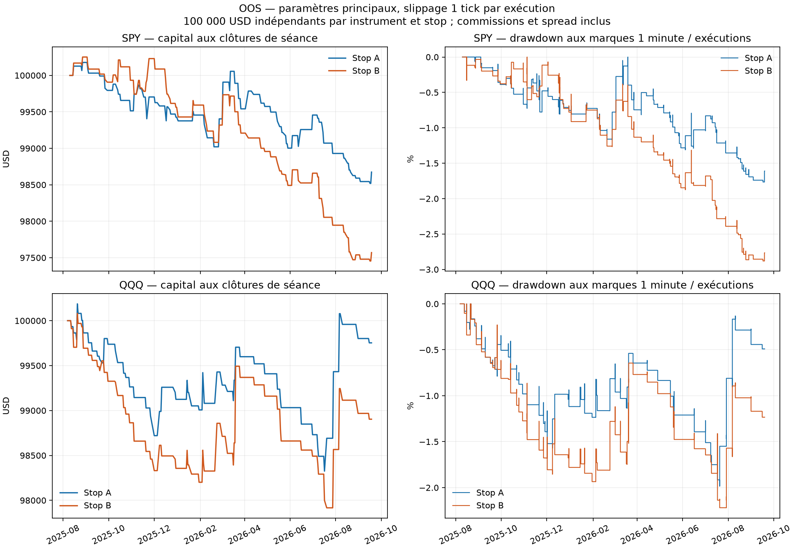
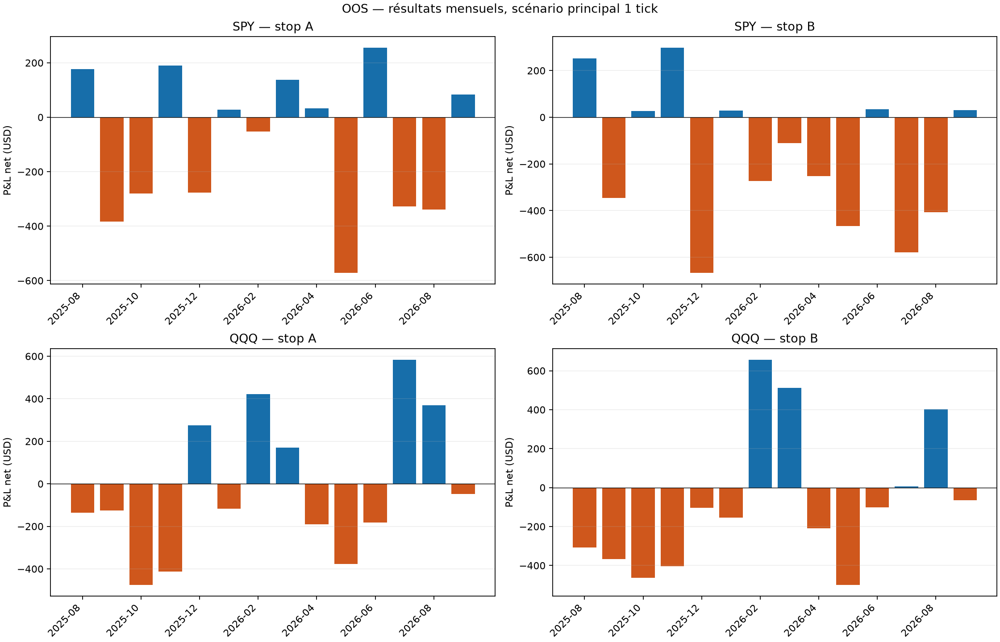
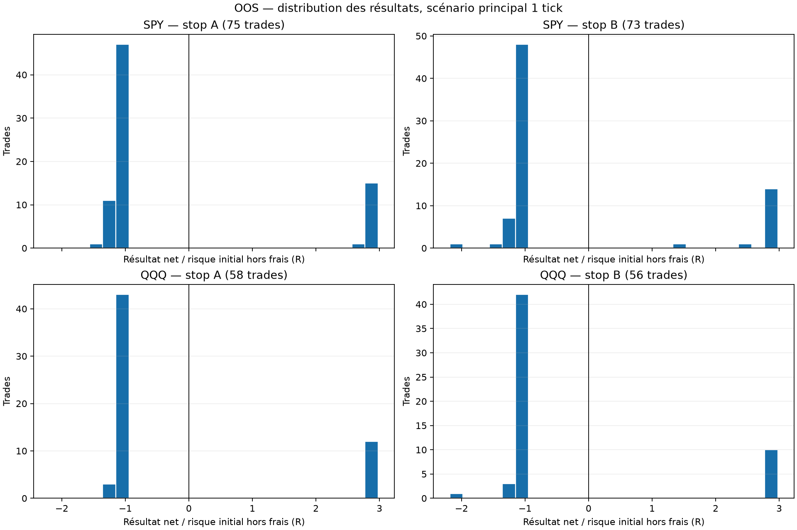

# First Candle Rule + FVG — validation historique longue SPY / QQQ

Étude exécutée le 19 octobre 2026. Source : Alpaca SIP, vraies bougies 1 minute, prix raw. Résultats propres à chaque instrument, stop et segment ; comptes indépendants de 100 000 USD, sans addition en portefeuille.

**Catégorie 3 — Aucun avantage démontré sur SPY/QQQ avec les règles et coûts testés.** Les quatre scénarios principaux perdent hors échantillon : SPY A −1 325,98 USD ; SPY B −2 429,87 USD ; QQQ A −246,62 USD ; QQQ B −1 096,55 USD. Leurs espérances moyennes nettes en R sont négatives. Les intervalles à 95 % par blocs de cinq séances contiennent tous zéro ; aucune espérance positive n'est établie. Les données permettent maintenant une évaluation historique longue des ETF. **ES/NQ restent en catégorie 5 pour la validation longue**, faute de contrats datés et raccordements vérifiables dans les sources gratuites accessibles.

Les pertes sont des résultats observés sous un modèle d'exécution déclaré. Elles ne prouvent pas que toute stratégie appelée FVG serait déficitaire dans tous les marchés. Aucun paramètre n'est modifié pour faire apparaître une rentabilité.

1. **Profit après frais.** Les quatre versions principales sont négatives OOS. En IS, trois sur quatre perdent ; SPY B gagne seulement 282,91 USD sur 651 séances, avec PF 1,03 et espérance −0,0555R. Le P&L en dollars et la moyenne en R peuvent avoir des signes différents : chaque trade engage un risque monétaire différent, notamment à cause du plafond d'exposition. Un PF légèrement supérieur à 1 ne suffit donc pas à établir un avantage.

2. **Validation réservée.** Le découpage chronologique 70/30, fixé avant les nouveaux résultats, échoue à montrer une rentabilité des quatre versions principales. Il s'agit d'une validation rétrospective sur une période réservée ; la correction technique du moteur après résultats partiels est documentée. Cette démarche ne vaut pas un test prospectif indépendant de toute histoire de développement.

3. **Instrument le plus solide.** QQQ perd moins de dollars que SPY sur ce segment, mais QQQ A conserve une espérance −0,2469R, avec IC95 [−0,6399 ; +0,1778]. Aucun des deux ETF ne démontre une rentabilité robuste. Les résultats ES/NQ longs restent inconnus et ne peuvent pas être classés par performance.

4. **LONG et SHORT.** Sur SPY OOS, les deux sens perdent pour A et B. Sur QQQ, les LONG perdent −2 125,31 USD (A) et −2 567,74 USD (B), alors que les SHORT gagnent +1 878,69 USD sur 26 trades (A) et +1 471,19 USD sur 24 trades (B). C'est un résultat descriptif à faible effectif. Transformer ce constat observé en filtre « SHORT uniquement » puis le valider sur ces mêmes séances serait une sélection rétrospective ; aucun tel filtre n'est ajouté ici.

5. **Stop le plus robuste.** A perd moins que B sur les deux ETF OOS, dans les quatre hypothèses de slippage. Cette comparaison décrit un moindre déficit ; elle n'établit pas une version profitable. Les deux stops restent deux hypothèses distinctes, sans sélection automatique d'un gagnant.

6. **Conditions de marché.** Les douze sous-groupes OOS instrument × stop × tercile de volatilité ont une espérance moyenne en R négative. Quelques P&L en dollars sont positifs, par exemple le régime médian SPY A ou les régimes médian/haut QQQ A. Les groupes ne comptent que 12 à 29 trades. Ils ne permettent pas de conclure à un filtre de régime exploitable, et ne servent pas à modifier la stratégie.

7. **Concentration des gains.** Les scénarios principaux perdent déjà en conservant tous leurs gains. Retirer les trois meilleures séances porte QQQ A de −246,62 à −2 048,44 USD, et QQQ B de −1 096,55 à −3 277,70 USD. C'est un diagnostic de concentration, sans nouvelle sélection de trades ni simulation optimisée.

8. **Coûts et fenêtres.** Les quatre versions principales restent négatives aux slippages 1, 2, 3 et 5 ticks. À cinq ticks : SPY A −1 807,57 USD ; B −3 338,21 USD ; QQQ A −678,15 USD ; B −1 590,13 USD. Parmi les tests de fenêtres OOS, QQQ A avec retest 20 minutes gagne +350,66 USD sur 62 trades, mais sa moyenne reste −0,1700R ; les autres cellules affichées perdent. Cette cellule ne justifie pas de remplacer rétroactivement les 15 minutes préfixées.

9. **Taille et stabilité.** Les scénarios principaux OOS comptent seulement 56 à 75 trades chacun, environ un par semaine, malgré plus d'une année réservée. Les variantes recouvrent souvent les mêmes séances et signaux ; leurs effectifs ne s'additionnent pas pour augmenter la puissance statistique. Les intervalles larges permettent encore des espérances positives ou négatives : le nombre d'années ne suffit pas à lui seul à établir un petit avantage.

10. **Avantage, hasard et walk-forward.** Sur onze blocs par combinaison, SPY A et B n'ont chacun que deux blocs positifs ; leurs sommes de P&L de blocs valent −1 995,07 et −2 546,09 USD. QQQ A a six blocs positifs et une somme légèrement positive de +113,88 USD, mais une espérance en R pondérée par les trades de −0,0614R ; QQQ B a quatre blocs positifs et −1 796,00 USD. Les capitaux sont réinitialisés par bloc : ces sommes ne sont pas des rendements composés. Le faible gain en dollars d'une combinaison ne démontre pas une stabilité favorable et les fenêtres WF recouvrent en partie le test 70/30. Les observations ne suffisent pas à attribuer un mécanisme au hasard ou à prouver l'inexistence de tout avantage ; elles n'établissent aucun avantage positif de la stratégie complète testée.

Le drawdown OOS observé aux marques du modèle va de 1,77 % à 2,88 %. Le risque initial moyen n'est que de 0,075 % à 0,118 % du capital, bien inférieur à la cible maximale de 0,5 %, en raison notamment de l'exposition ETF sans levier. Ces pertes en pourcentage relativement faibles ne constituent donc pas, seules, une preuve de bon rendement ajusté au risque. Le carnet, les fills et l'emprunt historiques restent non observés.


## Périmètre, qualité et dates fixées

| instrument | bougies_acquises | pages | seances_retenues | seances_exclues | minutes_manquantes | OHLCV_invalides | doublons_conflictuels |
|---|---|---|---|---|---|---|---|
| SPY | 773977 | 78 | 930 | 1 | 4 | 0 | 0 |
| QQQ | 807421 | 81 | 931 | 0 | 0 | 0 | 0 |

| instrument | first | last | IS_first | IS_last | OOS_first | OOS_last |
|---|---|---|---|---|---|---|
| SPY | 2023-01-03 | 2026-09-18 | 2023-01-03 | 2025-08-08 | 2025-08-11 | 2026-09-18 |
| QQQ | 2023-01-03 | 2026-09-18 | 2023-01-03 | 2025-08-07 | 2025-08-08 | 2026-09-18 |

Prix non ajustés, horodatages d'ouverture UTC convertis en America/New_York ; seules les minutes régulières du calendrier XNYS sont utilisées, avec jours fériés, DST et clôtures écourtées. SPY : séance du 5 juin 2023 exclue pour quatre minutes absentes, hors opening range ; QQQ : aucune séance régulière exclue. Toute séance incomplète est exclue entière, aucune interpolation. Cette sélection qualité rétrospective peut différer d'une décision en temps réel. Les heures étendues acquises ne créent aucun signal. Une seule année est demandée au minimum : les données retenues couvrent ici 1 355 jours calendaires et plus de trois années.

La fin de demande, 21 septembre 2026 exclu, écarte les journées déjà étudiées dans le test Yahoo préliminaire. `PRE_EXECUTION_SPLIT.json` a été écrit avant les nouveaux calculs de performance. Le seuil 70/30 est appliqué aux séances conservées, d'où un jour de différence entre ETF. Les deux historiques sont comparables sans être strictement identiques à leur frontière. Le protocole a été figé après l'exploration récente et avant ces nouveaux calculs : c'est une validation historique rétrospective sur une période réservée, pas une preuve prospective d'un modèle enregistré avant 2025.

Une correction numérique des contacts stop/TP a été nécessaire après l'audit du premier calcul partiel. L'étude présentée ici est entièrement recalculée avec ce correctif symétrique, sur les dates initiales inchangées. Des résultats partiels avaient été vus avant la correction ; cette étape de débogage et ses tests sont détaillés dans `CORRECTION_NUMERIQUE.md`. Les sorties provisoires archivées ne sont pas la référence. Le correctif ne modifie aucune fenêtre, aucun filtre ni aucun coût de la stratégie.

## Performances principales — 1 tick par exécution

| instrument | segment | stop_variant | valid_sessions | trades | winners | losers | win_rate | profit_factor | net_pnl | net_return_pct | expectancy_r |
|---|---|---|---|---|---|---|---|---|---|---|---|
| SPY | IS | A | 651 | 154 | 34 | 120 | 0.2208 | 0.7674 | -2212.1853 | -2.2122 | -0.2497 |
| SPY | IS | B | 651 | 146 | 40 | 106 | 0.2740 | 1.0314 | 282.9070 | 0.2829 | -0.0555 |
| SPY | OOS | A | 279 | 75 | 16 | 59 | 0.2133 | 0.7224 | -1325.9789 | -1.3260 | -0.2561 |
| SPY | OOS | B | 279 | 73 | 16 | 57 | 0.2192 | 0.5407 | -2429.8689 | -2.4299 | -0.2653 |
| QQQ | IS | A | 651 | 158 | 42 | 116 | 0.2658 | 0.9022 | -1376.6844 | -1.3767 | -0.0356 |
| QQQ | IS | B | 651 | 152 | 42 | 110 | 0.2763 | 0.8898 | -1629.2724 | -1.6293 | -0.0054 |
| QQQ | OOS | A | 280 | 58 | 12 | 46 | 0.2069 | 0.9484 | -246.6196 | -0.2466 | -0.2469 |
| QQQ | OOS | B | 280 | 56 | 10 | 46 | 0.1786 | 0.7962 | -1096.5497 | -1.0965 | -0.3729 |

`win_rate` est une fraction, `net_return_pct` un pourcentage. P&L et rendement sont nets de frais et d'emprunt hypothétique. Les sensibilités et les stops représentent des hypothèses distinctes ; leurs trades ne sont pas des observations indépendantes supplémentaires.

## Risque et comportement

| instrument | segment | stop_variant | max_drawdown_usd | max_drawdown_pct | longest_loss_streak | longest_win_streak | actual_risk_mean_pct | max_exposure_pct |
|---|---|---|---|---|---|---|---|---|
| SPY | IS | A | 3360.7531 | 3.3450 | 14 | 2 | 0.0736 | 99.9988 |
| SPY | IS | B | 1311.8836 | 1.3034 | 10 | 3 | 0.0779 | 99.9934 |
| SPY | OOS | A | 1771.0071 | 1.7659 | 15 | 2 | 0.0751 | 99.9927 |
| SPY | OOS | B | 2891.2759 | 2.8813 | 15 | 3 | 0.0826 | 99.9955 |
| QQQ | IS | A | 3614.9965 | 3.5922 | 10 | 3 | 0.1119 | 99.9964 |
| QQQ | IS | B | 2873.9531 | 2.8490 | 9 | 4 | 0.1214 | 99.9963 |
| QQQ | OOS | A | 1989.5796 | 1.9847 | 11 | 3 | 0.1048 | 99.9952 |
| QQQ | OOS | B | 2222.9288 | 2.2198 | 12 | 2 | 0.1183 | 99.9917 |

| instrument | segment | stop_variant | average_win_r | average_loss_r | win_loss_ratio | trades_per_calendar_week | average_duration_minutes | pnl_excluding_best_3_sessions |
|---|---|---|---|---|---|---|---|---|
| SPY | IS | A | 2.8694 | -1.1335 | 2.5315 | 1.1324 | 14.0714 | -3896.3034 |
| SPY | IS | B | 2.8561 | -1.1543 | 2.4744 | 1.0735 | 20.4795 | -1385.3954 |
| SPY | OOS | A | 2.8946 | -1.1105 | 2.6065 | 1.2931 | 12.3600 | -2511.5234 |
| SPY | OOS | B | 2.7693 | -1.1171 | 2.4790 | 1.2586 | 20.4932 | -3440.4385 |
| QQQ | IS | A | 2.9014 | -1.0990 | 2.6399 | 1.1618 | 12.6962 | -3392.2392 |
| QQQ | IS | B | 2.8940 | -1.1124 | 2.6016 | 1.1176 | 13.9474 | -3924.8505 |
| QQQ | OOS | A | 2.9329 | -1.0764 | 2.7248 | 0.9831 | 11.2586 | -2048.4393 |
| QQQ | OOS | B | 2.9311 | -1.0912 | 2.6862 | 0.9492 | 22.2679 | -3277.6983 |

| instrument | segment | stop | risque_moyen_USD | risque_max_USD | perte_stop_projetee_max_pct | trades_perte_stop_projetee_sup_0_5pct |
|---|---|---|---|---|---|---|
| SPY | IS | A | 72.3482 | 279.6800 | 0.2963 | 0 |
| SPY | IS | B | 78.2915 | 248.9700 | 0.2521 | 0 |
| SPY | OOS | A | 74.6939 | 203.6800 | 0.2090 | 0 |
| SPY | OOS | B | 82.0047 | 286.8900 | 0.2984 | 0 |
| QQQ | IS | A | 110.1462 | 478.2900 | 0.4903 | 0 |
| QQQ | IS | B | 120.5899 | 490.8700 | 0.4996 | 0 |
| QQQ | OOS | A | 104.0362 | 249.6600 | 0.2607 | 0 |
| QQQ | OOS | B | 117.0102 | 287.6400 | 0.2994 | 0 |

Le drawdown inclut les marques aux clôtures des minutes et aux exécutions, pas les excursions au sein des minutes. Le risque en R utilise le risque initial au fill, hors frais ; le budget de dimensionnement réserve les frais et la friction de sortie. Des pertes légèrement inférieures à −1R sont donc normales. La moyenne de risque effectivement engagé peut être bien inférieure à 0,5 %, notamment du fait de l'exposition ETF plafonnée à 100 % du capital.

Les durées intrabougie sont des bornes inférieures à une précision d'une minute ; le journal fournit aussi une borne supérieure. Les instants du stop/TP sont connus seulement à l'intérieur de leur minute, contrairement aux exécutions programmées à l'open.

## Incertitude — 5 000 rééchantillonnages

| instrument | segment | stop | trades | expectancy_r | IC95_bloc5 | IC95_iid |
|---|---|---|---|---|---|---|
| SPY | IS | A | 154 | -0.2497 | [-0.4985256748230448, 0.014043346434157503] | [-0.4993516146670959, 0.016989322995747572] |
| SPY | IS | B | 146 | -0.0555 | [-0.3216606754946063, 0.24355795037915795] | [-0.3342571452953489, 0.2462999652569104] |
| SPY | OOS | A | 75 | -0.2561 | [-0.6136450597743713, 0.14691152877293825] | [-0.6053078674186919, 0.1168604686716992] |
| SPY | OOS | B | 73 | -0.2653 | [-0.6557435926046952, 0.18856170184608753] | [-0.6208536401995315, 0.10994337906354139] |
| QQQ | IS | A | 158 | -0.0356 | [-0.30407760211814494, 0.23965085356810298] | [-0.31127596496410725, 0.25166853523876703] |
| QQQ | IS | B | 152 | -0.0054 | [-0.2761711721636056, 0.2810162855868823] | [-0.2831605009416888, 0.28610661173194346] |
| QQQ | OOS | A | 58 | -0.2469 | [-0.6399029833287847, 0.1778273961537506] | [-0.6450374248267063, 0.21041554267066176] |
| QQQ | OOS | B | 56 | -0.3729 | [-0.7502726331608618, 0.007956685848665664] | [-0.7506837122421327, 0.05849357151678365] |

IC percentile à 95 % de l'espérance moyenne en R par trade. Les jours sans trade sont inclus et les trades sont regroupés par séance. Deux schémas : séances indépendantes et blocs circulaires de cinq séances. Les intervalles supposent que le rééchantillonnage représente les dépendances pertinentes ; ils ne garantissent ni stabilité future ni correction de toutes les comparaisons multiples. Le seuil technique de 20 trades / 60 séances ne constitue pas une démonstration de puissance. Une fraction de réplications positives n'est ni une probabilité bayésienne d'avantage ni une p-value.

## Dégradation des coûts sur la période OOS

| instrument | segment | stop_variant | slippage_ticks | trades | net_pnl | profit_factor | expectancy_r |
|---|---|---|---|---|---|---|---|
| SPY | OOS | A | 1 | 75 | -1325.9789 | 0.7224 | -0.2561 |
| SPY | OOS | A | 2 | 75 | -1442.1328 | 0.7080 | -0.2773 |
| SPY | OOS | A | 3 | 75 | -1562.7809 | 0.6938 | -0.2971 |
| SPY | OOS | A | 5 | 75 | -1807.5728 | 0.6670 | -0.3336 |
| SPY | OOS | B | 1 | 73 | -2429.8689 | 0.5407 | -0.2653 |
| SPY | OOS | B | 2 | 73 | -2647.4148 | 0.5166 | -0.3399 |
| SPY | OOS | B | 3 | 73 | -2769.1602 | 0.5085 | -0.3587 |
| SPY | OOS | B | 5 | 73 | -3338.2065 | 0.4399 | -0.5030 |
| QQQ | OOS | A | 1 | 58 | -246.6196 | 0.9484 | -0.2469 |
| QQQ | OOS | A | 2 | 58 | -351.4125 | 0.9285 | -0.2636 |
| QQQ | OOS | A | 3 | 58 | -461.7239 | 0.9088 | -0.2795 |
| QQQ | OOS | A | 5 | 58 | -678.1493 | 0.8732 | -0.3094 |
| QQQ | OOS | B | 1 | 56 | -1096.5497 | 0.7962 | -0.3729 |
| QQQ | OOS | B | 2 | 56 | -1206.4174 | 0.7815 | -0.3876 |
| QQQ | OOS | B | 3 | 57 | -1338.8470 | 0.7644 | -0.5837 |
| QQQ | OOS | B | 5 | 58 | -1590.1323 | 0.7347 | -0.6279 |

Le slippage nominal 1/2/3/5 ticks est appliqué à chaque entrée et sortie, avec les mêmes règles de signal. Le spread ETF total supposé est un tick, réparti par moitié et arrondi défavorablement au tick. Les fills peuvent donc subir deux ticks effectifs au scénario nominal un tick. Le prix exécuté change le risque, la quantité prévue, le TP et parfois l'acceptation d'un ordre : les journaux ne sont pas mécaniquement identiques. Les commissions restent inchangées.

## Sensibilités de règles, sans sélection du meilleur résultat

| instrument | segment | stop_variant | test | trades | net_pnl | profit_factor | expectancy_r |
|---|---|---|---|---|---|---|---|
| SPY | OOS | A | principal | 75 | -1325.9789 | 0.7224 | -0.2561 |
| SPY | OOS | A | retest10 | 75 | -1325.9789 | 0.7224 | -0.2561 |
| SPY | OOS | A | retest20 | 75 | -1321.9695 | 0.7230 | -0.2552 |
| SPY | OOS | A | confirmation0 | 19 | -714.9525 | 0.4123 | -0.4903 |
| SPY | OOS | A | confirmation1 | 53 | -2357.8399 | 0.3729 | -0.6579 |
| SPY | OOS | A | confirmation3 | 96 | -1979.1408 | 0.6995 | -0.2723 |
| SPY | OOS | B | principal | 73 | -2429.8689 | 0.5407 | -0.2653 |
| SPY | OOS | B | retest10 | 73 | -2429.8689 | 0.5407 | -0.2653 |
| SPY | OOS | B | retest20 | 73 | -2420.4306 | 0.5416 | -0.2648 |
| SPY | OOS | B | confirmation0 | 19 | -735.0921 | 0.4859 | -0.5337 |
| SPY | OOS | B | confirmation1 | 53 | -2942.1994 | 0.3384 | -0.5916 |
| SPY | OOS | B | confirmation3 | 90 | -3772.6953 | 0.4316 | -0.4208 |
| QQQ | OOS | A | principal | 58 | -246.6196 | 0.9484 | -0.2469 |
| QQQ | OOS | A | retest10 | 53 | -545.5649 | 0.8742 | -0.2449 |
| QQQ | OOS | A | retest20 | 62 | 350.6639 | 1.0699 | -0.1700 |
| QQQ | OOS | A | confirmation0 | 16 | -1326.4542 | 0.0000 | -1.0994 |
| QQQ | OOS | A | confirmation1 | 42 | -744.0240 | 0.7859 | -0.4092 |
| QQQ | OOS | A | confirmation3 | 75 | -1543.5471 | 0.7786 | -0.2716 |
| QQQ | OOS | B | principal | 56 | -1096.5497 | 0.7962 | -0.3729 |
| QQQ | OOS | B | retest10 | 51 | -1232.3389 | 0.7472 | -0.3649 |
| QQQ | OOS | B | retest20 | 61 | -1267.0270 | 0.7864 | -0.3631 |
| QQQ | OOS | B | confirmation0 | 16 | -1785.0438 | 0.0576 | -0.8239 |
| QQQ | OOS | B | confirmation1 | 42 | -1884.9458 | 0.5820 | -0.4914 |
| QQQ | OOS | B | confirmation3 | 70 | -823.7546 | 0.8662 | -0.2989 |

Version principale : retest sous 15 minutes ; confirmation sur le retest ou les deux minutes suivantes. Tests séparés : retest 10/20 minutes, confirmation 0/1/3 minutes. La traversée du niveau par le corps de la deuxième bougie du FVG reste stricte. Les paramètres ne sont ni optimisés sur IS ni choisis selon OOS.

Le délai de 15 minutes porte sur la survenue du premier retest, mesurée à son close. Une confirmation deux bougies après un retest situé à cette limite peut être connue jusqu'à 17 minutes après formation. Cette convention de fenêtres séparées est conservée pour tous les scénarios.

## Walk-forward à paramètres fixes

| instrument | stop | blocs | blocs_positifs | seances | trades | somme_PnL_blocs | esperance_R_ponderee |
|---|---|---|---|---|---|---|---|
| QQQ | A | 11 | 6 | 679 | 160 | 113.8751 | -0.0614 |
| QQQ | B | 11 | 4 | 679 | 156 | -1796.0014 | -0.0952 |
| SPY | A | 11 | 2 | 678 | 175 | -1995.0741 | -0.2095 |
| SPY | B | 11 | 2 | 678 | 168 | -2546.0897 | -0.1270 |

252 séances antérieures pour définir seulement les seuils descriptifs de volatilité, puis 63 séances test, avancées de 63 séances ; dernier bloc conservé s'il contient au moins 30 séances. Aucun entraînement des règles. Le capital repart de 100 000 USD pour chaque bloc : la somme des P&L de blocs est un diagnostic à capital réinitialisé, pas une courbe de compte composé. Les fenêtres WF couvrent en partie les segments IS et OOS de l'autre découpage ; elles ne constituent pas une seconde collection indépendante à ajouter aux trades OOS.

| instrument | stop_variant | first_session | last_session | trades | net_pnl | profit_factor | expectancy_r |
|---|---|---|---|---|---|---|---|
| SPY | A | 2024-01-05 | 2024-04-05 | 18 | -177.3524 | 0.7937 | -0.2660 |
| SPY | B | 2024-01-05 | 2024-04-05 | 17 | 876.9992 | 2.2375 | 0.4697 |
| SPY | A | 2024-04-08 | 2024-07-08 | 18 | -83.2817 | 0.9227 | -0.6792 |
| SPY | B | 2024-04-08 | 2024-07-08 | 17 | -91.3588 | 0.9130 | -0.4392 |
| SPY | A | 2024-07-09 | 2024-10-04 | 15 | -267.5659 | 0.7060 | -0.3471 |
| SPY | B | 2024-07-09 | 2024-10-04 | 14 | -41.5000 | 0.9547 | 0.2955 |
| SPY | A | 2024-10-07 | 2025-01-06 | 16 | -243.3960 | 0.6755 | -0.1434 |
| SPY | B | 2024-10-07 | 2025-01-06 | 14 | -121.4039 | 0.8381 | -0.3430 |
| SPY | A | 2025-01-07 | 2025-04-08 | 13 | 617.2389 | 1.7582 | 0.7467 |
| SPY | B | 2025-01-07 | 2025-04-08 | 13 | -174.1232 | 0.8154 | 0.1044 |
| SPY | A | 2025-04-09 | 2025-07-10 | 18 | -530.8195 | 0.5832 | -0.2359 |
| SPY | B | 2025-04-09 | 2025-07-10 | 18 | -564.7568 | 0.5621 | -0.2698 |
| SPY | A | 2025-07-11 | 2025-10-08 | 11 | -104.1452 | 0.7953 | 0.2941 |
| SPY | B | 2025-07-11 | 2025-10-08 | 11 | 24.8366 | 1.0553 | 0.1691 |
| SPY | A | 2025-10-09 | 2026-01-08 | 20 | -503.6580 | 0.6264 | -0.3028 |
| SPY | B | 2025-10-09 | 2026-01-08 | 19 | -575.4767 | 0.6198 | -0.0515 |
| SPY | A | 2026-01-09 | 2026-04-10 | 14 | 413.0871 | 1.3677 | 0.3618 |
| SPY | B | 2026-01-09 | 2026-04-10 | 14 | -288.3851 | 0.7795 | 0.0765 |
| SPY | A | 2026-04-13 | 2026-07-13 | 18 | -428.0476 | 0.5845 | -0.4235 |
| SPY | B | 2026-04-13 | 2026-07-13 | 17 | -835.5954 | 0.2954 | -0.6836 |
| SPY | A | 2026-07-14 | 2026-09-18 | 14 | -687.1340 | 0.1854 | -0.8733 |
| SPY | B | 2026-07-14 | 2026-09-18 | 14 | -755.3256 | 0.1974 | -0.5731 |
| QQQ | A | 2024-01-04 | 2024-04-04 | 17 | -521.2531 | 0.6218 | -0.4092 |
| QQQ | B | 2024-01-04 | 2024-04-04 | 16 | -452.2149 | 0.6829 | -0.3594 |
| QQQ | A | 2024-04-05 | 2024-07-05 | 17 | 571.7329 | 1.5747 | 0.5409 |
| QQQ | B | 2024-04-05 | 2024-07-05 | 17 | 1101.8142 | 2.1133 | 0.5008 |
| QQQ | A | 2024-07-08 | 2024-10-03 | 11 | 82.2687 | 1.0854 | -0.0078 |
| QQQ | B | 2024-07-08 | 2024-10-03 | 11 | -365.9374 | 0.7163 | -0.0003 |
| QQQ | A | 2024-10-04 | 2025-01-03 | 21 | 528.4269 | 1.3574 | 0.2533 |
| QQQ | B | 2024-10-04 | 2025-01-03 | 21 | 809.5819 | 1.6259 | 0.2363 |
| QQQ | A | 2025-01-06 | 2025-04-07 | 13 | -920.4725 | 0.4778 | -0.4506 |
| QQQ | B | 2025-01-06 | 2025-04-07 | 13 | -1528.0736 | 0.2634 | -0.4491 |
| QQQ | A | 2025-04-08 | 2025-07-09 | 16 | 684.4026 | 1.5082 | 0.1766 |
| QQQ | B | 2025-04-08 | 2025-07-09 | 15 | -231.0218 | 0.8572 | -0.0061 |
| QQQ | A | 2025-07-10 | 2025-10-07 | 21 | -348.4480 | 0.7581 | -0.3538 |
| QQQ | B | 2025-07-10 | 2025-10-07 | 20 | -728.5639 | 0.5797 | -0.1054 |
| QQQ | A | 2025-10-08 | 2026-01-07 | 14 | -616.2330 | 0.4672 | -0.5033 |
| QQQ | B | 2025-10-08 | 2026-01-07 | 13 | -973.7353 | 0.2270 | -0.8395 |
| QQQ | A | 2026-01-08 | 2026-04-09 | 14 | 478.2107 | 1.4321 | 0.3580 |
| QQQ | B | 2026-01-08 | 2026-04-09 | 14 | 1032.9104 | 1.8634 | 0.3712 |
| QQQ | A | 2026-04-10 | 2026-07-10 | 9 | -1110.4302 | 0.0000 | -1.0497 |
| QQQ | B | 2026-04-10 | 2026-07-10 | 9 | -1083.8702 | 0.0000 | -1.0529 |
| QQQ | A | 2026-07-13 | 2026-09-18 | 7 | 1285.6699 | 3.5845 | 0.6649 |
| QQQ | B | 2026-07-13 | 2026-09-18 | 7 | 623.1094 | 1.8562 | 0.0938 |

## LONG, SHORT, horaires et volatilité

Les tableaux `behavior_primary.csv` et `by_direction.csv`, `by_entry_hour.csv`, `by_volatility_regime.csv` dans chaque scénario contiennent les décompositions complètes. Les régimes low/middle/high sont les terciles de l'amplitude de la première bougie rapportée à son milieu : ce proxy de volatilité ne décrit pas tout le marché. Seuils estimés sur IS seulement pour IS/OOS, sur les 252 séances précédentes pour WF. Une différence de groupe est descriptive et ne justifie pas de modifier le filtre après observation.

## Rapprochement indépendant et exemples historiques

La suite exécutée comporte **41 tests réussis**. Les exports des **116 scénarios** ont aussi été contrôlés pour leurs effectifs, totaux, regroupements, budgets, absence d'overnight et limites d'entrée. Les empreintes du code et des données concordent avec le manifeste ; le découpage original est inchangé. Six figures de synthèse et trois diagnostics représentatifs ont été examinés visuellement, en complément du contrôle structurel et des empreintes des 122 PNG. Voir `VALIDATION.md` et `OUTPUT_VALIDATION.json`.

**872 lignes de trades IS/OOS principales vérifiées**, stops A/B à un tick : opening range, FVG après 9:35, corps de traversée, premier retest, englobante, chronologie, quantité calculée avant le prochain open, fills, stop, TP, premier événement de sortie, stop avant TP ambigu, frais, budget et P&L. Les pages brutes et CSV ont été vérifiés par SHA-256. Totaux journaliers/mensuels, PF, espérance, capital et drawdowns sont rapprochés indépendamment ; détails dans `audit_validation.json` et `audited_trades.csv`. L'audit ne réexécute pas indépendamment tous les chemins des sensibilités/WF et ne prouve pas l'exhaustivité de tous les signaux omis.

Premiers trades LONG/SHORT chronologiques OOS de chaque combinaison, sélectionnés sans condition de profit :

| instrument | stop | date | direction | signal | entree | stop_prix | TP | quantite | sortie | frais | net | R |
|---|---|---|---|---|---|---|---|---|---|---|---|---|
| SPY | A | 2025-08-15 | SHORT | 2025-08-15 09:48:00-04:00 | 644.4800 | 644.7700 | 643.6100 | 155 | 643.6300 | 4.8058 | 126.9442 | 2.8241 |
| SPY | A | 2025-08-27 | LONG | 2025-08-27 09:58:00-04:00 | 645.2700 | 645.0200 | 646.0200 | 155 | 646.0000 | 2.0310 | 111.1190 | 2.8676 |
| SPY | B | 2025-08-15 | SHORT | 2025-08-15 09:48:00-04:00 | 644.4800 | 645.2000 | 642.3200 | 155 | 643.3600 | 4.8058 | 168.7942 | 1.5125 |
| SPY | B | 2025-08-27 | LONG | 2025-08-27 09:58:00-04:00 | 645.2700 | 645.0200 | 646.0200 | 155 | 646.0000 | 2.0310 | 111.1190 | 2.8676 |
| QQQ | A | 2025-08-12 | LONG | 2025-08-12 09:42:00-04:00 | 576.7000 | 576.3500 | 577.7500 | 173 | 576.3300 | 2.0346 | -66.0446 | -1.0907 |
| QQQ | A | 2025-08-15 | SHORT | 2025-08-15 09:48:00-04:00 | 577.2700 | 577.6300 | 576.1900 | 173 | 577.6500 | 4.8087 | -70.5487 | -1.1328 |
| QQQ | B | 2025-08-12 | LONG | 2025-08-12 09:42:00-04:00 | 576.7000 | 576.2200 | 578.1400 | 173 | 576.2000 | 2.0346 | -88.5346 | -1.0662 |
| QQQ | B | 2025-08-15 | SHORT | 2025-08-15 09:48:00-04:00 | 577.2700 | 578.4200 | 573.8200 | 173 | 578.4400 | 4.8087 | -207.2187 | -1.0416 |

Les bougies correspondantes figurent dans `audited_ohlc_excerpts.csv`. Ces contrôles ne révèlent pas l'ordre réellement suivi par les prix dans une minute et ne valident pas un carnet d'ordres ou des capacités d'emprunt historiques.

## Hypothèses d'exécution conservées

- Un seul trade par instrument et séance, première intention valide, entrée à l'open suivant la confirmation et avant 11:00 New York. Au plus tard, sortie à l'open de la dernière minute de la séance, y compris écourtée.
- Stop A sous/au-dessus des extrêmes du retest à la confirmation ; stop B derrière le FVG, chacun avec un tick de buffer. TP fixé à 3 fois le risque au fill, avec arrondi au tick. Sorties TP traitées comme marché déclenché ; ce ne sont pas des ordres limites garantis.
- Quantité entière fixée au close de confirmation. Cible de perte estimée avec frais ≤0,5 % du capital courant ; plafond d'exposition sans levier et plafond de 1 % du volume connu de confirmation. Aucune lecture du volume ou du prix de la minute suivante pour dimensionner.
- Commission hypothétique de 0,005 USD/action/côté, minimum 1 USD, plafonnée à 1 % du nominal, plus réserve 0,0001 USD/action/côté. Emprunt SHORT supposé disponible, coût 1 % annuel sur une journée de 360 jours par trade intraday. Ce modèle de frais préexistant est conservé ; utiliser Alpaca comme fournisseur n'en fait pas une simulation de sa tarification d'exécution.
- Gap stop : sortie au prix disponible avec friction. Stop et TP touchés dans la même minute : stop prioritaire, sauf si un événement déjà observable à l'open s'est produit avant les excursions. Rejet d'un ordre devenu invalide ou trop exposé au prochain open selon la convention du moteur ; une vraie intention déjà envoyée pourrait être exécutée et nécessiter une fermeture. L'effet concret de cette convention est recensé dans les rejets de signaux.

| instrument | segment | stop | raison | intentions |
|---|---|---|---|---|
| SPY | IS | B | invalid_stop_at_order | 8 |
| SPY | OOS | B | invalid_stop_at_order | 4 |
| QQQ | IS | B | broker_capital_or_exposure_rejection_after_gap | 2 |
| QQQ | IS | B | invalid_stop_at_order | 4 |
| QQQ | OOS | B | invalid_stop_at_order | 2 |

Ce tableau compte des intentions, dont plusieurs peuvent être rejetées pendant une même séance avant un éventuel trade. `invalid_stop_at_order` est un rejet au close connu ; `invalid_stop` et `broker_capital_or_exposure_rejection_after_gap` interviennent à l'open suivant. Ils ne sont pas des transactions fictivement effacées d'un compte réel, mais une limitation explicite du modèle d'acceptation des ordres.

Pas de ticks, bid/ask historique, profondeur, latence, remplissages partiels ou disponibilité d'emprunt vérifiée. Révisions et règles d'agrégation du fournisseur peuvent changer certains hauts/bas stricts. Pas d'ajustement de paramètres après lecture de la période réservée. ES/NQ restent séparément non validés sur historique long : les fichiers gratuits trouvés sont des continus sans échéances vérifiables ; leur audit qualité ne valide pas les raccordements. Aucun résultat de continu n'est présenté comme validation finale ES/NQ.

## Figures et fichiers livrés







Les trois figures équivalentes IS sont présentes, ainsi que `diagnostics.png` dans chacun des 116 scénarios. Les journaux, equity aux minutes, mois, sous-groupes et rejets sont conservés. Les graphiques de diagnostic sont rendus à nouveau depuis leurs CSV pour espacer les étiquettes mensuelles ; aucune statistique n'est changée par cette opération (`FIGURES_PROVENANCE.json`).

## Sources et reproduction

Source officielle : [FAQ Alpaca, gratuité SIP historique et agrégation des minutes](https://docs.alpaca.markets/us/docs/market-data-faq), [API de données](https://docs.alpaca.markets/us/docs/about-market-data-api). Requêtes `feed=sip`, `adjustment=raw`, `timeframe=1Min`, début 2023-01-01 inclus, fin 2026-09-21 exclu, pagination complète. Tous les fichiers sont privés et locaux ; les clés n'ont pas été sauvegardées dans les sources, données ou rapports. Aucun endpoint d'ordre ni de compte utilisé. Les alternatives examinées sont documentées dans `docs/RECHERCHE_SOURCES_GRATUITES.md`.

Environnement exécuté : Python 3.14.6, versions exactes et empreintes du code dans `manifest.json`, dépendances dans `requirements-lock.txt`. Depuis la racine, après installation des dépendances :

```powershell
python scripts/run_long_history.py --out results/reproduction_alpaca
python scripts/audit_long_history.py --results results/reproduction_alpaca
python scripts/render_long_figures.py --results results/reproduction_alpaca
```

Les CSV déjà acquis suffisent pour refaire les calculs, sans identifiants ni réseau. Une nouvelle acquisition exige vos propres clés en console masquée : `python scripts/download_alpaca.py --prompt-credentials`. Ne jamais les coller dans un rapport ou un chat. Le moteur ne contacte aucun courtier.

Le Pine v6 est livré dans `tradingview/first_candle_fvg.pine`, compilé et enregistré privé lors de l'étude initiale. Aucun backtest TradingView annuel ni rapprochement annuel Python/Pine n'a été exécuté : limites du compte Basic et différences du simulateur, expliquées dans `tradingview/README.md`. L'étude longue présente est réellement exécutée en Python sur les fichiers Alpaca, avec les différences de convention déjà déclarées.
