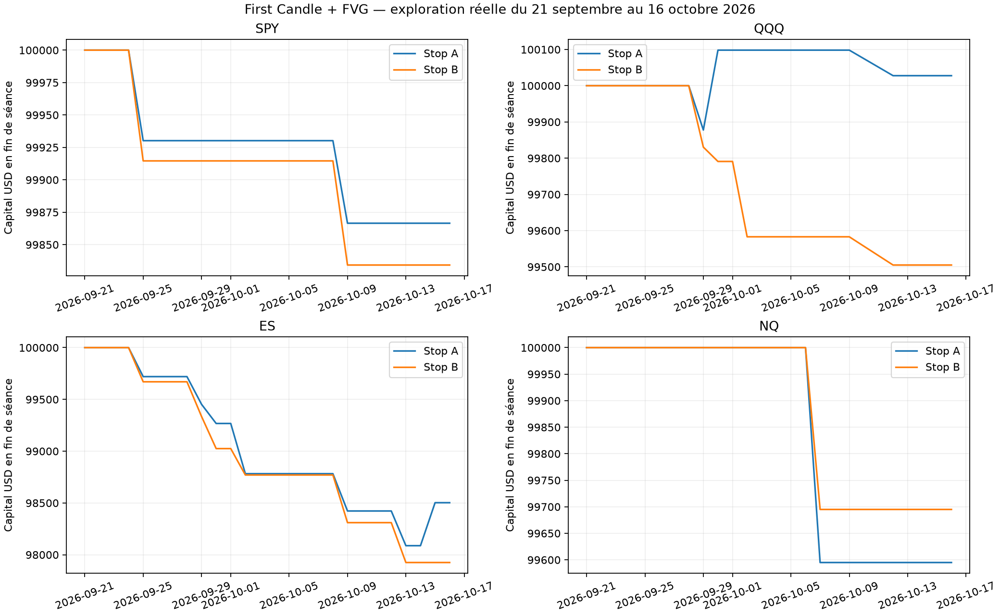

# Rapport final — First Candle Rule + FVG

Étude exécutée le **19 octobre 2026**. Période de marché effectivement étudiée : **21 septembre–16 octobre 2026**. Capital séparé de 100 000 USD pour chaque instrument et variante. Tous les résultats ci-dessous incluent les hypothèses de commissions, spread et slippage du protocole.

## Conclusion

**Catégorie 5 — Impossible à évaluer sérieusement à ce stade.** L'année minimale n'est pas disponible dans les accès utilisés. Sept des huit couples instrument/stop sont négatifs. QQQ-A affiche seulement **+27,71 USD sur trois trades**, puis devient perdant avec deux ticks de slippage. Il n'y a que **1 à 7 trades par scénario principal**. Cela ne démontre ni un avantage, ni une déficience structurelle de la stratégie. Il serait incorrect de conclure « structurellement déficitaire » sur cette base.

## Ce qui a réellement été fait

- Acquisition de véritables OHLCV 1 minute Yahoo Finance, réponses JSON brutes et empreintes SHA-256 conservées. Requêtes de sept jours dans une plage récente de 28 jours calendaires ; aucune reconstruction de minutes.
- SPY : 20 séances complètes. QQQ : 19 séances, car le 7 octobre comporte une minute entièrement nulle/NaN à 12:42 NY et est rejeté intégralement. Aucun prix n'a été comblé.
- ES et NQ : 20 séances chacun, **contrats datés décembre 2026** ESZ26.CME/NQZ26.CME, identité confirmée par les métadonnées du fournisseur. Un seul contrat par instrument sur cette période ; aucun raccordement continu. La gestion d'un changement de contrat n'a donc pas été validée sur un rollover historique dans cet échantillon.
- Exécution de **72 scénarios distincts** : A/B, slippage 1/2/3/5 ticks, et sensibilités préfixées du retest et de la confirmation. Les scénarios ne sont pas des échantillons indépendants ; leurs trades ne s'additionnent pas pour augmenter la puissance statistique.
- **30 tests automatisés passants** à la vérification du code ; scénarios artificiels réservés à ces tests. Les trades réels des huit scénarios principaux sont rapprochés indépendamment des bougies, chronologie, stops, TP, risque et P&L dans AUDIT_TRADES.md. Plusieurs apparaissent dans les deux variantes et ne sont donc pas des observations indépendantes.
- Pine v6 compilé, ajouté au graphique et sauvegardé dans votre espace privé TradingView sous « First Candle + FVG | recherche v1 ». Le compte connecté affiche Basic ; Last 365 days est bloqué par l'accès Premium. Le Strategy Tester sur le 19 octobre, séance en cours, indique zéro trade aux paramètres courants. Aucun backtest annuel TradingView n'est revendiqué.

## Performance des scénarios principaux

Slippage nominal : un tick défavorable à chaque exécution. Les ETF supportent en plus un spread complet hypothétique d'un tick, avec arrondi défavorable au tick négociable. `win_rate_pct` est exprimé en pourcentage ; les résultats R sont nets rapportés au risque prix initial.

| instrument | stop_variant | trades | winners | losers | win_rate_pct | profit_factor | net_pnl | net_return_pct | expectancy_r |
|---|---|---|---|---|---|---|---|---|---|
| SPY | A | 2 | 0 | 2 | 0.0000 | 0.0000 | -133.4600 | -0.1335 | -1.1245 |
| SPY | B | 2 | 0 | 2 | 0.0000 | 0.0000 | -165.7000 | -0.1657 | -1.0977 |
| QQQ | A | 3 | 1 | 2 | 33.3333 | 1.1438 | 27.7093 | 0.0277 | 0.2511 |
| QQQ | B | 4 | 0 | 4 | 0.0000 | 0.0000 | -494.9162 | -0.4949 | -1.0775 |
| ES | A | 7 | 1 | 6 | 14.2857 | 0.2170 | -1497.5000 | -1.4975 | -0.5579 |
| ES | B | 6 | 0 | 6 | 0.0000 | 0.0000 | -2075.0000 | -2.0750 | -1.0927 |
| NQ | A | 1 | 0 | 1 | 0.0000 | 0.0000 | -405.0000 | -0.4050 | -1.0253 |
| NQ | B | 1 | 0 | 1 | 0.0000 | 0.0000 | -305.0000 | -0.3050 | -1.0339 |

### Gains, pertes, fréquence et durée

| instrument | stop_variant | average_win_r | average_loss_r | win_loss_ratio | trades_per_calendar_week | average_duration_minutes |
|---|---|---|---|---|---|---|
| SPY | A | — | -1.1245 | — | 0.5000 | 8.0000 |
| SPY | B | — | -1.0977 | — | 0.5000 | 14.5000 |
| QQQ | A | 2.9373 | -1.0921 | 2.6897 | 0.7500 | 49.6667 |
| QQQ | B | — | -1.0775 | — | 1.0000 | 38.0000 |
| ES | A | 2.7667 | -1.1120 | 2.4880 | 1.7500 | 3.5714 |
| ES | B | — | -1.0927 | — | 1.5000 | 5.6667 |
| NQ | A | — | -1.0253 | — | 0.2500 | 5.0000 |
| NQ | B | — | -1.0339 | — | 0.2500 | 3.0000 |

Les cellules sans gain moyen ne sont pas des gains nuls : aucun gagnant n'a été observé. Les durées sont des bornes inférieures calculées sur le bar de sortie ; précision d'une minute au mieux. La moyenne par semaine conserve les semaines sans trade.

## Risque

| instrument | stop_variant | max_drawdown_usd | max_drawdown_pct | longest_loss_streak | longest_win_streak | actual_risk_mean_usd | actual_risk_max_usd | planned_loss_max_usd | max_exposure_usd |
|---|---|---|---|---|---|---|---|---|---|
| SPY | A | 248.1460 | 0.2479 | 2 | 0 | 59.3600 | 62.4000 | 69.7974 | 99769.8000 |
| SPY | B | 280.3860 | 0.2801 | 2 | 0 | 75.4800 | 78.0000 | 85.3974 | 99769.8000 |
| QQQ | A | 238.2933 | 0.2377 | 1 | 1 | 84.2567 | 114.7500 | 122.2385 | 100031.0000 |
| QQQ | B | 531.7077 | 0.5315 | 4 | 0 | 117.6525 | 203.2800 | 207.9464 | 99556.6400 |
| ES | A | 2352.5000 | 2.3423 | 6 | 1 | 269.6429 | 450.0000 | 485.0000 | 785725.0000 |
| ES | B | 2510.0000 | 2.4991 | 6 | 0 | 316.6667 | 425.0000 | 460.0000 | 785725.0000 |
| NQ | A | 517.5000 | 0.5169 | 1 | 0 | 395.0000 | 395.0000 | 405.0000 | 624130.0000 |
| NQ | B | 417.5000 | 0.4170 | 1 | 0 | 295.0000 | 295.0000 | 305.0000 | 624130.0000 |

Les drawdowns utilisent les closes 1 minute, les fills et le capital initial ; ils peuvent dépasser la perte finale du compte après des gains latents reperdus. Ils ne capturent pas toutes les excursions intraminute. Les quantités ETF sont souvent plafonnées par l'exposition sans levier, ce qui empêche de risquer exactement 500 USD. Les futures respectent leurs valeurs du point et des unités entières. La marge ES 25 000 / NQ 40 000 USD par contrat est une **hypothèse**, sans archive de marge historique validée.

## Dégradation de l'exécution

P&L net USD, colonnes = ticks de slippage par exécution :

| instrument | stop_variant | 1 | 2 | 3 | 5 |
|---|---|---|---|---|---|
| ES | A | -1497.5000 | -1430.0000 | -1605.0000 | -1407.5000 |
| ES | B | -2075.0000 | -2070.0000 | -2295.0000 | -1930.0000 |
| NQ | A | -405.0000 | -415.0000 | -425.0000 | -445.0000 |
| NQ | B | -305.0000 | -315.0000 | -325.0000 | -345.0000 |
| QQQ | A | 27.7093 | -121.6861 | -127.0060 | -137.6459 |
| QQQ | B | -494.9162 | -505.5961 | -516.2760 | -537.6359 |
| SPY | A | -133.4600 | -138.6199 | -143.7799 | -154.0997 |
| SPY | B | -165.7000 | -170.8599 | -176.0199 | -186.3397 |

**31 des 32 scénarios principaux de coûts sont négatifs.** Seul QQQ-A à un tick est légèrement positif ; il devient négatif dès deux ticks. Les pertes en dollars ne sont pas nécessairement monotones : le slippage modifie le prix estimé au passage de l'ordre, la quantité entière, le fill et l'objectif 3R. Les signaux et les règles restent identiques. Pour ES, des contrats en moins peuvent réduire une perte en dollars malgré une moins bonne exécution. Il faut donc lire aussi les espérances en R et les quantités des journaux ; cette variation n'est pas une amélioration économique due aux frais.

Sur QQQ-A, le signal du 2 octobre est rejeté à un tick : la quantité fixée au close de confirmation dépasse le capital/exposition autorisés lorsque le prix d'ouverture suivant arrive. Avec deux ticks estimés au passage de l'ordre, la quantité est plus faible ; l'ordre est accepté puis perdant. Le saut de P&L entre scénarios vient donc aussi d'une contrainte d'exécution discrète. Le journal des rejets et les quantités permettent de le reproduire ; il n'est pas corrigé rétrospectivement pour lisser les résultats.

### Autres sensibilités préfixées

P&L net USD, un tick nominal. `principal` : retest 15 min et confirmation dans les deux bougies suivantes ; les autres colonnes ne changent qu'un de ces paramètres.

| instrument | stop_variant | confirmation0 | confirmation1 | confirmation3 | principal | retest10 | retest20 |
|---|---|---|---|---|---|---|---|
| ES | A | -1285.0000 | -1137.5000 | -1497.5000 | -1497.5000 | -1162.5000 | -1497.5000 |
| ES | B | -1410.0000 | -1745.0000 | -2075.0000 | -2075.0000 | -1690.0000 | -2075.0000 |
| NQ | A | 0.0000 | 0.0000 | -405.0000 | -405.0000 | -405.0000 | -405.0000 |
| NQ | B | 0.0000 | 0.0000 | -540.0000 | -305.0000 | -305.0000 | -305.0000 |
| QQQ | A | -122.2385 | -336.7794 | -61.0471 | 27.7093 | 98.1747 | 27.7093 |
| QQQ | B | -169.4885 | -455.3694 | -539.3035 | -494.9162 | -416.9817 | -494.9162 |
| SPY | A | 0.0000 | -63.6626 | -133.4600 | -133.4600 | -133.4600 | -133.4600 |
| SPY | B | 0.0000 | -80.3026 | -165.7000 | -165.7000 | -165.7000 | -165.7000 |

Aucun maximum de ce tableau n'a servi à sélectionner une stratégie recommandée. Les résultats de quelques journées peuvent se renverser en changeant un stop ou une fenêtre ; cette instabilité ne constitue pas une validation.

## LONG et SHORT

| instrument | stop_variant | direction | trades | net_pnl | expectancy_r | win_rate |
|---|---|---|---|---|---|---|
| SPY | A | SHORT | 2 | -133.4600 | -1.1245 | 0.0000 |
| SPY | B | SHORT | 2 | -165.7000 | -1.0977 | 0.0000 |
| QQQ | A | LONG | 1 | 220.4132 | 2.9373 | 1.0000 |
| QQQ | A | SHORT | 2 | -192.7039 | -1.0921 | 0.0000 |
| QQQ | B | LONG | 2 | -247.4932 | -1.0790 | 0.0000 |
| QQQ | B | SHORT | 2 | -247.4230 | -1.0759 | 0.0000 |
| ES | A | LONG | 4 | -590.0000 | -0.1653 | 0.2500 |
| ES | A | SHORT | 3 | -907.5000 | -1.0815 | 0.0000 |
| ES | B | LONG | 3 | -950.0000 | -1.1003 | 0.0000 |
| ES | B | SHORT | 3 | -1125.0000 | -1.0850 | 0.0000 |
| NQ | A | SHORT | 1 | -405.0000 | -1.0253 | 0.0000 |
| NQ | B | SHORT | 1 | -305.0000 | -1.0339 | 0.0000 |

Seuls QQQ-A et ES-A ont un gagnant dans cet échantillon. Les LONG y sont donc relativement meilleurs que les SHORT, mais les effectifs sont trop faibles pour généraliser. SPY et NQ n'ont ici que des SHORT exécutés aux paramètres principaux ; il est impossible d'y comparer objectivement les deux directions.

## Résultats mensuels

| instrument | stop_variant | month | net_pnl | return_pct |
|---|---|---|---|---|
| SPY | A | 2026-09 | -69.7974 | -0.0698 |
| SPY | A | 2026-10 | -63.6626 | -0.0637 |
| SPY | B | 2026-09 | -85.3974 | -0.0854 |
| SPY | B | 2026-10 | -80.3026 | -0.0804 |
| QQQ | A | 2026-09 | 98.1747 | 0.0982 |
| QQQ | A | 2026-10 | -70.4654 | -0.0704 |
| QQQ | B | 2026-09 | -209.0353 | -0.2090 |
| QQQ | B | 2026-10 | -285.8809 | -0.2865 |
| ES | A | 2026-09 | -732.5000 | -0.7325 |
| ES | A | 2026-10 | -765.0000 | -0.7706 |
| ES | B | 2026-09 | -975.0000 | -0.9750 |
| ES | B | 2026-10 | -1100.0000 | -1.1108 |
| NQ | A | 2026-09 | 0.0000 | 0.0000 |
| NQ | A | 2026-10 | -405.0000 | -0.4050 |
| NQ | B | 2026-09 | 0.0000 | 0.0000 |
| NQ | B | 2026-10 | -305.0000 | -0.3050 |

Septembre et octobre sont des **mois incomplets** dans l'étude ; aucune extrapolation mensuelle/annuelle n'est faite.

## Réponses aux dix questions de recherche

1. **Profitable après frais ?** Seul QQQ-A est légèrement positif (+27,71 USD / +0,0277 %) avec trois trades et un seul gagnant. Les sept autres couples sont négatifs. Cela ne répond pas à la profitabilité sur une année ou plusieurs années.
2. **Profitable hors échantillon ?** Non évalué. Aucune partition 70/30 ni fenêtre walk-forward historique n'est revendiquée avec seulement 19–20 séances. Le code les prépare pour un historique suffisant.
3. **Instrument le plus solide ?** Aucun n'a des preuves suffisantes. Classer les pertes de quelques trades ou comparer NQ à un seul trade serait trompeur.
4. **LONG plus rentables ?** Observation locale plus favorable sur QQQ-A et ES-A, sans effectif permettant une conclusion statistique.
5. **Meilleur stop ?** A perd moins que B sur SPY, QQQ et ES ; B perd moins sur NQ avec un seul trade. Ce n'est pas une raison suffisante pour choisir A pour du trading réel.
6. **Seulement certains régimes ?** Non évalué de manière crédible. Les regroupements de volatilité sont volontairement non classés en exploratoire ; des seuils calculés sur toute la période auraient ajouté une sélection rétrospective. Sur une étude longue, les seuils sont fixés sur l'IS seulement.
7. **Dépendance à quelques gains ?** Forte fragilité : un seul gagnant dans QQQ-A et un seul dans ES-A. Retirer le gagnant de QQQ-A suffit à rendre son P&L négatif. Les métriques `pnl_excluding_best_3_sessions/trades` sont exportées. L'ES-A est déjà perdant avec son gagnant.
8. **Supporte plus de slippage ?** Le petit profit QQQ-A disparaît dès deux ticks. Les 24 scénarios principaux à 2/3/5 ticks sont tous négatifs. Aucun profit robuste aux coûts n'est montré.
9. **Assez de trades ?** Non : 1–7 par scénario, avec dépendance entre variantes. Le nombre de scénarios exécutés ne corrige pas ce manque d'observations.
10. **Avantage ou hasard ?** Aucun avantage démontré ; les données sont trop courtes pour départager absence d'avantage, hasard d'échantillonnage et effets de régime. Une conclusion causale ou une précision élevée seraient injustifiées.

## Validation et limites restantes

Les intervalles de Wilson du win rate sont exportés, mais n'ont guère de précision avec ces effectifs. Le bootstrap n'a **pas été appliqué aux performances historiques** : les seuils préfixés de calcul (20 trades et 60 séances minimum) ne sont pas atteints. L'algorithme de bootstrap est testé sur une fixture artificielle ; cela ne valide pas ses hypothèses de stationnarité sur un marché.

L'audit détaillé est dans [AUDIT_TRADES.md](AUDIT_TRADES.md) et les tableaux exhaustifs dans [comparison_all.csv](comparison_all.csv). Le moteur ne possède pas de cotations bid/ask historiques, de carnet, de fills partiels ni de disponibilité d'emprunt. La limite de 1 % du volume de confirmation est une approximation déclarée. Les frais d'emprunt ETF de 1 % annuel, facturés pour un jour, et les commissions futures sont hypothétiques. L'ordre réel des prix dans une minute demeure inconnu, d'où la convention stop d'abord hors gaps connus à l'open.

**Causalité du dimensionnement :** la quantité Python est fixée au close de confirmation avec un prix d'entrée estimé et une réserve de coûts. Aucun prix de la minute suivante n'y entre. Le fill observé à l'open suivant détermine le risque effectif et le TP, sans ajuster rétroactivement la quantité. Le risque effectif peut dépasser la cible à cause d'un gap. `estimated_loss_at_order_usd` respecte le budget prévu ; `planned_loss_usd` mesure le risque stop projeté après fill. Le rejet d'un stop devenu invalide ou d'un ordre non finançable à l'open demeure une convention de simulation : un véritable ordre au marché déjà envoyé pourrait être exécuté puis devoir être fermé. Les cotations et la latence manquent pour valider cette exécution.

Le Pine ne force pas le stop en premier dans une bougie ambiguë du broker emulator, utilise un TP limite, ne reproduit pas les minima de frais/emprunt et exige un traitement de calendrier supplémentaire pour une longue période de futures. TradingView affiche l'avertissement général lié à `calc_on_order_fills`. Le code isole le recalcul sur fill, mais la parité historique/realtime complète n'a pas été démontrée. Voir [ses limites détaillées](../../tradingview/README.md).

Les prix Yahoo sont conservés tels que publiés. Leur représentation flottante peut se trouver très légèrement au-dessus ou au-dessous d'un tick exact ; cela peut affecter une comparaison stricte de FVG ou l'arrondi extérieur d'un stop. Aucune correction de prix ni taille minimale de FVG n'a été introduite pour améliorer les performances. Un flux de précision normalisée devra servir au rapprochement de production.

## Reproduction et données à obtenir pour poursuivre

Les fichiers bruts et leurs métadonnées se trouvent dans `data/yahoo_28d` et `data/yahoo_contracts`. `manifest.json` fige entrées, hashes du code, versions et paramètres. [README.md](../../README.md) contient la commande d'exécution, les dépendances et les formats CSV, rolls, calendrier et marge.

Pour réaliser l'étude demandée, il manque **au moins un an de bougies réelles 1 minute**, idéalement trois, avec contrats datés, calendrier fiable et hypothèses de marge/coûts adaptées à l'époque. Un accès TradingView Premium/supérieur peut permettre un test Pine profond, mais ne garantit pas un export complet ni la convention d'exécution Python. Des CSV externes ou un fournisseur historique approprié permettent de poursuivre sans modifier les règles pour rechercher un profit.

La priorité reste l'exactitude : **aucun passage au trading réel n'est justifié par ce travail exploratoire.**
