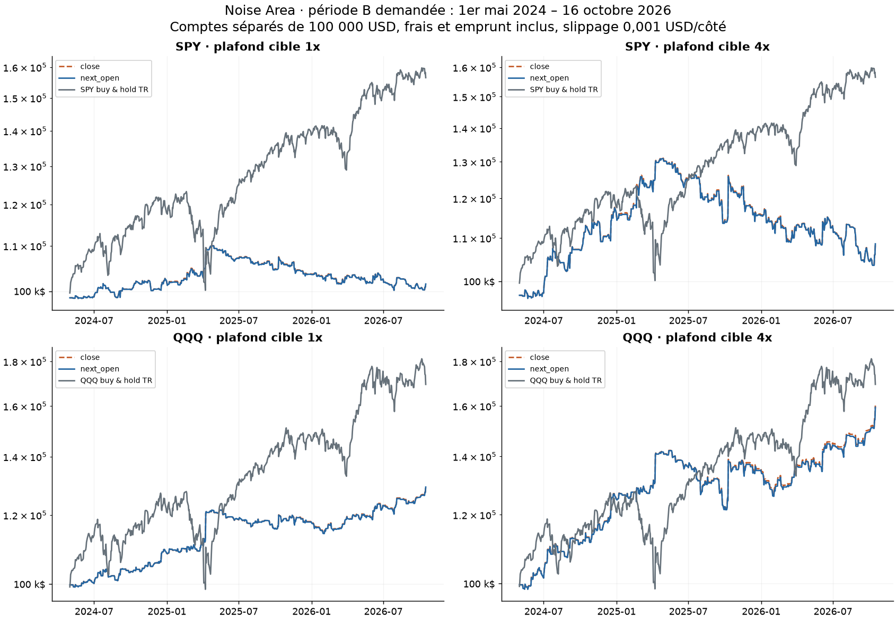
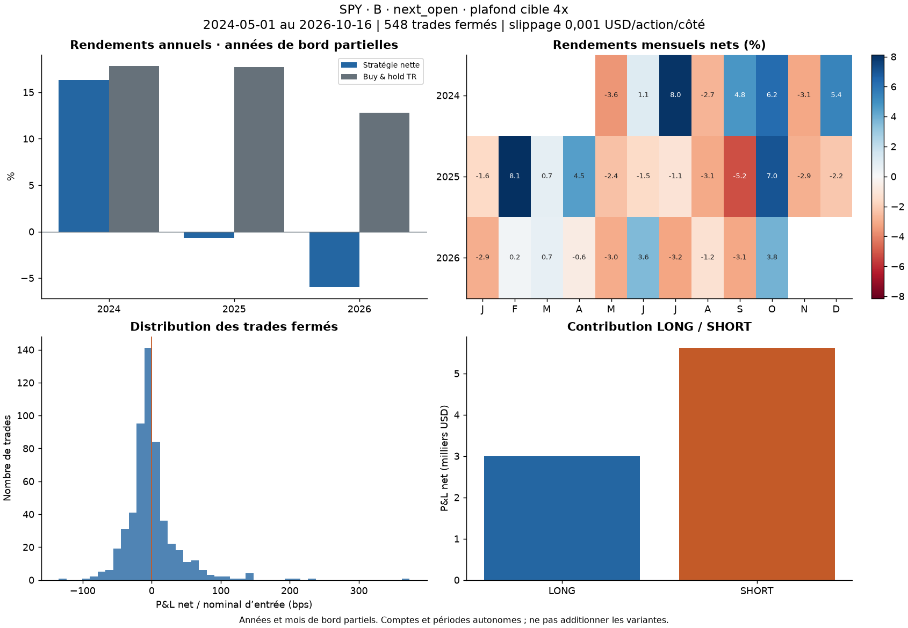
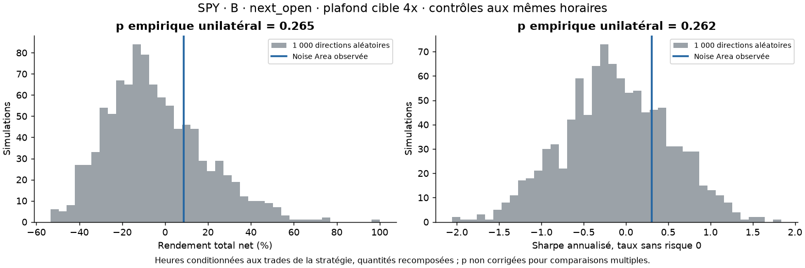
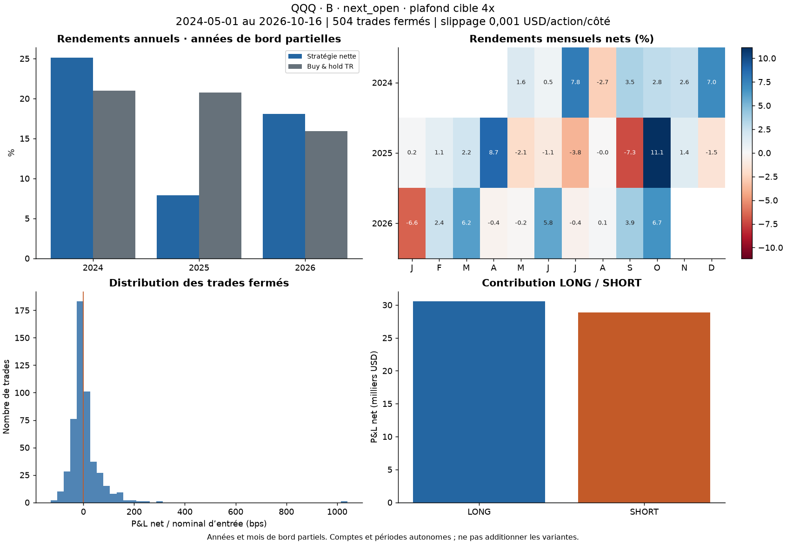
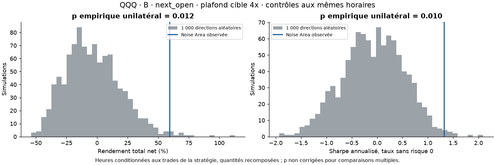

# Noise Area — backtest et validation au 16 octobre 2026

Étude exécutée le 19 octobre 2026 (heure de New York), terminée le 20 octobre en UTC. Capital initial de **100 000 USD par compte**. Résultats locaux ; aucun ajout à GitHub à ce stade.

## A. Résultat principal et portée

**SPY : catégorie 3 — aucun avantage démontré. QQQ : catégorie 2 — potentiellement intéressante, preuves insuffisantes.** Sur B, QQQ présente une performance positive et un signal statistique au coût bas, avec les mêmes paramètres que SPY. Cela justifie de poursuivre l'observation ; cela ne suffit pas à conclure à un avantage exploitable aujourd'hui. SPY est très sensible aux coûts et ses intervalles incluent largement zéro.

B correspond à la coupure demandée, du **1er mai 2024 au 16 octobre 2026**, soit 618 séances. Convention principale : décision sur minute terminée, exécution au **prochain open**, friction adverse **0,001 USD/action/côté**, commission **0,0035 USD/action/côté, minimum 0,35 USD/ordre**, emprunt SHORT supposé disponible à **1 %/an, minimum un jour/360 par trade**. La friction de référence est un dixième de cent ; les tests à 1–5 cents ci-dessous sont essentiels.

| Compte / exécution / cible | Trades | Net USD | Total % | CAGR % | Sharpe | Sortino | Vol. % | PF | DD minute % |
|---|---|---|---|---|---|---|---|---|---|
| SPY open+1 1x | 548 | 1 540,11 | 1,54 | 0,62 | 0,14 | 0,24 | 5,65 | 1,02 | 9,88 |
| SPY open+1 4x | 548 | 8 606,73 | 8,61 | 3,41 | 0,30 | 0,54 | 14,44 | 1,05 | 21,79 |
| QQQ open+1 1x | 504 | 29 210,54 | 29,21 | 10,97 | 1,31 | 2,94 | 8,25 | 1,34 | 7,02 |
| QQQ open+1 4x | 504 | 59 406,57 | 59,41 | 20,86 | 1,33 | 2,78 | 15,20 | 1,33 | 15,46 |

Le buy & hold SPY, dividendes réinvestis, gagne **56,51 %**, Sharpe **1,26** sur les mêmes dates. QQQ buy & hold gagne **69,39 %**, Sharpe **1,12**. Ces passifs sont théoriques, sans frais ni impôt ; leurs drawdowns quotidiens ne doivent pas être assimilés aux drawdowns minute de la stratégie.

La publication initiale n'est pas le 1er mai : le PDF indique une première version au 10 mai 2024 et SSRN une mise en ligne le 14 mai. Le PDF accessible est **révisé au 22 septembre 2025**. Sans copie séparée de mai 2024, B ne constitue pas un hors-échantillon incontestable de la révision consultée. C commence le 15 mai 2024 ; D, le **23 septembre 2025**, est le contrôle après la révision. Cette limite était fixée dans le protocole avant les performances. [Article officiel](https://concretumgroup.com/wp-content/uploads/2026/02/Beat-the-Market.pdf), [page SSRN](https://papers.ssrn.com/sol3/papers.cfm?abstract_id=4824172).

Sur D, QQQ reste bénéficiaire mais ses intervalles de confiance incluent zéro ; SPY perd. Les dix meilleurs jours de B expliquent environ **98–104 % du P&L QQQ**, selon la cible. Ces éléments empêchent la catégorie 1 et une recommandation de passage en réel.

## B. Reproduction partielle de l'article

L'article annonce environ **1 985 %** au total, **19,6 %/an** et un **Sharpe de 1,33** sur mai 2007–avril 2024. Notre A couvre seulement **26 janvier 2016–30 avril 2024** : les rendements totaux ne sont donc pas directement comparables. La reproduction exacte 2007–2024 n'a pas été réalisée.

| Mesure / périmètre | Total % | CAGR % | Sharpe |
|---|---|---|---|
| Article annoncé, mai 2007–avril 2024 | 1 985 | 19,6 | 1,33 |
| Notre SPY A, close, cible 4x | 242,31 | 16,06 | 1,14 |
| Notre SPY A, next_open, cible 4x | 235,49 | 15,78 | 1,12 |

| Compte / exécution / cible | Trades | Net USD | Total % | CAGR % | Sharpe | Sortino | Vol. % | PF | DD minute % |
|---|---|---|---|---|---|---|---|---|---|
| SPY close 1x | 1768 | 77 159,28 | 77,16 | 7,17 | 1,17 | 2,18 | 6,06 | 1,31 | 6,71 |
| SPY close 4x | 1768 | 242 305,60 | 242,31 | 16,06 | 1,14 | 2,12 | 13,93 | 1,33 | 24,42 |
| SPY open+1 1x | 1768 | 75 551,63 | 75,55 | 7,05 | 1,16 | 2,14 | 6,06 | 1,30 | 6,76 |
| SPY open+1 4x | 1768 | 235 486,70 | 235,49 | 15,78 | 1,12 | 2,09 | 13,92 | 1,33 | 24,55 |
| QQQ close 1x | 1755 | 157 154,18 | 157,15 | 12,11 | 1,56 | 3,03 | 7,51 | 1,39 | 7,24 |
| QQQ close 4x | 1755 | 382 134,86 | 382,13 | 20,97 | 1,42 | 2,79 | 14,12 | 1,36 | 21,58 |
| QQQ open+1 1x | 1755 | 151 852,94 | 151,85 | 11,83 | 1,53 | 2,96 | 7,50 | 1,38 | 7,41 |
| QQQ open+1 4x | 1755 | 362 086,44 | 362,09 | 20,35 | 1,38 | 2,70 | 14,12 | 1,35 | 22,00 |

Les chiffres sont positifs sur A, mais ne prouvent pas la reproduction des chiffres publiés. Les différences de période, source SIP, filtre de séances complètes, coûts fixes avec minimum, dividendes, arrondi inférieur, fenêtres strictement passées et sortie à 15:59 expliquent des écarts possibles. Aucune attribution quantitative de chaque écart au papier n'est revendiquée. Le tutoriel utilise notamment un arrondi et une tranche de volatilité différents de la formule du papier ; nos choix restent ceux du protocole.

Quatre séances de mars 2020 avec 14 minutes absentes ont été exclues : 9, 12, 16 et 18 mars. Ces dates correspondent aux interruptions générales de marché documentées par le NYSE ; ce ne sont pas nécessairement des erreurs du fournisseur. L'exigence d'une grille complète retire donc des journées de crise importantes et affecte aussi le réchauffement ultérieur. C'est une limite matérielle de A, sans incidence sur les 618 séances complètes de B. [NYSE : interruptions de mars 2020](https://www.nyse.com/article/assessing-nyse-model-performance).

## C. B : comparaison des conventions et métriques

| Compte / exécution / cible | Trades | Net USD | Total % | CAGR % | Sharpe | Sortino | Vol. % | PF | DD minute % |
|---|---|---|---|---|---|---|---|---|---|
| SPY close 1x | 548 | 1 548,01 | 1,55 | 0,63 | 0,14 | 0,24 | 5,64 | 1,02 | 9,87 |
| SPY close 4x | 548 | 8 665,78 | 8,67 | 3,43 | 0,31 | 0,54 | 14,44 | 1,05 | 21,82 |
| SPY open+1 1x | 548 | 1 540,11 | 1,54 | 0,62 | 0,14 | 0,24 | 5,65 | 1,02 | 9,88 |
| SPY open+1 4x | 548 | 8 606,73 | 8,61 | 3,41 | 0,30 | 0,54 | 14,44 | 1,05 | 21,79 |
| QQQ close 1x | 504 | 29 390,88 | 29,39 | 11,04 | 1,31 | 2,96 | 8,25 | 1,35 | 6,86 |
| QQQ close 4x | 504 | 60 143,89 | 60,14 | 21,08 | 1,34 | 2,82 | 15,20 | 1,34 | 15,26 |
| QQQ open+1 1x | 504 | 29 210,54 | 29,21 | 10,97 | 1,31 | 2,94 | 8,25 | 1,34 | 7,02 |
| QQQ open+1 4x | 504 | 59 406,57 | 59,41 | 20,86 | 1,33 | 2,78 | 15,20 | 1,33 | 15,46 |

Le passage du close au prochain open modifie peu ces résultats agrégés, mais le close suppose une exécution au prix qui vient de former le signal. Aucune convention ne démontre un remplissage réel. La sortie de fin de séance est l'open de la dernière minute dans les deux versions, sans prix officiel MOC.

### Métriques détaillées — SPY

| Mesure | SPY close 1x | SPY close 4x | SPY open+1 1x | SPY open+1 4x |
|---|---|---|---|---|
| Trades / séance | 0,89 | 0,89 | 0,89 | 0,89 |
| % séances avec trade | 60,19 | 60,19 | 60,19 | 60,19 |
| Win rate % | 39,78 | 39,78 | 40,15 | 40,15 |
| Gain moyen USD | 311,84 | 896,27 | 308,43 | 886,26 |
| Perte moyenne USD | -201,31 | -565,82 | -202,18 | -568,20 |
| Ratio gain/perte | 1,55 | 1,58 | 1,53 | 1,56 |
| P&L moyen / nominal entrée bps | 0,45 | 0,45 | 0,45 | 0,45 |
| Série max pertes, trades | 10,00 | 10,00 | 10,00 | 10,00 |
| Bêta quotidien vs SPY TR | 0,00 | -0,08 | 0,00 | -0,08 |
| Corrélation quotidienne vs SPY TR | 0,00 | -0,08 | 0,00 | -0,08 |
| DD max USD | 10 973,83 | 28 883,33 | 10 980,33 | 28 814,24 |
| DD max aux clôtures % | 8,91 | 20,90 | 8,91 | 20,85 |
| Pire jour % | -1,36 | -2,98 | -1,36 | -2,98 |
| Pire mois % | -1,82 | -5,18 | -1,82 | -5,22 |
| Pire année % | -2,06 | -6,12 | -1,97 | -5,98 |
| Commissions USD | 618,52 | 1 844,39 | 618,25 | 1 841,82 |
| Emprunt USD | 736,21 | 2 279,03 | 735,94 | 2 275,53 |

| Compte | Pire jour | Pire mois | Pire année |
|---|---|---|---|
| SPY close 1x | 2024-05-01 | 2024-08 | 2026 |
| SPY close 4x | 2024-05-01 | 2025-09 | 2026 |
| SPY open+1 1x | 2024-05-01 | 2024-08 | 2026 |
| SPY open+1 4x | 2024-05-01 | 2025-09 | 2026 |

### Métriques détaillées — QQQ

| Mesure | QQQ close 1x | QQQ close 4x | QQQ open+1 1x | QQQ open+1 4x |
|---|---|---|---|---|
| Trades / séance | 0,82 | 0,82 | 0,82 | 0,82 |
| % séances avec trade | 56,15 | 56,15 | 56,15 | 56,15 |
| Win rate % | 41,67 | 41,67 | 41,87 | 41,87 |
| Gain moyen USD | 543,33 | 1 133,19 | 540,56 | 1 124,50 |
| Perte moyenne USD | -288,12 | -604,85 | -289,58 | -607,04 |
| Ratio gain/perte | 1,89 | 1,87 | 1,87 | 1,85 |
| P&L moyen / nominal entrée bps | 5,55 | 5,55 | 5,52 | 5,52 |
| Série max pertes, trades | 6,00 | 6,00 | 6,00 | 6,00 |
| Bêta quotidien vs SPY TR | 0,04 | -0,04 | 0,04 | -0,04 |
| Corrélation quotidienne vs SPY TR | 0,07 | -0,04 | 0,07 | -0,04 |
| DD max USD | 8 409,45 | 21 839,30 | 8 609,23 | 22 107,82 |
| DD max aux clôtures % | 5,84 | 14,26 | 6,01 | 14,45 |
| Pire jour % | -1,57 | -3,51 | -1,56 | -3,57 |
| Pire mois % | -3,02 | -7,19 | -3,02 | -7,29 |
| Pire année % | 8,55 | 8,34 | 8,56 | 7,91 |
| Commissions USD | 701,96 | 1 587,93 | 701,65 | 1 584,11 |
| Emprunt USD | 779,23 | 1 831,92 | 778,94 | 1 827,12 |

| Compte | Pire jour | Pire mois | Pire année |
|---|---|---|---|
| QQQ close 1x | 2024-08-06 | 2026-01 | 2024 |
| QQQ close 4x | 2025-08-01 | 2025-09 | 2025 |
| QQQ open+1 1x | 2024-08-06 | 2026-01 | 2025 |
| QQQ open+1 4x | 2025-08-01 | 2025-09 | 2025 |

Les moyennes par trade ne sont pas des rendements de compte : les bps divisent le P&L net par le nominal d'entrée. Les années 2024 et 2026 de B sont partielles. Les bêta/corrélations utilisent toutes les séances, y compris celles sans position. Sharpe : rendement quotidien net, taux sans risque nul, annualisation 252 ; Sortino : racine de la moyenne des carrés négatifs sur toutes les séances. CAGR : durée calendaire. Le cash ne rapporte aucun intérêt.

### Coupures de publication : C et D

| Compte / exécution / cible | Trades | Net USD | Total % | CAGR % | Sharpe | Sortino | Vol. % | PF | DD minute % |
|---|---|---|---|---|---|---|---|---|---|
| SPY / C close 1x | 543 | 3 015,67 | 3,02 | 1,23 | 0,25 | 0,44 | 5,62 | 1,05 | 9,89 |
| SPY / C close 4x | 543 | 12 244,41 | 12,24 | 4,88 | 0,40 | 0,73 | 14,43 | 1,06 | 21,83 |
| SPY / C open+1 1x | 543 | 3 020,07 | 3,02 | 1,24 | 0,25 | 0,44 | 5,63 | 1,05 | 9,88 |
| SPY / C open+1 4x | 543 | 12 166,28 | 12,17 | 4,85 | 0,40 | 0,73 | 14,43 | 1,06 | 21,80 |
| SPY / D close 1x | 253 | -4 115,77 | -4,12 | -3,87 | -0,71 | -1,12 | 5,33 | 0,86 | 6,90 |
| SPY / D close 4x | 253 | -8 814,72 | -8,81 | -8,30 | -0,46 | -0,81 | 16,12 | 0,89 | 18,17 |
| SPY / D open+1 1x | 253 | -4 026,01 | -4,03 | -3,78 | -0,70 | -1,09 | 5,33 | 0,86 | 6,84 |
| SPY / D open+1 4x | 253 | -8 630,21 | -8,63 | -8,13 | -0,45 | -0,79 | 16,13 | 0,89 | 18,03 |
| QQQ / C close 1x | 499 | 30 444,07 | 30,44 | 11,59 | 1,37 | 3,09 | 8,31 | 1,36 | 6,87 |
| QQQ / C close 4x | 499 | 62 495,27 | 62,50 | 22,18 | 1,39 | 2,93 | 15,31 | 1,35 | 15,27 |
| QQQ / C open+1 1x | 499 | 30 217,08 | 30,22 | 11,51 | 1,36 | 3,06 | 8,31 | 1,36 | 7,03 |
| QQQ / C open+1 4x | 499 | 61 791,64 | 61,79 | 21,97 | 1,38 | 2,90 | 15,31 | 1,35 | 15,47 |
| QQQ / D close 1x | 218 | 10 458,00 | 10,46 | 9,79 | 1,33 | 2,54 | 7,22 | 1,31 | 5,33 |
| QQQ / D close 4x | 218 | 25 089,07 | 25,09 | 23,39 | 1,33 | 3,01 | 16,84 | 1,38 | 10,15 |
| QQQ / D open+1 1x | 218 | 10 347,20 | 10,35 | 9,69 | 1,31 | 2,51 | 7,23 | 1,31 | 5,39 |
| QQQ / D open+1 4x | 218 | 24 842,85 | 24,84 | 23,16 | 1,32 | 2,98 | 16,83 | 1,38 | 10,26 |

C et D sont des comptes réinitialisés à 100 000 USD, réchauffés uniquement avec le passé. Ils recouvrent B et ne sont pas des observations indépendantes.

| D, prochain open | IC95 moyenne/jour % | IC95 Sharpe | p aléatoire Sharpe |
|---|---|---|---|
| SPY 1x | -0,0521 ; 0,0229 | -2,714 ; 0,983 | 0,7333 |
| SPY 4x | -0,1403 ; 0,0916 | -2,650 ; 1,199 | 0,6244 |
| QQQ 1x | -0,0155 ; 0,0918 | -0,615 ; 2,938 | 0,0729 |
| QQQ 4x | -0,0296 ; 0,2203 | -0,588 ; 2,714 | 0,0779 |

## D. Risque, levier et coûts

| Compte | DD minute USD | DD minute % | Durée calendaire, jours | Récupéré ? | Levier moyen détenu | Max effectif |
|---|---|---|---|---|---|---|
| QQQ open+1 1x | 8 609,23 | 7,02 | 424,96 | oui | 0,984 | 1,021 |
| QQQ open+1 4x | 22 107,82 | 15,46 | 424,96 | oui | 2,010 | 4,153 |
| SPY open+1 1x | 10 980,33 | 9,88 | 554,15 | non, censuré au 16/10/2026 | 0,988 | 1,018 |
| SPY open+1 4x | 28 814,24 | 21,79 | 554,15 | non, censuré au 16/10/2026 | 2,767 | 4,149 |

La durée ci-dessus concerne **l'épisode du pire drawdown en pourcentage aux marques minute**, du dernier sommet égal au premier retour au sommet, ou jusqu'à la fin s'il reste ouvert. Le maximum USD peut appartenir à un autre épisode. Les durées quotidiennes du `summary.json` sont distinctes et explicitement nommées dans `OUTPUT_METADATA_NOTES.json`. L'audit indépendant livre sommets, creux, récupération et dates des maxima dans [INTRADAY_RISK_AUDIT.csv](INTRADAY_RISK_AUDIT.csv).

Le levier moyen est pondéré par les minutes effectivement détenues ; le maximum inclut les marques de prix et les remplissages. Les cibles 1x/4x sont calculées à l'ouverture et les actions sont figées toute la séance. La cible 1x n'est donc pas une simulation stricte de compte cash : elle atteint environ **1,02x** en B. La cible 4x atteint environ **4,15x**. Les pertes ou mouvements de cours peuvent augmenter l'exposition effective ; aucune liquidation de marge automatique n'est simulée. Les résultats ne constituent pas la performance garantie d'un compte soumis à un plafond dur.

### Friction adverse par action et par côté

Les commissions et l'emprunt restent appliqués en plus de la friction. Chaque cellule résulte d'un rejeu complet avec composition, pas d'une déduction linéaire des coûts.

| Friction USD/côté | SPY 1x net USD | SPY 4x | QQQ 1x | QQQ 4x |
|---|---|---|---|---|
| 0,001 | 1 540,11 | 8 606,73 | 29 210,54 | 59 406,57 |
| 0,010 | -39,33 | 4 125,84 | 27 173,31 | 54 303,22 |
| 0,020 | -1 729,71 | -610,41 | 24 923,43 | 48 911,02 |
| 0,030 | -3 392,92 | -5 107,92 | 22 742,05 | 43 651,37 |
| 0,050 | -6 655,30 | -13 549,40 | 18 420,90 | 33 644,85 |

| Compte | Friction de point mort USD/action/côté |
|---|---|
| SPY 1x | 0,009727 |
| SPY 4x | 0,018746 |
| QQQ 1x | 0,144878 |
| QQQ 4x | 0,130519 |

Les points morts sont obtenus par bissection avec composition, frais et emprunt inchangés. Ils ne sont ni un coût total par trade ni une promesse d'exécution : spread, impact et difficulté d'emprunt réels peuvent varier, surtout pendant les jours qui portent le résultat. À 1 cent, SPY 1x est déjà légèrement perdant ; SPY 4x passe en perte entre 1 et 2 cents. QQQ demeure bénéficiaire jusqu'à 5 cents dans l'échantillon, mais cela ne garantit pas la persistance de sa moyenne.

Sensibilité de l'emprunt SHORT, prochain open, autres paramètres fixes :

| Compte | Emprunt annuel | Net USD |
|---|---|---|
| SPY open+1 1x | 0 % | 2 258,98 |
| SPY open+1 1x | 3 % | 65,15 |
| SPY open+1 4x | 0 % | 10 801,17 |
| SPY open+1 4x | 3 % | 4 334,60 |
| QQQ open+1 1x | 0 % | 30 082,85 |
| QQQ open+1 1x | 3 % | 27 419,92 |
| QQQ open+1 4x | 0 % | 61 760,76 |
| QQQ open+1 4x | 3 % | 54 941,17 |

Historique réglementaire : l'ancienne règle PDT exigeait 25 000 USD pour les comptes qualifiés et le 4x dépendait de la marge disponible. Au 19 octobre 2026, FINRA indique une nouvelle norme effective depuis le 4 juin 2026, avec transition des courtiers jusqu'au 20 octobre 2027. Le régime applicable dépend donc du courtier ; le résumé « 25 000 USD obligatoire aujourd'hui dans tous les cas » serait inexact. Cette étude ne vérifie aucun pouvoir d'achat personnel. [FINRA](https://syndication.finra.org/content/understanding-new-intraday-margin-requirements), [Investor.gov](https://www.investor.gov/introduction-investing/general-resources/news-alerts/alerts-bulletins/investor-bulletins/margin).

## E. Robustesse, contrôles et concentration

### Incertitude de B

Bootstrap circulaire de **blocs de 5 séances**, **5 000 réplications**, seed **20261019**, mêmes dates rééchantillonnées pour la stratégie et le passif. Les IC sont conditionnels à cet historique et à cette longueur de bloc ; ils ne couvrent pas toute l'incertitude de modèle. Les variantes se recouvrent et aucune correction de multiplicité n'a été appliquée.

| Compte | IC95 moyenne/jour % | IC95 Sharpe | IC95 ΔSharpe vs ETF passif |
|---|---|---|---|
| SPY open+1 1x | -0,0222 ; 0,0320 | -1,127 ; 1,241 | -3,091 ; 0,557 |
| SPY open+1 4x | -0,0479 ; 0,0838 | -0,921 ; 1,361 | -2,810 ; 0,689 |
| QQQ open+1 1x | 0,0063 ; 0,0858 | 0,237 ; 2,229 | -1,484 ; 1,714 |
| QQQ open+1 4x | 0,0124 ; 0,1537 | 0,245 ; 2,312 | -1,494 ; 1,767 |

QQQ au coût de référence a un IC de moyenne et de Sharpe au-dessus de zéro sur B. L'IC de sa différence de Sharpe avec son propre passif inclut zéro : la supériorité ajustée au risque n'est pas établie. SPY n'a pas de moyenne significativement positive. Pour QQQ à 5 cents, les IC incluent zéro ; sur D également. [Tous les IC de coûts B](UNCERTAINTY_B_COSTS.json), [contrôle D](POST_REVISION_VALIDATION.json).

### Comparaison appariée avec SPY passif

| Compte | IC95 ΔSharpe vs SPY passif |
|---|---|
| SPY 1x | -3,091 ; 0,557 |
| SPY 4x | -2,810 ; 0,689 |
| QQQ 1x | -1,666 ; 1,586 |
| QQQ 4x | -1,680 ; 1,633 |

Les différences de Sharpe avec SPY incluent également zéro. Les simulations appariées utilisent exactement les mêmes dates tirées en blocs ; [résultats complets](B_VS_SPY_PASSIVE.json).

### Contrôles de direction

Mêmes intervalles fermés d'entrée/sortie que la stratégie ; **1 000** directions ±1 aléatoires, quantités recalculées sur le capital de chaque chemin, commissions/friction/emprunt appliqués. Le benchmark toujours LONG utilise aussi les sorties de la stratégie. Les horaires et la durée sont déterminés par les signaux originaux : ces contrôles conditionnels ne sont pas une stratégie aléatoire entièrement indépendante ni une preuve causale d'alpha. p empirique unilatérale = (1 + nombre de contrôles au moins aussi bons) / 1 001, sans correction pour essais multiples.

| Compte | Toujours LONG total % | Sharpe LONG | p aléatoire Sharpe | p aléatoire capital final |
|---|---|---|---|---|
| SPY open+1 1x | -1,70 | -0,09 | 0,3447 | 0,3447 |
| SPY open+1 4x | -11,08 | -0,22 | 0,2617 | 0,2647 |
| QQQ open+1 1x | -3,37 | -0,12 | 0,0100 | 0,0150 |
| QQQ open+1 4x | -6,39 | -0,10 | 0,0100 | 0,0120 |

### Concentration des gains

| Compte | P&L dix meilleurs jours USD | Part du P&L total % | Rendement si dix rendements journaliers retirés % |
|---|---|---|---|
| SPY open+1 1x | 17 161,04 | 1 114,28 | -13,98 |
| SPY open+1 4x | 47 688,67 | 554,09 | -28,23 |
| QQQ open+1 1x | 28 600,57 | 97,91 | 0,82 |
| QQQ open+1 4x | 61 487,06 | 103,50 | 0,86 |

Une part supérieure à 100 % signifie que les autres journées ont un P&L en dollars négatif. Le retrait des dix rendements quotidiens est un diagnostic mécanique : il ne rejoue pas une nouvelle taille de position après suppression des journées. Il diffère donc de la contribution en dollars. Cela mesure une concentration, sans affirmer qu'une stratégie de suivi de tendance doit gagner tous les jours.

#### SPY, cible 4x : dix meilleurs jours B

| Date | P&L net USD |
|---|---|
| 2025-10-10 | 10 846,47 |
| 2025-02-21 | 5 731,76 |
| 2026-06-05 | 5 232,40 |
| 2024-12-18 | 4 944,87 |
| 2025-04-09 | 4 465,36 |
| 2024-09-03 | 3 574,60 |
| 2024-09-06 | 3 548,95 |
| 2026-07-29 | 3 238,45 |
| 2025-04-04 | 3 083,52 |
| 2024-10-31 | 3 022,30 |

| Mois de crise | P&L net USD | Rendement % | Séances sans trade pour qualité/réchauffement |
|---|---|---|---|
| 2020-03 | 2 187,71 | 1,71 | 17 |
| 2025-04 | 5 556,64 | 4,46 | 0 |

#### QQQ, cible 4x : dix meilleurs jours B

| Date | P&L net USD |
|---|---|
| 2025-10-10 | 13 924,95 |
| 2025-04-09 | 9 828,72 |
| 2026-06-05 | 7 324,50 |
| 2024-12-18 | 6 069,91 |
| 2026-10-16 | 5 226,28 |
| 2025-02-21 | 4 584,70 |
| 2026-09-21 | 4 185,98 |
| 2026-07-29 | 3 660,03 |
| 2026-10-14 | 3 405,04 |
| 2024-09-03 | 3 276,94 |

| Mois de crise | P&L net USD | Rendement % | Séances sans trade pour qualité/réchauffement |
|---|---|---|---|
| 2020-03 | 2 381,59 | 1,19 | 17 |
| 2025-04 | 11 311,83 | 8,73 | 0 |

### Paramètres voisins — aucune sélection du meilleur

| Compte | Changement isolé | Net USD | Sharpe | DD minute % |
|---|---|---|---|---|
| SPY open+1 1x | lookback10 | 576,00 | 0,07 | 10,27 |
| SPY open+1 1x | lookback20 | 5 508,86 | 0,41 | 8,49 |
| SPY open+1 1x | frequency15 | -6 633,96 | -0,40 | 15,49 |
| SPY open+1 1x | frequency60 | -2 267,45 | -0,14 | 10,06 |
| SPY open+1 1x | stop_band | 1 737,91 | 0,15 | 9,16 |
| SPY open+1 1x | stop_vwap | 1 253,18 | 0,12 | 11,42 |
| SPY open+1 4x | lookback10 | 5 692,61 | 0,23 | 22,82 |
| SPY open+1 4x | lookback20 | 19 701,12 | 0,56 | 18,06 |
| SPY open+1 4x | frequency15 | -4 955,62 | -0,06 | 31,83 |
| SPY open+1 4x | frequency60 | -7 234,33 | -0,15 | 23,43 |
| SPY open+1 4x | stop_band | 11 421,64 | 0,38 | 18,64 |
| SPY open+1 4x | stop_vwap | 5 784,55 | 0,23 | 25,72 |
| QQQ open+1 1x | lookback10 | 17 606,70 | 0,84 | 9,04 |
| QQQ open+1 1x | lookback20 | 20 469,52 | 0,95 | 7,61 |
| QQQ open+1 1x | frequency15 | 20 955,49 | 0,88 | 11,29 |
| QQQ open+1 1x | frequency60 | 20 557,93 | 0,92 | 6,24 |
| QQQ open+1 1x | stop_band | 27 784,72 | 1,25 | 6,81 |
| QQQ open+1 1x | stop_vwap | 20 572,14 | 0,91 | 8,87 |
| QQQ open+1 4x | lookback10 | 36 255,18 | 0,90 | 19,84 |
| QQQ open+1 4x | lookback20 | 45 589,70 | 1,08 | 15,96 |
| QQQ open+1 4x | frequency15 | 56 048,57 | 1,18 | 14,87 |
| QQQ open+1 4x | frequency60 | 37 994,21 | 1,01 | 11,69 |
| QQQ open+1 4x | stop_band | 57 297,51 | 1,30 | 14,64 |
| QQQ open+1 4x | stop_vwap | 45 018,82 | 1,03 | 14,99 |

Les paramètres principaux restent 14/30/stop combiné. Les fenêtres 10/20 ne changent pas les 14 rendements du dimensionnement. Les décisions de 15 ou 60 minutes changent le premier horaire aussi, depuis 09:30. SPY n'est pas stable au changement de fréquence ; QQQ reste positif dans les voisins testés. Ces tableaux ne sont pas une optimisation à exploiter après lecture.

### Walk-forward à paramètres fixes

Trimestres civils, capital autonome de 100 000 USD par bloc, historique passé disponible pour le réchauffement. Premier et dernier trimestres partiels. Les blocs sont descriptifs et recouvrent B ; leur addition ne reconstitue pas le P&L composé de B.

| ETF | Cible | Bloc | Net USD | Sharpe | Trades |
|---|---|---|---|---|---|
| SPY | 1x | 2024Q2 | -1 166,64 | -1,77 | 26 |
| SPY | 4x | 2024Q2 | -2 518,69 | -1,45 | 26 |
| SPY | 1x | 2024Q3 | 1 603,96 | 1,10 | 55 |
| SPY | 4x | 2024Q3 | 10 012,04 | 2,59 | 55 |
| SPY | 1x | 2024Q4 | 1 719,87 | 1,46 | 61 |
| SPY | 4x | 2024Q4 | 8 454,39 | 2,32 | 61 |
| SPY | 1x | 2025Q1 | 2 018,61 | 1,55 | 59 |
| SPY | 4x | 2025Q1 | 7 167,90 | 2,14 | 59 |
| SPY | 1x | 2025Q2 | 2 836,82 | 1,25 | 50 |
| SPY | 4x | 2025Q2 | 372,93 | 0,19 | 50 |
| SPY | 1x | 2025Q3 | -2 389,60 | -2,87 | 51 |
| SPY | 4x | 2025Q3 | -9 195,57 | -3,16 | 51 |
| SPY | 1x | 2025Q4 | -958,74 | -0,54 | 56 |
| SPY | 4x | 2025Q4 | 1 678,73 | 0,40 | 56 |
| SPY | 1x | 2026Q1 | -310,77 | -0,24 | 59 |
| SPY | 4x | 2026Q1 | -2 048,21 | -0,63 | 59 |
| SPY | 1x | 2026Q2 | -617,54 | -0,43 | 63 |
| SPY | 4x | 2026Q2 | -195,10 | 0,02 | 63 |
| SPY | 1x | 2026Q3 | -2 011,27 | -1,78 | 59 |
| SPY | 4x | 2026Q3 | -7 400,11 | -2,31 | 59 |
| SPY | 1x | 2026Q4 | 953,26 | 4,53 | 9 |
| SPY | 4x | 2026Q4 | 3 846,13 | 4,95 | 9 |
| QQQ | 1x | 2024Q2 | 417,08 | 0,68 | 31 |
| QQQ | 4x | 2024Q2 | 2 137,20 | 1,36 | 31 |
| QQQ | 1x | 2024Q3 | 2 698,62 | 1,31 | 54 |
| QQQ | 4x | 2024Q3 | 8 598,13 | 2,38 | 54 |
| QQQ | 1x | 2024Q4 | 5 289,56 | 3,17 | 52 |
| QQQ | 4x | 2024Q4 | 12 841,94 | 3,51 | 52 |
| QQQ | 1x | 2025Q1 | 2 300,78 | 1,41 | 52 |
| QQQ | 4x | 2025Q1 | 3 528,12 | 1,21 | 52 |
| QQQ | 1x | 2025Q2 | 6 885,12 | 1,74 | 49 |
| QQQ | 4x | 2025Q2 | 5 319,33 | 1,31 | 49 |
| QQQ | 1x | 2025Q3 | -2 550,06 | -2,18 | 55 |
| QQQ | 4x | 2025Q3 | -10 842,48 | -3,15 | 55 |
| QQQ | 1x | 2025Q4 | 1 889,34 | 0,87 | 48 |
| QQQ | 4x | 2025Q4 | 10 996,58 | 1,74 | 48 |
| QQQ | 1x | 2026Q1 | 1 312,94 | 0,96 | 58 |
| QQQ | 4x | 2026Q1 | 1 534,46 | 0,61 | 58 |
| QQQ | 1x | 2026Q2 | 3 082,46 | 1,67 | 55 |
| QQQ | 4x | 2026Q2 | 5 218,26 | 1,55 | 55 |
| QQQ | 1x | 2026Q3 | 2 155,72 | 1,35 | 43 |
| QQQ | 4x | 2026Q3 | 3 600,23 | 1,26 | 43 |
| QQQ | 1x | 2026Q4 | 2 738,03 | 7,70 | 7 |
| QQQ | 4x | 2026Q4 | 6 657,90 | 7,62 | 7 |

### Comportement B — prochain open, cible 4x

#### SPY

Sens

| direction | trades | net_pnl | mean_net_bps |
|---|---|---|---|
| LONG | 287 | 2 992,60 | 0,29 |
| SHORT | 261 | 5 614,13 | 0,63 |

Heure d’entrée NY

| entry_clock | trades | net_pnl | mean_net_bps |
|---|---|---|---|
| 10:00 | 146 | 7 671,47 | 1,29 |
| 10:30 | 62 | 1 336,83 | 3,42 |
| 11:00 | 49 | 5 252,42 | 1,58 |
| 11:30 | 47 | -3 058,88 | -3,65 |
| 12:00 | 34 | -8 148,61 | -7,96 |
| 12:30 | 32 | 6 978,61 | 7,18 |
| 13:00 | 37 | -9 373,95 | -8,94 |
| 13:30 | 32 | 5 788,84 | 11,96 |
| 14:00 | 33 | -1 829,22 | -2,36 |
| 14:30 | 29 | 6 574,33 | 4,02 |
| 15:00 | 25 | -8 259,29 | -12,10 |
| 15:30 | 22 | 5 674,17 | 8,83 |

Tercile de volatilité passée

| volatility_regime | trades | net_pnl | mean_net_bps |
|---|---|---|---|
| high | 120 | -7 664,53 | -0,98 |
| low | 125 | 16 334,04 | 3,34 |
| medium | 303 | -62,79 | -0,17 |

VIX à l’ouverture

| vix_regime | trades | net_pnl | mean_net_bps |
|---|---|---|---|
| 15to25 | 442 | -4 132,43 | -1,37 |
| above25 | 36 | 5 282,08 | 17,08 |
| below15 | 70 | 7 457,08 | 3,44 |

Année

| year | net_pnl | sessions | trades | return_pct |
|---|---|---|---|---|
| 2024 | 16 302,19 | 169 | 142 | 16,30 |
| 2025 | -784,87 | 250 | 216 | -0,67 |
| 2026 | -6 910,58 | 199 | 190 | -5,98 |

#### QQQ

Sens

| direction | trades | net_pnl | mean_net_bps |
|---|---|---|---|
| LONG | 251 | 30 521,43 | 5,45 |
| SHORT | 253 | 28 885,14 | 5,58 |

Heure d’entrée NY

| entry_clock | trades | net_pnl | mean_net_bps |
|---|---|---|---|
| 10:00 | 153 | 16 524,92 | 4,78 |
| 10:30 | 60 | 14 957,63 | 12,72 |
| 11:00 | 51 | 17 861,04 | 11,83 |
| 11:30 | 42 | -722,56 | -4,97 |
| 12:00 | 19 | -5 568,04 | -15,92 |
| 12:30 | 35 | 18 042,49 | 39,11 |
| 13:00 | 26 | -4 060,13 | -6,84 |
| 13:30 | 19 | 3 712,47 | 5,75 |
| 14:00 | 26 | -6 413,59 | -12,10 |
| 14:30 | 29 | 6 631,16 | 9,98 |
| 15:00 | 18 | -3 078,44 | -10,47 |
| 15:30 | 26 | 1 519,61 | 4,15 |

Tercile de volatilité passée

| volatility_regime | trades | net_pnl | mean_net_bps |
|---|---|---|---|
| high | 146 | 10 436,97 | 5,97 |
| low | 116 | 23 566,18 | 6,93 |
| medium | 242 | 25 403,43 | 4,57 |

VIX à l’ouverture

| vix_regime | trades | net_pnl | mean_net_bps |
|---|---|---|---|
| 15to25 | 374 | 36 462,40 | 3,71 |
| above25 | 37 | 13 520,51 | 29,41 |
| below15 | 93 | 9 423,66 | 3,29 |

Année

| year | net_pnl | sessions | trades | return_pct |
|---|---|---|---|---|
| 2024 | 25 140,73 | 169 | 137 | 25,14 |
| 2025 | 9 895,16 | 250 | 204 | 7,91 |
| 2026 | 24 370,68 | 199 | 163 | 18,05 |

Les seuils des terciles de volatilité sont estimés sur A seulement puis gelés. Le VIX est l'ouverture quotidienne CBOE, observée avant la première décision, sans clôture du jour utilisée pour classer les trades. Les seuils VIX sont 15 et 25 ; les libellés exacts proviennent des exports. Les résultats en dollars par régime dépendent aussi du capital et du nombre de trades. Les distributions ne prouvent pas une règle conditionnelle profitable. Tous les regroupements existent pour les **32 scénarios principaux** dans leurs sous-dossiers ; les mois sont dans `by_month.csv`.

## F. Méthode, données, code et validation

### Résumé utilisateur vs sources et choix

Voir le [protocole préexécution](../../docs/PROTOCOLE.md) et ses empreintes dans [PRE_EXECUTION_PROTOCOL.json](PRE_EXECUTION_PROTOCOL.json). Le principal changement d'entrée est le filtre bande **et VWAP**, conformément au code des auteurs. La clôture précédente est diminuée du dividende ex-date uniquement pour les références de bandes ; les OHLC minute restent bruts. Les retournements sont immédiats aux décisions, avec fermeture puis ouverture facturées séparément. L'arrondi inférieur et les 14 rendements passés suivent la formule du papier, même lorsque le tutoriel diffère. [Python des auteurs](https://concretumgroup.com/python-backtesting-beat-the-market-an-effective-intraday-momentum-strategy-for-the-sp500-etf-spy/).

La zone de bruit utilise 14 observations passées à la même minute, jour courant exclu. Les demi-séances contribuent avant 13:00 et ne créent pas de zéros l'après-midi : les 14 observations de l'après-midi peuvent couvrir plus de 14 séances. Volatilité de taille : 14 rendements bruts close-à-close, ddof=1, veille incluse, quinze clôtures consécutives complètes. Une fenêtre manquante laisse le compte plat. Aucun indicateur de signal n'utilise les minutes futures ; VWAP HLC3 limité à la minute terminée.

### Provenance et qualité réelles

**4 258 678 lignes minute Alpaca SIP raw** acquises : SPY 2 166 287, QQQ 2 092 391. Réutilisation vérifiée de 2023–septembre 2026, extension 2016–2022 et fin septembre–16 octobre 2026. Chaque CSV est rapproché ligne à ligne de toutes ses pages JSON originales compressées, avec hashes des deux. Le nombre comprend les heures étendues ; seuls les créneaux réguliers contrôlés servent aux signaux. Aucune bougie minute n'est reconstruite et aucun trou n'est interpolé. [Disponibilité historique SIP](https://docs.alpaca.markets/us/docs/market-data-faq).

Le jeu de données finit le **16 octobre 2026** ; la séance du 19 octobre n'est pas incluse. Le calendrier de contrôle comprend une ligne technique du 31 décembre 2015, provenant de l'UTC initial, sans aucune minute régulière : exclue du backtest. Les premières données régulières sont celles du 4 janvier 2016 ; premier jour éligible le 26 janvier après réchauffement.

| ETF | Séances calendaires contrôlées | Complètes | Exclues dont ligne 2015 | Dividendes résolus |
|---|---|---|---|---|
| SPY | 2714 | 2705 | 9 | 43 |
| QQQ | 2714 | 2707 | 7 | 44 |

Séances exclues — SPY

| Date | Minutes absentes | Minutes de décision absentes |
|---|---|---|
| 2015-12-31 | 390 | 13 |
| 2016-02-02 | 9 | 0 |
| 2019-08-12 | 30 | 2 |
| 2020-03-09 | 14 | 0 |
| 2020-03-12 | 14 | 0 |
| 2020-03-16 | 14 | 0 |
| 2020-03-18 | 14 | 1 |
| 2021-05-05 | 5 | 1 |
| 2023-06-05 | 4 | 0 |

Séances exclues — QQQ

| Date | Minutes absentes | Minutes de décision absentes |
|---|---|---|
| 2015-12-31 | 390 | 13 |
| 2016-02-02 | 9 | 0 |
| 2016-02-22 | 50 | 2 |
| 2020-03-09 | 14 | 0 |
| 2020-03-12 | 14 | 0 |
| 2020-03-16 | 14 | 0 |
| 2020-03-18 | 14 | 1 |

L'exclusion complète d'une journée est connue **après** contrôle des données. Même si elle évite des indicateurs artificiels, elle ne simule pas la détection causale d'une panne en cours de journée. Les résultats sont donc conditionnels au filtre de qualité ; ce point affecte surtout A. En B, les 618 séances sont toutes complètes et éligibles.

Dividendes : SPY utilise les 43 distributions officielles SSGA, trois ex-dates étant absentes de la réponse Alpaca. QQQ utilise 44 événements Alpaca uniques ; un doublon identique est retiré. Yahoo confirme les dates SPY et la plupart des événements QQQ, mais manque le 21 septembre 2020 et diffère légèrement sur un montant de 2018. Ces divergences sont conservées dans [DIVIDEND_RECONCILIATION.json](DIVIDEND_RECONCILIATION.json). Disponibilité ex ante des annonces supposée, pas auditée. [SSGA](https://www.ssga.com/us/en/individual/resources/documents/etf-dividend-distributions).

Les benchmarks passifs utilisent les clôtures SIP régulières lorsqu'elles existent, avec clôtures quotidiennes Yahoo de secours lorsque nécessaire et historique des dividendes. Ils ne remplacent jamais des OHLC minute manquants. Rendement total théorique : (clôture + dividende) / clôture précédente − 1. Les dates de secours sont enregistrées dans le manifest. Le VIX provient du [CSV officiel CBOE](https://cdn.cboe.com/api/global/us_indices/daily_prices/VIX_History.csv).

### Exécution et vérifications réalisées

- **220 scénarios exécutés** : 80 A/B avec cinq coûts, 16 C/D, 24 paramètres voisins B, huit emprunts B, quatre diagnostics de gap et 88 blocs trimestriels. Aucun réglage retenu en fonction de B.
- **32 tests unitaires** des fonctions critiques passés ; scénarios synthétiques réservés aux tests, jamais utilisés pour les résultats de marché.
- Audit exhaustif de **220 exports**, reconstruction scalaire indépendante de **32 scénarios principaux**, **335 136 décisions** et **24 352 lignes de trades** contrôlées. Les périodes recouvrantes comptent plusieurs fois les mêmes transactions économiques ; ce n'est pas un nombre d'observations indépendantes.
- Risque recalculé séparément sur **11,218,144 marques**, rapprochement du P&L et du drawdown minute. Écart de ledger maximal inférieur à 0,000001 USD.
- **15 transactions historiques détaillées**, dont les dix premières chronologiques et des cas SHORT/retournement/demi-séance/ex-dividende : [examen des calculs](EXAMEN_MANUEL.md).
- Réexécution complète de la préparation : les six fichiers de données préparées ont des hashes identiques à ceux utilisés pour le backtest. [Reproduction](DATA_REPRODUCTION_VALIDATION.json).
- **73 figures** issues des exports, provenance et hashes conservés ; contrôle visuel des figures de synthèse et d'échantillons détaillés. Les courbes de drawdown dessinées sont quotidiennes, leur pire marque minute est indiquée séparément.

Les audits partagent les acquisitions brutes contrôlées ; ils ne prouvent pas les remplissages réels. Le diagnostic « gap non ajusté » a un champ `lookback=99` dans quatre lignes d'export : **99 est une clé interne, le calcul utilise bien 14 observations**. Cette annotation est expliquée dans [OUTPUT_METADATA_NOTES.json](OUTPUT_METADATA_NOTES.json) sans réécrire les exports ou les performances figés.

### TradingView, futures et fonctions non validées

Le [Pine v6](../../tradingview/noise_area.pine) a été **réellement compilé et sauvegardé** dans TradingView. Le compte accessible n'a fourni qu'une séance dans le testeur, **zéro trade** : aucune validation annuelle ou concordance de signaux Python/Pine n'est revendiquée. Basic annonce 5 000 bougies, moins que les 5 460 nécessaires à quatorze journées pleines, avant la séance courante. Le minimum de commission et l'emprunt ne sont pas modélisés en Pine ; son slippage entier vaut 1 cent et sa marge peut liquider des positions. [Statut détaillé et preuve](../../tradingview/README.md).

ES/NQ restent hors périmètre, faute de contrats et raccordements vérifiables. Les quotes bid/ask, impact, latence, halts en temps réel, disponibilité et prix d'emprunt à chaque date, marge réelle, intérêts du cash, impôts et changements de régime ne sont pas validés. Les limites d'exposition ne sont pas imposées en cours de position. Les coûts constants sont des hypothèses de simulation, particulièrement optimistes à 0,001 USD.

### Reproduire et inspecter

Les [instructions](../../README.md), dépendances figées, scripts, code et tests sont livrés. Les données minute et les clés restent locales, hors Git. Les journaux `trades.csv`, `daily.csv`, `decisions.csv` et `summary.json` se trouvent dans chaque dossier de scénario. [Comparaison complète : 220 lignes](comparison_all.csv), [audit historique](AUDIT_HISTORIQUE.json), [audit du risque](INTRADAY_RISK_AUDIT.json), [manifest d'exécution](manifest.json), [qualité des acquisitions](DATA_VALIDATION.json).

## G. Réponses aux dix questions et conclusion

1. **Reproduction A : partielle.** Les résultats A sont positifs ; la période 2007–2015 manque et les séances de crise incomplètes sont filtrées. Les chiffres 1 985 % / 19,6 % / 1,33 ne sont pas reproduits à l'identique, sans comparabilité temporelle suffisante pour attribuer un écart à une seule cause.
2. **Rentabilité B :** positive au coût bas pour les quatre comptes. SPY 1x devient perdant à 1 cent et SPY 4x à 2 cents ; QQQ reste positif à 5 cents, avec une preuve statistique moins nette. B inclut quelques jours avant publication et la révision est postérieure : D apporte la réserve déterminante.
3. **Mieux que SPY passif ajusté au risque :** SPY clairement moins bon en valeur centrale ; QQQ a un Sharpe central légèrement supérieur à SPY, sans preuve de supériorité statistique. Les IC appariés contre SPY et contre le passif de chaque ETF incluent zéro.
4. **Direction aléatoire :** QQQ dépasse environ 99 % des contrôles conditionnels au coût de référence B ; SPY ne les bat pas significativement. Sur D, les p de QQQ sont supérieures à 5 %. Multiplicité et conditionnement interdisent une interprétation comme preuve autonome d'alpha.
5. **Levier :** il amplifie les gains, mais aussi le drawdown. QQQ 1x gagne déjà 29,21 % en B ; la cible 4x porte le gain à 59,41 %, DD de 7,02 à 15,46 %. SPY reste faible sans cible élevée. Le levier effectif moyen QQQ 4x n'est qu'environ 2,01x ; aucun simple facteur quatre ne décrit ces résultats composés.
6. **Journées exceptionnelles :** dépendance forte, surtout B. Les dix jours QQQ portent presque tout le P&L et le retrait mécanique laisse moins de 1 % de rendement. Les exclusions de mars 2020 limitent en plus l'analyse de cette crise ; avril 2025 est conservé.
7. **Point mort :** friction par côté approximativement 0,00973/0,01875 USD SPY 1x/4x et 0,14488/0,13052 USD QQQ 1x/4x, frais et emprunt en plus. Il s'agit d'un résultat rétrospectif composé, pas d'un budget de coûts fiable à l'avenir.
8. **QQQ sans réglage :** oui, résultats B plus favorables avec exactement les mêmes paramètres et son propre historique de volatilité. Cela ne transforme pas QQQ en preuve indépendante d'une stratégie découverte sur marchés corrélés.
9. **LONG et SHORT :** contributions nettes positives pour les deux ETF en B, cible 4x, avec équilibre meilleur sur QQQ ; les tableaux par sens donnent les montants exacts. Le rendement de chaque côté reste conditionnel aux mêmes journées et coûts d'emprunt supposés.
10. **Avantage aujourd'hui :** **SPY, catégorie 3** ; **QQQ, catégorie 2**. QQQ mérite un suivi prospectif figé avec données et coûts d'exécution observés, sans changer les paramètres après ce rapport. La concentration, les IC de D, les coûts et les contraintes de marge empêchent de qualifier cette étude de validation solide pour du trading réel.

Les résultats établissent ce que cette simulation a produit jusqu'au 16 octobre 2026. Ils ne justifient pas un passage en réel sur la seule base d'un backtest positif.
