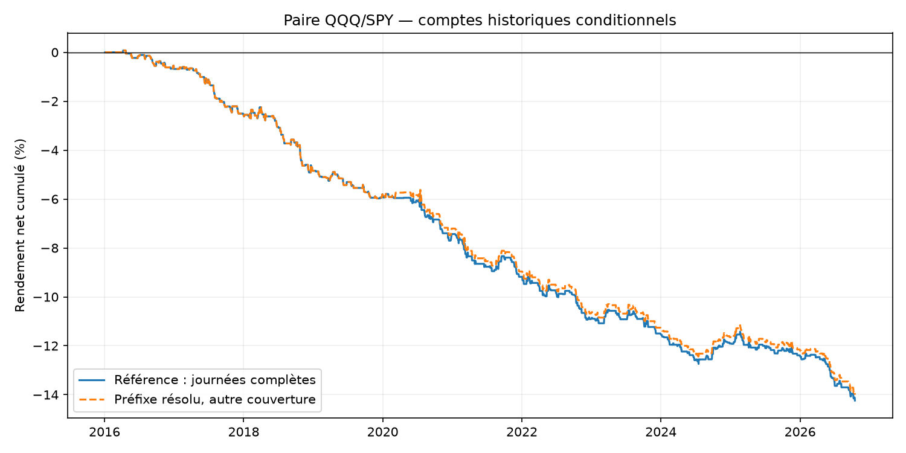
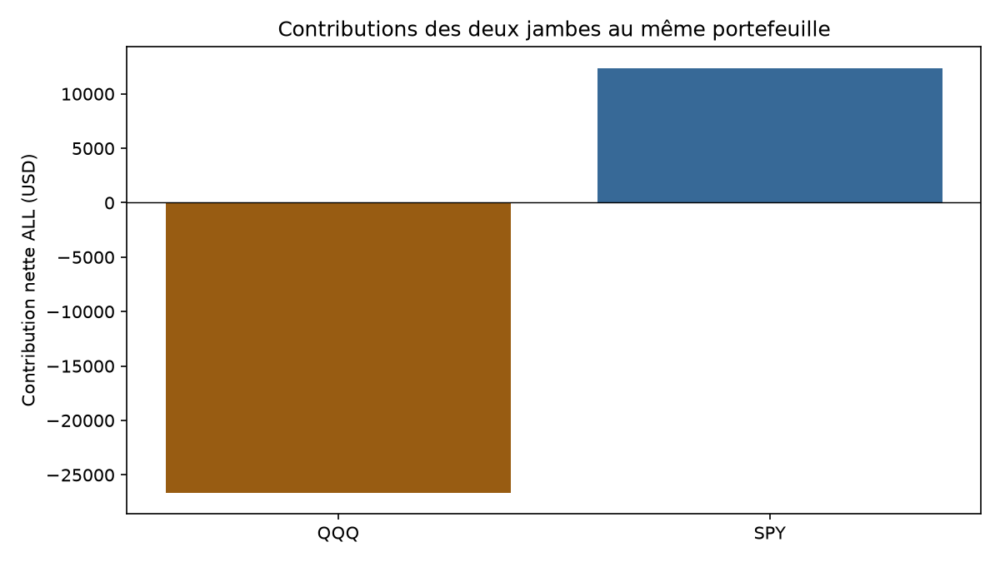
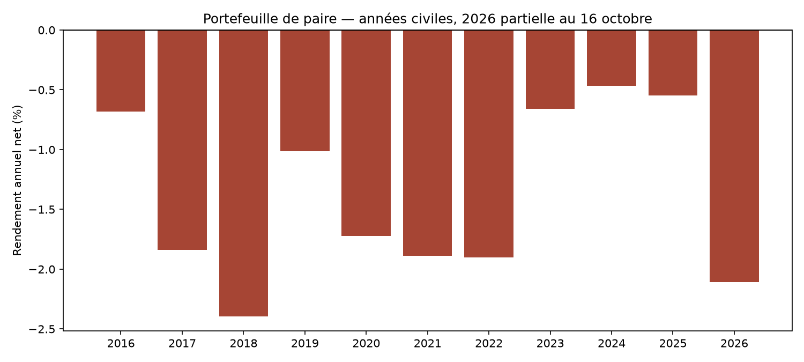
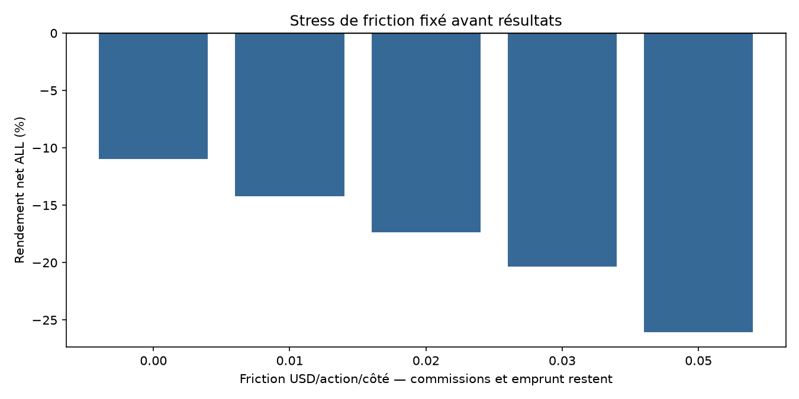

# Valeur relative intraday QQQ/SPY — rapport final

**Piste écartée pour un nouveau bot : critères fixés avant résultats non satisfaits.**

Un seul portefeuille initial de100000USD, deux jambes simultanées QQQ/SPY. Les contributions par actif ci-dessous ne sont pas deux stratégies ou deux comptes indépendants. Les bots Noise Area et ORB restent inchangés en simulation.

## Règles réellement testées

Écart des log-retours depuis l’open RTH du jour. Avant chaque séance, moyenne et écart-type échantillon du même créneau sur20séances passées, sans sauter une séance invalide ; demi-séances structurelles traitées selon le protocole. Première close5min entre10:00et14:30 où2<=abs(Z)<3 : acheter l’ETF relativement faible et vendre l’autre. Quantités entières figées aux closes, dollar-neutres approximativement, gross cap1x et proxy de risque cible1%. Entrée aux opens suivants.

Cible à la moyenne et stop3sigma fixés à la décision ; contrôle aux closes1minute, sortie aux opens suivants, EOD préprogrammé au dernier open15:59/12:59. Pas de stop intrabar garanti : gaps et mouvements entre closes peuvent dépasser la perte proxy. Une paire maximum/jour, pas de nuit ni de réentrée.

Commission0.0035USD/action/côté minimum0.35 pour chacun des quatre ordres ; friction0.01USD/action/côté ; emprunt SHORT1%annuel/360 minimum1jour sur valeur au fill. Les produits de short ne sont pas un profit réutilisé pour augmenter l’exposition. Référence cash sans intérêt0%.

## Résultats du portefeuille après frais

| Période | Paires | Jambes | Net % | CAGR % | Paires gagnantes % | PF | DD observé % | Sans top3 % |
|---|---|---|---|---|---|---|---|---|
| ALL | 539 | 1078 | -14.24 | -1.41 | 30.98 | 0.52 | 14.34 | -15.13 |
| A | 411 | 822 | -12.24 | -1.56 | 30.17 | 0.49 | 12.34 | -13.15 |
| B | 128 | 256 | -2.26 | -0.93 | 33.59 | 0.66 | 3.23 | -2.99 |

ALL2016-01-04–2026-10-16 ; A jusqu’au2024-04-30 ; B2024-05-01–2026-10-16. Chaque compte de période repart de100000USD. A et B ont déjà été étudiées ; aucun nouvel OOS aveugle. Comptes historiques conditionnels aux données résolues, pas portefeuille observé sans interruption.

## Attribution des coûts et des jambes

| Mouvement brut USD | Frictions USD | Commissions USD | Emprunt USD | Net USD | Pire paire USD | Levier réf max | Levier fill max | Risque proxy max % |
|---|---|---|---|---|---|---|---|---|
| -8786.18 | 3491.52 | 1271.40 | 688.94 | -14238.04 | -258.54 | 1.00 | 1.00 | 0.35 |

| Jambe | Mouvement USD | Friction USD | Commissions USD | Emprunt USD | Contribution nette USD |
|---|---|---|---|---|---|
| QQQ | -23504.99 | 2081.36 | 748.29 | 291.54 | -26626.18 |
| SPY | 14718.81 | 1410.16 | 523.11 | 397.40 | 12388.14 |

La somme des contributions nettes des deux jambes égale le résultat du portefeuille. Une jambe positive isolée ne constitue pas une stratégie ETF autonome. Les parts notionnelles ne sont pas parfaitement égales après arrondis ; ce hedge en dollars ne neutralise pas nécessairement le bêta ou le risque sectoriel.

## Sorties et calendrier

| Sortie | Paires ALL | Net USD |
|---|---|---|
| eod_open | 238 | 6921.58 |
| mean_cross | 21 | 4285.59 |
| spread_stop | 280 | -25445.21 |

## Sensibilités fixées avant PnL

| Période | Variante | Paires | Net % | PF | DD % |
|---|---|---|---|---|---|
| ALL | reference | 539 | -14.24 | 0.52 | 14.34 |
| ALL | cost_0.02 | 539 | -17.34 | 0.45 | 17.43 |
| ALL | cost_0.03 | 539 | -20.34 | 0.39 | 20.42 |
| ALL | cost_0.05 | 539 | -26.06 | 0.29 | 26.13 |
| ALL | z1.5 | 1009 | -21.81 | 0.61 | 21.95 |
| ALL | z2.5 | 280 | -4.21 | 0.64 | 4.57 |
| ALL | window10 | 733 | -15.61 | 0.58 | 15.68 |
| ALL | window40 | 445 | -8.13 | 0.68 | 8.51 |
| ALL | long_spread_only | 311 | -6.01 | 0.65 | 6.20 |
| ALL | short_spread_only | 228 | -8.68 | 0.37 | 8.73 |
| ALL | delay2 | 539 | -13.17 | 0.55 | 13.28 |
| ALL | cost_gate | 539 | -14.24 | 0.52 | 14.34 |
| ALL | resolved_prefix | 540 | -14.00 | 0.53 | 14.10 |
| ALL | friction_zero | 539 | -11.00 | 0.61 | 11.11 |
| A | reference | 411 | -12.24 | 0.49 | 12.34 |
| A | cost_0.02 | 411 | -15.02 | 0.42 | 15.11 |
| A | cost_0.03 | 411 | -17.76 | 0.35 | 17.84 |
| A | cost_0.05 | 411 | -22.99 | 0.25 | 23.05 |
| A | z1.5 | 781 | -18.60 | 0.59 | 18.84 |
| A | z2.5 | 219 | -3.14 | 0.67 | 3.29 |
| A | window10 | 569 | -11.84 | 0.60 | 11.91 |
| A | window40 | 343 | -6.58 | 0.67 | 6.84 |
| A | long_spread_only | 236 | -4.57 | 0.67 | 4.72 |
| A | short_spread_only | 175 | -7.97 | 0.29 | 7.99 |
| A | delay2 | 411 | -11.88 | 0.50 | 11.98 |
| A | cost_gate | 411 | -12.24 | 0.49 | 12.34 |
| A | resolved_prefix | 412 | -12.00 | 0.50 | 12.10 |
| A | friction_zero | 411 | -9.32 | 0.58 | 9.43 |
| B | reference | 128 | -2.26 | 0.66 | 3.23 |
| B | cost_0.02 | 128 | -2.66 | 0.62 | 3.46 |
| B | cost_0.03 | 128 | -3.09 | 0.57 | 3.73 |
| B | cost_0.05 | 128 | -3.95 | 0.49 | 4.25 |
| B | z1.5 | 228 | -3.80 | 0.72 | 3.97 |
| B | z2.5 | 61 | -1.09 | 0.53 | 1.40 |
| B | window10 | 164 | -4.27 | 0.49 | 4.44 |
| B | window40 | 102 | -1.65 | 0.69 | 2.65 |
| B | long_spread_only | 75 | -1.51 | 0.61 | 2.26 |
| B | short_spread_only | 53 | -0.77 | 0.72 | 1.18 |
| B | delay2 | 128 | -1.48 | 0.76 | 2.78 |
| B | cost_gate | 128 | -2.26 | 0.66 | 3.23 |
| B | resolved_prefix | 128 | -2.26 | 0.66 | 3.23 |
| B | friction_zero | 128 | -1.84 | 0.72 | 2.95 |

friction_zero conserve commissions et emprunt : ce n’est pas un scénario gratuit. cost_gate est un filtre causal basé sur un proxy de retour à la moyenne comparé à deux fois les coûts anticipés ; son absence d’effet éventuelle ne prouve pas les fills. Les comptes de sensibilités se chevauchent et aucune variante ne remplace après coup la référence.

## Incertitude et décision

| Période | IC95 moyen/jour bas, bps | IC95 haut, bps |
|---|---|---|
| ALL | -0.76 | -0.37 |
| A | -0.83 | -0.42 |
| B | -0.79 | 0.05 |

Bootstrap descriptif3000tirages, blocs circulaires5/20séances, seed20261031. Les jours exclus entrent comme zéros de chaînage, pas cash observé. Pas de correction de toutes les hypothèses antérieures ; IC conditionnels et histoire réutilisée.

| Critère avant résultats | Résultat |
|---|---|
| pairs_all_ge100 | passe |
| reference_A_B_ALL_positive | échoue |
| all_without_top3_positive | échoue |
| A_double_friction_positive | échoue |
| all_block20_ci_lower_positive | échoue |

Piste écartée pour un nouveau bot : critères fixés avant résultats non satisfaits.

## Couverture, preuve et limites

| Période | Jours exclus | Paires non résolues | Exposition RTH simulée % |
|---|---|---|---|
| ALL | 124 | 0 | 8.47 |
| A | 124 | 0 | 8.16 |
| B | 0 | 0 | 9.52 |

Replay scalaire indépendant :1972227contrôles,42scénarios,14638lignes de paires et29276jambes,75964lignes quotidiennes. Ces observations se chevauchent entre scénarios et périodes. L’oracle recalcule features, choix, deux fills, quatre frais, emprunt, comptes et DD sans appeler le moteur ; même source/chargeur, pas deuxième feed.

Le principal complete_days filtre la qualité de la journée courante connue après coup. resolved_prefix le retire mais conserve les prix nécessaires aux décisions et à la position ; un signal inconnu n’est pas sauté pour en chercher un autre favorable. Une paire non résolue est omise en entier, coûts d’entrée connus archivés. Le résultat n’est pas une performance continue certifiée sur les périodes exclues.

Fills aux deux opens simultanés hypothétiques : pas d’atomicité broker, carnet, quotes, liquidité, fills partiels ou risques de legging modélisés. delay2 retarde les deux jambes ensemble et ne simule pas une seule jambe bloquée. Taux et disponibilité réels d’emprunt non vérifiés ; spread/slippage réel peut excéder le modèle. Données historiques susceptibles de révisions, pas véritable archive point-in-time certifiée. DD aux marks observés, pas maximum de tick ; MAE/MFE excluent commissions et emprunt.

Aucune cointégration, vitesse de retour ou neutralité de marché n’est déduite de la corrélation des ETF. Cette adaptation diffère des sources Kalman, niveaux daily ou univers de paires sélectionnées ; aucun rendement externe reproduit.

## Accéder aux preuves

[42comptes](comparison_all.csv) · [Critères](SCREENING.json) · [Gel financier](PRE_EXECUTION_PROTOCOL.json) · [Données](DATA_SOURCE_PROFILE.json) · [Tests](TESTS.json) · [Audit](../../audit/AUDIT_RESULTS.json) · [Recherche](../../RESEARCH.md) · [Protocole](../../PROTOCOL_EXECUTION.md). Exports de chaque compte : daily, trades de paire, legs, unresolved, by_year et summary. Historiques minute complets et clés restent locaux. Aucun nouveau bot ni ordre réel.
