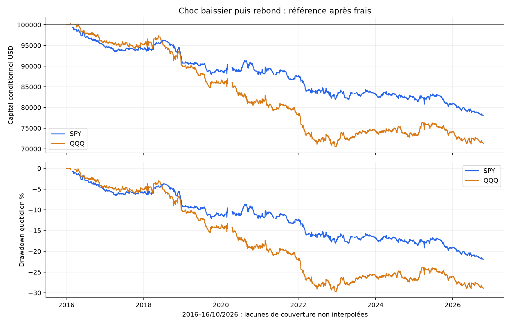
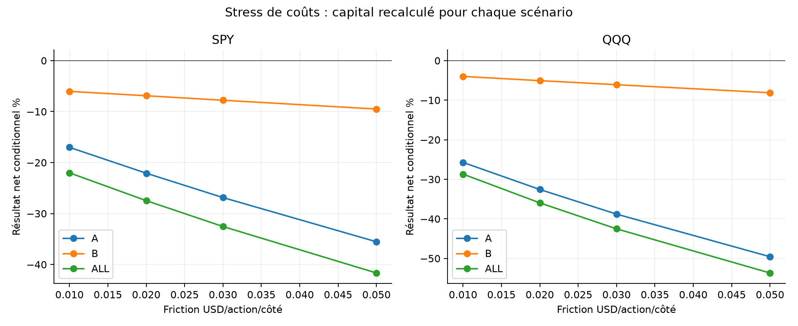
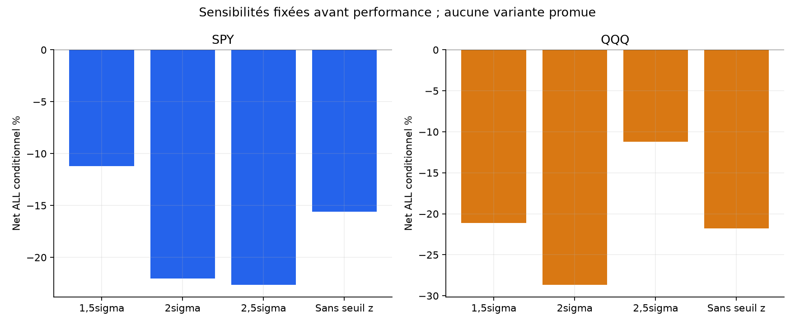
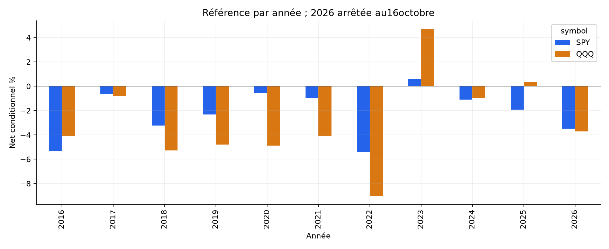

# Rebond après choc intraday — rapport SPY / QQQ

Les critères historiques prédéfinis ne passent pas. Cette formalisation ne justifie pas un nouveau bot.

Capital100000USD indépendant par scénario. ALL4janvier2016–16octobre2026 ; A jusqu’au30avril2024 ; B1mai2024–16octobre2026. B et ces ETF déjà explorés : aucun nouveau OOS aveugle.

## Recherche élargie et limites des sources

Publications arXiv/articles académiques, recherches quantitatives, forums et GitHub comparés. Retenir une adaptation de réversion après choc, sans reprendre de rendement tiers. Les travaux SPY NBBO/event-time ou sur actions ne démontrent pas la rentabilité de notre règle clock-time sur deux ETF. Paires/lead-lag : stabilité/vitesse/coûts ; améliorations ORB à règles payantes : pas de fausse réplication ; IBS overnight : hors day trading. [Recherche détaillée](../../RESEARCH.md).

## Règles figées avant PnL

LONG seulement. Tous les5minutes dès09:59, rendement log(close/open) des30minutes écoulées. Moyenne et sigma ddof1 sur20séances précédentes à même heure. Ignorer uniquement une fermeture structurelle, jamais une donnée manquante. Les30minutes OHLC de chaque rendement doivent être cohérentes. Moins de20séances=>chauffe connue ; historique nécessaire troué=>inconnu ; sigma≤1e-12=>pas de choc exploitable. Aucun paramètre estimé avec le futur.

Rendement négatif et z≤−2 (tolérance1e-10), puis confirmation5minutes immédiatement suivante, close>open et>closeChoc. Premier couple admissible seulement ; une fenêtre inconnue antérieure ne devient pas arbitrairement un non-signal. Confirmation lue seulement après un choc admissible.

Entrée open minute suivante, dès10:05, au plus tard60minutes avant clôture incluse (15:00/12:00). Stop min(choc,confirmation)−0,01USD arrondi vers le bas. Quantité au close du signal : risque cible1%, plafond1x, frais exclus. Gap futur peut dépasser ces plafonds ; aucune annulation rétroactive. TP2R depuis open d’entrée observé, arrondi vers l’entrée. Stop prioritaire si SL/TP ensemble ; gap stop au mauvais open, gap TP sans amélioration. EOD dernier open15:59/12:59 avant sa mèche. Aucun overnight, trailing, RSI, VWAP ou EMA. [Protocole complet](../../PROTOCOL_EXECUTION.md).

## Référence après les mêmes frais

| ETF | Période | Trades | Net cumulé % | CAGR % | PF | WR % | DD marks % | Sans top3 % |
| --- | --- | --- | --- | --- | --- | --- | --- | --- |
| SPY | ALL | 1290 | -22.02 | -2.28 | 0.811 | 31.71 | 22.19 | -25.22 |
| SPY | A | 993 | -17.02 | -2.22 | 0.813 | 32.02 | 18.27 | -20.34 |
| SPY | B | 297 | -6.03 | -2.50 | 0.804 | 30.64 | 6.55 | -8.82 |
| QQQ | ALL | 1319 | -28.69 | -3.09 | 0.807 | 31.77 | 29.80 | -31.99 |
| QQQ | A | 1013 | -25.73 | -3.51 | 0.781 | 31.89 | 29.80 | -29.17 |
| QQQ | B | 306 | -4.00 | -1.64 | 0.903 | 31.37 | 7.04 | -7.95 |

Comptes conditionnels aux données résolues ; CAGR sur période nominale chauffe comprise. DD aux frais d’entrée, closes1minute entièrement détenus et sortie nette, sans borne de tous les ticks. DD quotidien graphique moins fin. ETF corrélés, pas deux preuves indépendantes ; aucun avantage sur le passif à exposition comparable revendiqué, cash0%.

## Frais et attribution

Commission0,0035USD/action/côté minimum0,35 ; friction adverse0,01USD/action/côté ; empruntSHORT1%annuel/360 minimum1jour seulement miroir SHORT. Friction comprise dans les fills puis attribuée une seule fois. Modèle commun, pas tarif broker garanti ; spreads lors des chocs et frais variables non observés.

| ETF | Période | Prix USD | Friction USD | Commission USD | Emprunt USD | Net USD | Exposition RTH bornehaute % |
| --- | --- | --- | --- | --- | --- | --- | --- |
| SPY | ALL | -13241.19 | 6500.64 | 2275.22 | 0.00 | -22017.06 | 4.82 |
| SPY | A | -9276.11 | 5733.14 | 2006.60 | 0.00 | -17015.85 | 4.83 |
| SPY | B | -4785.32 | 925.10 | 323.79 | 0.00 | -6034.21 | 4.79 |
| QQQ | ALL | -16042.70 | 9367.94 | 3279.20 | 0.00 | -28689.84 | 5.19 |
| QQQ | A | -14181.13 | 8555.78 | 2994.52 | 0.00 | -25731.44 | 5.11 |
| QQQ | B | -2520.15 | 1094.58 | 383.10 | 0.00 | -3997.83 | 5.45 |

## Sensibilités fixées et contrôles

| Variante ALL : trades/net%/PF | SPY | QQQ |
| --- | --- | --- |
| reference | 1290 / -22.02 / 0.811 | 1319 / -28.69 / 0.807 |
| cost_0.02 | 1290 / -27.47 / 0.763 | 1319 / -35.96 / 0.751 |
| cost_0.03 | 1290 / -32.55 / 0.718 | 1319 / -42.52 / 0.699 |
| cost_0.05 | 1290 / -41.66 / 0.634 | 1319 / -53.68 / 0.601 |
| z1.5 | 1795 / -11.22 / 0.928 | 1842 / -21.11 / 0.892 |
| z2.5 | 896 / -22.67 / 0.749 | 891 / -11.19 / 0.905 |
| rr1 | 1290 / -16.82 / 0.822 | 1319 / -23.75 / 0.800 |
| rr3 | 1290 / -23.63 / 0.813 | 1319 / -22.47 / 0.863 |
| no_confirmation | 1404 / -17.87 / 0.660 | 1429 / -27.30 / 0.615 |
| no_z_filter | 2651 / -15.60 / 0.935 | 2666 / -21.79 / 0.932 |
| short_mirror | 1100 / -24.14 / 0.746 | 1111 / -6.70 / 0.946 |
| resolved_prefix | 1292 / -22.26 / 0.810 | 1320 / -29.09 / 0.804 |

12variantes ×2ETF ×3périodes=72comptes recouvrants. Coûts0,02/0,03/0,05, seuil1,5/2,5sigma, TP1R/3R, sans confirmation, sans filtre z, miroir SHORT et prefix. Sans z conserve r<0, confirmation et disponibilité de baseline ; ce n’est pas un contrôle causal à exposition identique. Sans confirmation entre dès10:00 avec stop30minutes seul. SHORT miroir : r>0,z≥+2, confirmation baissière et stop high+0,01. Comptes composés séparément. [Tous les scénarios](comparison_all.csv), aucune variante promue après PnL.

## Critères de présélection déclarés

| Critère avant PnL | Passe |
| --- | --- |
| min100trades_ALL | oui |
| six_references_positive | non |
| sans_top3_ALL_positive | non |
| doubled_friction_A_positive | non |
| block20_ALL_lower_positive | non |

Exiger ≥100trades ALL/ETF, six références positives, ALL sans top3 positif, A à friction doublée positive et bornes basses IC95 blocs20 ALL>0 sur les deux ETF. Un passage resterait une présélection historique, pas preuve prospective ni activation automatique.

## Couverture et provenance

Mêmes archives SIP/préparations vérifiées SHA, calendrier NYSE et rapprochement corporate actions.2714séances préparées dont padding2015-12-31,2713évaluées. SPY2705/QQQ2707complètes dans le cache total. Trous, notamment en2020 ; pas de deuxième flux ni interpolation. [Profil source](DATA_SOURCE_PROFILE.json).

Rendements entièrement intraday, invariants à l’échelle de chaque séance : aucun raccord entre ancien prix non ajusté et niveau courant, aucun dividende crédité au compte flat overnight. Les20séances passées sont choisies par horaire ouvert, sans filtre futur de qualité de journée entière. Une lacune historique peut donc empêcher des décisions durant20séances suivantes à cette heure.

complete_days applique après coup la qualité OHLCV courante après premier signal, biais potentiel. Prefix la retire mais reste conditionnel : fenêtre/historique/confirmation nécessaire inconnu avant signal=>journée inconnue ; trou actif=>trade entier non résolu, frais d’entrée connus exportés. Zéro de chaînage n’est pas cash observé. Chauffe initiale/sigma nul sont connus sans ordre. Données inutiles après signal ou sortie ne l’annulent pas.

| ETF | Période | Exclues principal | Trades principal | Net principal % | Trades prefix | Non résolues | Net prefix % |
| --- | --- | --- | --- | --- | --- | --- | --- |
| SPY | ALL | 72 | 1290 | -22.02 | 1292 | 1 | -22.26 |
| SPY | A | 72 | 993 | -17.02 | 995 | 1 | -17.28 |
| SPY | B | 0 | 297 | -6.03 | 297 | 0 | -6.03 |
| QQQ | ALL | 58 | 1319 | -28.69 | 1320 | 0 | -29.09 |
| QQQ | A | 58 | 1013 | -25.73 | 1014 | 0 | -26.14 |
| QQQ | B | 0 | 306 | -4.00 | 306 | 0 | -4.00 |

## Incertitude et concentration

Bootstrap descriptif3000tirages seed20261026, blocs circulaires5/20séances et clusters annuels. Exclusions au zéro de chaînage, données non reconstruites, peu de clusters et essais multiples non corrigés.

| ETF | Période | IC95 moyenne quotidienne %, blocs5 | Blocs20 | IC95 bps/trade, années |
| --- | --- | --- | --- | --- |
| SPY | ALL | [-0.0151 ; -0.0029] | [-0.0151 ; -0.0030] | [-3.0329676424190932, -1.1341455087929497] |
| SPY | A | [-0.0159 ; -0.0014] | [-0.0163 ; -0.0018] | [-3.2021347513148557, -0.8957731150743983] |
| SPY | B | [-0.0220 ; 0.0025] | [-0.0198 ; 0.0005] | [-3.5121174270410354, -0.8358162347637181] |
| QQQ | ALL | [-0.0204 ; -0.0040] | [-0.0201 ; -0.0042] | [-4.400495756647545, -0.8565378687365418] |
| QQQ | A | [-0.0228 ; -0.0046] | [-0.0237 ; -0.0053] | [-5.001390174167289, -0.7467047366013003] |
| QQQ | B | [-0.0246 ; 0.0126] | [-0.0224 ; 0.0107] | [-3.6164463926171275, -0.199583526154733] |

| ETF | Période | Sans top3 % | Sans2020 % | Pertes consécutives max |
| --- | --- | --- | --- | --- |
| SPY | ALL | -25.22 | -21.61 | 16 |
| SPY | A | -20.34 | -16.58 | 16 |
| SPY | B | -8.82 | -6.03 | 10 |
| QQQ | ALL | -31.99 | -25.02 | 15 |
| QQQ | A | -29.17 | -21.91 | 14 |
| QQQ | B | -7.95 | -4.00 | 15 |

Ablations : rendements concernés mis à zéro dans le compte original, sans nouveau sizing. Années/mois/directions, qualité, premières décisions par variante et chaque trade exportés.

## Figures

## Validation et limites

[Tests, revue et replay](../../VALIDATION.md). Code/tests/rapport/audit/dépendances gelés avant PnL. Moteur : rolling pandas décalé ; audit : deque des20séances ouvertes et NumPy, puis replay scalaire de chaque décision, fill et compte sans appeler le moteur. Même chargeur/source : pas de réplication sur un deuxième fournisseur.

Limites : adaptation clock-time de travaux NBBO/event-time/actions ; quotes/carnet absents, ticks non ordonnés dans la minute, élargissement de spread lors du choc non reconstruit, coûts fixes/shorts non garantis, couverture incomplète et choix d’hypothèse sur des marchés déjà explorés. Aucun nouveau holdout aveugle.

Les critères historiques prédéfinis ne passent pas. Cette formalisation ne justifie pas un nouveau bot. Les deux bots QQQ existants restent inchangés, aucun nouveau bot ou ordre réel.
