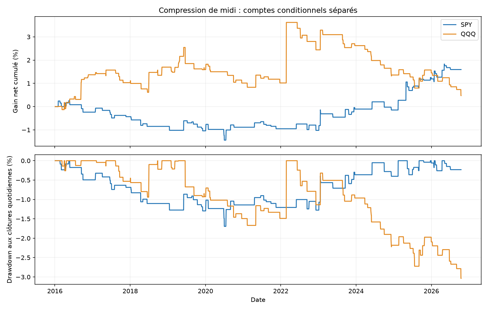
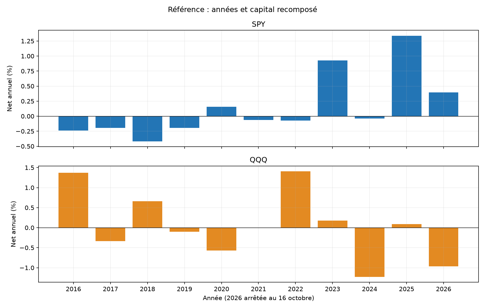
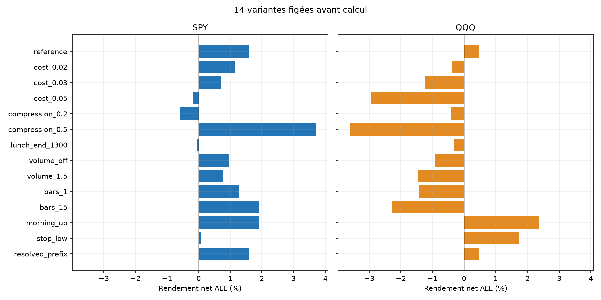
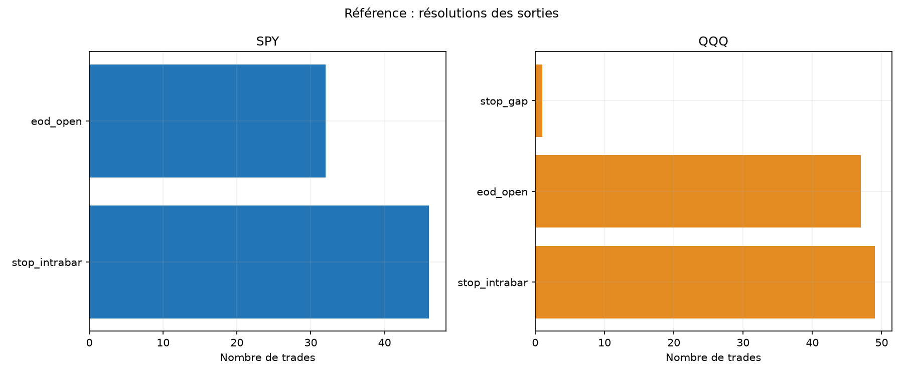

# Compression de midi, cassure après 13 h — SPY et QQQ

Calcul du 31 octobre 2026, historique du 4 janvier 2016 au 16 octobre 2026. Deux comptes indépendants de 100 000 USD. Piste écartée pour un nouveau bot : les critères fixés avant les résultats ne sont pas tous satisfaits.

## Hypothèse et sources

Tester une reprise après une consolidation de midi étroite : le range de 11:30–12:30 doit mesurer moins de 30 % de celui de 09:30–11:30. Attendre ensuite une nouvelle cassure avec volume après 13 h. Aucun résultat public n’est repris comme résultat du dépôt.

[TOSIndicators, setup2](https://tosindicators.com/research/lunch-trading) décrit cette famille et un stop au milieu de la zone. Sa discussion ne définit pas chaque détail et change parfois de fenêtre. Notre version LONG seule, traversée par closes, première candidate consommée, ratio de volume, délai et taille sont des choix propres, figés avant PnL. Ce n’est pas une réplication certifiée. [Recherche élargie et contrepoints](../../RESEARCH.md).

## Règles et mêmes frais

Range matin : max high−min low, minutes 0:120. Range midi : minutes 120:180, soit 11:30–12:30 exclue. Tous les OHLCV de ce contexte doivent être valides. Ranges quantifiés à 1e−8 ; ratio strictement inférieur à 0,30, égalité insuffisante. Niveau = highMidi au cent supérieur ; stop = milieu highMidi/lowMidi au cent inférieur.

Bougies 5 minutes alignées à 09:30. Première traversée terminée après 13:00 jusqu’à 14:30 incluse : close>niveau ET close de la bougie précédente<=niveau. Déjà au-dessus à 13:00 sans nouveau croisement ne suffit pas. Volume par minute de cette bougie strictement supérieur à la moyenne par minute du midi. La première candidate est consommée même si le volume est insuffisant ; aucun deuxième essai choisi.

Première décision possible 13:05, achat au marché à l’open 13:06, une minute de délai après décision. Quantité entière calculée avant le fill = min(capital/close signal, budget 1 %/(close signal−stop)). Objectifs 1× et 1 % avant frais et gap ; pas de resize au prix futur. Tous les OHLCV depuis l’ouverture au signal sont requis, y compris l’attente 12:30–13:00.

Une transaction LONG maximum par jour, aucun TP/trailing/break-even. Stop actif immédiatement : gap sous stop => sortie au mauvais open, y compris entrée déjà sous stop avec tous les coûts ; sinon low touchant stop => sortie au niveau. Sortie sinon à open 15:59 ; ses mèches ne sont pas détenues. Journées de 210 minutes sans entrée.

Commission 0,0035 USD/action/côté, minimum 0,35 USD. Friction adverse 0,01 USD/action/côté ajoutée à l’entrée et retirée à la sortie ; stresses 0,02/0,03/0,05. Coûts comptés exactement une fois. Long seul, emprunt nul, cash sans intérêt. Financement, fiscalité, quotes/partiels/rejets et latence variable hors modèle.

## Référence : A, B et ALL

| ETF | Période | Trades | Net % | Annualisé % | PF | Gagnants % | DD minute observé % |
|---|---|---|---|---|---|---|---|
| SPY | ALL | 78 | 1.59 | 0.15 | 1.27 | 38.46 | 2.14 |
| SPY | A | 55 | -0.11 | -0.01 | 0.98 | 36.36 | 2.14 |
| SPY | B | 23 | 1.70 | 0.69 | 2.11 | 43.48 | 0.55 |
| QQQ | ALL | 97 | 0.47 | 0.04 | 1.05 | 38.14 | 3.73 |
| QQQ | A | 71 | 2.36 | 0.28 | 1.34 | 43.66 | 1.92 |
| QQQ | B | 26 | -1.85 | -0.76 | 0.41 | 23.08 | 1.91 |

ALL commence le 4 janvier 2016 ; A s’arrête au 30 avril 2024 ; B va du 1er mai 2024 au 16 octobre 2026. Comptes remis à 100 000 USD séparément. A/B déjà réutilisées : aucun nouvel OOS aveugle. Deux ETF corrélés, pas deux preuves indépendantes. Un faible nombre de trades reste insuffisant, même sur dix ans.

## Période récente : coûts et concentration

| ETF | Variante B | Net B % | PF B | B sans top3 % |
|---|---|---|---|---|
| SPY | reference | 1.70 | 2.11 | 0.03 |
| SPY | cost_0.02 | 1.63 | 2.04 | -0.03 |
| QQQ | reference | -1.85 | 0.41 | -2.73 |
| QQQ | cost_0.02 | -1.94 | 0.40 | -2.81 |

Ces diagnostics ne déplacent pas les critères : top3 et IC étaient exigés sur ALL, friction doublée sur A. Une variante plus permissive comptant davantage de trades n’est pas substituée après observation à la référence trop sélective.

## Coûts, pertes et risque

| ETF | Prix USD | Friction USD | Commissions USD | Net USD | Sans top3 % | Top3/gains % | Pire trade USD | Pire MAE prix USD | Temps RTH comptabilisé % |
|---|---|---|---|---|---|---|---|---|---|
| SPY | 2181.46 | 435.30 | 152.35 | 1593.81 | -0.33 | 25.29 | -254.15 | -327.60 | 0.66 |
| QQQ | 1655.26 | 875.98 | 306.59 | 472.69 | -3.67 | 40.06 | -693.05 | -776.54 | 0.90 |

Décomposition selon les quantités originales du compte net, pas portefeuille gratuit recalculé. Sans top3 = mettre les rendements de ces jours à zéro sans nouvelles quantités. DD aux coûts d’entrée, closes entièrement détenus et sortie nette ; pas pire tick. MAE/MFE prix incluent fills et extrêmes entièrement détenus, pas commissions ni mèches de sortie. Minute du stop intrabar en durée supérieure ; le temps enregistré ne certifie pas le temps inconnu des exclusions.

## Toutes les sensibilités figées

| ETF | Variante | Trades | Net % | PF | DD minute % |
|---|---|---|---|---|---|
| SPY | reference | 78 | 1.59 | 1.27 | 2.14 |
| SPY | cost_0.02 | 78 | 1.15 | 1.18 | 2.39 |
| SPY | cost_0.03 | 78 | 0.71 | 1.11 | 2.64 |
| SPY | cost_0.05 | 78 | -0.17 | 0.98 | 3.14 |
| SPY | compression_0.2 | 11 | -0.57 | 0.41 | 0.80 |
| SPY | compression_0.5 | 299 | 3.71 | 1.12 | 3.73 |
| SPY | lunch_end_1300 | 53 | -0.05 | 0.99 | 1.86 |
| SPY | volume_off | 143 | 0.95 | 1.08 | 4.75 |
| SPY | volume_1.5 | 31 | 0.79 | 1.38 | 1.30 |
| SPY | bars_1 | 98 | 1.27 | 1.18 | 2.83 |
| SPY | bars_15 | 57 | 1.91 | 1.41 | 1.96 |
| SPY | morning_up | 58 | 1.90 | 1.46 | 1.53 |
| SPY | stop_low | 78 | 0.09 | 1.01 | 2.19 |
| SPY | resolved_prefix | 78 | 1.59 | 1.27 | 2.14 |
| QQQ | reference | 97 | 0.47 | 1.05 | 3.73 |
| QQQ | cost_0.02 | 97 | -0.39 | 0.96 | 3.90 |
| QQQ | cost_0.03 | 97 | -1.25 | 0.89 | 4.06 |
| QQQ | cost_0.05 | 97 | -2.94 | 0.75 | 4.38 |
| QQQ | compression_0.2 | 16 | -0.42 | 0.64 | 1.08 |
| QQQ | compression_0.5 | 295 | -3.62 | 0.91 | 6.51 |
| QQQ | lunch_end_1300 | 81 | -0.32 | 0.97 | 3.28 |
| QQQ | volume_off | 226 | -0.93 | 0.96 | 5.38 |
| QQQ | volume_1.5 | 43 | -1.46 | 0.69 | 2.51 |
| QQQ | bars_1 | 139 | -1.41 | 0.90 | 4.08 |
| QQQ | bars_15 | 73 | -2.28 | 0.72 | 4.27 |
| QQQ | morning_up | 64 | 2.37 | 1.39 | 1.66 |
| QQQ | stop_low | 97 | 1.73 | 1.17 | 4.20 |
| QQQ | resolved_prefix | 97 | 0.47 | 1.05 | 3.73 |

14 variantes × 2 ETF × 3 périodes = 84 comptes. Compression 0,20/0,50 ; fin du midi 13:00 ; volume désactivé ou multiplicateur 1,5 ; grilles 1/15 minutes ; matin haussier ; stop au lowMidi ; resolved_prefix et stresses de coûts. Une dimension à la fois. Même fin 14:30 ; premières décisions selon la grille 13:01/13:05/13:15. Aucun nouveau gagnant promu après calcul.

Comptes ALL positifs : SPY/reference +1.59 %; SPY/cost_0.02 +1.15 %; SPY/cost_0.03 +0.71 %; SPY/compression_0.5 +3.71 %; SPY/volume_off +0.95 %; SPY/volume_1.5 +0.79 %; SPY/bars_1 +1.27 %; SPY/bars_15 +1.91 %; SPY/morning_up +1.90 %; SPY/stop_low +0.09 %; SPY/resolved_prefix +1.59 %; QQQ/reference +0.47 %; QQQ/morning_up +2.37 %; QQQ/stop_low +1.73 %; QQQ/resolved_prefix +0.47 %. Ces chiffres restent des sensibilités exploratoires, pas une sélection corrigée des essais multiples.

## Incertitude et critères avant PnL

| ETF | Période | IC95 bas quotidien bps | IC95 haut bps |
|---|---|---|---|
| SPY | ALL | -0.06 | 0.20 |
| SPY | A | -0.13 | 0.12 |
| SPY | B | -0.05 | 0.64 |
| QQQ | ALL | -0.20 | 0.29 |
| QQQ | A | -0.15 | 0.46 |
| QQQ | B | -0.62 | 0.01 |

Bootstrap descriptif : 3 000 tirages seed 20261031, blocs circulaires 5/20 séances et clusters annuels. Jours exclus au zéro du chaînage. Les IC ne corrigent ni les nombreuses stratégies testées ici ni les choix de la source. La rareté des setups réduit fortement la précision.

| ETF | >=100 ALL | Références A/B/ALL positives | Sans top3 positif | A friction doublée positive | IC95 blocs20 bas>0 |
|---|---|---|---|---|---|
| SPY | échoue | échoue | échoue | échoue | échoue |
| QQQ | échoue | échoue | échoue | passe | échoue |

## Couverture et validation

| ETF | Période | Séances inconnues/exclues | Trades non résolus | Levier max fill | Risque net stop modélisé max % |
|---|---|---|---|---|---|
| SPY | ALL | 6 | 0 | 1.0003 | 0.65 |
| SPY | A | 6 | 0 | 1.0003 | 0.65 |
| SPY | B | 0 | 0 | 1.0003 | 0.35 |
| QQQ | ALL | 5 | 0 | 1.0008 | 0.87 |
| QQQ | A | 5 | 0 | 1.0008 | 0.87 |
| QQQ | B | 0 | 0 | 0.9985 | 0.86 |

Le contexte et le scan doivent être connus sans trous. Les highs/lows post-midi ne changent pas les niveaux et une lacune future ne modifie pas le signal passé. Ensuite complete_days impose la journée entière : filtre futur de disponibilité, performance explicitement conditionnelle, pas portefeuille continu observé. resolved_prefix retire ce filtre ; issue active inconnue omet le trade entier et archive les coûts d’entrée connus, observed_return manquant. Zéro comptable d’une exclusion n’est pas une journée de cash observée.

| ETF | Sortie | Trades |
|---|---|---|
| SPY | stop_intrabar | 46 |
| SPY | eod_open | 32 |
| QQQ | stop_intrabar | 49 |
| QQQ | eod_open | 47 |
| QQQ | stop_gap | 1 |

51 tests passent ; oracle scalaire : 7,177,660 contrôles, 84 comptes, 5,474 lignes de trades et 151,928 lignes quotidiennes recouvrantes. 864 vérifications agrégées et six références bootstrap blocs5/20 reproduites. Variantes/périodes se recouvrent ; ces lignes ne sont pas indépendantes.

Sources SIP/calendrier XNYS/caches/acquisitions vérifiés par empreintes. L’oracle recalcule contexte, traversée, volume et ledger sans importer le moteur/statistiques, mais partage le fournisseur et le chargeur : pas deuxième source. Les notes héritées de rapprochement dividendes concernent l’étude originale ; ici prix bruts, sans cet ajustement. Aucun split renvoyé dans l’acquisition archivée, complétude non certifiée ; prix révisables et absence de carnet/ticks. Aucun fill réel démontré.

## Décision

Piste écartée pour un nouveau bot : les critères fixés avant les résultats ne sont pas tous satisfaits. Aucun nouveau bot ni passage au réel. Les deux simulations Noise Area et ORB restent inchangées par cette étude. Les risques/expositions diffèrent : pas de classement sur rendement brut seul.

[84 comptes](comparison_all.csv) · [Critères](SCREENING.json) · [Gel avant PnL](PRE_EXECUTION_PROTOCOL.json) · [Source](DATA_SOURCE_PROFILE.json) · [Tests](TESTS.json) · [Audit](../../audit/AUDIT_RESULTS.json) · [Agrégats](../../audit/ADDITIONAL_CHECKS.json) · [Protocole](../../PROTOCOL_EXECUTION.md) · [Reproduction](../../README.md). Trades/daily/unresolved/by_year/summary par compte, features/gaps par ETF, snapshots et manifest. Archives brutes et secrets exclus de Git.
