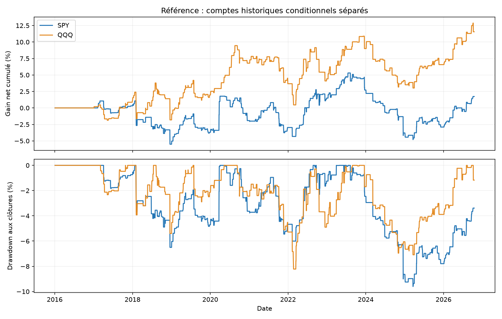
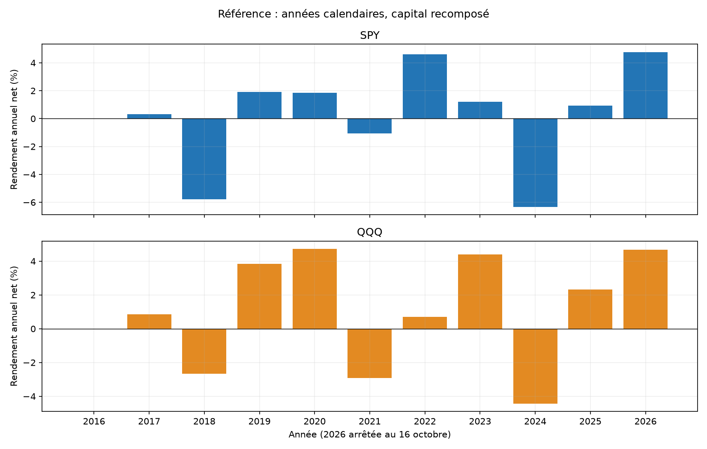
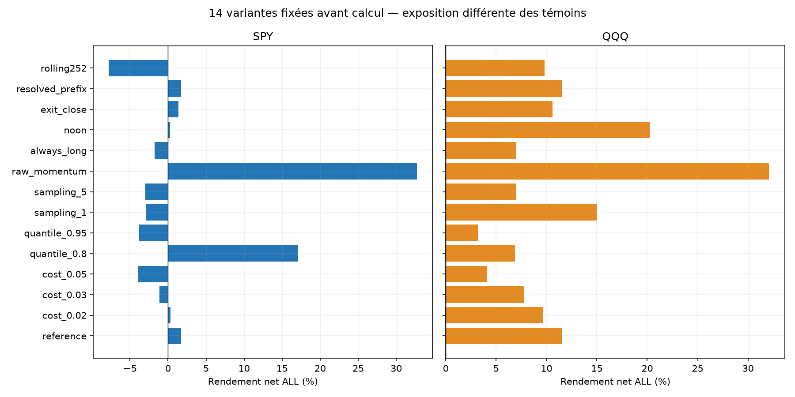
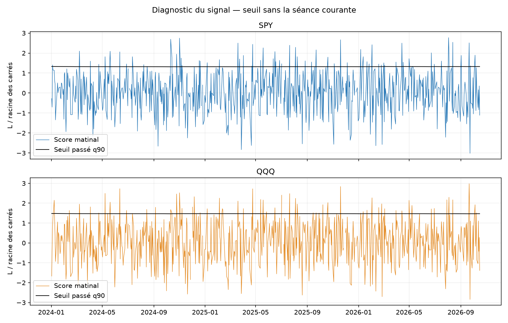

# Momentum matinal normalisé par la variation — résultats SPY/QQQ

Calcul du 31 octobre 2026, historique2016-01-04–2026-10-16. Deux comptes indépendants de 100 000 USD, LONG seulement, plafond causal de 1× hors frais. Piste écartée pour un nouveau bot : au moins un critère fixé avant les résultats échoue.

## Règle et recherche

Le score de première heure est L/V : log(close10:29/open09:30), divisé par la racine de la somme des retours logarithmiques sur 2 minutes au carré. Achat si score au-dessus du quantile 90 % des matinées antérieures admissibles, minimum 252. Signal à 10:30 New York, quantité floor(capital/close10:29), entrée à l’open de 10:31, sortie à l’open de 15:59, aucune nuit ni stop. Le ratio n’est ni Sharpe ni prévision en sigmas. Tous les OHLCV du matin sont exigés ; seuls les créneaux échantillonnés entrent dans V.

[SharpeTwo, source primaire](https://sharpetwo.com/research/spys-quiet-rally-what-happens-after-a-big-move-with-little-volatility) propose cette famille sur quote-midpoints et panier large. Notre adaptation ne réplique ni ce panier ni les performances gross publiées. Différences matérielles : tradebarsSIP, SPY/QQQ séparés, quantile expanding précisément défini ici et sortie à l’open de 15:59. [Recherche Web lisible, alternatives et statut des accès](../../RESEARCH_READABLE.md).

## Frais et risque

Commission 0,0035 USD/action/côté, minimum 0,35 USD, plus friction adverse 0,01 USD/action/côté ; doublement et stress 0,03/0,05 USD testés. Friction incluse aux fills une seule fois ; LONG donc emprunt 0. Cash sans intérêt. Hypothèses communes aux études antérieures, pas un tarif broker certifié.

Le notionnel est de 1× avant frais, sans stop ni cible de perte 1 %. Un gap au fill peut dépasser 1× ; pas de redimensionnement rétrospectif. Les risques et l’exposition diffèrent des bots Noise Area 4×/ORB 1× avec stops. Ne pas classer ces stratégies sur le seul rendement brut.

## Référence : comptes séparés A, B et ALL

| ETF | Période | Trades | Net % | CAGR % | PF | Gagnants % | DD minute observé % | DD clôture % |
|---|---|---|---|---|---|---|---|---|
| SPY | ALL | 273 | 1.74 | 0.16 | 1.03 | 59.34 | 10.00 | 9.60 |
| SPY | A | 209 | 0.88 | 0.11 | 1.02 | 58.37 | 8.04 | 6.50 |
| SPY | B | 64 | 0.87 | 0.35 | 1.07 | 62.50 | 6.10 | 5.75 |
| QQQ | ALL | 230 | 11.55 | 1.02 | 1.19 | 60.43 | 10.63 | 8.22 |
| QQQ | A | 171 | 7.16 | 0.83 | 1.15 | 59.65 | 10.63 | 8.22 |
| QQQ | B | 59 | 4.10 | 1.65 | 1.38 | 62.71 | 4.75 | 4.08 |

A va jusqu’au 30 avril 2024 ; B du 1er mai 2024 au 16 octobre 2026. Chaque compte repart de 100 000 USD. B et A ont déjà servi aux recherches précédentes : aucune nouvelle période OOS aveugle. Le warmup initial explique de la non-exposition en2016 ; aucune donnée antérieure inventée.

## Décomposition des coûts, pertes et concentration

| ETF | Mouvement de prix USD | Friction USD | Commission USD | Emprunt USD | Net USD | Sans top3 % | Top3/gains % | Pire trade USD | Pire MAE prix USD | Exposition RTH % |
|---|---|---|---|---|---|---|---|---|---|---|
| SPY | 3664.88 | 1428.50 | 499.98 | 0.00 | 1736.40 | -3.82 | 9.59 | -3732.10 | -4472.52 | 8.49 |
| QQQ | 13959.12 | 1782.36 | 623.83 | 0.00 | 11552.94 | 6.27 | 7.22 | -4019.22 | -4521.66 | 7.16 |

Sans top3 signifie mise à zéro de ces retours sur la trajectoire initiale, sans recalcul des quantités ultérieures. MAE/MFE de prix utilisent les fills après friction et les extrêmes entièrement détenus, hors commissions. DD aux marks d’entrée, closes minute détenus et sortie nette ; ni pire tick ni garantie de perte maximale.

## Sensibilités et témoins

| ETF | Variante | Trades | Net % | PF | DD minute % |
|---|---|---|---|---|---|
| SPY | reference | 273 | 1.74 | 1.03 | 10.00 |
| SPY | cost_0.02 | 273 | 0.29 | 1.01 | 10.10 |
| SPY | cost_0.03 | 273 | -1.15 | 0.98 | 10.22 |
| SPY | cost_0.05 | 273 | -3.95 | 0.93 | 10.88 |
| SPY | quantile_0.8 | 495 | 17.09 | 1.17 | 8.55 |
| SPY | quantile_0.95 | 138 | -3.81 | 0.87 | 8.88 |
| SPY | sampling_1 | 285 | -2.91 | 0.95 | 9.24 |
| SPY | sampling_5 | 277 | -3.00 | 0.95 | 10.26 |
| SPY | raw_momentum | 298 | 32.75 | 1.41 | 8.65 |
| SPY | always_long | 2433 | -1.78 | 1.00 | 25.43 |
| SPY | noon | 263 | 0.27 | 1.01 | 9.27 |
| SPY | exit_close | 273 | 1.35 | 1.02 | 9.58 |
| SPY | resolved_prefix | 273 | 1.74 | 1.03 | 10.00 |
| SPY | rolling252 | 247 | -7.81 | 0.85 | 14.94 |
| QQQ | reference | 230 | 11.55 | 1.19 | 10.63 |
| QQQ | cost_0.02 | 230 | 9.67 | 1.16 | 10.82 |
| QQQ | cost_0.03 | 230 | 7.76 | 1.13 | 11.02 |
| QQQ | cost_0.05 | 230 | 4.13 | 1.07 | 11.42 |
| QQQ | quantile_0.8 | 503 | 6.87 | 1.05 | 12.62 |
| QQQ | quantile_0.95 | 130 | 3.20 | 1.09 | 7.33 |
| QQQ | sampling_1 | 236 | 15.04 | 1.25 | 9.08 |
| QQQ | sampling_5 | 245 | 6.99 | 1.11 | 11.01 |
| QQQ | raw_momentum | 305 | 32.07 | 1.27 | 11.13 |
| QQQ | always_long | 2435 | 7.01 | 1.01 | 30.01 |
| QQQ | noon | 249 | 20.25 | 1.51 | 5.11 |
| QQQ | exit_close | 230 | 10.58 | 1.17 | 11.32 |
| QQQ | resolved_prefix | 230 | 11.55 | 1.19 | 10.63 |
| QQQ | rolling252 | 249 | 9.81 | 1.15 | 11.03 |

Les 84 comptes sont publiés, pas une sélection des gagnants. raw_momentum remplace le ratio par L sur le même panel ; always_long garde le warmup/panel et achète sans seuil. Fréquences et capitalisations différentes : aucune attribution causale isolée au filtre. noon observe jusqu’à 11:59 et entre à 12:01. exit_close utilise un proxy SIP final, pas un fill officiel d’enchère vérifié.

## Incertitude et présélection

| ETF | Période | IC95 bas moyenne quotidienne bps | IC95 haut bps |
|---|---|---|---|
| SPY | ALL | -0.66 | 0.87 |
| SPY | A | -0.80 | 0.96 |
| SPY | B | -1.39 | 1.64 |
| QQQ | ALL | -0.40 | 1.26 |
| QQQ | A | -0.66 | 1.32 |
| QQQ | B | -0.68 | 2.01 |

Bootstrap descriptif : 3 000 tirages, seed 20261031, blocs circulaires de 5/20 séances, clusters annuels. Exclusions au zéro de chaînage, pas des rendements cash observés. Pas de correction des multiples essais ; les ETF corrélés ne sont pas deux validations indépendantes.

| ETF | >=100 ALL | A/B/ALL positifs | Sans top3 positif | A frais doublés positif | IC95 blocs20 bas>0 |
|---|---|---|---|---|---|
| SPY | passe | passe | échoue | échoue | échoue |
| QQQ | passe | passe | passe | passe | échoue |

## Données, exclusions et validation

| ETF | Période | Séances inconnues/exclues | Trades non résolus | Séances calendaires |
|---|---|---|---|---|
| SPY | ALL | 4 | 0 | 2713 |
| SPY | A | 4 | 0 | 2095 |
| SPY | B | 0 | 0 | 618 |
| QQQ | ALL | 4 | 0 | 2713 |
| QQQ | A | 4 | 0 | 2095 |
| QQQ | B | 0 | 0 | 618 |

Principal complete_days filtre la journée entière après un signal, donc utilise une condition de couverture connue après coup. resolved_prefix retire ce filtre mais exige matin et trajet détenu observables. Un trou actif/fill inconnu omet tout le trade et archive les coûts connus ; cela ne constitue pas un portefeuille continuellement observé. Les motifs quotidiens et gaps sont exportés. Demi-séances : inactivité connue. Une lacune après-midi historique n’efface pas un matin valide de calibration.

42 tests passent. Oracle scalaire séparé :5 437 956 contrôles, 84 comptes, 23 612 lignes de trades, 151 928 lignes quotidiennes qui se chevauchent entre variantes/périodes. Il recalcule grilles, quantiles, signaux, fills, frais, ledger et marks. 864 contrôles agrégés supplémentaires et 6 comptes bootstrap vérifiés.

Même fournisseur/cache/chargeur : pas une seconde source indépendante. Hashes des acquisitions et calendrier XNYS vérifiés, aucune clé/API. Sans quotes, liquidité, fills partiels, rejets broker ou latence réelle ; barres révisables, notionnel 1× sans frais de financement/impôts/abonnement. Les comparaisons avec buy-and-hold de long terme ne sont pas couvertes par ces témoins intraday.

## Décision et reproduction

Piste écartée pour un nouveau bot : au moins un critère fixé avant les résultats échoue. Les deux simulations QQQ existantes restent inchangées ; aucun nouveau bot ni passage au réel.

[Comparaison des 84 comptes](comparison_all.csv) · [Gel avant PnL](PRE_EXECUTION_PROTOCOL.json) · [Critères](SCREENING.json) · [Source](DATA_SOURCE_PROFILE.json) · [Tests](TESTS.json) · [Audit](../../audit/AUDIT_RESULTS.json) · [Contrôles supplémentaires](../../audit/ADDITIONAL_CHECKS.json) · [Protocole](../../PROTOCOL_EXECUTION.md). Chaque compte : trades/daily/unresolved/by_year/summary ; features et gaps par ETF ; snapshots financiers/dépendances et manifest final. Données brutes et secrets exclus de Git.
