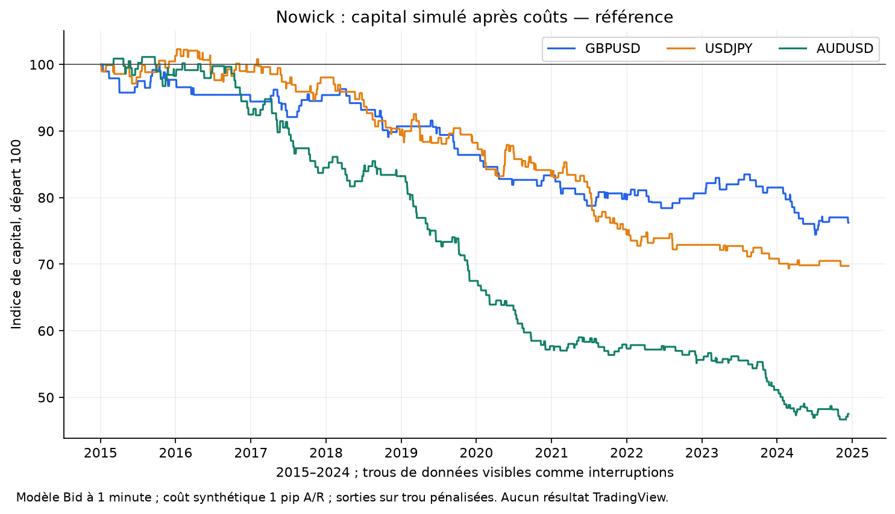
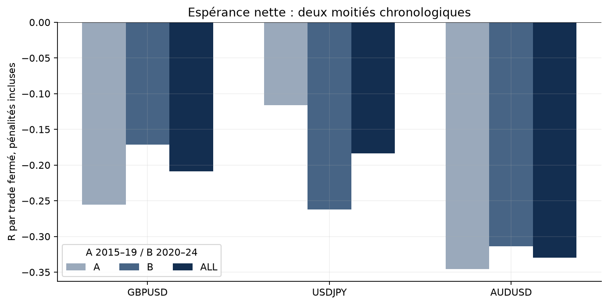
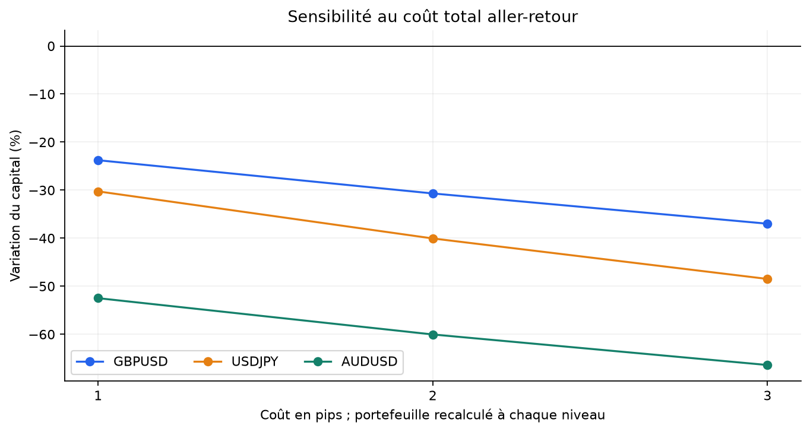
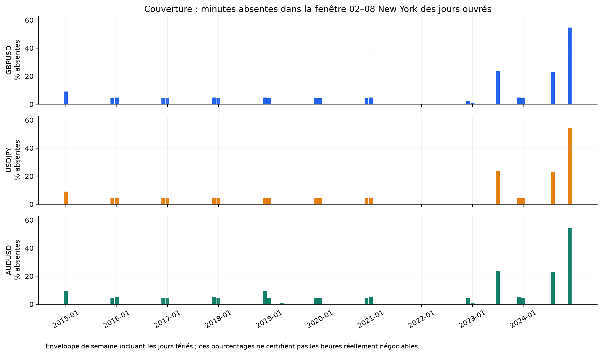
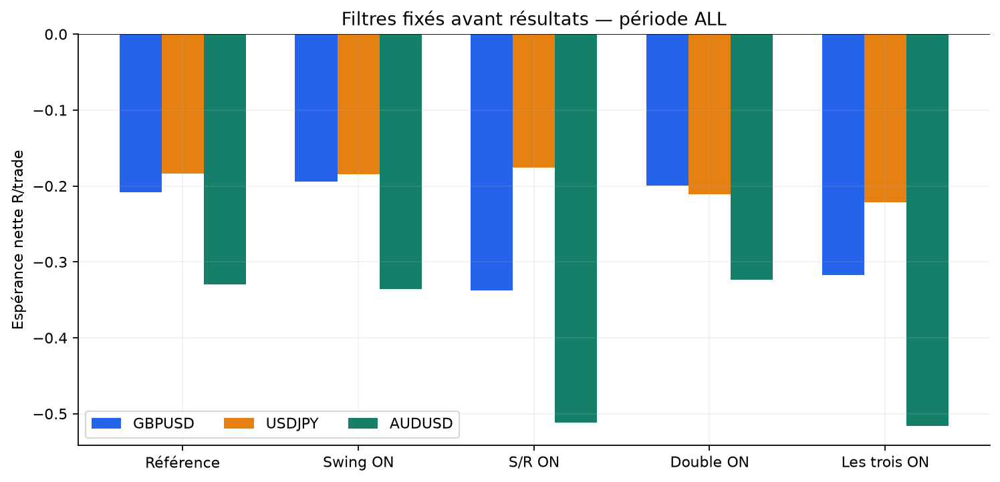

# Nowick / Compensation Play — backtest Python

Exécution `2026-10-24-python-v1`, achevée le 2026-10-24T23:12:52.534014+00:00. Formalisation fournie par Mina, pas une certification d’une autre version de la méthode Bard FX.

**La référence perd de l’argent après frais sur les trois paires. Cette version ne justifie pas de créer un bot de trading.** Les résultats ci-dessous sont ceux du moteur Python sur archives FXCM, pas des résultats TradingView. Les sorties sur trou sont pénalisées selon une convention explicite ; elles ne sont pas des fills observés.

## Périmètre et seuil demandé

Entrées nominales du 1er janvier 2015 au 31 décembre 2024, même période pour les trois paires. La source s’interrompt notamment du 13 décembre 2024 au 12 janvier 2025 : il n’existe donc pas de couverture continue jusqu’au 31 décembre. Amorçage fin 2014, historique de sortie jusqu’au 24 janvier 2025 ; aucune clôture forcée pour atteindre le nombre de trades.

Le seuil de 100 est vérifié **par paire, sur la référence ALL**, sans additionner les variantes ni les moitiés recouvrantes. « Résolu » exclut toute position traversant une minute absente et toute pénalité de couverture. Objectif atteint sur les trois paires : **oui**.

| Paire | Fermés ALL | Résolus sans trou | Pénalités de couverture | Position finale ouverte |
| --- | --- | --- | --- | --- |
| GBPUSD | 127 | 122 | 5 | non |
| USDJPY | 191 | 174 | 17 | non |
| AUDUSD | 222 | 193 | 29 | non |

## Règles et coûts conservés

Bougies Bid 15 min constituées de 15 minutes valides ; nouvelles entrées 02:00 incluse–08:00 exclue, America/New_York, heure d’été incluse. Structure de pivots 5/5 confirmés seulement, Nowick sans mèche côté ouverture et tolérance zéro, direction de la tendance. Limite à l’ouverture de la Nowick, valable neuf bougies après sa clôture ; front-run activé. SL au dernier pivot opposé confirmé plus 3 pips, distance 5–30 pips, TP 1R. Une position ou un ordre en attente, risque de prix 1 % du solde au signal, unités entières et plafond de marge 100x. Aucune gestion ultérieure, aucun break-even.

1 pip = 0,0001 sur GBPUSD/AUDUSD et 0,01 sur USDJPY. Le franchissement de limite exige 1 pip, puis le fill reste au prix prévu. Le TP limite exige également cette pénétration, conformément à l’hypothèse globale de limite de la version Pine. Le coût **total synthétique est 1 pip aller-retour**, moitié à l’entrée et moitié à la sortie ; les spreads Ask-Bid archivés ne sont pas ajoutés à nouveau. Les gaps de stop peuvent encore aggraver la perte. Swaps/financement non inclus. Il s’agit d’un modèle de graphique Bid à coûts fixes, pas d’une reconstitution des achats à l’Ask et ventes au Bid d’un courtier réel.

Chaque simulation commence avec 100 000 dans la devise de cotation : **USD** pour GBPUSD/AUDUSD et **JPY** pour USDJPY. Les montants ne constituent pas trois comptes en USD et ne s’additionnent pas comme un portefeuille. Les frais font dépasser 1 % de perte nette même sur un stop ordinaire.

La [spécification figée avant performances](../../PYTHON_PROTOCOL.md) précise les égalités de pivots, les heures complètes de l’EMA, la fraîcheur des signaux, les annulations et la priorité des événements. Aucun paramètre n’a été retenu après observation de sa rentabilité.

## Résultats principaux après frais

| Paire | Résultat net % | PF monétaire | Win rate | Wilson 95 % | Espérance nette R | DD marques % | DD fermé R | Série pertes |
| --- | --- | --- | --- | --- | --- | --- | --- | --- |
| GBPUSD | -23,77 | 0,65 | 43,31 % | 35,01–52,00 % | -0,209 | 25,79 | 29,08 | 9 |
| USDJPY | -30,26 | 0,70 | 45,03 % | 38,14–52,11 % | -0,183 | 32,64 | 38,00 | 8 |
| AUDUSD | -52,48 | 0,51 | 37,39 % | 31,29–43,92 % | -0,330 | 54,14 | 76,22 | 10 |

PF = somme des gains nets / somme absolue des pertes nettes. R = risque de prix figé à l’entrée, avant frais. Le drawdown en R porte sur les trades fermés ; le drawdown en % utilise les clôtures minute observées et les événements de fill, pas chaque tick. Wilson suppose des observations binomiales indépendantes : l’intervalle ne corrige pas l’autocorrélation ni les changements de régime.

| Paire / devise | PnL brut | Frais | PnL net | Solde final | CAGR nominal % |
| --- | --- | --- | --- | --- | --- |
| GBPUSD / USD | -15 557,37 | 8 211,91 | -23 769,28 | 76 230,72 | -2,68 |
| USDJPY / JPY | -16 940,85 | 13 316,14 | -30 256,99 | 69 743,01 | -3,54 |
| AUDUSD / USD | -40 186,85 | 12 295,04 | -52 481,89 | 47 518,11 | -7,17 |

Le CAGR emploie la durée calendaire nominale de dix ans et le résultat du modèle ; les interruptions de données l’empêchent de représenter dix années d’exécution certifiée. Les comptes et les listes de transactions se trouvent dans les sous-dossiers `PAIRE/ALL/reference/`.

## Deux moitiés chronologiques séparées

A = 2015–2019, B = 2020–2024. Chaque moitié repart de 100 000 avec les mêmes règles et l’historique antérieur pour les indicateurs. Les tailles composées expliquent pourquoi leurs montants ne s’additionnent pas à ALL. B est une validation chronologique des règles fixées ; elle n’est pas présentée comme une nouvelle expérience prospective aveugle.

| Paire | Moitié | Fermés | Résolus | Net % | PF | R / trade | DD % |
| --- | --- | --- | --- | --- | --- | --- | --- |
| GBPUSD | A | 56 | 54 | -13,58 | 0,60 | -0,255 | 13,70 |
| GBPUSD | B | 71 | 68 | -11,79 | 0,70 | -0,172 | 14,08 |
| USDJPY | A | 103 | 97 | -11,75 | 0,79 | -0,116 | 14,37 |
| USDJPY | B | 88 | 77 | -20,97 | 0,59 | -0,262 | 21,95 |
| AUDUSD | A | 112 | 95 | -32,50 | 0,51 | -0,346 | 33,51 |
| AUDUSD | B | 110 | 98 | -29,60 | 0,51 | -0,314 | 31,45 |

L’exigence de 100 porte sur chaque paire complète. Les moitiés ou filtres ayant moins de 100 trades restent affichés avec leur taille ; aucun échantillon n’a été gonflé en additionnant des scénarios.

## Coûts et taux de réussite minimal

| Paire | 1 pip : net % | 2 pips : net % | 3 pips : net % |
| --- | --- | --- | --- |
| GBPUSD | -23,77 | -30,69 | -36,98 |
| USDJPY | -30,26 | -40,05 | -48,48 |
| AUDUSD | -52,48 | -60,04 | -66,39 |

Les portefeuilles sont recalculés à chaque coût, y compris la composition des tailles. Sans gap, pour un TP/SL 1:1 et une distance de stop fixe de S pips, avec c pips aller-retour : `E[R] = 2p − 1 − c/S`. Seuil de rentabilité : **p > (1 + c/S)/2**. À 1 pip de frais : 60 % pour un stop de 5 pips, 55 % à 10 pips, 51,67 % à 30 pips. Avec des stops variables, il faut tenir compte du coût relatif moyen et de la dépendance entre taille du stop et résultat ; « plus de 50 % » ne suffit pas. Les pénalités/gaps augmentent encore l’exigence.

## Filtres et sensibilités fixés à l’avance

Référence : filtres Swing, S/R et Double OFF. Chaque filtre est activé séparément, puis les trois ensemble. Le filtre S/R recherche les pivots opposés confirmés dans les 100 dernières bougies. Le Double compare les signaux acceptés de même sens espacés de 2 à 4 bougies. Un filtre peut modifier les positions disponibles et donc augmenter le nombre ultérieur de trades ; les portefeuilles sont simulés à nouveau.

| Variante : n / net % / R moyen | GBPUSD | USDJPY | AUDUSD |
| --- | --- | --- | --- |
| Référence | 127 / -23,77 % / -0,209 R | 191 / -30,26 % / -0,183 R | 222 / -52,48 % / -0,330 R |
| Swing ON | 125 / -22,08 % / -0,194 R | 189 / -30,08 % / -0,184 R | 221 / -52,93 % / -0,336 R |
| S/R ON | 40 / -12,83 % / -0,338 R | 48 / -8,33 % / -0,176 R | 66 / -28,90 % / -0,511 R |
| Double ON | 128 / -23,04 % / -0,199 R | 183 / -32,64 % / -0,211 R | 212 / -50,16 % / -0,323 R |
| Trois filtres ON | 39 / -11,82 % / -0,317 R | 46 / -9,91 % / -0,222 R | 63 / -27,99 % / -0,516 R |
| EMA 50/200 1h | 236 / -31,43 % / -0,155 R | 307 / -64,07 % / -0,328 R | 368 / -66,81 % / -0,294 R |
| Milieu du corps | 161 / -18,80 % / -0,124 R | 248 / -45,57 % / -0,240 R | 293 / -56,92 % / -0,282 R |
| TP 1,5R | 126 / -26,96 % / -0,242 R | 190 / -39,34 % / -0,256 R | 222 / -59,70 % / -0,402 R |
| TP 2R | 126 / -31,31 % / -0,289 R | 189 / -44,36 % / -0,300 R | 222 / -65,39 % / -0,470 R |
| Front-run OFF | 222 / -40,26 % / -0,227 R | 357 / -50,69 % / -0,193 R | 388 / -73,16 % / -0,334 R |

Toutes les variantes et les moitiés figurent dans [comparison_all.csv](comparison_all.csv), soit 126 exécutions recouvrantes. Ce ne sont pas 126 preuves indépendantes. Les variantes à petit n ne permettent pas de sélectionner un gagnant fiable. **News : non évalué**, faute de calendrier daté fourni et archivé ; aucune liste de nouvelles n’a été inventée, filtre OFF dans toutes les exécutions.

## Incertitude d’exécution et trous

L’open de chaque minute est connu avant ses extrêmes. Si le front-run et le retest sont dans une même minute sans ordre temporel certain, la référence annule et `fill_first` remplit d’abord. L’annulation n’est pas une borne garantie du PnL. Quand SL et TP sont tous deux possibles sur une minute de position ouverte, le stop prime. Après un fill intraminute, une seule mèche favorable ne prouve pas un TP postérieur au fill.

| Paire | Front-run ambigus | Annuler % | Fill d’abord % | Gaps observés % | Pénalités n | PnL pénalités | PnL résolus seul* |
| --- | --- | --- | --- | --- | --- | --- | --- |
| GBPUSD | 0 | -23,77 | -23,77 | -17,42 | 5 | -4 624,08 | -19 145,20 |
| USDJPY | 0 | -30,26 | -30,26 | -21,36 | 17 | -16 616,76 | -13 640,23 |
| AUDUSD | 1 | -52,48 | -53,00 | -37,52 | 29 | -22 120,53 | -30 361,37 |

Au premier open valide suivant une minute absente, la référence ferme une position au pire du stop ou de cet open, avec frais complets, sous l’étiquette `COVERAGE_GAP_STOP`. Cette **pénalité de couverture** est une hypothèse, pas un ordre exécuté ni une borne universelle sur des prix inconnus. Une limite en attente est annulée sur trou. La sensibilité `observed_gap` conserve les positions sur les quotes disponibles et les signale : elle ne résout pas ce qui s’est passé dans le trou.

*Le PnL des seuls trades résolus est un diagnostic en devise de cotation des tailles originales, pas un portefeuille recréé en supprimant les autres trades. Les pénalités ne sont donc pas cachées en excluant les pertes. Les valeurs des autres variantes sont également soumises à leur propre nombre de trous, disponible dans leurs summaries.

## Qualité et provenance des données

[FXCM MarketData officiel](https://github.com/fxcm/MarketData) et [exemple officiel de lecture des candles](https://github.com/fxcm/MarketData/blob/master/CandleData/CandleData%28pandas%29.py). Archives `https://candledata.fxcorporate.com/m1/{PAIR}/{YEAR}/{WEEK}.csv.gz`, timestamps UTC. 1 620 archives demandées : 1 579 reçues et 41 réponses 404, sans erreur de téléchargement restante. Empreintes par archive dans le [manifest d’acquisition](../2026-10-24-python/source_manifest.json).

FXCM décrit ces quotes comme indicatives ; elles ne garantissent pas un prix accessible chez le courtier de l’utilisateur. Les historiques intégraux restent locaux et ignorés par Git ; le dépôt contient les résultats dérivés et leurs preuves. Aucun abonnement ni clé API n’est utilisé.

| Paire | Minutes présentes % | Jours complets 360 min | Jours ouvrés nominaux | Jours sans quote | Minutes absentes |
| --- | --- | --- | --- | --- | --- |
| GBPUSD | 98,51 | 2550 | 2609 | 38 | 13951 |
| USDJPY | 98,53 | 2530 | 2609 | 38 | 13812 |
| AUDUSD | 98,44 | 2514 | 2609 | 39 | 14654 |

L’enveloppe de couverture compte chaque lundi–vendredi 02:00–08:00 New York, y compris jours fériés : elle mesure des observations, pas un calendrier certifié de marché négociable. Aucune minute n’est forward-fill. Les trous empêchent les signaux incomplets ; une fenêtre de pivot doit comporter 11 bougies complètes et consécutives. Les égalités de pivots utilisent une convention explicite non certifiée par un compilateur Pine.

Les trois flux présentent notamment les interruptions communes suivantes : 30 juin–9 juillet 2023, 23 août–1er septembre 2024, 13 décembre 2024–12 janvier 2025. Les dates et vingt plus grands écarts par paire sont dans [data_quality.json](data_quality.json). Les fichiers de couverture journalière rendent les autres absences visibles. Ces trous peuvent aussi supprimer des opportunités qui auraient eu lieu ; une pénalité sur les positions connues ne les reconstitue pas.

Les OHLC non finis, non positifs ou incohérents sont refusés comme barres valides ; les doublons conflictuels provoquent un arrêt. L’acquisition obtenue ne comporte aucun OHLC Bid/Ask invalide ni doublon. Des quotes de clôture Ask inférieures au Bid existent : GBPUSD 25 742, USDJPY 31 193, AUDUSD 25 074. Ce défaut interdit de traiter le spread archivé comme une preuve de fill réel ; le modèle principal utilise la seule série Bid et son coût synthétique explicite.

## Répartition et concentration

| Paire | LONG n / PnL | SHORT n / PnL | Trois meilleurs gains | Net moins ces gains* | Durée ≥24 h |
| --- | --- | --- | --- | --- | --- |
| GBPUSD | 63 / -15 548,32 | 64 / -8 220,96 | 2 797,09 | -26 566,38 | 0 |
| USDJPY | 97 / -14 921,58 | 94 / -15 335,41 | 2 915,51 | -33 172,50 | 2 |
| AUDUSD | 119 / -32 686,21 | 103 / -19 795,68 | 2 860,03 | -55 341,92 | 1 |

*Soustraction comptable, pas une nouvelle simulation de capital. Les répartitions par année d’entrée et direction sont exportées à côté du rapport. « Durée ≥24 h » n’est pas synonyme de passage à la date New York suivante ; une sortie avant 24 h peut néanmoins être overnight. Le modèle n’ajoute aucun swap.

## Figures

## Validation, reproduction et portée

70 tests contrôlés couvrent décodage des archives, unités et timestamps, confirmations de pivots, EMA 1h, sessions/DST, validité des limites, front-run, priorités stop/TP, frais, risques et trous. Ils comprennent les 27 tests de référence précédents et deux régressions de préservation des données lors d’une reproduction refusée ; ils ne compilent pas le Pine. Le drawdown a été corrigé avant toute exécution de marché pour intégrer les frais dès l’entrée ; une régression reproduit le défaut puis vérifie le correctif.

La revue indépendante et les calculs Decimal/math sont conservés dans [audit](../../audit/). Le script d’audit n’importe pas les helpers de calcul du moteur pour vérifier les comptes. Voir [VALIDATION_PYTHON.md](../../VALIDATION_PYTHON.md) pour le périmètre exact, les compteurs et les limites ; un audit d’échantillons ne devient pas une relecture manuelle de toutes les minutes.

[RUN_MANIFEST.json](RUN_MANIFEST.json) conserve paramètres et empreintes figés avant les performances ; [DEPENDENCY_PROVENANCE.json](DEPENDENCY_PROVENANCE.json) complète l’empreinte du helper `reference.py`, inchangé par rapport au commit antérieur. Les snapshots de code rendent cette version reproductible. Le [guide de l’étude](../../README.md) donne les commandes. L’intégrité de publication est inventoriée dans `FILE_MANIFEST.json` ; les exécutions historiques précédentes ne sont pas remplacées.

Les biais restants sont l’historique incomplet et indicatif, la résolution minute qui ne donne pas l’ordre des ticks, l’absence de swaps, un coût fixe qui ne varie pas lors des annonces et les files d’attente/latences de limites non simulées. Les paires partagent des risques USD et ne sont pas des réplications indépendantes. La compilation Pine et la parité TradingView restent non vérifiées.

## Décision

La référence perd de l’argent après frais sur les trois paires. Cette version ne justifie pas de créer un bot de trading. Aucun passage automatique en réel. Une autre formalisation ou une nouvelle source devrait faire l’objet d’un nouveau protocole et d’une nouvelle exécution, sans effacer cette version ni sélectionner ici un filtre après coup.
