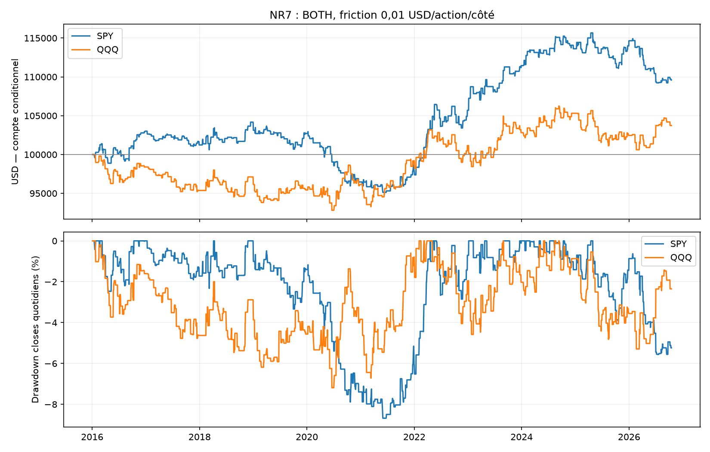
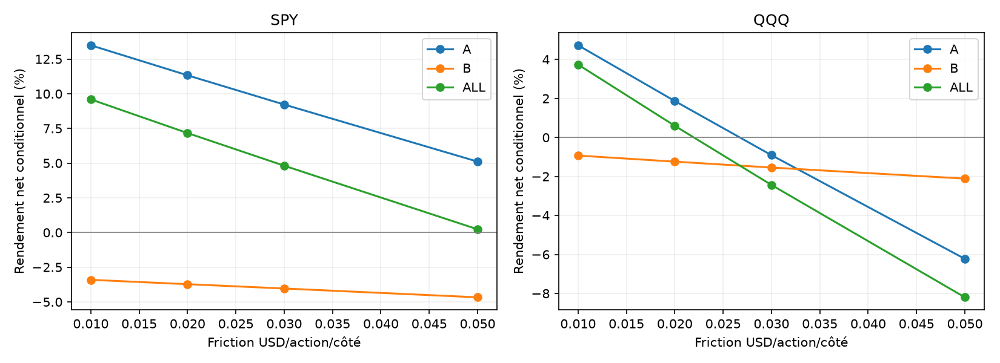
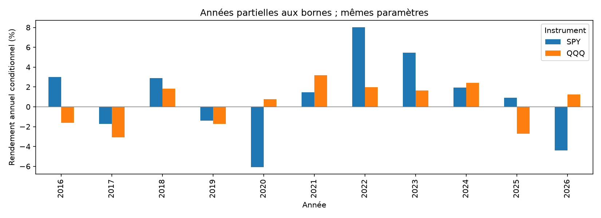
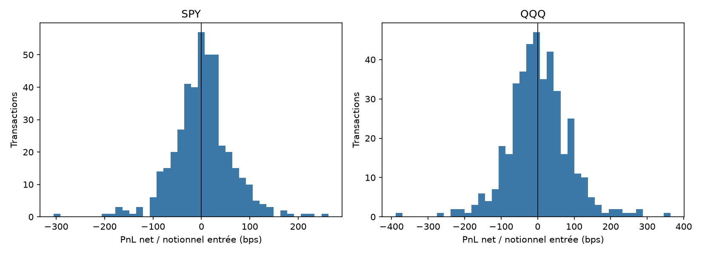

# NR7 SPY/QQQ — rapport final du 24 octobre 2026

48 scénarios figés avant les calculs ; dates2016–16/10/2026. A2016–30/04/2024 ; B01/05/2024–16/10/2026, période déjà explorée et réutilisée : aucun nouvel OOS aveugle. Capital100000USD indépendant par scénario.

## Résultats principaux, frais inclus

| Instrument | Période | Net % | CAGR % | DD marks observés % | Trades | PF | Sans top3 jours % | Coûts USD : friction / commissions / emprunt |
|---|---|---:|---:|---:|---:|---:|---:|---|
| SPY | ALL | 9.60 | 0.85 | 8.86 | 429 | 1.118 | 4.36 | 2325.22 / 814.35 / 484.19 |
| SPY | A | 13.50 | 1.53 | 8.86 | 323 | 1.228 | 8.08 | 1966.24 / 688.43 / 362.12 |
| SPY | B | -3.41 | -1.40 | 6.55 | 106 | 0.824 | -6.30 | 316.22 / 111.24 / 107.51 |
| QQQ | ALL | 3.74 | 0.34 | 7.26 | 412 | 1.039 | -1.60 | 2989.40 / 1047.22 / 366.34 |
| QQQ | A | 4.73 | 0.56 | 7.26 | 318 | 1.064 | -0.77 | 2682.08 / 938.81 / 267.68 |
| QQQ | B | -0.93 | -0.38 | 5.75 | 94 | 0.956 | -4.47 | 293.50 / 103.81 / 94.16 |

## Interprétation et sensibilité

Les variantes sont toutes publiées dans comparison_all.csv, sans retenir après coup la meilleure. Les LONG/SHORT seuls filtrent le premier signal. Le témoin sans filtre NR7 utilise son propre capital et ses quantités : comparaison descriptive, pas effet causal à exposition égale. Cash vaut0% avant inflation. Les trois meilleurs jours sont classés par PnL net positif en USD ; leurs rendements sont ensuite annulés sans recalculer les quantités.

SPY : ALL 9.60% net, B -3.41% sur 106 transactions. ALL sans rendements2020 : 16.69%. Stress ALL de0,01 à0,05USD : 0.01→9.60%, 0.02→7.17%, 0.03→4.81%, 0.05→0.23%.
B : IC95 descriptif moyenne trade bps, clusters annuels [-15.897549384842478, 3.315135088999016] ; blocs5/20 pour moyenne quotidienne : {'5': {'conditional_daily_mean_ci95': [-0.00019047109410225097, 7.798695945665828e-05]}, '20': {'conditional_daily_mean_ci95': [-0.0002023824032191317, 9.55105007165755e-05]}}. Peu de clusters annuels, dépendance et absence de correction des comparaisons multiples limitent ces intervalles.

QQQ : ALL 3.74% net, B -0.93% sur 94 transactions. ALL sans rendements2020 : 2.96%. Stress ALL de0,01 à0,05USD : 0.01→3.74%, 0.02→0.60%, 0.03→-2.44%, 0.05→-8.20%.
B : IC95 descriptif moyenne trade bps, clusters annuels [-6.475471588462645, 10.160156038042995] ; blocs5/20 pour moyenne quotidienne : {'5': {'conditional_daily_mean_ci95': [-0.00018924129161618198, 0.00015986917792930119]}, '20': {'conditional_daily_mean_ci95': [-0.000199616027739877, 0.00016632716032681267]}}. Peu de clusters annuels, dépendance et absence de correction des comparaisons multiples limitent ces intervalles.

## Validation, couverture et exécution

Les sources sont les mêmes archives Alpaca SIP que les études précédentes. Six fichiers préparés et six acquisitions OHLCV brutes sont revérifiés par SHA256 ; calendrier XNYS continu, horodatages et demi-séances contrôlés. DATA_SOURCE_PROFILE.json contient la provenance et les nombres de séances complètes/incomplètes. PRE_EXECUTION_PROTOCOL.json fige règles,48spécifications, empreintes et versions avant la boucle financière.

Le principal reste conditionnel au filtre complete_days connu après coup. Pour une absence NR7 ou un historique invalide connue avant la séance, le cash est causal. Pour des données inconnues avant signal ou en position, observed_return est manquant et le zero du compte conditionnel ne représente pas une performance observée. resolved_prefix, intentions non résolues et frais connus sont exportés. Il ne faut pas interpréter ces exclusions comme un portefeuille continu réalisable.

Cas matériel : QQQ le2020-03-09 est une séance NR7 éligible incomplète. Le principal l’exclut ; resolved_prefix retrouve une entrée SHORT59actions à193,265USD, puis un open actif manquant au slot5. Le trade entier reste omis, avec commission d’entrée connue0,35USD et friction d’entrée0,59USD exportées. L’égalité des résultats principal/prefix ne démontre donc pas une robustesse à cette séance : ils omettent tous deux le même trade non résolu. SPY n’a pas de séance NR7 courante éligible incomplète dans ces archives.

Le stop et les fills utilisent les prix OHLC minute : spread, liquidité, ordre exact des ticks, disponibilité SHORT et latence réelle ne sont pas prouvés. Le sizing est causal au close du signal ; les gaps peuvent dépasser le risque1% ou le plafond1x effectifs. Friction0,01/côté, commission0,0035minimum0,35 et emprunt1%/360 sont des hypothèses comparables, pas une cotation de frais garantie. Les frais réglementaires variables ne sont pas séparés.

AUDIT_INDEPENDENT.json décrit la reconstruction indépendante Decimal des features, signaux, trades, coûts, comptes et marks sur48scénarios ; AUDIT_SCENARIOS.csv compare comptes finaux, nombres de trades et drawdowns. Le JSON liste les agrégats effectivement recalculés, dont CAGR, Sharpe, PF et coûts. Les lignes de périodes A/B/ALL se recouvrent : leur nombre ne mesure pas des trades uniques. Les tableaux annual/monthly/directions/ablations et les figures complètent le rapport.

## Décision

BOTH principal perd en B sur SPY et QQQ : cette version NR7 n’est pas retenue pour un nouveau bot. Les petits gains historiques ALL sont sensibles aux frais et ne compensent pas la faiblesse récente ni les limites de couverture. Les variantes LONG/SHORT et le témoin restent exploratoires, sans sélectionner après coup un sous-ensemble positif. Aucun paramètre n’est retouché à partir de ces résultats. La simulation ORB reste une expérience distincte avec son propre journal.

## Figures

