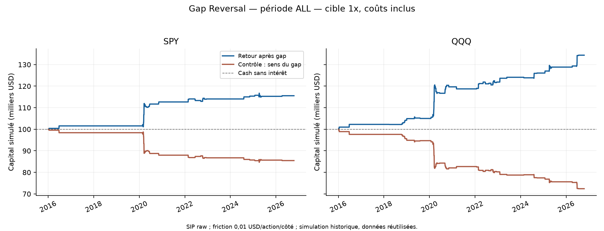
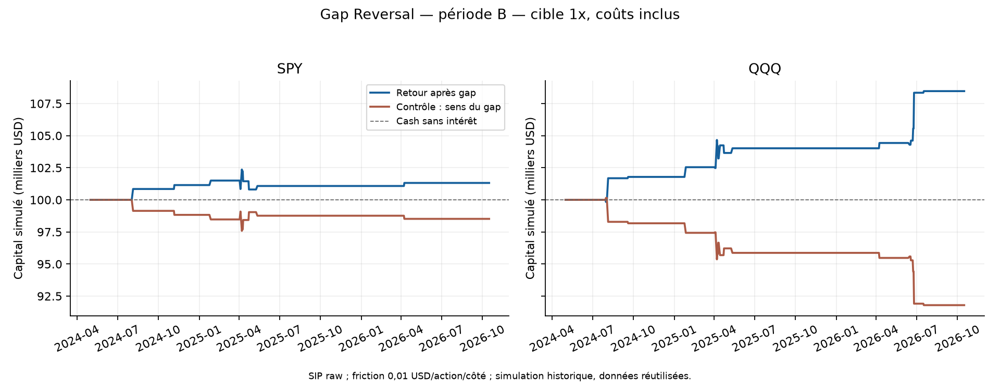
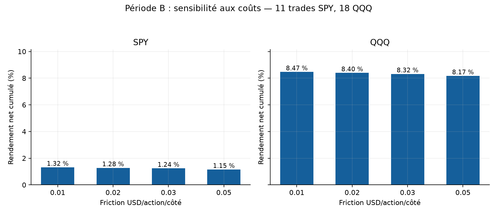

# Opening Gap Reversal — rapport final du 20 octobre 2026

**QQQ mérite un suivi en simulation ; les preuves restent insuffisantes pour un bot autonome. SPY apporte trop peu de gain récent pour conclure à un avantage.** La comparaison B est rétrospective sur des données déjà étudiées, pas une validation aveugle.

## Règles, période et coûts

Gap = ouverture 09:30 / (clôture régulière précédente − dividende ex-date) − 1. Seuil absolu strictement supérieur à 2 %. Acheter un gap négatif, vendre un gap positif. Entrée à 09:31, sortie à 10:00, heure de New York, sans stop ajouté. Quantité entière floor(capital/open 09:30), exposition cible 1x ; la taille ne connaît pas le futur open 09:31. Le levier effectif peut légèrement varier avec ce prix.

Capital initial séparé de 100 000 USD dans ALL (04/01/2016–16/10/2026), A (jusqu’au 30/04/2024) et B (01/05/2024–16/10/2026). Le capital se recompose dans chaque période ; ne pas additionner leurs profits. Commission 0,0035 USD/action/côté, minimum 0,35 USD/ordre, emprunt SHORT supposé 1 %/360 minimum un jour, friction adverse de 0,01 à 0,05 USD/action/côté. Ces coûts ne sont pas des spreads/quotes observés.

## Résultats principaux à 0,01 USD par côté

| Instrument | Période | Trades | Net % | CAGR % | Sharpe | Gagnants % | DD quotidien % | DD minute observé % |
|---|---|---|---|---|---|---|---|---|
| SPY | ALL | 48 | 15.55 | 1.35 | 0.77 | 60.4 | 1.59 | 2.74 |
| SPY | A | 37 | 14.05 | 1.59 | 0.86 | 62.2 | 1.59 | 2.74 |
| SPY | B | 11 | 1.32 | 0.53 | 0.40 | 54.5 | 1.52 | 2.44 |
| QQQ | ALL | 83 | 34.36 | 2.78 | 1.10 | 62.7 | 3.26 | 3.90 |
| QQQ | A | 65 | 23.86 | 2.60 | 1.07 | 63.1 | 3.26 | 3.90 |
| QQQ | B | 18 | 8.47 | 3.36 | 1.20 | 61.1 | 1.38 | 1.85 |

Les rendements de Sharpe utilisent toutes les séances régulières et un taux sans risque nul. Le cash témoin est non rémunéré : cette comparaison ne démontre pas une surperformance par rapport à un placement monétaire rémunéré. Le DD minute utilise les clôtures observées et les fills ; il peut sous-estimer le risque entre deux observations, surtout pendant une suspension.

## Sensibilité aux coûts et contrôles

| Instrument | Friction par côté USD | P&L net USD | Net B % |
|---|---|---|---|
| SPY | 0.01 | 1317.52 | 1.32 |
| SPY | 0.02 | 1277.16 | 1.28 |
| SPY | 0.03 | 1240.87 | 1.24 |
| SPY | 0.05 | 1153.68 | 1.15 |
| QQQ | 0.01 | 8468.54 | 8.47 |
| QQQ | 0.02 | 8396.88 | 8.40 |
| QQQ | 0.03 | 8318.84 | 8.32 |
| QQQ | 0.05 | 8171.05 | 8.17 |

Le contrôle qui entre dans le sens du gap utilise les mêmes événements et horaires. En B à 0,01, il perd environ 1,48 % sur SPY et 8,20 % sur QQQ. Cette comparaison appuie le sens du retour dans cet échantillon ; elle ne crée pas un échantillon de validation supplémentaire. Les 54 scénarios sont déclarés : 48 instrument/période/coût/sens et 6 sensibilités de qualité. Aucun meilleur seuil ou horaire n’a été recherché.

## Rareté, concentration et incertitude

| Instrument | Moyenne bps/trade B | IC 95 % bootstrap annuel bps | Net B sans 3 meilleurs jours % |
|---|---|---|---|
| SPY | 12.18 | [-0.61 ; 57.60] | -1.37 |
| QQQ | 45.83 | [24.58 ; 70.80] | 1.59 |

Le bootstrap rééchantillonne des années entières, conserve les années sans événement et utilise 5 000 répétitions, seed 20261020. B ne compte que trois blocs annuels, partiels ou complets. L’intervalle QQQ positif est descriptif et fragile ; il ne suffit pas à prouver un avantage avec 18 trades, un historique réutilisé et un contexte de recherche ayant déjà examiné plusieurs stratégies.

Retirer les trois meilleures journées ramène QQQ B à +1,59 % et SPY à −1,37 %. Sur ALL, le rendement sans les journées de 2020 passe de +34,36 % à +17,90 % pour QQQ et de +15,55 % à +4,15 % pour SPY. Ces retraits recomposent les rendements quotidiens observés sans les journées désignées ; ce n’est pas une nouvelle recherche de paramètres.

### Répartition des transactions principales ALL

| Instrument | Année | Trades | P&L net USD |
|---|---|---|---|
| SPY | 2016 | 2 | 1552.60 |
| SPY | 2020 | 26 | 11112.90 |
| SPY | 2022 | 9 | 1384.08 |
| SPY | 2024 | 2 | 1310.33 |
| SPY | 2025 | 8 | -84.90 |
| SPY | 2026 | 1 | 271.87 |
| QQQ | 2016 | 3 | 2254.57 |
| QQQ | 2018 | 6 | 1910.65 |
| QQQ | 2019 | 4 | 840.22 |
| QQQ | 2020 | 31 | 14662.73 |
| QQQ | 2021 | 1 | -943.50 |
| QQQ | 2022 | 16 | 3163.20 |
| QQQ | 2023 | 3 | 2215.17 |
| QQQ | 2024 | 4 | 1967.05 |
| QQQ | 2025 | 9 | 2761.82 |
| QQQ | 2026 | 6 | 5525.92 |

Les fichiers by_direction.csv donnent séparément LONG/SHORT ; trades.csv fournit chaque entrée, sortie, quantité, coût, emprunt, levier effectif et MAE/MFE de prix observés. [Quinze exemples réels](EXEMPLES_15_TRADES.csv) accompagnent l’audit exhaustif ; ils ne remplacent pas tous les trades.

## Qualité des données et suspensions

Le profil principal exige des prix observés à 09:30, 09:31 et 10:00 ainsi que la clôture précédente. Il conserve les trous intermédiaires sans inventer de prix. Une séance manquante après le trade ne l’annule pas. Les erreurs OHLCV ou ambiguïtés signalées restent exclues. Les quatre dates de circuit breaker de mars 2020 sont confirmées par [NYSE](https://www.nyse.com/article/assessing-nyse-model-performance). Un autre trou ne devient pas une suspension officielle par simple inférence.

| Instrument | Date | Statut aux bornes | Gap >2 % | Minutes absentes pendant détention |
|---|---|---|---|---|
| SPY | 2020-03-09 | eligible | True | 14 |
| SPY | 2020-03-12 | eligible | True | 14 |
| SPY | 2020-03-16 | missing_required_prices | True | 14 |
| SPY | 2020-03-18 | eligible | True | 0 |
| QQQ | 2020-03-09 | eligible | True | 14 |
| QQQ | 2020-03-12 | eligible | True | 14 |
| QQQ | 2020-03-16 | missing_required_prices | True | 14 |
| QQQ | 2020-03-18 | eligible | True | 0 |

Le 16 mars 2020 ne possède pas les bornes nécessaires et n’est pas exécuté artificiellement. Les 9 et 12 mars peuvent être simulés aux deux bornes observées malgré 14 minutes intermédiaires absentes ; leurs MAE/MFE et leur DD restent limités aux prix observés. Les fenêtres d’entrée/sortie réelles de crise peuvent subir plus de friction que 0,05 USD ; le backtest ne prouve pas la liquidité de ces fills.

Le filtre alternatif de journées complètes donne 42 SPY /77 QQQ, identiques au comptage publié. Le profil principal en conserve 48 /83 car la qualité de la journée entière n’est pas une information disponible à 09:31. En B, les comptes restent 11 /18. Le filtre complet réduit ALL à +4,41 % SPY et +19,69 % QQQ ; cette différence montre la sensibilité au traitement des crises et des séances qui les suivent. Les exclusions détaillées sont dans [quality_exceptions.csv](quality_exceptions.csv).

## Comparaison à Noise Area

| Instrument | Corrélation P&L quotidiens USD | Corrélation rendements quotidiens |
|---|---|---|
| SPY | -0.0528 | -0.0514 |
| QQQ | -0.0864 | -0.0829 |

618 dates B communes ; Noise Area next_open, cible plafonnée à 1x, même friction 0,01. Ces corrélations proches de zéro sont descriptives, influencées par les nombreuses journées sans gap trade. Elles ne démontrent pas une diversification stable et aucun portefeuille combiné n’a été optimisé.

## Validation et versions

20 tests automatisés passent. L’audit Decimal indépendant rapproche 2 334 lignes de trades des 54 scénarios : signal, quantité, sens, référence ex-dividende, timestamps, fills, frais, emprunt, capital, rendements et DD quotidien. Les 2 334 lignes incluent les scénarios de coûts, contrôles et périodes qui se recouvrent : ce ne sont pas 2 334 événements indépendants. Une seconde revue a recalculé les 131 trades principaux ALL, les drawdowns minute et le bootstrap.

La revue a corrigé une frontière flottante exactement à 2 % après dividende, séparé corrélations P&L/rendements et corrigé localement la durée du drawdown depuis le dernier sommet précédant la perte. Les P&L des 54 scénarios sont inchangés entre la première et la version finale. Les deux exécutions antérieures restent archivées ; v3 est la référence. Aucune source ni sortie des études FVG/Noise Area n’a été modifiée.

[Audit indépendant](AUDIT_INDEPENDANT.json) · [Manifeste original de cette exécution](MANIFEST.json) · [Comparaison des versions](VERSION_COMPARISON.json) · [54 scénarios](comparison_all.csv) · [Protocole gelé avant cette exécution](PRE_EXECUTION_PROTOCOL.json).

## Décision et suite

Conserver QQQ Gap Reversal comme piste de recherche et de suivi virtuel séparé, sans l’intégrer automatiquement au bot Noise Area. SPY n’apporte pas de preuve convaincante. La stratégie est trop rare pour attendre rapidement une validation prospective puissante. Avant tout changement d’usage : prix/quotes d’ouverture observés, latence et coûts réels, journal de toutes les journées admissibles, dates de suspension et règles de reprise. Une observation véritablement nouvelle peut commencer le 21 octobre 2026 avec ce protocole figé.
