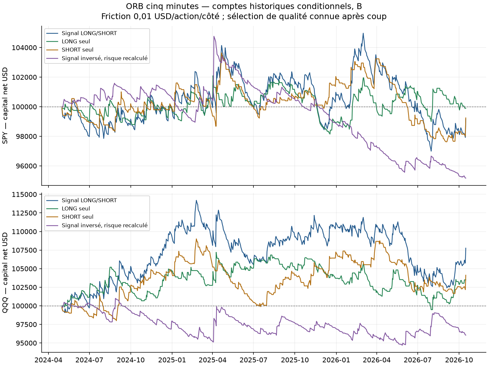
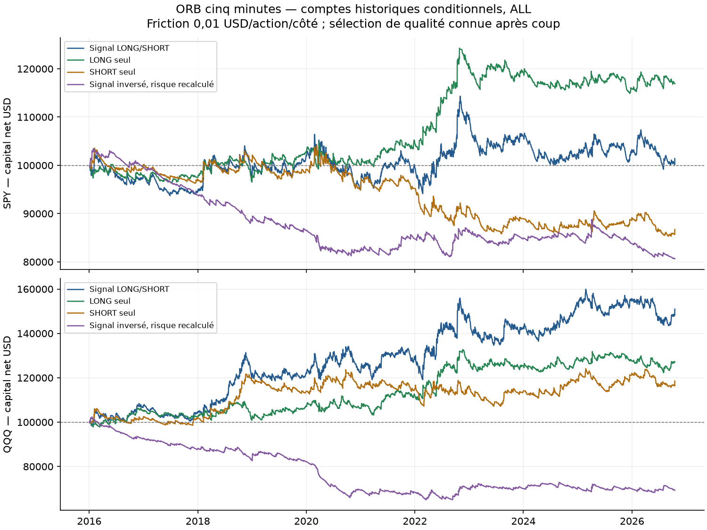
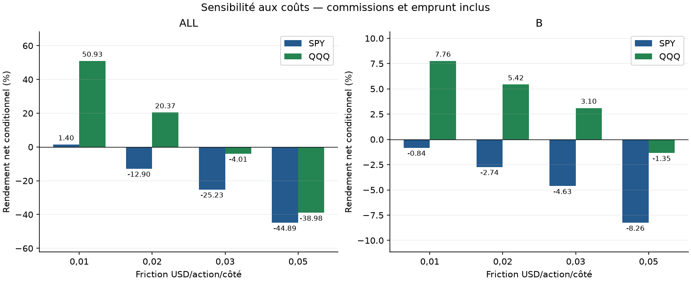
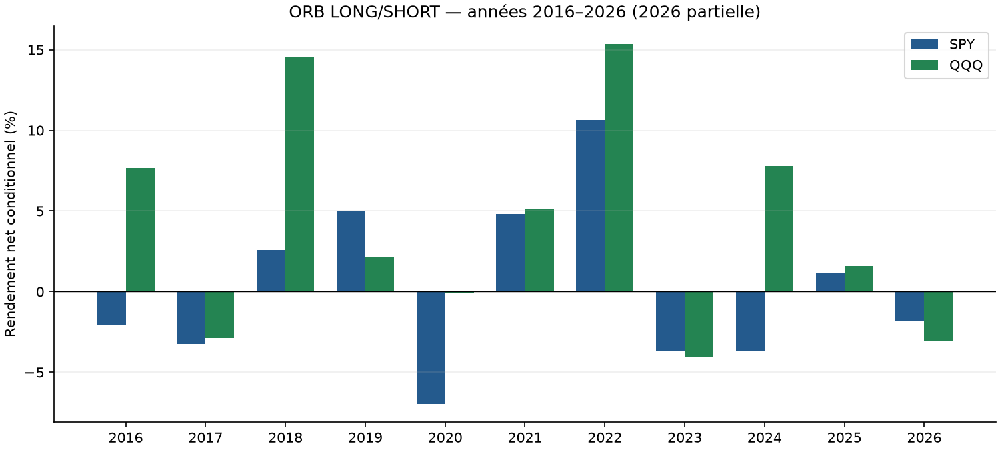

# ORB cinq minutes — rapport final SPY/QQQ

**QQQ mérite une observation prospective supplémentaire ; ces résultats ne suffisent pas à justifier un nouveau bot. SPY ne convainc pas.** QQQ principal gagne 7,759 % en B et 50,933 % sur ALL, à exposition théorique plafonnée à 1x et coûts de base. Mais retirer ses trois meilleurs jours B donne −0,938 %, doubler/tripler la friction fragilise le long historique, et les intervalles descriptifs B couvrent zéro. Aucun paramètre n’est modifié après calcul.

**Portée : comptes historiques conditionnels à la couverture des données.** Le filtre principal exige une séance entièrement observée, information disponible après la clôture : cette sélection ne peut pas être appliquée telle quelle à 09:35. Les journées exclues sont omises du compte, avec `observed_return=NaN` et zéro uniquement comptable dans `return_net`. Aucune performance continue d’un portefeuille réel traversant toutes les journées n’est revendiquée. B n’a pas d’exclusion de données pour ces instruments, mais reste un historique déjà étudié, sans validation aveugle.

## Hypothèse et méthode

Version simplifiée de l’Opening Range Breakout présentée par [Zarattini et Aziz, pp. 4–6](https://concretumgroup.com/wp-content/uploads/2026/02/Can-Day-Trading-Really-Be-Profitable.pdf). Direction de la bougie 09:30–09:34 ; entrée à l’open 09:35 ; stop au plus bas/haut initial et objectif 10R. L’entrée est immédiate après la plage initiale, sans attendre une cassure ultérieure. Notre capital de 100 000 USD, plafond 1x, coûts, taille causale et sortie à 15:59/12:59 diffèrent du papier ; aucune réplication exacte ni performance publiée attribuée à ce test.

Quantité entière fixée avant entrée : minimum entre capital/close09:34 et 1 % du capital/risque au stop connu, arrondi inférieur. Le gap peut changer le levier effectif et dépasser le budget de risque ; pas de redimensionnement avec un open futur. Objectif calculé sur le risque de référence après fill, pas le prix après friction. Une entrée au-delà du stop reste un aller-retour immédiat coûté. Un objectif SHORT négatif est logiquement inatteignable, sans fill inventé.

Open de chaque minute d’abord : stop dépassé rempli au prix open, objectif dépassé au niveau cible conservateur ; puis high/low, STOP prioritaire si les deux barrières sont touchées. TARGET prioritaire est une sensibilité séparée. La minute de sortie intrabar ne révèle pas la seconde ; son close et ses extrêmes postérieurs possibles sont exclus des marks. MAE/MFE partiellement observées et drawdown aux closes observés ne mesurent pas le risque tick. [Contrat complet](../../PROTOCOL_EXECUTION.md).

## Périodes, sources et frais

ALL : 04/01/2016–16/10/2026 ; A jusqu’au 30/04/2024 ; B du 01/05/2024 au 16/10/2026. Chaque instrument/période recommence à 100 000 USD. A/B/ALL et variantes se recouvrent. Les 54 lignes et leurs trades ne sont pas indépendants. **B réutilisée n’est pas un nouveau hors-échantillon aveugle.**

Alpaca SIP raw local : six CSV et six caches vérifiés par SHA, calendrier XNYS continu, float64, demi-séances/heures vérifiées. Aucune clé dans le dépôt. Les actions sur titres ont été rapprochées dans la validation source ; aucun split n’est retourné par la requête d’origine, sans certification de complétude indépendante du fournisseur. Le signal n’utilise aucune clôture précédente, donc aucun ajustement overnight pour dividende. [Provenance](DATA_SOURCE_PROFILE.json).

Commission par côté max(0,35 USD ; 0,0035×actions), friction adverse 0,01 USD/action/côté, stress 0,02/0,03/0,05 ; SHORT 1 %/360 du notionnel d’entrée après friction, un jour minimum. Cash non rémunéré. Pas de frais réglementaires séparés, disponibilité du prêt, spread observé, latence, rejets ni fills réels. La friction constitue une hypothèse, pas une mesure ni garantie d’exécution. L’open 09:35 peut être inaccessible après publication de close09:34.

## Principaux résultats conditionnels

| Instrument | Période | Trades | Net % | CAGR % | DD minute observé % | Sharpe | Profit factor |
|---|---|---|---|---|---|---|---|
| SPY | ALL | 2679 | 1.399 | 0.129 | 13.694 | 0.052 | 1.004 |
| SPY | A | 2064 | 2.267 | 0.270 | 12.949 | 0.073 | 1.009 |
| SPY | B | 615 | -0.835 | -0.340 | 7.813 | -0.036 | 0.988 |
| QQQ | ALL | 2688 | 50.933 | 3.891 | 14.229 | 0.450 | 1.077 |
| QQQ | A | 2073 | 40.059 | 4.131 | 14.229 | 0.460 | 1.080 |
| QQQ | B | 615 | 7.759 | 3.082 | 10.446 | 0.414 | 1.067 |

## Sensibilité aux coûts et aux règles

| Instrument | Période | Friction USD/côté | Trades | Net % |
|---|---|---|---|---|
| SPY | ALL | 0.010 | 2679 | 1.399 |
| SPY | ALL | 0.020 | 2679 | -12.899 |
| SPY | ALL | 0.030 | 2679 | -25.233 |
| SPY | ALL | 0.050 | 2679 | -44.894 |
| SPY | A | 0.010 | 2064 | 2.267 |
| SPY | A | 0.020 | 2064 | -10.419 |
| SPY | A | 0.030 | 2064 | -21.587 |
| SPY | A | 0.050 | 2064 | -39.877 |
| SPY | B | 0.010 | 615 | -0.835 |
| SPY | B | 0.020 | 615 | -2.740 |
| SPY | B | 0.030 | 615 | -4.625 |
| SPY | B | 0.050 | 615 | -8.257 |
| QQQ | ALL | 0.010 | 2688 | 50.933 |
| QQQ | ALL | 0.020 | 2688 | 20.372 |
| QQQ | ALL | 0.030 | 2688 | -4.014 |
| QQQ | ALL | 0.050 | 2688 | -38.976 |
| QQQ | A | 0.010 | 2073 | 40.059 |
| QQQ | A | 0.020 | 2073 | 14.167 |
| QQQ | A | 0.030 | 2073 | -6.951 |
| QQQ | A | 0.050 | 2073 | -38.161 |
| QQQ | B | 0.010 | 615 | 7.759 |
| QQQ | B | 0.020 | 615 | 5.425 |
| QQQ | B | 0.030 | 615 | 3.102 |
| QQQ | B | 0.050 | 615 | -1.353 |

Toutes les variantes sont publiées dans [comparison_all.csv](comparison_all.csv). LONG seul, SHORT seul et inverse sont des diagnostics prédéfinis. L’inverse possède son propre stop, quantité et heure de sortie ; la comparaison n’isole donc pas le sens à exposition identique et ne démontre pas un alpha face à buy-and-hold.

| Instrument | mode | quality | priority | Trades | Net % |
|---|---|---|---|---|---|
| SPY | both | complete_days | stop_first | 615 | -0.835 |
| SPY | long_only | complete_days | stop_first | 317 | -0.103 |
| SPY | short_only | complete_days | stop_first | 298 | -0.756 |
| SPY | inverse | complete_days | stop_first | 598 | -4.826 |
| SPY | both | complete_days | target_first | 615 | -0.835 |
| SPY | both | resolved_prefix | stop_first | 615 | -0.835 |
| QQQ | both | complete_days | stop_first | 615 | 7.759 |
| QQQ | long_only | complete_days | stop_first | 297 | 3.490 |
| QQQ | short_only | complete_days | stop_first | 318 | 4.119 |
| QQQ | inverse | complete_days | stop_first | 601 | -3.943 |
| QQQ | both | complete_days | target_first | 615 | 7.759 |
| QQQ | both | resolved_prefix | stop_first | 615 | 7.759 |

## Couverture et exclusions

| Instrument | date | eligibility |
|---|---|---|
| SPY | 2016-02-02 | excluded_incomplete_day |
| SPY | 2019-08-12 | excluded_incomplete_day |
| SPY | 2020-03-09 | excluded_incomplete_day |
| SPY | 2020-03-12 | excluded_incomplete_day |
| SPY | 2020-03-16 | invalid_opening_window |
| SPY | 2020-03-18 | excluded_incomplete_day |
| SPY | 2021-05-05 | excluded_incomplete_day |
| SPY | 2023-06-05 | excluded_incomplete_day |
| QQQ | 2016-02-02 | excluded_incomplete_day |
| QQQ | 2016-02-22 | excluded_incomplete_day |
| QQQ | 2020-03-09 | excluded_incomplete_day |
| QQQ | 2020-03-12 | excluded_incomplete_day |
| QQQ | 2020-03-16 | invalid_opening_window |
| QQQ | 2020-03-18 | excluded_incomplete_day |

Des minutes manquent autour de certains arrêts de mars 2020, mais aussi d’autres jours sans suspension établie. La [NYSE décrit les interruptions de mars 2020](https://www.nyse.com/article/assessing-nyse-model-performance) ; cette information ne justifie pas d’interpoler les trous du fournisseur. Une sonde historique SIP en lecture seule sur QQQ du 02/02/2016 n’a récupéré aucune des neuf minutes manquantes. Aucune bougie n’a été fabriquée.

| Instrument | Période | quality | data_excluded_sessions | unresolved_sessions | Trades | Net % |
|---|---|---|---|---|---|---|
| SPY | ALL | complete_days | 8 | 0 | 2679 | 1.399 |
| SPY | ALL | resolved_prefix | 6 | 5 | 2681 | 0.084 |
| SPY | A | complete_days | 8 | 0 | 2064 | 2.267 |
| SPY | A | resolved_prefix | 6 | 5 | 2066 | 0.982 |
| SPY | B | complete_days | 0 | 0 | 615 | -0.835 |
| SPY | B | resolved_prefix | 0 | 0 | 615 | -0.835 |
| QQQ | ALL | complete_days | 6 | 0 | 2688 | 50.933 |
| QQQ | ALL | resolved_prefix | 6 | 5 | 2688 | 50.933 |
| QQQ | A | complete_days | 6 | 0 | 2073 | 40.059 |
| QQQ | A | resolved_prefix | 6 | 5 | 2073 | 40.059 |
| QQQ | B | complete_days | 0 | 0 | 615 | 7.759 |
| QQQ | B | resolved_prefix | 0 | 0 | 615 | 7.759 |

La sensibilité `resolved_prefix` conserve un trade résolu avant un trou ultérieur. Un trou pendant le maintien ou à l’entrée rend l’exécution indéterminable ; tout le trade est omis du compte conditionnel, y compris frais connus, qui restent décrits dans `unresolved.csv`. Ce compte n’est pas un traitement de production des pannes de données. [Audit des intentions non résolues](INDEPENDENT_UNKNOWN_AUDIT.csv).

## Risque, coût et exposition

| Instrument | Période | price_move_pnl | friction_cost | commission | borrow_fee | regular_time_exposure_upper_pct | max_actual_entry_leverage | max_entry_risk_pct | entry_risk_over_one_pct_count | ambiguous_trades |
|---|---|---|---|---|---|---|---|---|---|---|
| SPY | ALL | 25624.271 | 15248.320 | 5336.912 | 3640.146 | 28.112 | 1.000 | 1.005 | 2 | 0 |
| SPY | A | 22939.628 | 13244.760 | 4635.666 | 2792.522 | 28.061 | 1.000 | 1.005 | 2 | 0 |
| SPY | B | 2638.411 | 1959.220 | 685.727 | 828.891 | 28.288 | 1.000 | 0.480 | 0 | 0 |
| QQQ | ALL | 92526.716 | 27295.260 | 9553.341 | 4744.857 | 31.958 | 1.000 | 1.012 | 7 | 1 |
| QQQ | A | 75879.197 | 23997.840 | 8399.244 | 3422.972 | 31.480 | 1.000 | 1.012 | 7 | 1 |
| QQQ | B | 11877.505 | 2352.340 | 823.319 | 943.056 | 33.580 | 1.000 | 0.963 | 0 | 0 |

Exposition temps = minutes maintenues / minutes de séances, borne supérieure à une minute près lors d’une sortie intraminute. Risque à l’entrée = distance au stop × quantité / capital avant entrée ; il exclut frais et gaps futurs. Le budget de 1 % ne garantit pas une perte maximale de 1 %. Une seule barre ambiguë sur QQQ ALL/A explique la sensibilité TARGET ; SPY et B n’en ont aucune dans les principaux.

## Années, concentration et incertitude

| Instrument | Période | return_without_top3_days_pct | top3_positive_profit_share_pct | worst_trade_usd | worst_observed_mae_usd | half_session_trades |
|---|---|---|---|---|---|---|
| SPY | ALL | -10.161 | 3.665 | -1068.174 | -1063.040 | 21 |
| SPY | A | -9.393 | 4.637 | -1068.174 | -1063.040 | 15 |
| SPY | B | -6.952 | 9.289 | -491.545 | -488.400 | 6 |
| QQQ | ALL | 30.840 | 2.762 | -1502.096 | -1492.950 | 21 |
| QQQ | A | 21.920 | 3.488 | -1502.096 | -1492.950 | 15 |
| QQQ | B | -0.938 | 7.272 | -918.618 | -911.540 | 6 |

Retirer les trois meilleurs jours positifs met leurs rendements à zéro puis recompose les autres rendements quotidiens conservés. Diagnostic algébrique sans nouvelle simulation ni redimensionnement ; ce n’est pas une trajectoire à quantités fixes et les P&L originaux ne sont pas conservés. Les exports par année/sens/demi-séance/motif de sortie permettent de contrôler la stabilité. 2026 est partielle.

SPY B : IC descriptif 95 % de la moyenne **par transaction** par groupes annuels : [-0.871, 0.514] bps du notionnel engagé, seulement trois groupes 2024–2026 partiellement/complètement observés.

QQQ B : IC descriptif 95 % de la moyenne **par transaction** par groupes annuels : [-1.475, 5.503] bps du notionnel engagé, seulement trois groupes 2024–2026 partiellement/complètement observés.

| Instrument | Bloc | Moyenne_quotidienne_basse_bps | Moyenne_quotidienne_haute_bps |
|---|---|---|---|
| SPY | 5 | -2.667 | 2.382 |
| SPY | 20 | -2.448 | 2.329 |
| QQQ | 5 | -2.144 | 4.858 |
| QQQ | 20 | -1.732 | 4.286 |

Le tableau mesure la moyenne **quotidienne du rendement du capital conditionnel**, unité différente du rendement moyen par trade. Blocs circulaires 5/20 séances, 3 000 répétitions, graine 20261020 ; années sans événement conservées dans le rééchantillonnage annuel. Zéros comptables des exclusions inclus. Intervalles descriptifs sans correction pour essais multiples ; peu de groupes, dépendances et historique réutilisé empêchent une conclusion robuste de rentabilité.

## Validation et reproduction

Audit indépendant depuis les OHLCV source : **54 exécutions, 85526 lignes recouvrantes, 9282328 marks**. Écart maximal sur champs monétaires par trade 4.02e-11 USD ; capital cumulé 2.46e-08 USD ; drawdown monétaire 2.44e-08 USD et 2.37e-11 point de pourcentage. Tolérance capital/agrégats : 3×10⁻⁶. Signaux, taille Decimal, stops/cibles, ordre des événements, frais, capital, exclusions et DD observé reconstruits sans appeler le moteur. [Preuve et unités détaillées](INDEPENDENT_AUDIT.json), [détail](INDEPENDENT_TRADE_AUDIT.csv).

42 tests synthétiques ; rapprochements secondaires des 54 exports. 16 exemples, 112 références minute et 560 valeurs OHLCV relues dans les CSV hachés, écart nul. [Exemples](EXAMEN_TRANSACTIONS.md), [preuve brute](RAW_EXCERPT_AUDIT.json). Ces contrôles vérifient notre traitement du même fournisseur, pas son exactitude contre une source indépendante ni l’ordre des ticks.

Code et protocole figés avant première boucle financière : [gel](PRE_EXECUTION_PROTOCOL.json), [copie du code](code_snapshot), [manifest initial](MANIFEST.json). Les scripts d’audit/rapport sont écrits après ce gel et tracés dans le manifest de livraison. Une seconde instrumentation d’audit sépare les écarts par unité et mesure le capital cumulé ; sa preuve initiale reste archivée. Les 449 empreintes initiales concordent : aucun correctif numérique du moteur, des statistiques ou des résultats après P&L ni réglage pour retenir une variante. [Guide et tests](../../README.md).

## Décision

Conserver QQQ comme piste exploratoire à tester prospectivement avec données complètes et coûts d’exécution observés ; ne pas remplacer Noise Area ni lancer de nouveau bot avec cet essai seul. Le rendement QQQ de base est positif, mais son CAGR ALL de 3,891 %, le DD observé de 14,229 %, la dépendance aux frais et aux meilleurs jours B et les IC couvrant zéro limitent son intérêt. SPY est trop faible après coûts. Aucun argent réel, ordre paper ou réglage du bot actif n’est produit par cette étude.
