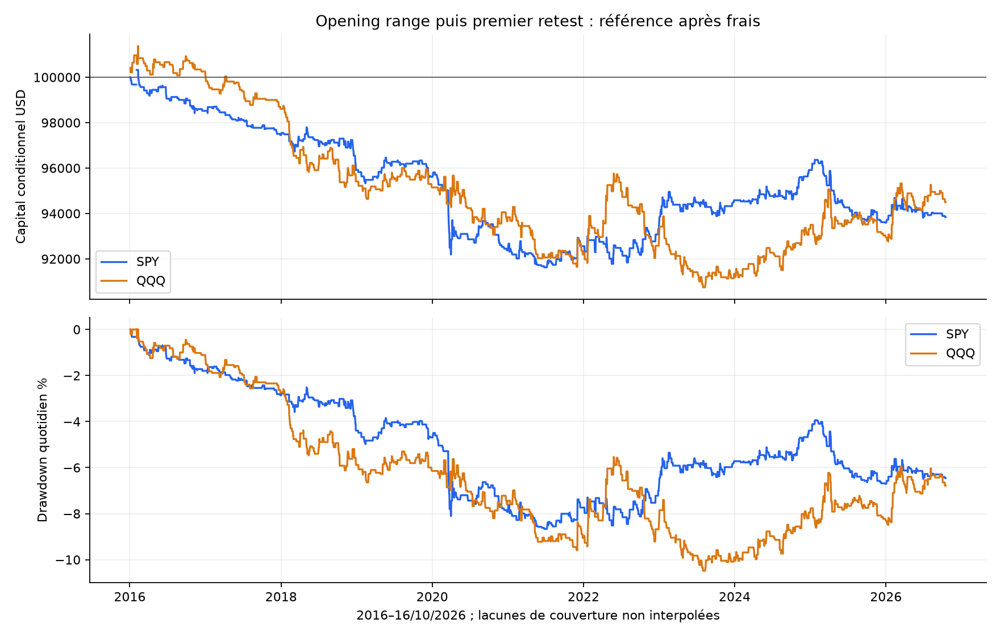
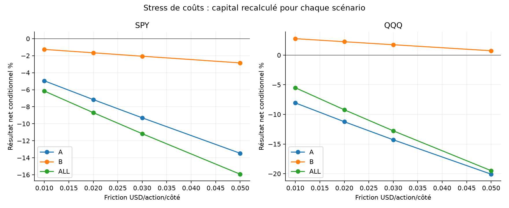
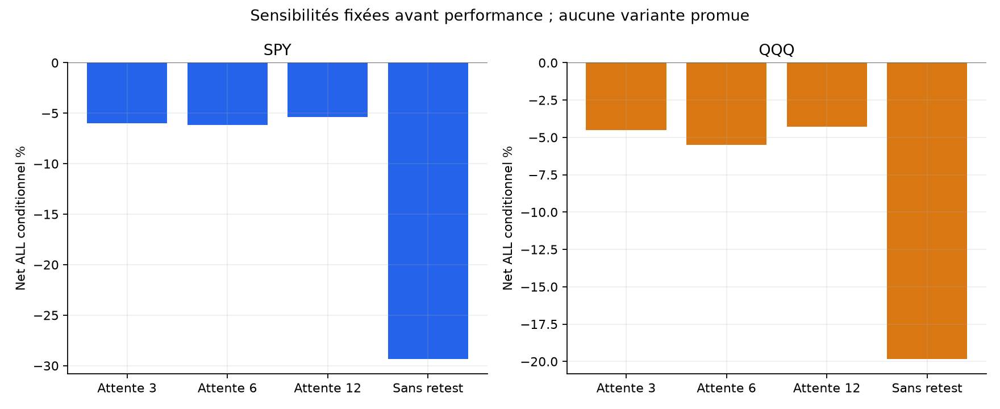
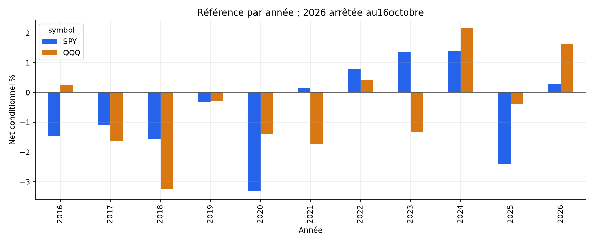

# Opening range puis premier retest confirmé — SPY / QQQ

Les critères historiques prédéfinis ne passent pas. Cette formalisation ne justifie pas un nouveau bot.

Capital100000USD indépendant par scénario. ALL4janvier2016–16octobre2026 ; A jusqu’au30avril2024 ; B1mai2024–16octobre2026. B et ces ETF déjà explorés : aucun nouveau OOS aveugle.

## Recherche élargie et limites des sources

Recherche universitaire, dépôts primaires, blogs quantitatifs et forums comparés. Le travail descriptif Research-QQQ motive une hypothèse de retest, sans démonstration de rentabilité ni reproduction de ses règles. Les statistiques de continuation ou d’extrêmes ne sont pas des fills. Les filtres propriétaires non publiés ne sont pas inventés. [Sources et limites de lecture](../../RESEARCH.md).

## Règles figées avant PnL

Range RTH09:30–09:44NY. Première clôture5minutes au-dessus du haut ou sous le bas. Exclure la bougie de cassure ; attendre au plus6bougies5minutes. Sur le premier toucher seulement, exiger clôture encore extérieure au niveau et corps dans le sens de la cassure. Premier toucher raté : fin de journée, sans chercher ensuite une réussite. Tolérance arithmétique1e−10USD, pas une tolérance économique.

Entrée open minute suivante, dès09:55 et au plus tard11:30 incluse sur séances normales et demi-séances. Stop sous le low du seul retest moins0,01USD LONG, inverse SHORT, centime vers extérieur. Quantité au close du signal : risque cible1%, plafond1x, frais exclus. Gap futur peut dépasser ces plafonds ; aucune annulation rétroactive. TP2R depuis open d’entrée observé, arrondi vers entrée. Stop prioritaire si SL/TP ensemble ; gap stop au mauvais open, gap TP sans amélioration. EOD dernier open15:59/12:59 avant sa mèche. Aucun overnight ou gestion intermédiaire. [Protocole complet](../../PROTOCOL_EXECUTION.md).

## Référence après les mêmes frais

| ETF | Période | Trades | Net cumulé % | CAGR % | PF | WR % | DD marks % | Sans top3 % |
| --- | --- | --- | --- | --- | --- | --- | --- | --- |
| SPY | ALL | 497 | -6.16 | -0.59 | 0.853 | 34.21 | 8.80 | -8.58 |
| SPY | A | 371 | -4.95 | -0.61 | 0.846 | 34.23 | 8.80 | -7.41 |
| SPY | B | 126 | -1.26 | -0.51 | 0.875 | 34.13 | 3.16 | -2.96 |
| QQQ | ALL | 509 | -5.50 | -0.52 | 0.907 | 33.99 | 10.71 | -8.66 |
| QQQ | A | 371 | -8.06 | -1.00 | 0.826 | 32.61 | 10.71 | -11.13 |
| QQQ | B | 138 | 2.78 | 1.12 | 1.199 | 37.68 | 2.85 | 0.32 |

Comptes conditionnels aux données résolues ; CAGR sur période nominale. DD aux frais d’entrée, closes1minute entièrement détenus et sortie nette, sans borne de tous les ticks. DD quotidien graphique moins fin. ETF corrélés, pas deux preuves indépendantes ; aucun avantage sur le passif à exposition comparable revendiqué, cash0%.

## Frais et attribution

Commission0,0035USD/action/côté minimum0,35 ; friction adverse0,01USD/action/côté ; empruntSHORT1%annuel/360 minimum1jour pour les ventes à découvert. Friction comprise dans les fills puis attribuée une seule fois. Modèle commun, pas tarif broker garanti ; spreads lors des mouvements rapides et frais variables non observés.

| ETF | Période | Prix USD | Friction USD | Commission USD | Emprunt USD | Net USD | Exposition RTH bornehaute % |
| --- | --- | --- | --- | --- | --- | --- | --- |
| SPY | ALL | -2030.61 | 2631.02 | 920.86 | 573.48 | -6155.97 | 1.23 |
| SPY | A | -1506.22 | 2245.94 | 786.08 | 416.38 | -4954.61 | 1.12 |
| SPY | B | -549.82 | 405.14 | 141.80 | 165.32 | -1262.08 | 1.58 |
| QQQ | ALL | 302.29 | 3841.06 | 1344.37 | 619.20 | -5502.34 | 1.57 |
| QQQ | A | -3036.92 | 3372.90 | 1180.52 | 468.89 | -8059.23 | 1.37 |
| QQQ | B | 3631.79 | 509.36 | 178.28 | 163.56 | 2780.59 | 2.24 |

## Sensibilités fixées et contrôles

| Variante ALL : trades/net%/PF | SPY | QQQ |
| --- | --- | --- |
| reference | 497 / -6.16 / 0.853 | 509 / -5.50 / 0.907 |
| cost_0.02 | 497 / -8.70 / 0.797 | 509 / -9.21 / 0.847 |
| cost_0.03 | 497 / -11.17 / 0.745 | 509 / -12.77 / 0.792 |
| cost_0.05 | 497 / -15.93 / 0.653 | 509 / -19.50 / 0.691 |
| rr1 | 497 / -7.30 / 0.776 | 509 / -0.92 / 0.979 |
| rr3 | 497 / -1.49 / 0.967 | 509 / -8.42 / 0.870 |
| wait3 | 467 / -5.97 / 0.850 | 490 / -4.52 / 0.921 |
| wait12 | 508 / -5.38 / 0.874 | 519 / -4.29 / 0.929 |
| long_only | 279 / -4.42 / 0.797 | 273 / -9.64 / 0.702 |
| short_only | 218 / -1.82 / 0.914 | 236 / 4.58 / 1.162 |
| no_retest | 2644 / -29.35 / 0.870 | 2629 / -19.84 / 0.943 |
| resolved_prefix | 498 / -6.22 / 0.851 | 509 / -5.50 / 0.907 |

12variantes ×2ETF ×3périodes=72comptes recouvrants. Coûts0,02/0,03/0,05, TP1R/3R, attente3/12barres, LONGseul/SHORTseul, sans retest et prefix. La direction est filtrée sur la première cassure commune, sans recherche ultérieure. Sans retest entre dès09:50 suivant la première cassure avec stop de cette bougie ; change aussi stop/sizing/exposition, pas contrôle causal pur du délai. Comptes composés séparément. [Tous les scénarios](comparison_all.csv), aucune variante promue après PnL.

## Critères de présélection déclarés

| Critère avant PnL | Passe |
| --- | --- |
| min100trades_ALL | oui |
| six_references_positive | non |
| sans_top3_ALL_positive | non |
| doubled_friction_A_positive | non |
| block20_ALL_lower_positive | non |

Exiger ≥100trades ALL/ETF, six références positives, ALL sans top3 positif, A à friction doublée positive et bornes basses IC95 blocs20 ALL>0 sur les deux ETF. Un passage resterait une présélection historique, pas preuve prospective ni activation automatique.

## Couverture et provenance

Mêmes archives SIP/préparations vérifiées SHA, calendrier NYSE et rapprochement corporate actions.2714séances préparées dont padding2015-12-31,2713évaluées. SPY2705/QQQ2707complètes dans le cache total. Trous, notamment en2020 ; pas de deuxième flux ni interpolation. [Profil source](DATA_SOURCE_PROFILE.json).

Niveaux et décisions entièrement intraday : aucun niveau de la veille ou historique de prix ajusté, aucun dividende crédité au compte flat overnight. Les minutes nécessaires au range, à la recherche de cassure et au premier retest doivent être présentes. Les données après échec/expiration/cutoff connus ne sont pas nécessaires.

complete_days applique après coup la qualité OHLCV de toute la journée après premier signal, biais potentiel. Prefix retire ce filtre mais reste conditionnel : barre nécessaire inconnue avant signal=>journée inconnue ; trou actif=>trade entier non résolu, frais d’entrée connus exportés. Zéro de chaînage n’est pas cash observé. Données inutiles après signal ou sortie ne l’annulent pas.

| ETF | Période | Exclues principal | Trades principal | Net principal % | Trades prefix | Non résolues | Net prefix % |
| --- | --- | --- | --- | --- | --- | --- | --- |
| SPY | ALL | 5 | 497 | -6.16 | 498 | 0 | -6.22 |
| SPY | A | 5 | 371 | -4.95 | 372 | 0 | -5.02 |
| SPY | B | 0 | 126 | -1.26 | 126 | 0 | -1.26 |
| QQQ | ALL | 4 | 509 | -5.50 | 509 | 0 | -5.50 |
| QQQ | A | 4 | 371 | -8.06 | 371 | 0 | -8.06 |
| QQQ | B | 0 | 138 | 2.78 | 138 | 0 | 2.78 |

## Incertitude et concentration

Bootstrap descriptif3000tirages seed20261026, blocs circulaires5/20séances et clusters annuels. Exclusions au zéro de chaînage, données non reconstruites, peu de clusters et essais multiples non corrigés.

| ETF | Période | IC95 moyenne quotidienne %, blocs5 | Blocs20 | IC95 bps/trade, années |
| --- | --- | --- | --- | --- |
| SPY | ALL | [-0.0058 ; 0.0011] | [-0.0059 ; 0.0011] | [-3.4324062618987066, 0.6451998652483836] |
| SPY | A | [-0.0067 ; 0.0019] | [-0.0064 ; 0.0015] | [-4.066179270548939, 0.7260809112374786] |
| SPY | B | [-0.0084 ; 0.0049] | [-0.0084 ; 0.0040] | [-4.702627493538751, 2.3007323985907195] |
| QQQ | ALL | [-0.0067 ; 0.0030] | [-0.0067 ; 0.0027] | [-2.9648096263437558, 0.98608143019511] |
| QQQ | A | [-0.0093 ; 0.0015] | [-0.0091 ; 0.0014] | [-3.9599613964593012, -0.4719655254855791] |
| QQQ | B | [-0.0059 ; 0.0151] | [-0.0055 ; 0.0152] | [-0.576491038528964, 4.2929817567946635] |

| ETF | Période | Sans top3 % | Sans2020 % | Pertes consécutives max |
| --- | --- | --- | --- | --- |
| SPY | ALL | -8.58 | -2.93 | 12 |
| SPY | A | -7.41 | -1.68 | 12 |
| SPY | B | -2.96 | -1.26 | 7 |
| QQQ | ALL | -8.66 | -4.18 | 14 |
| QQQ | A | -11.13 | -6.77 | 14 |
| QQQ | B | 0.32 | 2.78 | 9 |

Ablations : rendements concernés mis à zéro dans le compte original, sans nouveau sizing. Années/mois/directions, qualité, premières décisions par variante et chaque trade exportés.

## Figures

## Validation et limites

[Tests, revue et replay](../../VALIDATION.md). Code/tests/rapport/audit/dépendances gelés avant PnL. Agrégation séparée minute par minute, puis automate et replay scalaire de chaque décision, fill et compte sans appeler le moteur. Même chargeur/source : pas de réplication sur un deuxième fournisseur.

Limites : adaptation ORB/retest distincte des études descriptives, quotes/carnet absents, ticks non ordonnés dans la minute, spreads variables non reconstruits, coûts fixes/shorts non garantis, couverture incomplète et choix d’hypothèse sur des marchés déjà explorés. Aucun nouveau holdout aveugle, aucune famille de risque indépendante de l’ORB.

Les critères historiques prédéfinis ne passent pas. Cette formalisation ne justifie pas un nouveau bot. Les deux bots QQQ existants restent inchangés, aucun nouveau bot ou ordre réel.
