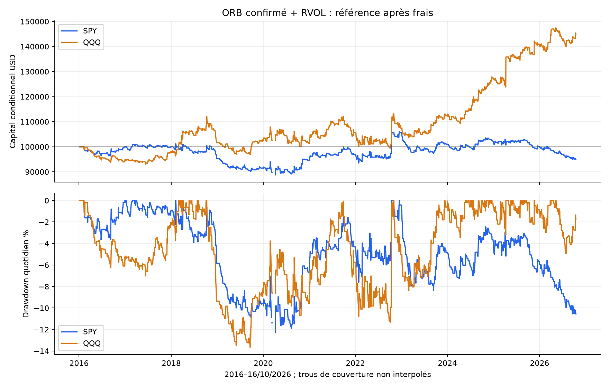
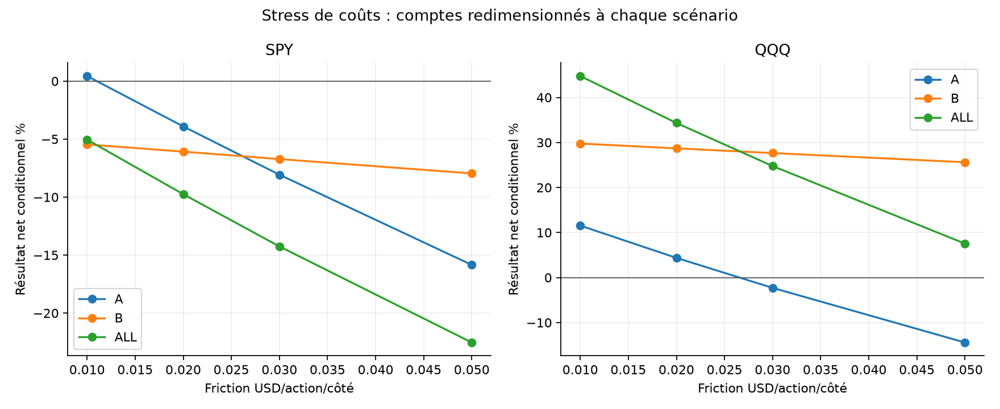
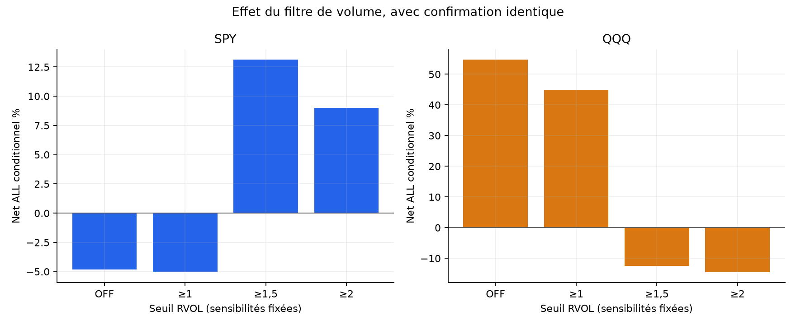
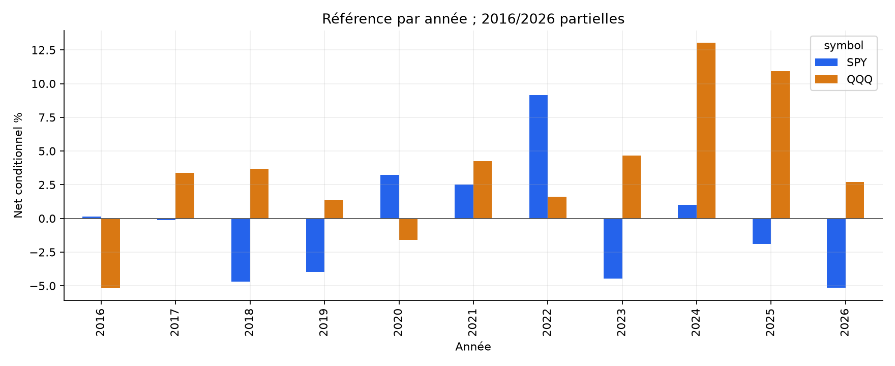

# ORB confirmé + volume relatif — rapport final SPY / QQQ

La référence ne reste pas positive dans toutes les périodes et sur les deux ETF. Pas de nouveau bot justifié par cette étude ; conserver les règles et ne pas promouvoir une variante choisie après résultats.

Recherche publique puis72 scénarios figés avant PnL. Capital100000USD par scénario ; ALL4janvier2016–16octobre2026, A jusqu’au30avril2024, B du1mai2024 au16octobre2026. B a déjà été explorée : aucun nouvel OOS aveugle. Résultats conditionnels à la résolution des données.

## Pourquoi cette piste

La [recherche comparative](../../RESEARCH.md) examine publications, forums et GitHub : volume d’ouverture, VWAP tendance, Dual Thrust, volume profile et paire SPY/QQQ. Le choix est une priorité de recherche documentée, pas une garantie de meilleure stratégie. Le cadre Stocks in Play motive l’hypothèse volume/cassure ; ses rendements de portefeuille d’actions ne sont jamais importés dans les ETF. Les forums contiennent des réplications divergentes et les dépôts peuvent mélanger versions ou essais multiples.

## Formalisation testée

Première plage5minutes RTH, direction de son corps. RVOL = volume de cette plage / moyenne des14plages correspondantes précédentes, seuil≥1. Attendre une clôture minute strictement hors range dans le même sens, puis entrer à l’open suivant avant11:30NY. Une entrée maximum par séance. Taille entière décidée au signal : risque cible1%, plafond1x. Stop extrême opposé, TP10R depuis open exécuté de référence, stop prioritaire si touches simultanées ; gap stop au prix défavorable, gap TP au niveau cible. Flat à l’open15:59 ou12:59.

Extension de notre ORB ; pas réplication du papier actions : absence du classement top20, stop range au lieu d’ATR, confirmation au close et cible10R. Le benchmark ancien ORB entre09:35 sans confirmation de cassure ni RVOL. [Protocole exact](../../PROTOCOL_EXECUTION.md). Aucun changement des simulations existantes.

## Résultats principaux nets

| ETF | Période | Trades | Net % | CAGR % | PF | WR % | DD marks % | Sans top3jours % |
| --- | --- | --- | --- | --- | --- | --- | --- | --- |
| SPY | ALL | 899 | -5.04 | -0.48 | 0.969 | 29.25 | 13.51 | -14.86 |
| SPY | A | 686 | 0.44 | 0.05 | 1.003 | 29.30 | 13.51 | -9.94 |
| SPY | B | 213 | -5.46 | -2.25 | 0.851 | 29.11 | 9.10 | -9.50 |
| QQQ | ALL | 915 | 44.75 | 3.49 | 1.166 | 35.52 | 14.26 | 20.74 |
| QQQ | A | 690 | 11.54 | 1.32 | 1.057 | 33.48 | 14.26 | -0.95 |
| QQQ | B | 225 | 29.75 | 11.16 | 1.495 | 41.78 | 5.48 | 11.25 |

Le CAGR porte sur toute la période nominale, chauffe incluse. Le DD marks comprend événements de fill et closes1min entièrement détenus ; il ne borne pas chaque tick. Les deux ETF sont corrélés. Aucun dépassement du rendement passif à exposition équivalente n’est revendiqué. Cash témoin0%, sans rémunération ni inflation.

## Apport des deux changements

| ETF | Période | Ancien ORB : net% / trades | Confirmation seule : net% / trades | Confirmation + RVOL : net% / trades |
| --- | --- | --- | --- | --- |
| SPY | ALL | 1.40 / 2679 | -4.83 / 2325 | -5.04 / 899 |
| SPY | A | 2.27 / 2064 | -3.09 / 1789 | 0.44 / 686 |
| SPY | B | -0.84 / 615 | -1.78 / 536 | -5.46 / 213 |
| QQQ | ALL | 50.93 / 2688 | 54.71 / 2316 | 44.75 / 915 |
| QQQ | A | 40.06 / 2073 | 6.29 / 1782 | 11.54 / 690 |
| QQQ | B | 7.76 / 615 | 45.46 / 534 | 29.75 / 225 |

Chaque compte est recalculé séparément avec son capital composé. Ce tableau mesure une association historique, pas l’effet causal garanti du filtre. Le RVOL et la confirmation retirent des jours/trades ; ils ne créent pas un échantillon indépendant. Le protocole n’a pas essayé RVOL sans confirmation.

## Coûts identiques et attribution

Commission0,0035USD/action/côté, minimum0,35 ; friction défavorable0,01USD/action/côté ; empruntSHORT1%annuel/360, minimum un jour. Friction déjà incorporée aux prix et soustraite une seule fois dans l’attribution. Coûts de recherche, pas tarif broker garanti. Pas de bid/ask ni file d’attente observés.

| ETF | Période | Prix USD | Friction USD | Commission USD | Emprunt USD | Net USD | Exposition RTH bornehaute % |
| --- | --- | --- | --- | --- | --- | --- | --- |
| SPY | ALL | 2849.63 | 4982.80 | 1743.98 | 1166.54 | -5043.69 | 14.54 |
| SPY | A | 7111.51 | 4304.86 | 1506.70 | 861.30 | 438.65 | 14.44 |
| SPY | B | -4240.62 | 675.10 | 236.29 | 303.96 | -5455.97 | 14.89 |
| QQQ | ALL | 56571.14 | 7761.44 | 2716.50 | 1338.60 | 44754.60 | 16.81 |
| QQQ | A | 21465.20 | 6698.12 | 2344.34 | 884.94 | 11537.80 | 16.26 |
| QQQ | B | 31446.14 | 952.78 | 333.47 | 406.48 | 29753.41 | 18.66 |

Le risque1% est calculé avant open et hors frais. Les gaps peuvent dépasser les plafonds effectifs de risque/levier ; leurs comptes sont exportés. Les valeurs de stop/target ne sont pas recalibrées après un gap.

## Sensibilités fixées à l’avance

| Variante ALL : trades / net% / PF | SPY | QQQ |
| --- | --- | --- |
| reference | 899 / -5.04 / 0.969 | 915 / 44.75 / 1.166 |
| cost_0.02 | 899 / -9.75 / 0.940 | 915 / 34.33 / 1.132 |
| cost_0.03 | 899 / -14.25 / 0.911 | 915 / 24.77 / 1.098 |
| cost_0.05 | 899 / -22.54 / 0.856 | 915 / 7.54 / 1.032 |
| no_volume | 2325 / -4.83 / 0.987 | 2316 / 54.71 / 1.089 |
| volume_1.5 | 206 / 13.12 / 1.284 | 234 / -12.40 / 0.831 |
| volume_2 | 74 / 9.00 / 1.504 | 82 / -14.49 / 0.535 |
| range15 | 844 / 13.85 / 1.071 | 865 / 50.06 / 1.186 |
| cutoff60 | 857 / -4.85 / 0.969 | 870 / 38.48 / 1.150 |
| long_only | 467 / 1.03 / 1.013 | 481 / 18.98 / 1.149 |
| short_only | 432 / -6.00 / 0.931 | 434 / 21.60 / 1.166 |
| resolved_prefix | 899 / -5.04 / 0.969 | 915 / 44.75 / 1.166 |

12 variantes ×2ETF ×3périodes ; aucune optimisation pour retenir le meilleur résultat. Volume OFF/1,5/2, range15min, cutoff10:30, LONG/SHORT, prefix et stress0,02/0,03/0,05. Les comptes recouvrants ne sont pas72preuves indépendantes. [Tous les scénarios](comparison_all.csv).

## Couverture, chauffe et incertitude

Source SIP déjà acquise, prix minute non ajustés, calendrier NYSE et SHA des archives/préparations vérifiés avant calcul.2714séances préparées dont un padding2015-12-31,2713évaluées ; SPY2705/QQQ2707complètes dans la préparation. Les premières14séances calendaires et tout trou de fenêtre antérieure limitent RVOL. Ne jamais remplacer une date inconnue. Pas d’usage du volume de fin de journée. [Sources et empreintes](DATA_SOURCE_PROFILE.json).

Principal complete_days applique un filtre futur de qualité sur les jours pouvant générer une entrée. Prefix retire ce filtre : trou avant décision=>signal inconnu, trou actif=>trade entier non résolu et frais d’entrée connus exportés. Aucune interpolation. Le zéro de chaînage comptable d’un jour exclu n’est pas un cash observé. Les fenêtres historiques inconnues sont marquées en couverture ; une chauffe connue ne génère aucun ordre.

| ETF | Période | Exclues principal | Trades principal | Net principal % | Trades prefix | Non résolues | Net prefix % |
| --- | --- | --- | --- | --- | --- | --- | --- |
| SPY | ALL | 18 | 899 | -5.04 | 899 | 0 | -5.04 |
| SPY | A | 18 | 686 | 0.44 | 686 | 0 | 0.44 |
| SPY | B | 0 | 213 | -5.46 | 213 | 0 | -5.46 |
| QQQ | ALL | 17 | 915 | 44.75 | 915 | 0 | 44.75 |
| QQQ | A | 17 | 690 | 11.54 | 690 | 0 | 11.54 |
| QQQ | B | 0 | 225 | 29.75 | 225 | 0 | 29.75 |

Les fichiers uncertainty contiennent3000bootstrap circulaires en blocs5/20séances et clusters annuels (seed20261024). Intervalles descriptifs conditionnels, sans correction des opportunités inconnues ou essais multiples. L’égalité éventuelle principal/prefix ne démontre pas la qualité d’exécution sur les lacunes.

| ETF | Période | Sans top3 % | Sans2020 % | Pertes consécutives max |
| --- | --- | --- | --- | --- |
| SPY | ALL | -14.86 | -8.02 | 29 |
| SPY | A | -9.94 | -2.71 | 29 |
| SPY | B | -9.50 | -5.46 | 14 |
| QQQ | ALL | 20.74 | 47.13 | 11 |
| QQQ | A | -0.95 | 13.37 | 11 |
| QQQ | B | 11.25 | 29.75 | 5 |

Ablations = mettre à zéro les rendements sélectionnés du compte original, sans redimensionner un nouveau portefeuille. Années, mois, directions, raisons de non-entrée et features sont exportés pour inspection.

## Figures

## Validation et décision

[Preuves de tests, revue et audit](../../VALIDATION.md). Snapshots et protocole pré-performance sont archivés. L’audit séparé contrôle les décisions, ordres, tailles, coûts et comptes sur les mêmes données préparées ; ce n’est pas une seconde source de marché. Les tests synthétiques ne sont pas des performances historiques.

Limites : minute de trade consolidé plutôt que quotes broker, fills approximés, crise2020 incomplète, accès aux shorts non garanti, frais variables non reconstruits, données déjà explorées et sélection de famille parmi plusieurs essais. Le volume anormal d’un ETF n’équivaut pas à une nouvelle spécifique d’entreprise.

La référence ne reste pas positive dans toutes les périodes et sur les deux ETF. Pas de nouveau bot justifié par cette étude ; conserver les règles et ne pas promouvoir une variante choisie après résultats. Aucune variante promue après PnL, aucun nouveau bot ni ordre réel.
