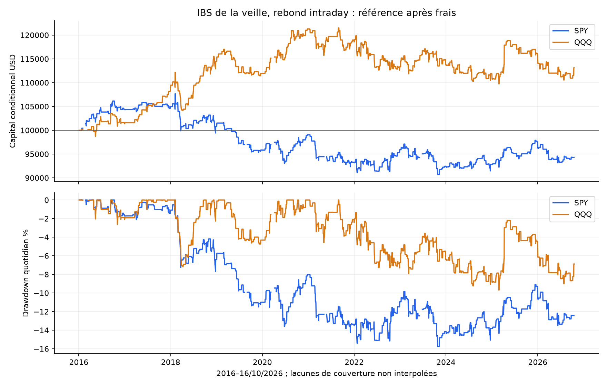
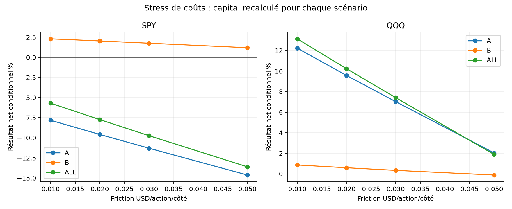
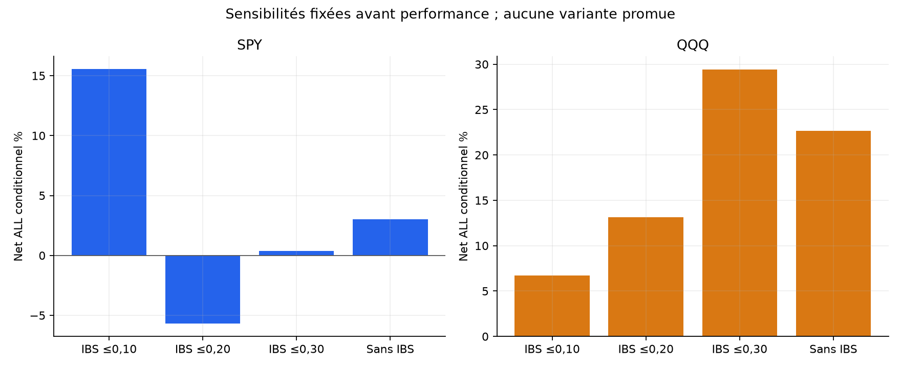
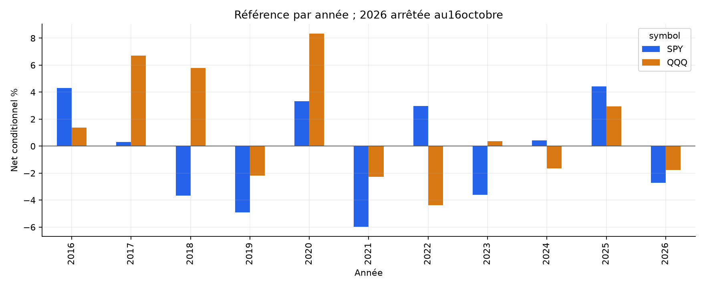

# IBS de la veille, rebond intraday — SPY / QQQ

Les critères historiques prédéfinis ne passent pas. Cette formalisation ne justifie pas un nouveau bot.

Capital100000USD indépendant par scénario. ALL4janvier2016–16octobre2026 ; A jusqu’au30avril2024 ; B1mai2024–16octobre2026. B et ces ETF déjà explorés : aucun nouveau OOS aveugle.

## Recherche élargie et limites des sources

La recherche large a comparé drift nocturne, périodicité, cassures, modèles multi-facteurs et IBS. Pagonidis motive le signal de clôture faible et LEAN fournit sa définition. Leurs stratégies daily/swing peuvent capter l’overnight : cette adaptation est volontairement intraday et ne reproduit pas leurs performances. Parties publiques de blogs/forums seulement, pas de règles payantes inventées. [Recherche et sources](../../RESEARCH.md).

## Règles figées avant PnL

IBS précédent=(close−low)/(high−low), sur toute la séance RTH précédente, neutre0,5 si range nul. Référence LONG si IBS≤0,20, sans RSI ou tendance. Les14séances immédiatement précédentes doivent avoir des OHLC complets : ADR14=moyenne de leurs amplitudes high-low, pas ATR. Aucune sélection de jours valides à travers un trou.

Sizing au close09:30, entrée open09:31. Stop fixe au prix de sizing moinsADR14 arrondi à1e-8USD, puis niveau au centime vers extérieur. Quantité floor(min(capital/prixSizing,1%capital/distanceStop)), plafond causal1x hors coûts. Le gap futur peut dépasser le risque1% sans réduire rétrospectivement la taille. Aucun TP ou gestion ; stop prioritaire, gap au mauvais open, sinon EOD dernier open15:59/12:59 avant sa mèche. Une entrée/jour, aucune nuit détenue. [Protocole complet](../../PROTOCOL_EXECUTION.md).

## Référence après les mêmes frais

| ETF | Période | Trades | Net cumulé % | CAGR % | PF | WR % | DD marks % | Sans top3 % |
| --- | --- | --- | --- | --- | --- | --- | --- | --- |
| SPY | ALL | 463 | -5.70 | -0.54 | 0.951 | 51.84 | 16.31 | -12.45 |
| SPY | A | 368 | -7.83 | -0.97 | 0.918 | 51.36 | 16.31 | -14.42 |
| SPY | B | 95 | 2.30 | 0.93 | 1.103 | 53.68 | 5.65 | -2.30 |
| QQQ | ALL | 463 | 13.15 | 1.15 | 1.094 | 53.13 | 10.02 | 3.69 |
| QQQ | A | 369 | 12.24 | 1.40 | 1.114 | 52.30 | 8.39 | 4.25 |
| QQQ | B | 94 | 0.86 | 0.35 | 1.029 | 56.38 | 7.71 | -5.57 |

Comptes conditionnels aux données résolues ; CAGR sur période nominale. DD aux frais d’entrée, closes1minute entièrement détenus et sortie nette, sans borne de tous les ticks. DD quotidien graphique moins fin. ETF corrélés, pas deux preuves indépendantes ; aucun avantage sur le passif à exposition comparable revendiqué, cash0%.

## Frais et attribution

Commission0,0035USD/action/côté minimum0,35 ; friction adverse0,01USD/action/côté ; empruntSHORT1%annuel/360 minimum1jour pour les ventes à découvert. Friction comprise dans les fills puis attribuée une seule fois. Modèle commun, pas tarif broker garanti ; spreads lors des mouvements rapides et frais variables non observés.

| ETF | Période | Prix USD | Friction USD | Commission USD | Emprunt USD | Net USD | Exposition RTH bornehaute % |
| --- | --- | --- | --- | --- | --- | --- | --- |
| SPY | ALL | -2788.73 | 2152.02 | 754.83 | 0.00 | -5695.58 | 15.22 |
| SPY | A | -5267.46 | 1894.50 | 663.68 | 0.00 | -7825.64 | 15.70 |
| SPY | B | 2678.22 | 279.48 | 98.56 | 0.00 | 2300.18 | 13.59 |
| QQQ | ALL | 17065.26 | 2900.34 | 1016.72 | 0.00 | 13148.20 | 15.28 |
| QQQ | A | 15775.96 | 2621.62 | 917.57 | 0.00 | 12236.78 | 16.05 |
| QQQ | B | 1196.19 | 248.40 | 89.72 | 0.00 | 858.07 | 12.64 |

## Sensibilités fixées et contrôles

| Variante ALL : trades/net%/PF | SPY | QQQ |
| --- | --- | --- |
| reference | 463 / -5.70 / 0.951 | 463 / 13.15 / 1.094 |
| cost_0.02 | 463 / -7.74 / 0.933 | 463 / 10.24 / 1.074 |
| cost_0.03 | 463 / -9.74 / 0.915 | 463 / 7.42 / 1.054 |
| cost_0.05 | 463 / -13.61 / 0.881 | 463 / 1.89 / 1.014 |
| threshold_0.1 | 249 / 15.54 / 1.261 | 256 / 6.69 / 1.086 |
| threshold_0.3 | 666 / 0.38 / 1.002 | 688 / 29.39 / 1.138 |
| both | 1254 / -34.15 / 0.854 | 1309 / -10.89 / 0.968 |
| short_only | 791 / -30.19 / 0.788 | 846 / -21.28 / 0.888 |
| trend200 | 210 / -13.16 / 0.738 | 298 / -0.49 / 0.994 |
| entry_5 | 463 / -1.03 / 0.991 | 463 / 14.39 / 1.110 |
| always_long | 2617 / 3.03 / 1.005 | 2649 / 22.63 / 1.031 |
| resolved_prefix | 463 / -5.70 / 0.951 | 463 / 13.15 / 1.094 |

12variantes ×2ETF ×3périodes=72comptes recouvrants. Frictions0,02/0,03/0,05 ; seuils0,10/0,30 ; both etSHORTseul au seuil haut symétrique ; filtre closeveille>SMA200 ; entrée09:35 avec sizing09:34 ; toujoursLONG sans IBS ; prefix. Historique200 requis seulement pour filtretrend. Always_long conserve ADR/stop/sizing, change fréquence/exposition et capital composé, donc ne prouve pas un effet causal propre à IBS. [Tous les scénarios](comparison_all.csv), aucune variante promue après PnL.

## Critères de présélection déclarés

| Critère avant PnL | Passe |
| --- | --- |
| min100trades_ALL | oui |
| six_references_positive | non |
| sans_top3_ALL_positive | non |
| doubled_friction_A_positive | non |
| block20_ALL_lower_positive | non |

Exiger ≥100trades ALL/ETF, six références positives, ALL sans top3 positif, A à friction doublée positive et bornes basses IC95 blocs20 ALL>0 sur les deux ETF. Un passage resterait une présélection historique, pas preuve prospective ni activation automatique.

## Couverture et provenance

Mêmes archives SIP/préparations vérifiées SHA, calendrier NYSE et rapprochement corporate actions.2714séances préparées dont padding2015-12-31,2713évaluées. SPY2705/QQQ2707complètes dans le cache total. Trous, notamment en2020 ; pas de deuxième flux ni interpolation. [Profil source](DATA_SOURCE_PROFILE.json).

IBS est sans dimension sur une seule séance ; ADR14 etSMA200 utilisent les prix bruts historiques. Aucun split renvoyé par la requête corporate actions archivée, sans certifier sa complétude. Flat overnight, aucun dividende crédité. Les premières séances sont un warmup connu : aucun historique avant le cache2015-12-31 n’est inventé.

complete_days applique après coup la qualité OHLCV de toute la journée après premier signal, biais potentiel. Prefix retire ce filtre mais reste conditionnel : historique ou minute de sizing inconnus avant entrée=>journée inconnue ; trou actif=>trade entier non résolu, frais d’entrée connus exportés. Zéro de chaînage n’est pas cash observé. Données inutiles après signal ou sortie ne l’annulent pas.

| ETF | Période | Exclues principal | Trades principal | Net principal % | Trades prefix | Non résolues | Net prefix % |
| --- | --- | --- | --- | --- | --- | --- | --- |
| SPY | ALL | 78 | 463 | -5.70 | 463 | 0 | -5.70 |
| SPY | A | 78 | 368 | -7.83 | 368 | 0 | -7.83 |
| SPY | B | 0 | 95 | 2.30 | 95 | 0 | 2.30 |
| QQQ | ALL | 49 | 463 | 13.15 | 463 | 0 | 13.15 |
| QQQ | A | 49 | 369 | 12.24 | 369 | 0 | 12.24 |
| QQQ | B | 0 | 94 | 0.86 | 94 | 0 | 0.86 |

## Incertitude et concentration

Bootstrap descriptif3000tirages seed20261028, blocs circulaires5/20séances et clusters annuels. Exclusions au zéro de chaînage, données non reconstruites, peu de clusters et essais multiples non corrigés.

| ETF | Période | IC95 moyenne quotidienne %, blocs5 | Blocs20 | IC95 bps/trade, années |
| --- | --- | --- | --- | --- |
| SPY | ALL | [-0.0113 ; 0.0074] | [-0.0111 ; 0.0070] | [-7.069843265591274, 7.609987872692013] |
| SPY | A | [-0.0142 ; 0.0072] | [-0.0141 ; 0.0071] | [-9.146536674337504, 7.2623850777144225] |
| SPY | B | [-0.0145 ; 0.0206] | [-0.0122 ; 0.0199] | [-10.998067342441283, 23.49362706673047] |
| QQQ | ALL | [-0.0061 ; 0.0156] | [-0.0052 ; 0.0150] | [-2.726343147101707, 18.818159504328953] |
| QQQ | A | [-0.0061 ; 0.0177] | [-0.0049 ; 0.0170] | [-4.6055239328859985, 16.26221959957689] |
| QQQ | B | [-0.0227 ; 0.0270] | [-0.0208 ; 0.0272] | [-8.01725179009954, 44.646431705254784] |

| ETF | Période | Sans top3 % | Sans2020 % | Pertes consécutives max |
| --- | --- | --- | --- | --- |
| SPY | ALL | -12.45 | -8.75 | 7 |
| SPY | A | -14.42 | -10.81 | 7 |
| SPY | B | -2.30 | 2.30 | 5 |
| QQQ | ALL | 3.69 | 4.44 | 9 |
| QQQ | A | 4.25 | 3.60 | 9 |
| QQQ | B | -5.57 | 0.86 | 4 |

Ablations : rendements concernés mis à zéro dans le compte original, sans nouveau sizing. Années/mois/directions, qualité, features et décisions par variante et chaque trade exportés.

## Figures

## Validation et limites

[Tests, revue et replay](../../VALIDATION.md). Code/tests/rapport/audit/dépendances gelés avant PnL. Agrégation séparée minute par minute, historique IBS/ADR/SMA puis replay scalaire de chaque décision, fill et compte sans appeler le moteur. Même chargeur/source : pas de réplication sur un deuxième fournisseur.

Limites : adaptation intraday distincte des stratégies IBS overnight/swing, quotes/carnet absents, ticks non ordonnés dans la minute, spreads variables non reconstruits, coûts fixes/shorts non garantis, couverture incomplète et choix d’hypothèse sur des marchés déjà explorés. Aucun nouveau holdout aveugle, le filtre IBS n’élimine pas le risque de marché.

Les critères historiques prédéfinis ne passent pas. Cette formalisation ne justifie pas un nouveau bot. Les deux bots QQQ existants restent inchangés, aucun nouveau bot ou ordre réel.
