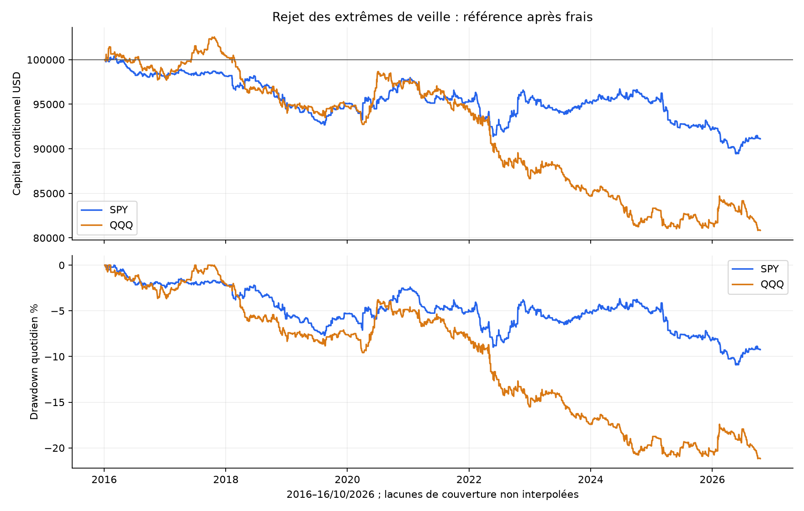
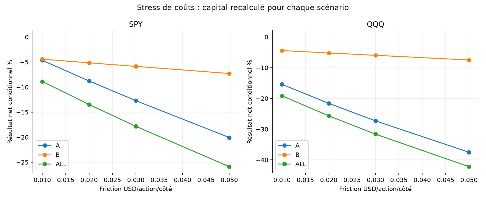
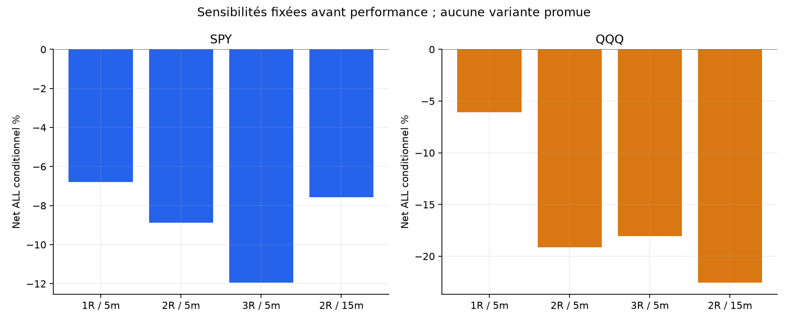
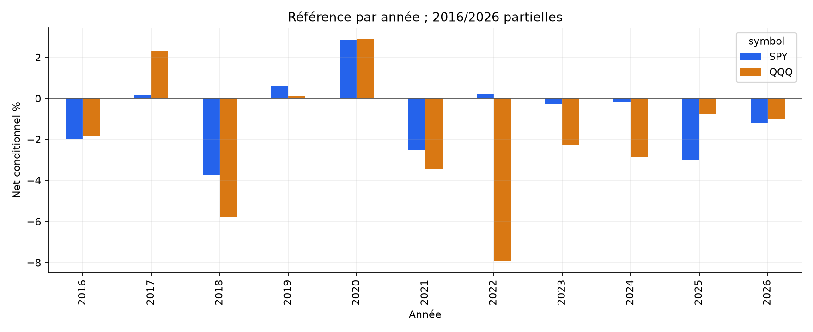

# Rejet des extrêmes de veille — rapport final SPY / QQQ

La référence ne reste pas positive sur les deux ETF et les deux périodes. Cette étude ne justifie pas un nouveau bot.

Capital initial100000USD indépendant par scénario. ALL4janvier2016–16octobre2026 ; A jusqu’au30avril2024 ; B du1mai2024 au16octobre2026. Ces marchés et B ont déjà été étudiés : ce découpage chronologique ne constitue pas un nouvel échantillon aveugle.

## Hypothèse et recherche

Après une fausse cassure du plus haut/bas de la veille, le retour dans le range pourrait produire une réversion intraday. Les exemples publics sur l’or ont servi à définir une primitive mécanique, sans importer leur win rate. [Sources, lecture de code et limites](../../RESEARCH.md). Aucune affirmation sur un carnet ou des stops réellement observés.

## Règles figées

Range OHLC de la séance RTH immédiatement précédente, demi-séances incluses ; correction du dividende cash courant. Open09:30 strictement dedans. Bougie5min : dépassement d’au moins0,01USD de l’extrême, puis clôture strictement dedans. Premier signal seulement ; deux côtés dépassés sur la même bougie=>aucun trade. Entrée à l’open suivant,09:45≤entrée<14:00NY ; une entrée maximum par jour.

Stop0,01USD au-delà de la mèche du signal, arrondi au centime vers l’extérieur. Quantité entière au close du signal : risque cible1%, plafond1x du capital. Objectif2R depuis open d’entrée, arrondi au centime défavorable. Stop prioritaire si touches simultanées ; gap stop au prix défavorable, gap TP sans amélioration. Dernier open15:59 ou12:59 si encore en position. Aucun break-even/trailing/overnight. [Protocole exhaustif](../../PROTOCOL_EXECUTION.md).

## Référence après tous les frais

| ETF | Période | Trades | Net % | CAGR % | PF | WR % | DD marks % | Sans top3jours % |
| --- | --- | --- | --- | --- | --- | --- | --- | --- |
| SPY | ALL | 929 | -8.88 | -0.86 | 0.883 | 32.83 | 10.94 | -11.97 |
| SPY | A | 690 | -4.65 | -0.57 | 0.918 | 32.90 | 9.02 | -7.89 |
| SPY | B | 239 | -4.43 | -1.82 | 0.782 | 32.64 | 7.56 | -5.94 |
| QQQ | ALL | 998 | -19.16 | -1.95 | 0.828 | 33.27 | 21.21 | -22.59 |
| QQQ | A | 770 | -15.42 | -1.99 | 0.823 | 34.03 | 17.56 | -18.26 |
| QQQ | B | 228 | -4.41 | -1.82 | 0.846 | 30.70 | 4.77 | -8.20 |

Compte historique conditionnel aux données résolues. CAGR sur toute la période nominale, pas annualisation du seul temps investi. DD marks inclut coût d’entrée, closes1min entièrement détenus et sortie nette ; ne borne pas tous les ticks. Le graphique de DD quotidien est une mesure moins fine. Deux ETF corrélés, pas deux preuves indépendantes. Aucun avantage face au buy-and-hold à exposition comparable n’est revendiqué ; cash témoin0%, non rémunéré.

## Coûts identiques et attribution

Commission0,0035USD/action/côté, minimum0,35 ; friction adverse0,01USD/action/côté ; empruntSHORT1%annuel/360, minimum un jour. Friction déjà incorporée aux prix et soustraite une seule fois dans l’attribution. Modèle de recherche commun, pas tarif garanti du courtier. Gaps susceptibles de dépasser les plafonds de risque/levier, frais exclus du risque cible.

| ETF | Période | Prix USD | Friction USD | Commission USD | Emprunt USD | Net USD | Exposition RTH bornehaute % |
| --- | --- | --- | --- | --- | --- | --- | --- |
| SPY | ALL | -906.21 | 4957.86 | 1735.26 | 1275.86 | -8875.18 | 2.77 |
| SPY | A | 2011.67 | 4249.88 | 1487.46 | 925.52 | -4651.19 | 2.58 |
| SPY | B | -3060.32 | 742.66 | 259.93 | 367.45 | -4430.36 | 3.42 |
| QQQ | ALL | -7053.42 | 7964.02 | 2787.41 | 1350.74 | -19155.59 | 3.57 |
| QQQ | A | -4514.39 | 7288.00 | 2550.80 | 1065.03 | -15418.22 | 3.24 |
| QQQ | B | -2997.02 | 799.74 | 279.91 | 337.93 | -4414.60 | 4.70 |

## Toutes les sensibilités prévues

| Variante ALL : trades / net% / PF | SPY | QQQ |
| --- | --- | --- |
| reference | 929 / -8.88 / 0.883 | 998 / -19.16 / 0.828 |
| cost_0.02 | 929 / -13.48 / 0.825 | 998 / -25.67 / 0.767 |
| cost_0.03 | 929 / -17.82 / 0.771 | 998 / -31.63 / 0.710 |
| cost_0.05 | 929 / -25.88 / 0.674 | 998 / -42.21 / 0.605 |
| long_only | 446 / -2.85 / 0.932 | 468 / -5.36 / 0.915 |
| short_only | 483 / -6.19 / 0.829 | 530 / -14.57 / 0.727 |
| rr1 | 929 / -6.80 / 0.881 | 998 / -6.08 / 0.927 |
| rr3 | 929 / -11.95 / 0.857 | 998 / -18.05 / 0.853 |
| signal15 | 887 / -7.58 / 0.928 | 961 / -22.56 / 0.850 |
| allow_opening_gap | 1522 / -12.08 / 0.910 | 1574 / -32.22 / 0.813 |
| no_cash_adjust | 924 / -8.01 / 0.894 | 1001 / -18.84 / 0.830 |
| resolved_prefix | 930 / -9.05 / 0.881 | 998 / -19.16 / 0.828 |

12variantes ×2ETF ×3périodes=72comptes recouvrants. Coûts0,02/0,03/0,05 ; LONG/SHORT ; TP1R/3R ; signal15min ; ouverture hors range autorisée ; sans correction cash ; resolved_prefix. Aucune variante choisie gagnante après PnL. [Matrice intégrale A/B/ALL](comparison_all.csv).

## Qualité et couverture

Source Alpaca SIP1minute déjà acquise ; SHA des archives/préparations, calendrier NYSE et rapprochement des corporate actions vérifiés avant PnL.2714séances préparées dont padding2015-12-31,2713évaluées. SPY2705/QQQ2707complètes dans le cache total. Quelques minutes manquent notamment pendant la crise2020. Aucun téléchargement, interpolation ou flux de courtier alternatif ajouté à cette étude. [Profil et empreintes](DATA_SOURCE_PROFILE.json).

Les niveaux exigent les OHLC de la veille entière ; le volume n’intervient pas. Une veille inconnue n’est jamais remplacée par une plus ancienne. Le dividende cash est soustrait seulement à son ex-date, sans futur ajustement ; la table historique et son rapprochement ne garantissent pas un fichier corporate actions exhaustif.

complete_days applique après coup la qualité OHLCV du jour courant lorsque le signal produirait une entrée : ce filtre futur peut favoriser la performance. resolved_prefix retire ce filtre, mais reste conditionnel : lacune nécessaire avant signal=>inconnu ; lacune active=>trade entier non résolu, frais d’entrée connus exportés. Le zéro de chaînage d’une exclusion n’est pas un rendement de cash observé.

| ETF | Période | Exclues principal | Trades principal | Net principal % | Trades prefix | Non résolues | Net prefix % |
| --- | --- | --- | --- | --- | --- | --- | --- |
| SPY | ALL | 12 | 929 | -8.88 | 930 | 0 | -9.05 |
| SPY | A | 12 | 690 | -4.65 | 691 | 0 | -4.83 |
| SPY | B | 0 | 239 | -4.43 | 239 | 0 | -4.43 |
| QQQ | ALL | 9 | 998 | -19.16 | 998 | 1 | -19.16 |
| QQQ | A | 9 | 770 | -15.42 | 770 | 1 | -15.42 |
| QQQ | B | 0 | 228 | -4.41 | 228 | 0 | -4.41 |

## Incertitude et concentration

Bootstrap descriptif3000tirages, seed20261026 : blocs circulaires5/20séances pour la moyenne quotidienne et clusters annuels pour les bps/trade. Comptes conditionnels, exclusions au zéro comptable, peu de clusters et aucune correction des essais multiples. Ces intervalles ne prouvent pas une performance future.

| ETF | Période | IC95 moyenne quotidienne %, blocs5 | Blocs20 | IC95 bps/trade, clusters annuels |
| --- | --- | --- | --- | --- |
| SPY | ALL | [-0.0085 ; 0.0019] | [-0.0087 ; 0.0023] | [-2.351070677631103, 0.25740746329386777] |
| SPY | A | [-0.0082 ; 0.0039] | [-0.0084 ; 0.0042] | [-2.216698339857341, 0.9546519269994891] |
| SPY | B | [-0.0187 ; 0.0041] | [-0.0183 ; 0.0026] | [-4.2962396374613, -0.3639085686059615] |
| QQQ | ALL | [-0.0143 ; -0.0013] | [-0.0144 ; -0.0004] | [-4.164012155190098, -0.24658372063703593] |
| QQQ | A | [-0.0148 ; -0.0008] | [-0.0149 ; -0.0004] | [-4.746956235104151, 0.40373483100867474] |
| QQQ | B | [-0.0226 ; 0.0081] | [-0.0229 ; 0.0105] | [-4.027922271170951, -0.8449134137559922] |

| ETF | Période | Sans top3 % | Sans2020 % | Pertes consécutives max |
| --- | --- | --- | --- | --- |
| SPY | ALL | -11.97 | -11.41 | 19 |
| SPY | A | -7.89 | -7.31 | 19 |
| SPY | B | -5.94 | -4.43 | 11 |
| QQQ | ALL | -22.59 | -21.44 | 15 |
| QQQ | A | -18.26 | -17.81 | 14 |
| QQQ | B | -8.20 | -4.41 | 15 |

Ablations : rendements sélectionnés mis à zéro dans le compte original, sans nouveau redimensionnement. Exports par année/mois/direction, raisons de non-entrée, niveaux/features, données manquantes et transactions accessibles dans ce dossier.

## Figures

## Vérifications et décision

[Tests, revue et audit indépendant](../../VALIDATION.md). Protocole, code et dépendances figés avant PnL. Replay scalaire séparé des signaux, tailles, fills, coûts, comptes et drawdowns sur les mêmes sources : pas une seconde source de marché. Empreintes liées à cette exécution et livraison scellée.

Limites : trade consolidé plutôt que bid/ask/carnet, ordre des ticks inconnu, coûts fixes, shorts non garantis, couverture de crise incomplète, choix de famille et sensibilités sur des données déjà explorées. Les seuils de centime représentent notre formalisation, pas une propriété universelle du marché.

La référence ne reste pas positive sur les deux ETF et les deux périodes. Cette étude ne justifie pas un nouveau bot. Les deux bots QQQ existants restent en simulation ; aucun nouveau bot ni ordre réel.
