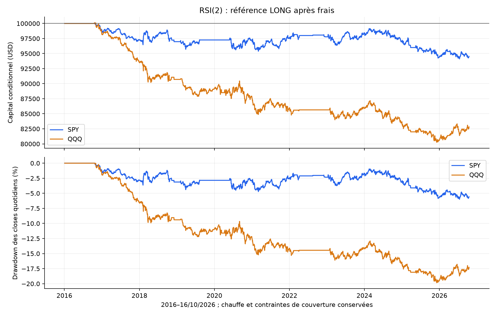
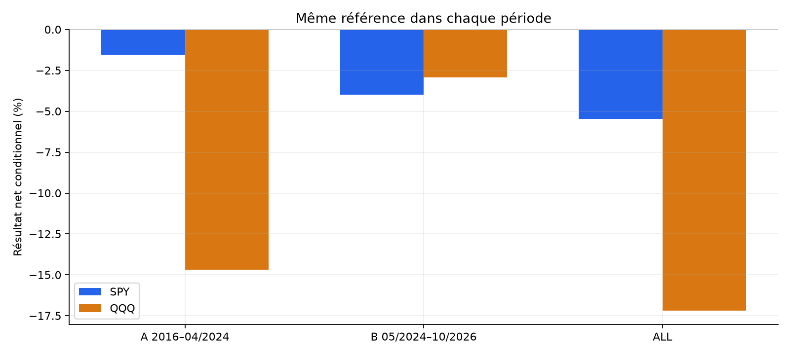
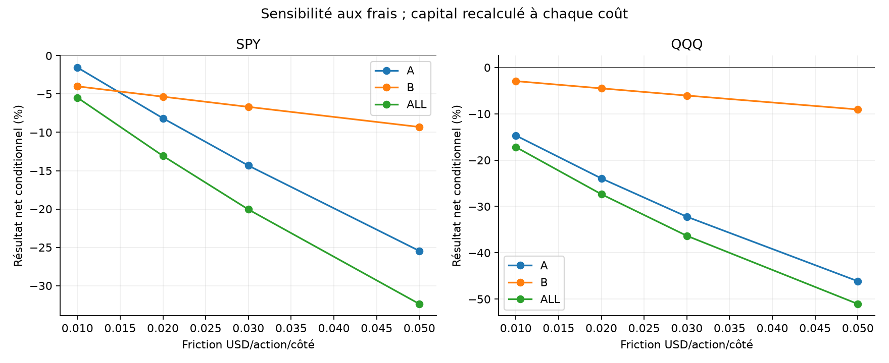
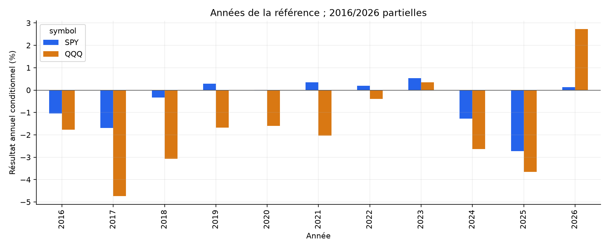

# RSI(2) intraday SPY / QQQ — rapport final

La référence est négative sur les deux ETF après frais ; cette formalisation ne justifie pas un nouveau bot.

72 exécutions fixées avant performances. Entrées 4 janvier 2016–16 octobre 2026 ; A jusqu’au30/04/2024, B du01/05/2024 au16/10/2026. B a déjà servi aux autres recherches : aucun nouvel OOS aveugle. Capital100000USD indépendant par scénario. La chauffe200séances, les absences de closes antérieurs et les journées incomplètes limitent les observations réellement négociées.

## Hypothèse et règles

Adaptation exploratoire intraday du retour à la moyenne RSI(2), distincte des stratégies journalières décrites par Connors. RSI Wilder2 sur closes5min RTH, réinitialisé chaque séance ; LONG quand régime haussier et RSI<5, première occurrence après chauffe ATR14. Régime = close minute RTH précédent contre moyenne des200closes antérieurs, corrigés par dividendes cash cumulés connus. Les200séances sont consécutives : un close manquant ne se remplace pas par une séance plus ancienne. Ce proxy cash-additif n’est pas un rendement total composé.

Entrée au prochain open1min, entre10:00 et15:00 New York ; chauffe ATR14 => première entrée possible10:40 sur séance normale. Une transaction maximum par séance. Stop2ATR14 figé au signal, arrondi adverse au centime. Sortie sur close5m RSI>70 à l’open suivant, stop prioritaire, liquidation à l’open de la dernière minute RTH15:59/12:59. Pas de TP, pyramide, break-even ou maintien overnight. Quantité décidée au signal : risque cible1%, plafond1x, unités entières ; les gaps peuvent dépasser ces plafonds réalisés. [Protocole exact](../../PROTOCOL_EXECUTION.md).

## Résultats principaux après frais

| ETF | Période | Trades | Net % | CAGR % | PF | Win rate % | DD marks % | Sans top3 jours % |
| --- | --- | --- | --- | --- | --- | --- | --- | --- |
| SPY | ALL | 1591 | -5.47 | -0.52 | 0.936 | 63.73 | 6.01 | -6.96 |
| SPY | A | 1139 | -1.54 | -0.19 | 0.974 | 64.44 | 5.08 | -3.10 |
| SPY | B | 452 | -4.00 | -1.65 | 0.851 | 61.95 | 4.91 | -4.78 |
| QQQ | ALL | 1713 | -17.18 | -1.73 | 0.857 | 62.29 | 19.99 | -19.14 |
| QQQ | A | 1251 | -14.68 | -1.89 | 0.834 | 61.47 | 16.20 | -16.70 |
| QQQ | B | 462 | -2.94 | -1.21 | 0.920 | 64.50 | 6.63 | -4.22 |

Le CAGR utilise la période nominale, y compris la chauffe/séances sans ordre. Les drawdowns « marks » utilisent les closes1min entièrement tenus et les événements de fill, pas chaque tick. Les courbes sont conditionnelles à la résolution des données ; elles ne prouvent pas une exécution continue durant les absences. Cash témoin0% avant inflation. Aucun dépassement d’un placement passif n’est revendiqué.

## Coûts et exposition

Mêmes hypothèses que les études ETF précédentes : commission0,0035USD/action/côté, minimum0,35/côté ; friction adverse0,01USD/action/côté ; empruntSHORT1%annuel/360, minimum un jour. Aucun double comptage : friction incorporée aux prix, puis commissions et emprunt soustraits une fois. Ces hypothèses ne sont pas un tarif garanti d’Alpaca. Frais réglementaires variables, file d’attente et bid/ask non reconstitués.

| ETF | Période | Mouvement prix USD | Friction USD | Commissions USD | Emprunt USD | Net USD | Part du temps RTH (borne haute) % |
| --- | --- | --- | --- | --- | --- | --- | --- |
| SPY | ALL | 5553.03 | 8165.66 | 2857.98 | 0.00 | -5470.61 | 3.26 |
| SPY | A | 7639.60 | 6800.66 | 2380.23 | 0.00 | -1541.29 | 3.01 |
| SPY | B | -2130.27 | 1386.14 | 485.15 | 0.00 | -4001.56 | 4.09 |
| QQQ | ALL | -1187.55 | 11846.30 | 4146.20 | 0.00 | -17180.05 | 3.54 |
| QQQ | A | -513.92 | 10495.86 | 3673.55 | 0.00 | -14683.33 | 3.32 |
| QQQ | B | -804.60 | 1583.70 | 554.30 | 0.00 | -2942.60 | 4.28 |

Les variantes SHORT utilisent l’emprunt minimum d’une journée même sans overnight. Le risque de1% est un plafond de prix au signal, pas une garantie de perte nette ; le plafond1x limite généralement la taille avant ce risque cible. Les mesures de levier et de risque effectifs à l’entrée sont exportées, avec leurs éventuels dépassements par gap.

## Configurations et coûts fixés avant résultats

| Variante ALL : trades / net % / PF | SPY | QQQ |
| --- | --- | --- |
| reference | 1591 / -5.47% / 0.936 | 1713 / -17.18% / 0.857 |
| cost_0.02 | 1591 / -13.07% / 0.844 | 1713 / -27.36% / 0.762 |
| cost_0.03 | 1591 / -20.06% / 0.757 | 1713 / -36.34% / 0.672 |
| cost_0.05 | 1591 / -32.39% / 0.602 | 1713 / -51.06% / 0.512 |
| both | 1873 / -8.70% / 0.923 | 2045 / -21.14% / 0.861 |
| short_only | 282 / -3.42% / 0.884 | 332 / -4.77% / 0.883 |
| no_regime | 2206 / -12.93% / 0.901 | 2214 / -28.02% / 0.826 |
| entry_10 | 1903 / -2.09% / 0.978 | 2035 / -6.13% / 0.957 |
| stop_1atr | 1591 / -5.51% / 0.930 | 1713 / -18.75% / 0.835 |
| stop_3atr | 1591 / -5.15% / 0.940 | 1713 / -15.86% / 0.865 |
| exit_80 | 1591 / -10.06% / 0.901 | 1713 / -17.27% / 0.877 |
| resolved_prefix | 1592 / -5.24% / 0.939 | 1713 / -17.18% / 0.857 |

Les72comptes sont recouvrants, pas72preuves indépendantes. BOTH ajoute les SHORT en régime baissier (RSI>95 puis sortie<30). Le filtre de tendance OFF, le seuil10, les stops1/3ATR et la sortie80 sont des sensibilités fixées à l’avance ; aucune n’est retenue après coup comme nouveau résultat principal. Toutes les périodes et coûts figurent dans [comparison_all.csv](comparison_all.csv).

La variante entrée RSI<10 est positive en B (+2,47% SPY, +3,55% QQQ), mais reste négative en A et sur ALL pour les deux ETF. Elle ne remplace pas la référence et ne justifie pas une sélection après observation.

## Couverture et causalité

Sources : archives Alpaca SIP brutes déjà acquises, préparations et corporate actions vérifiées par SHA avant exécution. 2714séances calendaires dans la préparation, dont une première date2015-12-31 sans données suffisantes ; période évaluée2713séances2016–2026. SPY2705séances complètes dans la préparation, QQQ2707. [Profil et empreintes](DATA_SOURCE_PROFILE.json). Aucune clé ni nouvelle requête API nécessaire.

Principal complete_days : exclusion après coup des séances courantes incomplètes pouvant générer une entrée. Ce filtre est connu après la séance et peut favoriser les résultats. resolved_prefix retire ce filtre futur : une lacune avant le signal rend la décision inconnue, une lacune active laisse une intention non résolue et les coûts d’entrée connus dans unresolved.csv ; le trade entier est omis du compte conditionnel. Le zéro de chaînage d’un jour exclu n’est pas du cash observé.

| ETF | Période | Exclues principal | Trades principal | Net principal % | Trades prefix | Non résolues prefix | Net prefix % |
| --- | --- | --- | --- | --- | --- | --- | --- |
| SPY | ALL | 3 | 1591 | -5.47 | 1592 | 0 | -5.24 |
| SPY | A | 3 | 1139 | -1.54 | 1140 | 0 | -1.30 |
| SPY | B | 0 | 452 | -4.00 | 452 | 0 | -4.00 |
| QQQ | ALL | 1 | 1713 | -17.18 | 1713 | 0 | -17.18 |
| QQQ | A | 1 | 1251 | -14.68 | 1251 | 0 | -14.68 |
| QQQ | B | 0 | 462 | -2.94 | 462 | 0 | -2.94 |

Une absence de régime éligible ou une chauffe connue avant séance implique aucun ordre selon les règles. Une donnée de close antérieur manquante bloque le régime jusqu’à sa sortie des200séances : ce comportement est causal mais restreint la période réellement exploitable. Il ne certifie pas que l’historique est complet. Les raisons détaillées par date sont dans daily.csv et les features. L’égalité éventuelle de résultats prefix et principal ne résout pas les opportunités manquantes.

## Incertitude et concentration

Les fichiers *_uncertainty.json contiennent les intervalles descriptifs par blocs circulaires5/20séances et clusters annuels,3000tirages seed20261024. Ils utilisent les retours conditionnels existants et ne corrigent ni les journées inconnues, ni les recherches multiples, ni la réutilisation de B. Pas de seuil p choisi après coup.

| ETF | Période | Sans top3 jours % | Sans2020 % | Série pertes max |
| --- | --- | --- | --- | --- |
| SPY | ALL | -6.96 | -5.47 | 7 |
| SPY | A | -3.10 | -1.55 | 6 |
| SPY | B | -4.78 | -4.00 | 7 |
| QQQ | ALL | -19.14 | -15.84 | 8 |
| QQQ | A | -16.70 | -13.30 | 8 |
| QQQ | B | -4.22 | -2.94 | 5 |

Les ablations mettent à zéro les rendements journaliers sélectionnés ; ce ne sont pas des comptes recalculés sans ces trades. Années/mois et directions sont exportés à côté du rapport. Un haut win rate peut coexister avec des gains faibles et des stops plus grands.

## Figures

## Validation et limites

[Tests, revue et audit indépendant](../../VALIDATION.md). Snapshots de code et dépendances figés avant la boucle dans PRE_EXECUTION_PROTOCOL.json. Les tests contrôlés ne sont pas des performances de marché. Les vérifications indépendantes relisent prix/signaux/comptes sans utiliser les fonctions du moteur pour confirmer leur arithmétique ; leur portée exacte figure dans les preuves d’audit.

Hypothèse encore non vérifiée en direct : rebond d’un excès intraday mesuré par RSI. Quotes de trades consolidées, résolution1min, gaps inconnus et coûts fixes peuvent différer des fills d’un courtier. Les données excluent plusieurs minutes de crise2020 et la complétude du retour des corporate actions n’est pas garantie. SPY/QQQ partagent leur exposition actions américaines, donc les deux résultats ne sont pas indépendants.

## Décision

La référence est négative sur les deux ETF après frais ; cette formalisation ne justifie pas un nouveau bot. Aucune variante choisie après résultats, aucune modification de Noise Area/ORB, aucun ordre envoyé.

Sources de l’idée : [Connors, sorties dynamiques RSI](https://tradingmarkets.com/recent/dynamic_exits_how_to_properly_exit_a_trade-641067), [TradingMarkets, replis et régime200jours](https://tradingmarkets.com/recent/buying_weakness_and_selling_strength-684961), [TradeStation, formule Wilder](https://help.tradestation.com/10_00/eng/tsdevhelp/elword/function/rsi_function_.htm). Ces textes motivent l’hypothèse ; leurs résultats ne sont pas importés dans nos comptes.
