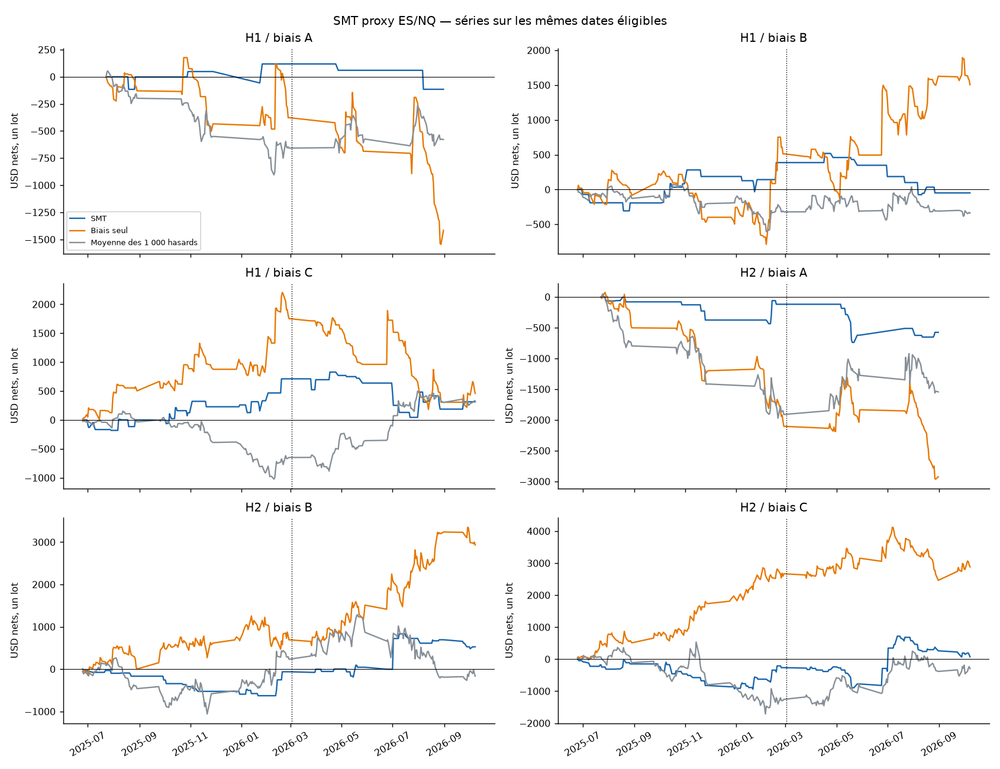
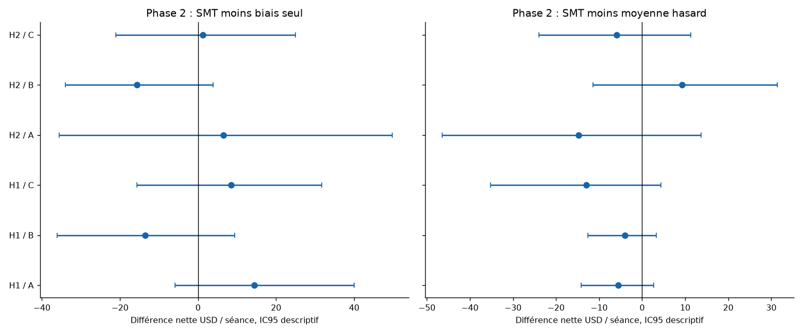
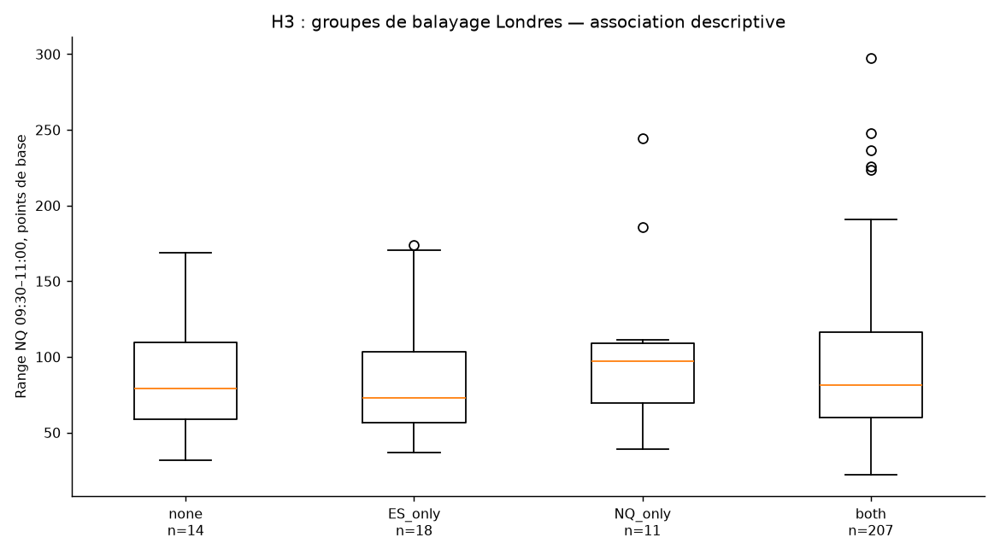
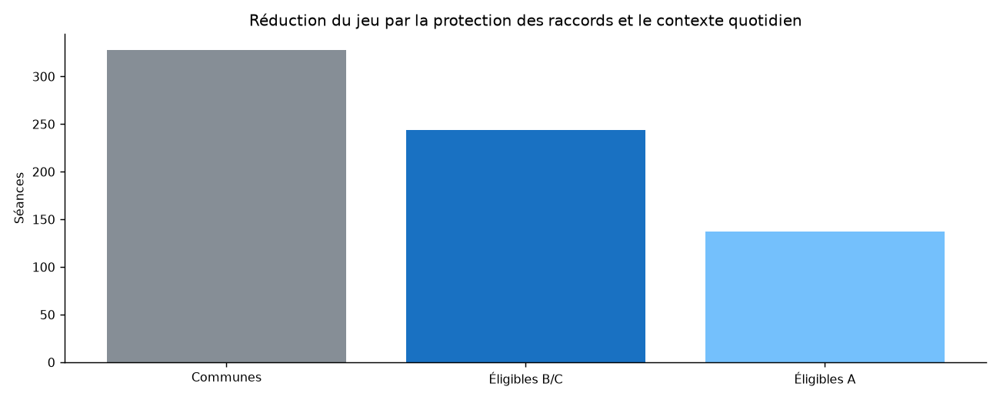

# SMT ES/NQ aux coûts MNQ — rapport complet

**Test proxy terminé. 0/6 variantes franchissent tous les critères préfixés.** Le tableau publie les six variantes ; aucun choix après résultat, aucun nouveau bot.

[Décision et interprétation détaillée](INTERPRETATION.md).

## Ce qui est testé

Hypothèse : la divergence ES/NQ ajoute-t-elle une espérance nette au-delà du biais et d’une minute aléatoire ? H1 continuation et H2 retournement sont testés avec trois biais. Un seul lot évalué à 2 USD/point, sans pourcentage de rendement ni capital arbitraire. Le comparateur ES n’est pas tradé.

Les résultats ne sont **pas** une exécution sur de vrais MNQ/MES. Leurs transactions, bougies et balayages peuvent différer. Le continu ES/NQ est autorisé comme phase proxy ; une réussite éventuelle resterait à confirmer sur contrats micros datés.

[Protocole complet figé](PROTOCOL_EXECUTION.md), [empreintes avant résultats](FREEZE.json), [code](smt/engine.py), [graines et contexte](smt/context.py).

## Couverture et données

Archives minute communes : **20 juin 2025–8 octobre 2026, 328 séances NYSE**. Entêtes locales America/New_York, conversion IANA vers UTC ; offsets hiver/été vérifiés, aucun offset fixe. Aucun doublon de prix contradictoire, aucun remplissage. 0 séance(s) incomplète(s) dans les fenêtres intraday retenues.

Les archives sont des **continus front-month non ajustés**, sans échéance par minute. **Nombre exact de changements identifiés : inconnu.** Les 78 dates dans les fenêtres trimestrielles préventives deviennent 84 dates exclues en protégeant aussi la veille. Ces nombres ne sont pas un nombre de raccords réels. Un contexte de veille ES absent au début est également identifié, sans inventer de niveau.

Biais B/C : **244 séances**, découverte 138, phase 2 106. Biais A : **137 séances**, découverte 81, phase 2 56, car les 20 clôtures doivent aussi éviter les raccords. Les stratégies et témoins d’une variante partagent exactement ces dates. Les variantes A et B/C ont des cohortes différentes : ne pas classer leurs seuls PnL totaux.

[Dates et motifs de toutes les exclusions](results/quality.csv), [niveaux](results/levels.csv), [profil et SHA des sources](results/data_profile.json). Les données brutes privées ne sont pas redistribuées. La complétude est une condition rétrospective de l’échantillon ; les tests de préfixe vérifient qu’elle ne change pas les signaux antérieurs.

La coupure est fixée au 2 mars 2026 : découverte jusqu’au 27 février, phase 2 à partir du 2 mars. Ces archives ont déjà servi dans le dépôt : il s’agit d’une séparation chronologique du protocole, **pas d’un OOS aveugle garanti**.

## Règles mécaniques et choix fixés

Londres 04:00–07:00, prémarché 07:00–09:30, veille cash 09:30–clôture NYSE. La veille quotidienne suit RTH, avec demi-séance à 13:00 ; pas le settlement Globex. Signal sur bougie close 09:31–10:59, entrée open suivant 09:32–11:00, fermeture open 11:30. Le balayage 09:30 est mémorisé mais n’arme pas un H2 reporté. Premier signal admissible dans le sens du biais ; priorité Londres → prémarché → veille en cas de même minute. Une seule tentative, sans remplacement après rejet.

H1 : stop sous/au-dessus des dix bougies closes ; objectif premier niveau NQ dans la priorité situé au-delà de la dernière clôture augmentée du glissement prévu ; ratio estimé au moins 1. H2 : retour ES de l’autre côté du niveau, stop extrême NQ depuis 09:30, objectif 2R depuis le fill. NQ balayant avant confirmation annule H2. Les deux directions simultanées non ordonnables sous C sont refusées.

Commission **1,25 USD par côté** ; principal **deux ticks au total aller-retour**, un par côté : **3,50 USD/trade**. Stress : deux ticks par côté, **4,50 USD/trade**. Coût uniforme également aux objectifs. Un gap conserve son trade : R utilise le fill réel, journal `ecart_ouverture`. Ouverture dépassant déjà stop ou cible : sortie immédiate à cette ouverture, deux côtés de coûts. Sinon stop et cible dans la même bougie : stop prioritaire.

## Six résultats principaux — un lot, frais déduits

| Modèle/biais | Trades ALL | Trades découverte/phase2 | Net découverte USD | Net phase2 USD | Net ALL USD | R net/trade | PF net | DD clôturé USD |
|---|---|---|---|---|---|---|---|---|
| H1/A | 7 | 5/2 | 118.00 | -233.50 | -115.50 | 0.143 | 0.746 | 233.50 |
| H1/B | 29 | 19/10 | 386.50 | -435.50 | -49.00 | -0.103 | 0.966 | 593.00 |
| H1/C | 48 | 30/18 | 711.50 | -397.00 | 314.50 | 0.027 | 1.129 | 783.00 |
| H2/A | 24 | 12/12 | -119.50 | -456.50 | -576.00 | -0.108 | 0.563 | 740.00 |
| H2/B | 45 | 22/23 | -62.50 | 588.50 | 526.00 | -0.203 | 1.331 | 628.50 |
| H2/C | 101 | 55/46 | -265.00 | 339.00 | 74.00 | -0.248 | 1.018 | 937.50 |

A = clôture veille vs SMA20 ; B = bougie de la veille ; C = les deux sens. Un PnL positif seul ne valide pas l’apport SMT. [Statistiques complètes, y compris Wilson, pertes et exposition](results/summary.csv). Le drawdown publié est calculé après transactions clôturées : il sous-estime potentiellement les mouvements intraposition, et n’est pas un drawdown de compte à levier. Les R s’additionnent avec un risque réel variable par trade.

## Apport net par rapport aux témoins — phase 2

| Modèle/biais | Δ biais USD/jour [IC95] | Δ hasard USD/jour [IC95] | p rang hasard | p joint Holm | Net stress B USD | Tous critères |
|---|---|---|---|---|---|---|
| H1/A | 14.38 [-5.86 ; 40.02] | -5.58 [-14.18 ; 2.71] | 0.6593 | 1.0000 | -235.50 | NON |
| H1/B | -13.48 [-36.13 ; 9.35] | -3.96 [-12.63 ; 3.28] | 0.6543 | 1.0000 | -445.50 | NON |
| H1/C | 8.44 [-15.59 ; 31.74] | -12.93 [-35.16 ; 4.38] | 0.8791 | 1.0000 | -415.00 | NON |
| H2/A | 6.49 [-35.61 ; 49.75] | -14.71 [-46.48 ; 13.71] | 0.7852 | 1.0000 | -462.50 | NON |
| H2/B | -15.59 [-34.01 ; 3.90] | 9.32 [-11.44 ; 31.38] | 0.2458 | 1.0000 | 576.00 | NON |
| H2/C | 1.17 [-21.07 ; 24.95] | -5.87 [-23.95 ; 11.35] | 0.6683 | 1.0000 | 311.00 | NON |

Intervalles percentiles, 3 000 bootstraps circulaires, blocs de 20 observations éligibles ; blocs de 5 aussi publiés. Les observations adjacentes peuvent être séparées par une fenêtre exclue. Test centré unilatéral sur la différence quotidienne ; p joint = maximum des deux p bootstrap et du rang empirique parmi 1 000 hasards, Holm sur les six variantes. Hypothèses stationnaires limitées et nombreuses recherches antérieures du dépôt : ce calcul n’efface pas le risque global de recherche multiple. [Tous les contrastes](results/contrasts.csv), [conditions booléennes de passage](results/gates.json).

## Fréquence et exposition des témoins

| Variante | SMT USD | Biais USD | Hasard moyen USD | Distribution hasard 95% USD | Trades SMT/biais/hasard | Minutes SMT/biais/hasard |
|---|---|---|---|---|---|---|
| H1/A | -115.50 | -1 416.00 | -578.67 | [-2 422.79 ; 1 432.29] | 7/99/94.0 | 85/944/1 591 |
| H1/B | -49.00 | 1 506.00 | -337.20 | [-2 881.55 ; 2 438.29] | 29/169/162.9 | 650/2 722/2 837 |
| H1/C | 314.50 | 461.00 | 325.45 | [-2 393.32 ; 2 961.12] | 48/167/172.6 | 1 071/2 471/3 139 |
| H2/A | -576.00 | -2 924.00 | -1 544.38 | [-4 161.26 ; 1 037.12] | 24/137/137.0 | 254/816/4 676 |
| H2/B | 526.00 | 2 934.00 | -166.67 | [-3 565.89 ; 3 408.64] | 45/244/244.0 | 419/2 817/8 918 |
| H2/C | 74.00 | 2 883.00 | -295.52 | [-3 775.27 ; 3 102.31] | 101/244/244.0 | 1 381/3 080/8 697 |

Les 1 000 hasards sont des portefeuilles complets, pas 1 000 nouveaux marchés indépendants. Une entrée invalide reste sans ordre, sans retirer une autre minute. La pièce C quotidienne et les minutes sont communes à tous les témoins : **graine 20261031, PCG64, clés par date**, [table exacte](results/control_draws.csv). Les stratégies plus rares évitent des coûts : un contraste favorable face à un témoin perdant ne suffit pas à démontrer une prévision rentable. [1 000 portefeuilles par variante/coût/période, dont R et coûts](results/random_portfolios.csv).

## Jours refusés et diagnostics

| Variante | SMT sans cible | SMT RR<1 | SMT absent | H2 annulé | Sans confirm. | Ambigu | Biais sans cible | Biais RR<1 | Hasards sans cible* | Hasards RR<1* |
|---|---|---|---|---|---|---|---|---|---|---|
| H1/A | 0 | 24 | 106 | 0 | 0 | 0 | 8 | 30 | 19845 | 23197 |
| H1/B | 0 | 39 | 176 | 0 | 0 | 0 | 18 | 57 | 41759 | 39345 |
| H1/C | 0 | 78 | 118 | 0 | 0 | 0 | 12 | 65 | 32849 | 38512 |
| H2/A | 0 | 0 | 102 | 9 | 2 | 0 | 0 | 0 | 0 | 0 |
| H2/B | 0 | 0 | 184 | 12 | 3 | 0 | 0 | 0 | 0 | 0 |
| H2/C | 0 | 0 | 118 | 21 | 4 | 0 | 0 | 0 | 0 | 0 |

* Comptages sur 1 000 portefeuilles ; ce ne sont pas des dates distinctes. Les catégories complètes incluent les biais neutres dans [diagnostics.json](results/diagnostics.json). Les journées sans cible sont publiées explicitement pour la stratégie et les deux témoins.

| Variante | Coûts USD | Win rate | Wilson95 | Série pertes max | Pire jour USD | 5 meilleurs gains USD | R nul |
|---|---|---|---|---|---|---|---|
| H1/A | 24.50 | 42.86% | 15.82–74.95% | 2 | -175.00 | 339.00 | 0 |
| H1/B | 101.50 | 37.93% | 22.69–56.00% | 6 | -175.00 | 968.50 | 0 |
| H1/C | 168.00 | 39.58% | 27.02–53.69% | 8 | -223.50 | 1 262.00 | 0 |
| H2/A | 84.00 | 33.33% | 17.97–53.29% | 7 | -277.00 | 658.00 | 0 |
| H2/B | 157.50 | 31.11% | 19.53–45.66% | 9 | -113.50 | 1 571.50 | 0 |
| H2/C | 353.50 | 28.71% | 20.80–38.19% | 9 | -277.00 | 1 996.50 | 0 |

| Variante | Gaps non nuls | RR réel<1 H1 | Sorties immédiates | Stop+TP même bougie | Gap absolu max pts |
|---|---|---|---|---|---|
| H1/A | 6 | 0 | 0 | 0 | 0.75 |
| H1/B | 23 | 1 | 0 | 0 | 1.00 |
| H1/C | 38 | 1 | 0 | 0 | 1.75 |
| H2/A | 22 | 0 | 0 | 1 | 2.00 |
| H2/B | 36 | 0 | 0 | 2 | 2.00 |
| H2/C | 87 | 0 | 0 | 3 | 5.00 |

Les excursions MAE/MFE des journaux ne sont que les extrêmes observables conservés par le simulateur hors ordre intraminute inconnu : elles ne certifient pas le chemin des prix. Le rapport utilise les drawdowns clôturés. Les journaux `ledger_1_*` et `ledger_2_*` incluent `ecart_ouverture`, prix remplis, stops, objectifs, frais, résolution et R réel.

### Contrefactuel demandé pour C — NON TRADABLE

| Modèle | Période | Jours SMT appariés | SMT USD | 09:32 sens futur USD | Hasard sens futur moyen USD |
|---|---|---|---|---|---|
| H1 | A | 30 | 711.50 | 617.50 | 460.03 |
| H1 | B | 18 | -397.00 | -523.50 | -24.52 |
| H1 | ALL | 48 | 314.50 | 94.00 | 435.50 |
| H2 | A | 55 | -265.00 | -642.00 | -1 034.68 |
| H2 | B | 46 | 339.00 | -1 487.50 | -2 000.82 |
| H2 | ALL | 101 | 74.00 | -2 129.50 | -3 035.50 |

Ces témoins connaissent le sens futur du signal et se limitent aux dates où SMT trade. Ils ne sont pas disponibles à 09:32 et ne participent à aucun critère. Les permutations de cartes minute/direction sont également des placebos statistiques non tradables, publiés dans diagnostics.json. Les tests par niveau [uniquement découverte](results/discovery_level_diagnostic.csv) conservent la priorité commune des objectifs H1 ; ils ne servent à choisir aucune variante.

## H3 — balayage Londres et volatilité, sans ordre

| Période | Groupe | Séances | Range moyen pts | Médiane pts | Moyenne bps | Médiane bps |
|---|---|---|---|---|---|---|
| A | none | 8 | 233.91 | 216.62 | 94.65 | 86.63 |
| A | ES_only | 11 | 190.64 | 181.25 | 77.56 | 69.76 |
| A | NQ_only | 7 | 287.96 | 230.50 | 113.89 | 97.00 |
| A | both | 115 | 207.93 | 180.50 | 84.20 | 75.11 |
| A | any | 133 | 210.71 | 181.25 | 85.21 | 75.11 |
| B | none | 6 | 223.62 | 235.38 | 75.64 | 79.21 |
| B | ES_only | 7 | 289.86 | 225.25 | 99.95 | 76.15 |
| B | NQ_only | 4 | 257.06 | 252.50 | 90.53 | 91.38 |
| B | both | 92 | 290.19 | 261.00 | 101.86 | 90.84 |
| B | any | 103 | 288.88 | 256.00 | 101.29 | 90.35 |
| ALL | none | 14 | 229.50 | 235.38 | 86.50 | 79.21 |
| ALL | ES_only | 18 | 229.22 | 217.88 | 86.26 | 72.95 |
| ALL | NQ_only | 11 | 276.73 | 230.50 | 105.40 | 97.00 |
| ALL | both | 207 | 244.49 | 211.75 | 92.05 | 81.25 |
| ALL | any | 236 | 244.83 | 212.62 | 92.23 | 81.36 |

Groupe any recoupe ES seul/NQ seul/deux, ce n’est pas une cinquième cohorte disjointe. Le contraste any moins none et ses IC sont publiés par blocs 5/20, avec et hors calendrier retenu, dans [h3_summary.csv](results/h3_summary.csv). Une association de range, même forte, ne fournit ni direction, ni entrée, ni espérance après frais.

| Période | Calendrier | Delta any-none bps | IC95 blocs20 |
|---|---|---|---|
| A | all | -9.44 | [-37.47 ; 21.00] |
| A | outside_retained_calendar | -19.29 | [-43.83 ; 13.12] |
| B | all | 25.66 | [8.16 ; 42.20] |
| B | outside_retained_calendar | 25.89 | [9.18 ; 40.95] |
| ALL | all | 5.73 | [-14.90 ; 25.59] |
| ALL | outside_retained_calendar | 1.13 | [-19.93 ; 20.95] |

**Nuance H3 :** en phase 2, +25,66 bps, IC95 [+8,16 ; +42,20], aussi positif hors calendrier retenu. Cela repose sur 103 séances balayées contre seulement **six** sans balayage ; découverte −9,44 bps et ensemble +5,73 bps non concluants. Le signal descriptif récent ne constitue pas une relation stable confirmée, une causalité ou une stratégie rentable.

## Annonces retenues

| Variante | Phase2 : strate | Séances | Trades | Net USD |
|---|---|---|---|---|
| H1/A | retained_announcements | 6 | 1 | -175.00 |
| H1/A | outside_retained_calendar | 50 | 1 | -58.50 |
| H1/B | retained_announcements | 10 | 2 | -154.50 |
| H1/B | outside_retained_calendar | 96 | 8 | -281.00 |
| H1/C | retained_announcements | 10 | 3 | -378.00 |
| H1/C | outside_retained_calendar | 96 | 15 | -19.00 |
| H2/A | retained_announcements | 6 | 2 | -128.50 |
| H2/A | outside_retained_calendar | 50 | 10 | -328.00 |
| H2/B | retained_announcements | 10 | 3 | 580.50 |
| H2/B | outside_retained_calendar | 96 | 20 | 8.00 |
| H2/C | retained_announcements | 10 | 6 | 279.00 |
| H2/C | outside_retained_calendar | 96 | 40 | 60.00 |

CPI et emploi NFP : calendriers annuels BLS, horaires 08:30 NY. FOMC : dates des communiqués officiels Fed à 14:00, après la sortie forcée. Ce sont des diagnostics avec/sans ces dates, sans ajout de filtre. D’autres annonces et jours agités existent. [Calendrier daté et sources](sources/news_calendar.csv).

## Figures

## Vérification et reproduction

**32 tests automatisés** avant gel, dont un parcours complet synthétique des six variantes/coûts/témoins. Oracle séparé sans import du moteur de trading, du contexte ou des statistiques : **173,728 plans/exécutions candidats**, **2,500 journées de signaux**, **4,180,564 comparaisons de champs**, 288 contrôles agrégés et 1000 vérifications H3. Voir [reçu](audit/oracle_receipt.json), [oracle](audit/verify.py) et [reproduction](REPRODUCTION.md). Les empreintes finales relient protocole, code, sources publiques et résultats.

Le gel porte sur le code et les empreintes des sources avant PnL ; les programmes de rapport et de vérification ajoutés ensuite n’ont pas modifié les règles. Aucune optimisation, aucun retrait de variante perdante. Une réussite proxy nécessiterait ensuite des échéances MNQ/MES authentifiées et une période nouvelle, puis une simulation prospective ; aucun passage automatique au réel.

## Sources publiques

- [CME — spécifications MNQ](https://www.cmegroup.com/markets/equities/nasdaq/micro-e-mini-nasdaq-100.contractSpecs.html) et [MES](https://www.cmegroup.com/markets/equities/sp/micro-e-mini-sandp-500.contractSpecs.html).

- [CME — dates usuelles de roll](https://www.cmegroup.com/trading/equity-index/rolldates.html) : ne prouvent pas les dates du fournisseur de continu.

- [BLS 2025](https://www.bls.gov/schedule/2025/home.htm), [BLS 2026](https://www.bls.gov/schedule/2026/home.htm), [calendrier FOMC](https://www.federalreserve.gov/monetarypolicy/fomccalendars.htm).

- [Description publique du script SMT cité](https://www.tradingview.com/script/qOrye4Ka-Killzones-SMT-IFVG-detector/) ; son code privé n’est pas une preuve de résultat pour notre protocole. [TradingView, déclaration et coûts](https://www.tradingview.com/pine-script-docs/language/declaration-statements/).
