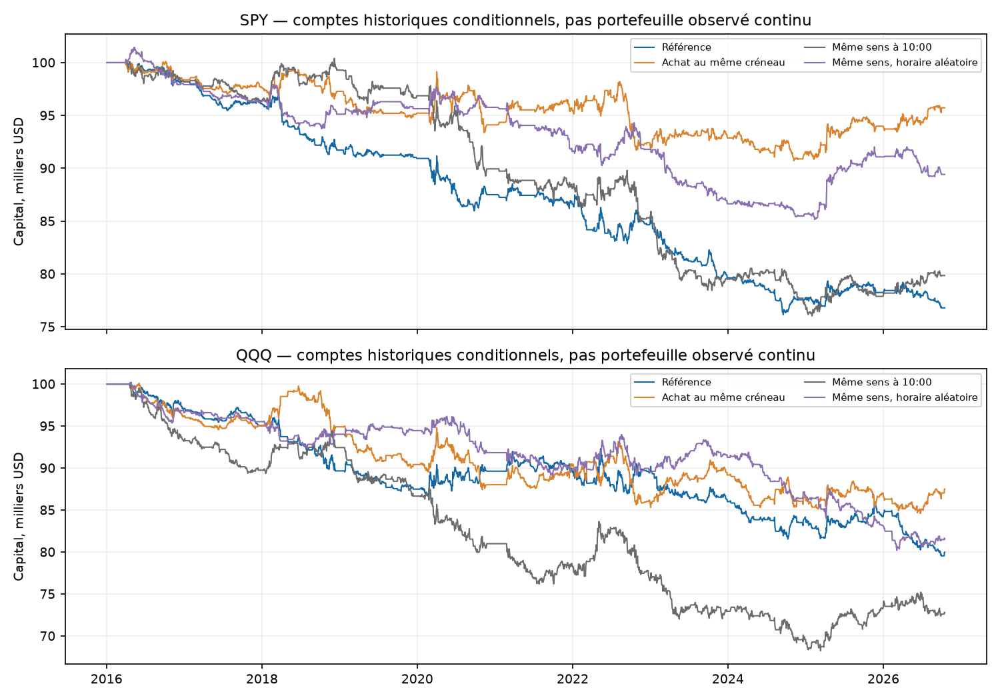
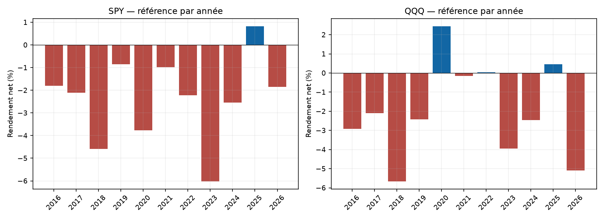
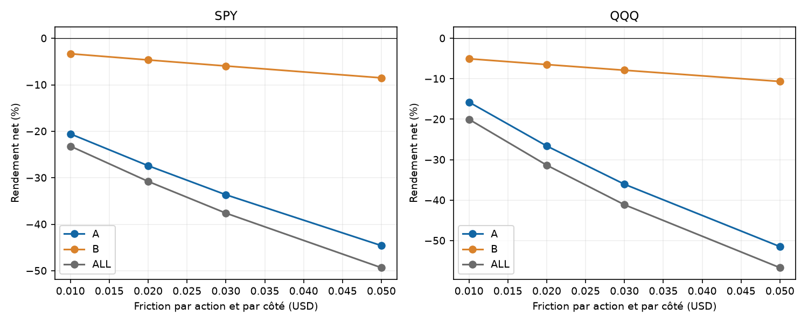
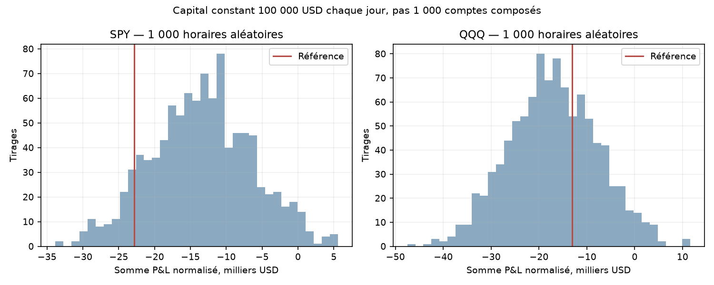

# Rapport final — saisonnalité au même créneau : QQQ et SPY

**Conclusion : la référence ne justifie aucun nouveau bot dans cette formalisation.** Les décisions restent celles du protocole figé avant le premier calcul de marché ; aucun réglage gagnant n’a été substitué après lecture des résultats.

Cette étude cherche une persistance du rendement à la même heure sur 40 séances passées. Source primaire : [Heston/Korajczyk/Sadka](https://arxiv.org/abs/1005.3535). Leur résultat porte sur des classements transversaux d’actions ; notre règle par ETF, son seuil statistique et ses stops sont une adaptation, pas une réplication. [Recherche élargie et alternatives](../../RESEARCH.md).

Données SIP 1 minute, séances du 4 janvier 2016 au 16 octobre 2026. A se termine le 30 avril 2024 ; B commence le 1er mai 2024. A et B ont déjà été réutilisées par de nombreuses études du dépôt : **B n’est pas une nouvelle validation aveugle**. Comptes indépendants de 100 000 USD, taille décidée avant fill, plafond cible 1x / risque 1 %. Prix bruts, pas de nuit ni intérêt de cash.

## Résultats de référence après les mêmes frais

| ETF | Période | Trades | Net cumulé % | CAGR % | PF | DD observé % | Win rate % |
|---|---|---|---|---|---|---|---|
| QQQ | A | 1451 | -15.77 | -2.04 | 0.88 | 16.71 | 47.42 |
| QQQ | B | 436 | -5.06 | -2.09 | 0.88 | 7.84 | 50.92 |
| QQQ | ALL | 1887 | -20.02 | -2.05 | 0.88 | 20.56 | 48.22 |
| SPY | A | 1423 | -20.56 | -2.73 | 0.79 | 20.96 | 46.31 |
| SPY | B | 434 | -3.33 | -1.37 | 0.90 | 4.44 | 48.39 |
| SPY | ALL | 1857 | -23.20 | -2.42 | 0.81 | 23.90 | 46.80 |

Ces rendements sont **conditionnels aux données résolues**. Les dates inconnues ne sont pas des journées cash observées. Le drawdown est celui des marques/closes tenus et de la sortie simulée, pas du pire tick.

## Règles et coûts

À chaque séance, choisir le premier créneau 10:00–15:00 dont le rendement des 40 séances précédentes donne |moyenne/erreur-type|>=1,5. Le sens et le créneau historiques sont connus avant l’ouverture. À la décision, stop à 2 sigma estimés à l’avance, prix de taille dernier close connu ; entrée une minute plus tard, puis stop ou sortie à l’open 30 minutes après l’entrée. Un trade/jour, aucune réentrée, aucun objectif optimisé. Les créneaux tardifs sont retirés quand le calendrier annonce une demi-séance.

Commission max(0,35 USD, 0,0035 USD/action) **par côté**, friction adverse 0,01 USD/action/côté, emprunt SHORT 1 %/360 avec minimum un jour. Stress 0,02/0,03/0,05. Le prix d’ouverture futur ne redimensionne pas l’ordre ; gaps, entrée déjà au-delà du stop et deux côtés de coûts sont conservés. [Protocole exact](../../PROTOCOL_EXECUTION.md).

## Attribution du résultat ALL

| ETF | Mouvements prix USD | Friction USD | Commissions USD | Emprunt USD | Net USD |
|---|---|---|---|---|---|
| SPY | -9048.56 | 9322.04 | 3262.73 | 1571.15 | -23204.48 |
| QQQ | 720.12 | 14026.80 | 4909.38 | 1802.59 | -20018.65 |

Cette attribution conserve les quantités du trajet après frais. Elle ne constitue pas un nouveau compte sans frais recalculé. Les coûts ne sont soustraits qu’une fois.

## Témoins et incertitude

Trois témoins causaux conservent la candidature historique : achat systématique au même créneau, même sens à 10:00, même sens à une heure SHA-seedée avant la séance. Quantités, stops, durée et coûts suivent les mêmes règles. Comparaisons appariées sur couverture commune ; bootstrap circulaire 3 000 tirages avec blocs 5/20 sur le calendrier en gardant les dates inconnues masquées. Les anciennes CI de zéros comptables restent descriptives ; le critère économique utilise seulement les observations connues avec pondération de leur nombre dans chaque bloc.

### SPY

Moyenne quotidienne nette observée, IC95 blocs 20 : [-1.9171, -0.4494] points de base ; 2239 séances connues sur 2713 calendaires.

| Témoin | Jours appariés | Jours où les deux tradent | Écart moyen net, pb/jour | IC95 blocs 20, pb/jour | p unilatéral |
|---|---:|---:|---:|---|---:|
| control_same_clock_long | 2239 | 1857 | -0.9840 | [-2.0646, 0.1572] | 0.9613 |
| control_fixed_clock | 2239 | 1857 | -0.1816 | [-1.2785, 0.8714] | 0.6145 |
| control_random_clock | 2041 | 1659 | -0.5996 | [-1.5428, 0.3414] | 0.8960 |

p d’intersection (maximum des 3 comparaisons)=0.961346, p Holm parmi les 2 ETF=1.000000. Critères satisfaits : 1/7. Statut de référence : critères non satisfaits.

### QQQ

Moyenne quotidienne nette observée, IC95 blocs 20 : [-1.8580, -0.0470] points de base ; 2296 séances connues sur 2713 calendaires.

| Témoin | Jours appariés | Jours où les deux tradent | Écart moyen net, pb/jour | IC95 blocs 20, pb/jour | p unilatéral |
|---|---:|---:|---:|---|---:|
| control_same_clock_long | 2296 | 1887 | -0.3904 | [-1.7392, 1.0397] | 0.7108 |
| control_fixed_clock | 2296 | 1887 | 0.3954 | [-0.9498, 1.7268] | 0.2622 |
| control_random_clock | 2108 | 1699 | 0.0289 | [-1.1796, 1.2095] | 0.4692 |

p d’intersection (maximum des 3 comparaisons)=0.710763, p Holm parmi les 2 ETF=1.000000. Critères satisfaits : 1/7. Statut de référence : critères non satisfaits.

La correction Holm concerne cette étude seulement. Elle ne corrige pas le choix de cette hypothèse ni toutes les recherches antérieures. Les CI restent conditionnelles à la couverture et aux très nombreuses décisions de recherche déjà prises.

## Panneau de 1 000 horaires aléatoires

Diagnostic à **capital constant 100 000 USD chaque jour**, référence normalisée de la même manière. Ce ne sont pas 1 000 comptes composés. Sous-ensemble conditionnel où toutes les heures compatibles avec le calendrier ont un historique et une trajectoire résolus ; dates exclues publiées. Aucun choix du meilleur seed.

- SPY : 1470 dates appariées, 387 candidates retirées ; référence normalisée -22815.63 USD, médiane hasard -13315.69 USD, rang 9.80 %, fraction supérieure 0.9021.
- QQQ : 1499 dates appariées, 388 candidates retirées ; référence normalisée -13067.08 USD, médiane hasard -16981.56 USD, rang 66.70 %, fraction supérieure 0.3337.

## Couverture, risque et concentration

| ETF | Séances exclues | Trajets non résolus | Net sans top3 % | Levier max au fill modélisé | Risque prix max % | Risque stop+coûts max % |
|---|---|---|---|---|---|---|
| SPY | 474 | 0 | -25.68 | 1.0094 | 1.1694 | 1.1767 |
| QQQ | 417 | 0 | -24.07 | 1.0093 | 1.1739 | 1.1854 |

SPY — statuts des séances : eligible=1857, unknown_history=468, no_signal=343, warmup=39, unknown_current_context=6.

QQQ — statuts des séances : eligible=1887, unknown_history=413, no_signal=370, warmup=39, unknown_current_context=4.

complete_days utilise la complétude de la journée actuelle, information disponible après coup : le signal causal est choisi avant ce filtre et ne bouge pas. resolved_prefix retire ce filtre mais conserve les informations requises avant entrée et pendant la position. En cas de trajet inconnu, le trade entier est omis du résultat résolu et ses coûts d’entrée connus sont conservés dans unresolved.csv. La mémoire de 40 séances propage aussi les lacunes historiques ; ces exclusions ne représentent pas une disponibilité continue.

Les erreurs de prix, corrections ultérieures, spreads variables, faible liquidité, prêt de titres, rejets/partiels et absence de carnet ne sont pas reproduits par ces barres. Le plafond 1x et le risque 1 % sont des cibles au prix connu avant fill, pas des garanties après gap.

## Toutes les variantes ALL

| Variante | SPY net % | QQQ net % |
|---|---|---|
| control_fixed_clock | -20.15 | -27.21 |
| control_random_clock | -10.58 | -18.49 |
| control_same_clock_long | -4.27 | -12.50 |
| cost_0.02 | -30.79 | -31.36 |
| cost_0.03 | -37.61 | -41.13 |
| cost_0.05 | -49.34 | -56.69 |
| inverse | -5.23 | -17.71 |
| long_only | -10.21 | -9.60 |
| lookback_20 | -13.33 | -19.32 |
| lookback_60 | -23.45 | -25.61 |
| reference | -23.20 | -20.02 |
| resolved_prefix | -23.20 | -20.02 |
| stop_1 | -22.50 | -17.05 |
| stop_3 | -24.80 | -22.18 |
| threshold_1 | -26.45 | -31.87 |
| threshold_2 | -10.42 | -15.77 |

Une variante ou un témoin positif isolé reste un diagnostic exploratoire. Aucun nouveau modèle n’est choisi ni installé après ces résultats. Les références A/B/ALL, tous les stress et tous les témoins restent disponibles dans comparison_all.csv.

## Figures









## Validation et reproduction

47 tests synthétiques passés avant le premier P&L de marché. Oracle séparé : 96 comptes, 86848 lignes de features, 173632 journées et 115016 trades comparés, avec quantité, sens, prix, stops, coûts, emprunt, capital composé et drawdown. Les sources de l’oracle sont distinctes du moteur financier mais utilisent les mêmes caches vérifiés : ce n’est pas un deuxième fournisseur.

Préenregistrement publié avant calcul : commit `28a4a77f45102319ae8a38b45065b2d081c72933`, reçu daté 2026-11-04T12:55:32.701877+00:00. Archives, caches, code, dépendances et protocoles hachés ; vérification des sources courantes ET des snapshots avant audit et livraison. Les scripts supplémentaires de présentation/contrôle d’exports sont ajoutés après calcul et distingués du gel financier ; le manifest final les inclut.

Contrôle statistique supplémentaire : 24 reconstructions indépendantes de bootstrap, appariements/Holm et deux panneaux de 1 000 tirages reconstruits. Les données brutes restent locales et sous licence ; le dépôt publie les exports dérivés, pas les clés ou les fichiers OHLC complets.

```powershell
python -m pytest studies/time-of-day-momentum/tests -q --junitxml=studies/time-of-day-momentum/runtime/preflight-tests.xml
python studies/time-of-day-momentum/scripts/run_study.py --out studies/time-of-day-momentum/results/nouvelle_execution
python studies/time-of-day-momentum/audit/independent.py --out studies/time-of-day-momentum/results/nouvelle_execution
python studies/time-of-day-momentum/scripts/additional_checks.py --out studies/time-of-day-momentum/results/nouvelle_execution
python studies/time-of-day-momentum/scripts/report.py --out studies/time-of-day-momentum/results/nouvelle_execution
python studies/time-of-day-momentum/scripts/verify_delivery.py --out studies/time-of-day-momentum/results/nouvelle_execution --seal
```

Configurer PYTHONPATH vers les dépendances locales ou installer les versions de requirements-lock.txt dans un environnement séparé. Le loader s’appuie sur les caches vérifiés existants ; le runner refuse d’écraser une exécution. TESTS.json de la livraison est extrait du JUnit préexécution ; pour reproduire le rapport avec cette commande, enregistrer préalablement le JUnit à runtime/preflight-tests.xml comme indiqué dans le README.

[96 comparaisons](comparison_all.csv) · [Critères](SCREENING.json) · [Gel](PRE_EXECUTION_PROTOCOL.json) · [Sources](DATA_SOURCE_PROFILE.json) · [Tests](TESTS.json) · [Audit](INDEPENDENT_AUDIT.json) · [Contrôles supplémentaires](ADDITIONAL_CHECKS.json). Aucun résultat TradingView, fill broker, nouveau bot ou avantage prospectif n’est revendiqué.
