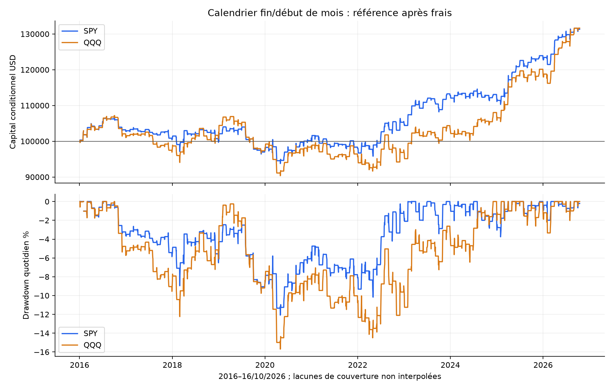
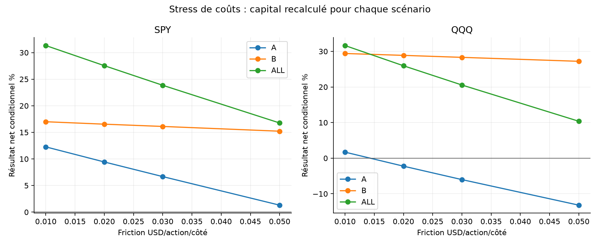
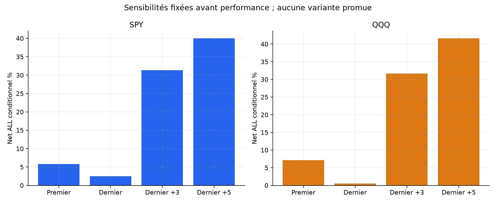
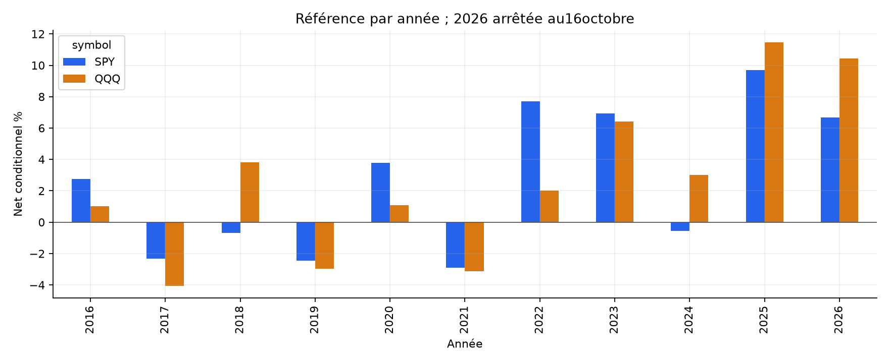

# Fin/début de mois en intraday — rapport SPY / QQQ

Les critères historiques prédéfinis ne passent pas. Cette formalisation ne justifie pas un nouveau bot.

Capital initial100000USD indépendant par scénario. ALL4janvier2016–16octobre2026 ; A jusqu’au30avril2024 ; B1mai2024–16octobre2026. B et ces ETF ont déjà été étudiés : aucun nouvel échantillon aveugle.

## Hypothèse et sources

Le calendrier peut concentrer certains rendements autour du changement de mois. Forums, GitHub et exemple QuantConnect décrivent des fenêtres et maintiens différents ; certains comprennent plusieurs nuits. [Recherche et limites des sources](../../RESEARCH.md). Notre question porte sur les seules heures régulières ; aucun gain overnight ou rendement tiers n’est importé. Aucune cause de flux institutionnel n’est démontrée par ce test.

## Règles fixées avant résultats

LONG dernier jour de bourse du mois et3premières séances. Calendrier XNYS sur mois complets, au-delà des coupures de données/A/B ; demi-séances incluses. Le dernier enregistrement source n’est jamais considéré artificiellement comme fin de mois. Calendrier historique reconstruit, pas archive point-in-time des fermetures annoncées.

Sizing au close09:34 (slot4), entrée open09:35 (slot5). Stop closeSignal×0,99 arrondi centime vers le bas. Quantité entière : risque cible1%, plafond1x, décidée avant open futur. Aucun TP. Gap stop au mauvais open, sinon low≤stop. Sortie dernier open15:59/12:59 avant sa mèche. Une entrée/jour, aucun short, trailing, indicateur ou overnight. no_stop conserve la quantité issue du stop virtuel et supprime seulement son exécution : la distance1% ne borne alors plus les pertes. [Protocole complet](../../PROTOCOL_EXECUTION.md).

## Référence après les mêmes frais

| ETF | Période | Trades | Net cumulé % | CAGR % | PF | WR % | DD marks % | Sans top3jours % |
| --- | --- | --- | --- | --- | --- | --- | --- | --- |
| SPY | ALL | 516 | 31.33 | 2.56 | 1.233 | 55.43 | 12.49 | 19.63 |
| SPY | A | 397 | 12.27 | 1.40 | 1.117 | 53.90 | 12.49 | 2.27 |
| SPY | B | 119 | 17.00 | 6.59 | 1.658 | 60.50 | 4.68 | 10.80 |
| QQQ | ALL | 518 | 31.64 | 2.58 | 1.178 | 53.09 | 16.22 | 18.84 |
| QQQ | A | 399 | 1.70 | 0.20 | 1.012 | 49.87 | 16.22 | -8.18 |
| QQQ | B | 119 | 29.41 | 11.04 | 1.879 | 63.87 | 3.70 | 21.11 |

Performances conditionnelles aux données résolues, pas compte observé continu. CAGR sur toute la période nominale. DD marks aux coûts d’entrée, closes entièrement détenus et sortie nette : ne borne pas tous les ticks. Le graphique DD quotidien est moins fin. Les deux ETF sont corrélés. Cash0%, sans rémunération. Aucun avantage par rapport au passif à exposition comparable n’est revendiqué.

## Coûts et attribution

Commission0,0035USD/action/côté minimum0,35 ; friction adverse0,01USD/action/côté. Modèle SHORT1%annuel/360 minimum1jour inchangé, mais emprunt nul ici car LONG seulement. Friction déjà dans les fills, soustraite une seule fois dans l’attribution. Modèle commun de recherche, pas tarif broker garanti ; frais variables et bid/ask non reconstruits. Gaps susceptibles de dépasser les plafonds effectifs1x/1%, frais exclus du risque cible.

| ETF | Période | Prix USD | Friction USD | Commission USD | Emprunt USD | Net USD | Exposition RTH bornehaute % |
| --- | --- | --- | --- | --- | --- | --- | --- |
| SPY | ALL | 35486.50 | 3081.16 | 1078.41 | 0.00 | 31326.94 | 16.95 |
| SPY | A | 15817.30 | 2629.20 | 920.22 | 0.00 | 12267.88 | 16.83 |
| SPY | B | 17541.17 | 402.60 | 140.91 | 0.00 | 16997.66 | 17.38 |
| QQQ | ALL | 37652.16 | 4457.08 | 1559.98 | 0.00 | 31635.11 | 15.31 |
| QQQ | A | 7053.42 | 3968.16 | 1388.86 | 0.00 | 1696.40 | 15.04 |
| QQQ | B | 30053.86 | 480.60 | 168.21 | 0.00 | 29405.05 | 16.23 |

## Contrôles : gagner ne suffit pas à prouver un effet de calendrier

| ETF | Période | TOM trades / net% / bps par trade | Autres jours | Tous les jours |
| --- | --- | --- | --- | --- |
| SPY | ALL | 516 / 31.33 / 5.563 | 2189 / -20.99 / -0.847 | 2705 / 3.85 / 0.376 |
| SPY | A | 397 / 12.27 / 3.198 | 1690 / -12.22 / -0.550 | 2087 / -1.46 / 0.163 |
| SPY | B | 119 / 17.00 / 13.455 | 499 / -9.93 / -1.853 | 618 / 5.38 / 1.095 |
| QQQ | ALL | 518 / 31.64 / 5.729 | 2189 / -14.56 / -0.349 | 2707 / 12.48 / 0.814 |
| QQQ | A | 399 / 1.70 / 0.843 | 1690 / -6.02 / -0.007 | 2089 / -4.42 / 0.155 |
| QQQ | B | 119 / 29.41 / 22.114 | 499 / -9.06 / -1.508 | 618 / 17.67 / 3.041 |

Contrôles : même achat09:35, stop1%, sizing et frais ; changer seulement les séances autorisées. Chaque compte est composé séparément. Des expositions différentes empêchent de lire le seul net cumulé comme un effet causal. Les bps par trade sont rapportés au notionnel d’entrée exécuté, pas au capital total.

| ETF | Période | Mois avec2groupes | Mois sans2groupes | Partiels/incomplets inclus | Écart moyen TOM−autres bps | IC95 par mois bps |
| --- | --- | --- | --- | --- | --- | --- |
| SPY | ALL | 130 | 0 | 6 | 6.504 | [-0.26510858835277656, 13.490223099666572] |
| SPY | A | 100 | 0 | 5 | 3.904 | [-3.90870612440834, 11.548000485809826] |
| SPY | B | 30 | 0 | 1 | 15.170 | [0.9311376861421631, 29.95223296878078] |
| QQQ | ALL | 130 | 0 | 3 | 6.280 | [-2.2809001716449706, 15.393963283498927] |
| QQQ | A | 100 | 0 | 2 | 1.060 | [-8.688683619596693, 11.01039264149523] |
| QQQ | B | 30 | 0 | 1 | 23.681 | [6.008034148119174, 42.60840787272904] |

Diagnostic fixé : depuis le compte all_days, calculer dans chaque mois la moyenne nette des trades TOM et autres, puis moyenner leurs écarts en donnant le même poids à chaque mois. IC95 par rééchantillonnage3000fois des mois, seed20261026. Mois partiels/incomplets conservés et signalés ; exclure seulement les mois sans les deux groupes. CSV calendar_months et JSON calendar_contrast exposent chaque calcul. Intervalles descriptifs conditionnels, peu de mois en B, dépendances de régime et essais multiples non corrigés.

Critères de candidature fixés avant PnL : référence positive sur chaque ETF/période ET borne basse du contraste mensuel ALL>0 sur les deux ETF. Un passage éventuel resterait une présélection historique, sans autorisation automatique de bot ou réel.

## Toutes les sensibilités prévues

| Variante ALL : trades / net% / PF | SPY | QQQ |
| --- | --- | --- |
| reference | 516 / 31.33 / 1.233 | 518 / 31.64 / 1.178 |
| cost_0.02 | 516 / 27.55 / 1.207 | 518 / 25.96 / 1.149 |
| cost_0.03 | 516 / 23.85 / 1.180 | 518 / 20.55 / 1.120 |
| cost_0.05 | 516 / 16.76 / 1.129 | 518 / 10.37 / 1.062 |
| first1 | 130 / 5.83 / 1.174 | 130 / 7.13 / 1.157 |
| last1 | 129 / 2.52 / 1.071 | 129 / 0.55 / 1.012 |
| first3 | 387 / 28.12 / 1.285 | 389 / 30.85 / 1.233 |
| first5_last1 | 776 / 39.97 / 1.181 | 778 / 41.58 / 1.141 |
| other_days | 2189 / -20.99 / 0.958 | 2189 / -14.56 / 0.978 |
| all_days | 2705 / 3.85 / 1.006 | 2707 / 12.48 / 1.015 |
| no_stop | 516 / 31.19 / 1.219 | 518 / 40.45 / 1.207 |
| resolved_prefix | 516 / 31.33 / 1.233 | 518 / 31.64 / 1.178 |

12variantes ×2ETF ×3périodes=72comptes recouvrants : coûts0,02/0,03/0,05, premier1, dernier1, premiers3, premier5+dernier1, autres/tous jours, sans stop et prefix. Pas de sélection de fenêtre gagnante après PnL. [Tous les scénarios](comparison_all.csv).

## Couverture et provenance

SIP minute déjà acquis. Archives/préparations SHA, calendrier NYSE et rapprochement des corporate actions vérifiés avant PnL.2714séances préparées dont padding2015-12-31,2713évaluées ; SPY2705/QQQ2707complètes dans le cache total. Quelques minutes manquent, notamment en2020. [Profil](DATA_SOURCE_PROFILE.json), [calendrier complet figé](XNYS_CALENDAR.csv).

Signal sans historique de prix ; aucun ajustement cash nécessaire : flat overnight et achat après l’ouverture à l’ex-date. Aucun dividende inventé ni crédité. Pas de volume dans le signal, mais complete_days applique après coup la qualité OHLCV du jour pouvant générer une entrée : biais potentiel. Prefix retire ce filtre mais reste conditionnel : sizing inconnu ou trade actif non résolu omis, frais d’entrée connus exportés. Pas d’interpolation ; zéro comptable d’exclusion n’est pas cash observé. Les minutes avant09:34 et après une sortie résolue ne sont pas nécessaires en prefix.

| ETF | Période | Exclues principal | Trades principal | Net principal % | Trades prefix | Non résolues | Net prefix % |
| --- | --- | --- | --- | --- | --- | --- | --- |
| SPY | ALL | 3 | 516 | 31.33 | 516 | 3 | 31.33 |
| SPY | A | 3 | 397 | 12.27 | 397 | 3 | 12.27 |
| SPY | B | 0 | 119 | 17.00 | 119 | 0 | 17.00 |
| QQQ | ALL | 1 | 518 | 31.64 | 518 | 1 | 31.64 |
| QQQ | A | 1 | 399 | 1.70 | 399 | 1 | 1.70 |
| QQQ | B | 0 | 119 | 29.41 | 119 | 0 | 29.41 |

## Incertitude, concentration et années

Bootstrap descriptif3000tirages seed20261026 : blocs circulaires5/20séances pour moyenne quotidienne et clusters annuels pour bps/trade. Exclusions au zéro de chaînage, pas couverture reconstruite ; aucun ajustement des essais multiples.

| ETF | Période | IC95 moyenne quotidienne %, blocs5 | Blocs20 | IC95 bps/trade, années |
| --- | --- | --- | --- | --- |
| SPY | ALL | [-0.0008 ; 0.0218] | [-0.0007 ; 0.0214] | [0.19180895614331314, 11.01979618924508] |
| SPY | A | [-0.0076 ; 0.0194] | [-0.0064 ; 0.0186] | [-2.1235291545486636, 8.88116553519384] |
| SPY | B | [0.0049 ; 0.0482] | [0.0057 ; 0.0469] | [0.05459313694389323, 19.626435033248146] |
| QQQ | ALL | [-0.0037 ; 0.0255] | [-0.0038 ; 0.0260] | [-0.14310940632858532, 12.028737295375098] |
| QQQ | A | [-0.0155 ; 0.0191] | [-0.0155 ; 0.0189] | [-4.212414558820853, 5.835591999767215] |
| QQQ | B | [0.0124 ; 0.0723] | [0.0160 ; 0.0702] | [16.052538519422356, 25.8756858192386] |

| ETF | Période | Sans top3 % | Sans2020 % | Pertes consécutives max |
| --- | --- | --- | --- | --- |
| SPY | ALL | 19.63 | 26.55 | 6 |
| SPY | A | 2.27 | 8.18 | 6 |
| SPY | B | 10.80 | 17.00 | 4 |
| QQQ | ALL | 18.84 | 30.21 | 9 |
| QQQ | A | -8.18 | 0.59 | 9 |
| QQQ | B | 21.11 | 29.41 | 5 |

Ablations : mettre à zéro les rendements sélectionnés du compte original, sans nouveau sizing. Années/mois/directions, qualité, calendrier et chaque transaction sont exportés.

## Figures

## Vérifications, limites et décision

[Tests/revue/audit](../../VALIDATION.md). Calendrier/code/dépendances gelés avant PnL. Replay scalaire séparé du calendrier mois par mois et de chaque ordre/compte ; il n’appelle pas le moteur. Source commune : pas deuxième flux de marché.

Limites : adaptation intraday d’une littérature souvent daily/overnight, prix de trades sans carnet, coûts fixes, données/fermetures historiques non point-in-time, couverture de crise incomplète, choix d’hypothèse et dates déjà explorées, exposition limitée et corrélation des ETF.

Les critères historiques prédéfinis ne passent pas. Cette formalisation ne justifie pas un nouveau bot. Les deux bots QQQ existants restent inchangés, aucun nouveau bot ni ordre réel.
