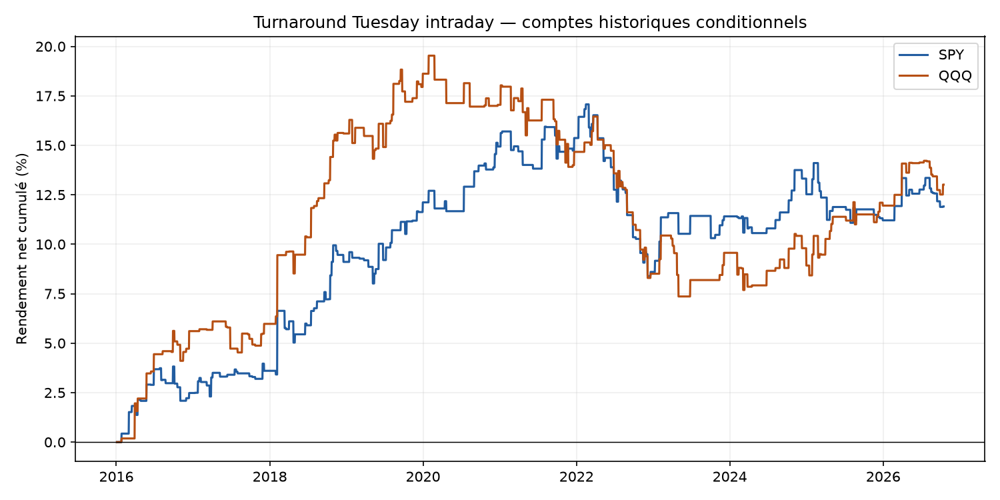
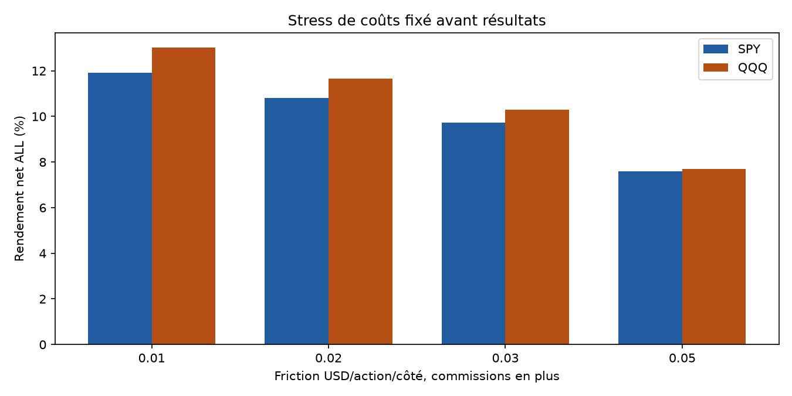
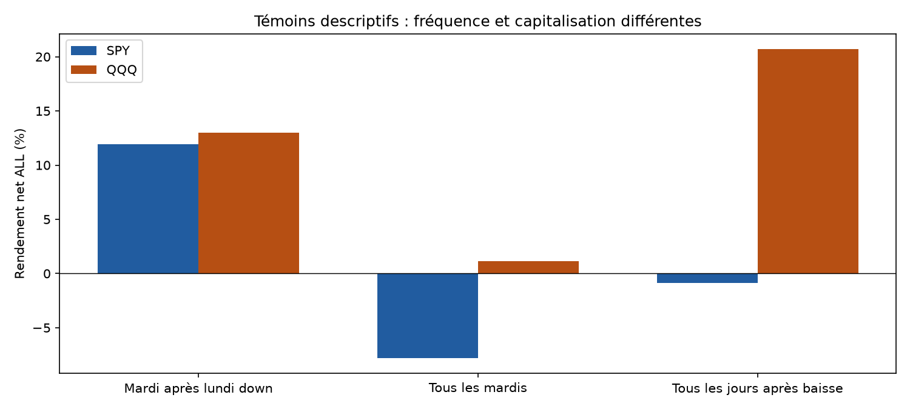
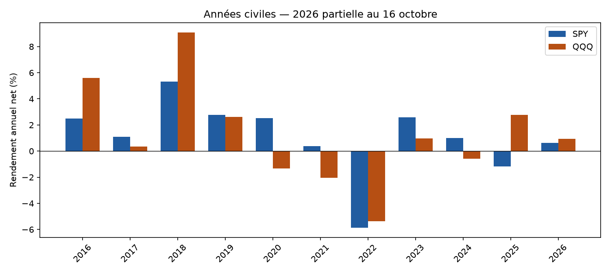

# Turnaround Tuesday intraday — rapport final

**Adaptation intraday écartée pour un nouveau bot : critères prédéfinis non satisfaits.** Les deux bots Noise Area et ORB continuent leur simulation distincte ; aucun nouveau moteur installé.

Étude calculée le31octobre2026, archives SIP1minute du4janvier2016 au16octobre2026, SPY/QQQ. Deux comptes séparés100000USD, risque cible1%, plafond causal1x. Résultats historiques conditionnels à la couverture. A et B ont déjà été examinées par de nombreuses études ; B n’est pas un nouvel hors-échantillon aveugle.

## Hypothèse et règles

Acheter le mardi si la dernière séance est un lundi dont le close RTH brut est inférieur au close de la séance précédente ; lundi férié exclu. Après le close09:30, quantité calculée puis achat à l’open09:31. Stop fixe ADR14, sortie au dernier open RTH15:59/12:59. Aucune nuit, aucun TP ou filtre RSI/IBS. Les stratégies externes détiennent souvent la nuit : cette adaptation ne reproduit pas leur performance et retire potentiellement leur principal moteur de profit.

Friction adverse0.01USD/action/côté ; commission0.0035USD/action/côté, minimum0.35. Risque cible hors frais ; quantités entières décidées avant le fill. Les gaps peuvent dépasser ce risque. LONG seulement : emprunt nul et aucun dividende encaissé overnight.

## Résultats des références

| ETF | Période | Trades | Net % | CAGR % | Gagnants % | PF | DD observé % | Sans top3 % |
|---|---|---|---|---|---|---|---|---|
| SPY | ALL | 196 | 11.91 | 1.05 | 52.04 | 1.29 | 7.66 | 5.81 |
| SPY | A | 155 | 10.56 | 1.21 | 53.55 | 1.32 | 7.66 | 4.63 |
| SPY | B | 41 | 1.21 | 0.49 | 46.34 | 1.15 | 3.16 | -1.67 |
| QQQ | ALL | 187 | 13.01 | 1.14 | 54.01 | 1.27 | 10.76 | 6.41 |
| QQQ | A | 145 | 7.92 | 0.92 | 53.79 | 1.19 | 10.76 | 1.69 |
| QQQ | B | 42 | 4.71 | 1.89 | 54.76 | 1.66 | 2.69 | 1.36 |

A :2016-01-04–2024-04-30 ; B :2024-05-01–2026-10-16. Chaque compte de période repart de100000USD. Le DD observe les frais d’entrée, closes minute détenus et sorties ; il ne reconstruit pas tous les ticks.

## Coûts et risque

| ETF | Mouvement brut USD | Friction USD | Commissions USD | Emprunt USD | Net USD | Levier réf max | Levier fill max | Risque brut max % | Risque stop net modélisé max % |
|---|---|---|---|---|---|---|---|---|---|
| SPY | 13348.05 | 1065.50 | 373.27 | 0.00 | 11909.27 | 1.00 | 1.00 | 1.00 | 1.01 |
| QQQ | 14807.07 | 1328.10 | 465.77 | 0.00 | 13013.20 | 1.00 | 1.00 | 1.02 | 1.04 |

Le risque net modélisé suppose une sortie au stop ou l’open d’entrée si le stop est déjà dépassé, avec deux frictions et commissions. Ce n’est pas une borne de perte : un nouveau gap ou des frais différents peut l’aggraver. MAE/MFE de prix excluent les commissions et utilisent les fills et seules minutes entièrement détenues.

## Témoins et sensibilités

| ETF | Période | Variante | Trades | Net % | PF |
|---|---|---|---|---|---|
| SPY | ALL | reference | 196 | 11.91 | 1.29 |
| SPY | ALL | all_tuesdays | 538 | -7.80 | 0.93 |
| SPY | ALL | all_down_days | 1172 | -0.85 | 1.00 |
| SPY | A | reference | 155 | 10.56 | 1.32 |
| SPY | A | all_tuesdays | 410 | -11.69 | 0.86 |
| SPY | A | all_down_days | 902 | -7.64 | 0.96 |
| SPY | B | reference | 41 | 1.21 | 1.15 |
| SPY | B | all_tuesdays | 128 | 4.40 | 1.18 |
| SPY | B | all_down_days | 270 | 7.38 | 1.11 |
| QQQ | ALL | reference | 187 | 13.01 | 1.27 |
| QQQ | ALL | all_tuesdays | 545 | 1.15 | 1.01 |
| QQQ | ALL | all_down_days | 1149 | 20.68 | 1.06 |
| QQQ | A | reference | 145 | 7.92 | 1.19 |
| QQQ | A | all_tuesdays | 417 | -5.40 | 0.95 |
| QQQ | A | all_down_days | 884 | 11.88 | 1.04 |
| QQQ | B | reference | 42 | 4.71 | 1.66 |
| QQQ | B | all_tuesdays | 128 | 6.90 | 1.24 |
| QQQ | B | all_down_days | 265 | 7.90 | 1.11 |

Ces témoins modifient la fréquence, les dates d’exposition et la capitalisation ; leurs écarts ne prouvent pas un effet causal du mardi. Les autres jours, seuils0.5%/1%, entrée09:35 et retrait du filtre de couverture sont tous conservés dans la matrice84scénarios. Aucun meilleur seuil n’est promu après observation.

## Années et concentration

| ETF | Période | Sans3meilleurs jours % | Top3/gains positifs % | Pire trade USD | Exposition RTH max % |
|---|---|---|---|---|---|
| SPY | ALL | 5.81 | 11.41 | -1167.83 | 6.68 |
| SPY | A | 4.63 | 13.72 | -1167.83 | 6.79 |
| SPY | B | -1.67 | 32.79 | -1019.00 | 6.30 |
| QQQ | ALL | 6.41 | 10.46 | -1213.67 | 6.23 |
| QQQ | A | 1.69 | 13.14 | -1213.67 | 6.13 |
| QQQ | B | 1.36 | 28.26 | -1036.64 | 6.57 |

Le retrait des trois meilleurs jours est un diagnostic de concentration avec rendements quotidiens de la trajectoire originale conservés, sans recalcul des quantités ; ce n’est pas un nouveau portefeuille recalculé. Les années2026 ne couvrent que la période arrêtée au16octobre.

## Incertitude et critères avant résultats

| ETF | Période | IC95 moyen quotidien bas, bps | IC95 haut, bps |
|---|---|---|---|
| SPY | ALL | -0.12 | 0.98 |
| SPY | A | -0.14 | 1.17 |
| SPY | B | -0.81 | 1.22 |
| QQQ | ALL | -0.16 | 1.07 |
| QQQ | A | -0.35 | 1.16 |
| QQQ | B | -0.26 | 1.75 |

Bootstrap descriptif3000tirages, blocs circulaires5/20séances et clusters annuels, seed20261031. Les exclusions sont à zéro dans le chaînage mais pas des observations de cash. IC conditionnels, peu de clusters et absence de correction pour les nombreux essais antérieurs : ni preuve de significativité exploitable ni OOS aveugle.

| ETF | >=100trades ALL | A/B/ALL positifs | ALL sans top3 positif | A coûts doublés positif | IC95 blocs20 bas>0 |
|---|---|---|---|---|---|
| SPY | passe | passe | passe | passe | échoue |
| QQQ | passe | passe | passe | passe | échoue |

## Couverture et validation

| ETF | Période | Jours exclus | Non résolus | Trades demi-séance |
|---|---|---|---|---|
| SPY | ALL | 16 | 0 | 0 |
| SPY | A | 16 | 0 | 0 |
| SPY | B | 0 | 0 | 0 |
| QQQ | ALL | 9 | 0 | 1 |
| QQQ | A | 9 | 0 | 1 |
| QQQ | B | 0 | 0 | 0 |

Audit scalaire séparé :2919453contrôles,84scénarios,15786lignes de trades et151928lignes quotidiennes qui se chevauchent entre scénarios. Il recalcule les calendriers/signaux, ADR, stops, quantités, fills, coûts et comptes sans appeler le moteur de stratégie. Même source et chargeur vérifié : pas un deuxième fournisseur de prix.

Le principal exige une journée complète, filtre connu après coup. resolved_prefix le retire mais conserve toute donnée nécessaire au signal et aux fills ; un trou actif rend le trade non résolu et omet son PnL entier, avec coûts connus archivés. Les données historiques peuvent être révisées ; absence de quotes, liquidité, fills partiels ou latence broker dans le modèle.

Les prix bruts close/close peuvent prendre un détachement de dividende pour une baisse. Aucun split renvoyé dans la requête archivée, complétude fournisseur non certifiée. Ces réserves s’ajoutent aux limites de sélection et d’exécution, elles ne sont pas effacées par un grand nombre de trades.

## Décision

Adaptation intraday écartée pour un nouveau bot : critères prédéfinis non satisfaits.

Les critères ont été figés avant le premier PnL. Aucune variante isolée positive ne remplace la référence. Les simulations Noise Area et ORB restent inchangées ; aucun passage automatique en réel.

## Fichiers et reproduction

[84scénarios](comparison_all.csv) · [Critères](SCREENING.json) · [Gel avant calcul](PRE_EXECUTION_PROTOCOL.json) · [Profil des données](DATA_SOURCE_PROFILE.json) · [Tests](TESTS.json) · [Audit](../../audit/AUDIT_RESULTS.json) · [Vérifications complémentaires](../../audit/ADDITIONAL_CHECKS.json) · [Sources et différences](../../RESEARCH.md) · [Protocole](../../PROTOCOL_EXECUTION.md). Chaque dossier de scénario conserve trades, daily, unresolved, by_year et summary. Archives de marché et clés exclues de Git.
