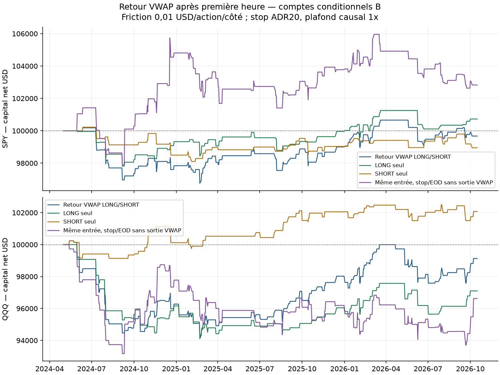
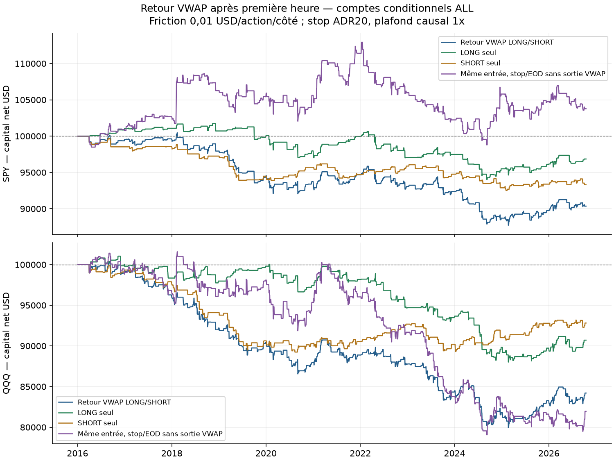
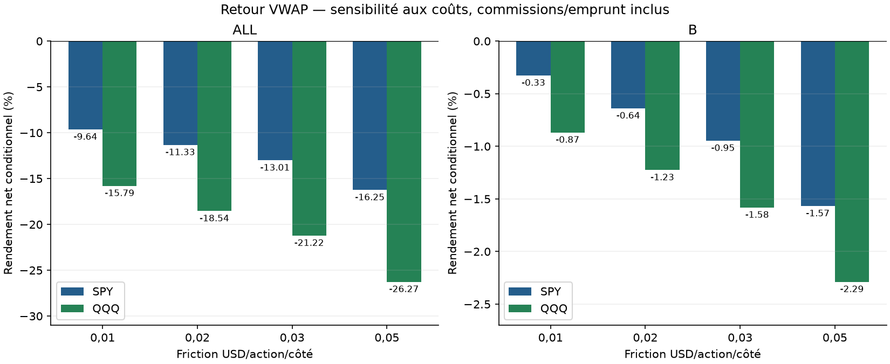
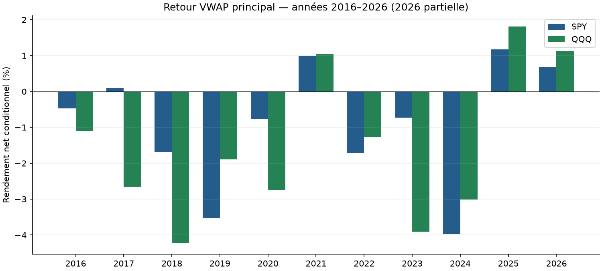

# Retour vers VWAP après première heure — rapport final

**Décision : archiver cette version comme piste négative après coûts ; aucun nouveau bot justifié.** Les principaux SPY et QQQ perdent sur A, B et ALL. À coûts de base : SPY ALL −9,639 % et B −0,327 % ; QQQ ALL −15,792 % et B −0,868 %. Aucun seuil/horaire/stop n’a été optimisé après observation. Les variantes positives locales sont conservées sans remplacer le principal.

**Portée conditionnelle et exploratoire.** Le filtre principal de séance actuelle complète est connu après coup ; les journées exclues ne représentent pas des rendements cash constatés. Les valeurs omettent ces journées (`observed_return=NaN`, zéro comptable de `return_net`). Les abstentions fondées sur warmup/historique déjà incomplet sont distinctes et causales. B réutilise l’historique déjà examiné : aucun nouveau hors-échantillon aveugle ni rendement prospectif.

## Hypothèse et sources

Tester si un écart important entre le close de la première heure et le VWAP de séance se corrige ensuite. C’est notre hypothèse figée, pas une stratégie rentable démontrée par les sources. [Alpaca définit le calcul VWAP et présente un autre signal de tendance](https://alpaca.markets/learn/algorithmic-trading-with-twap-and-vwap-using-alpaca) ; [construction officielle des barres](https://alpaca.markets/learn/stock-minute-bars) et [FAQ](https://docs.alpaca.markets/us/docs/market-data-faq) précisent timestamps, champs et agrégation. Aucune performance publiée n’est attribuée à notre version contrariante.

Nous utilisons le champ `vw` réel de chaque minute, pondéré par son volume : somme(vw×volume)/somme(volume) depuis09:30. Les CSV OHLCV n’avaient pas conservé ce champ, mais les 428 pages gzip originales le contenaient. Ce n’est pas une approximation HLC3. L’agrégation reste celle du fournisseur et de ses conditions de trades, sans reconstitution indépendante tick par tick.

## Règles et coûts

ADR20 = moyenne des amplitudes high-low RTH des20 séances immédiatement antérieures complètes, sans saut de journée ni composante overnight. À close10:29 : LONG si close est sous VWAP de plus de0,25 ADR ; SHORT si au-dessus de plus de0,25 ADR ; égalité = plat. Entrée open10:30 ; q=floor(min(capital/close10:29,1 %capital/ADR20)), plafond causal1x. Stop de référence à une ADR de l’open d’entrée. Un trade maximum par séance, aucune réentrée.

Sortie VWAP : attendre un close revenu au-delà du VWAP actualisé, puis exécuter au prochain open. Une touche intraminute ne suffit pas. Stop actif dès la minute d’entrée ; gap défavorable au stop rempli à l’open. Liquidation au dernier open15:59/12:59. Le délai de publication de10:29 peut empêcher le fill10:30 supposé. [Contrat complet avant P&L](../../PROTOCOL_EXECUTION.md).

Mêmes frais : par côté max(0,35 USD ; 0,0035×q), friction adverse0,01 USD/action/côté, stress0,02/0,03/0,05 ; emprunt SHORT q×entrée après friction×1 %/360, un jour minimum. Pas d’intérêts sur cash ni tarif réglementaire séparé, disponibilité du prêt/quotes/latence/fills réels non observés. Ces coûts sont hypothétiques, pas une mesure d’exécution.

ALL04/01/2016–16/10/2026 ; A jusqu’au30/04/2024 ; B01/05/2024–16/10/2026, chaque instrument/période réinitialisé séparément à100000 USD. Les20 jours de calcul avant B sont uniquement des informations passées connues, sans calibration. Les variantes et A/B/ALL se recouvrent ; les comptes ne constituent pas des observations indépendantes.

## Principaux résultats

| Instrument | Période | Trades | Net % | CAGR % | DD minute observé % | Sharpe | Profit factor |
|---|---|---|---|---|---|---|---|
| SPY | ALL | 393 | -9.639 | -0.935 | 12.887 | -0.433 | 0.819 |
| SPY | A | 286 | -9.332 | -1.170 | 9.964 | -0.556 | 0.767 |
| SPY | B | 107 | -0.327 | -0.133 | 3.672 | -0.048 | 0.978 |
| QQQ | ALL | 506 | -15.792 | -1.581 | 20.489 | -0.564 | 0.797 |
| QQQ | A | 377 | -15.056 | -1.941 | 17.280 | -0.719 | 0.747 |
| QQQ | B | 129 | -0.868 | -0.354 | 6.364 | -0.102 | 0.960 |

## Frais et variantes prédéfinies

| Instrument | Période | Friction USD/côté | Net % |
|---|---|---|---|
| SPY | ALL | 0.010 | -9.639 |
| SPY | ALL | 0.020 | -11.330 |
| SPY | ALL | 0.030 | -13.011 |
| SPY | ALL | 0.050 | -16.249 |
| SPY | A | 0.010 | -9.332 |
| SPY | A | 0.020 | -10.754 |
| SPY | A | 0.030 | -12.182 |
| SPY | A | 0.050 | -14.915 |
| SPY | B | 0.010 | -0.327 |
| SPY | B | 0.020 | -0.638 |
| SPY | B | 0.030 | -0.946 |
| SPY | B | 0.050 | -1.568 |
| QQQ | ALL | 0.010 | -15.792 |
| QQQ | ALL | 0.020 | -18.544 |
| QQQ | ALL | 0.030 | -21.222 |
| QQQ | ALL | 0.050 | -26.267 |
| QQQ | A | 0.010 | -15.056 |
| QQQ | A | 0.020 | -17.528 |
| QQQ | A | 0.030 | -19.931 |
| QQQ | A | 0.050 | -24.529 |
| QQQ | B | 0.010 | -0.868 |
| QQQ | B | 0.020 | -1.225 |
| QQQ | B | 0.030 | -1.581 |
| QQQ | B | 0.050 | -2.288 |

| Instrument | mode | quality | exit_policy | Trades | Net % |
|---|---|---|---|---|---|
| SPY | both | complete_days | vwap | 107 | -0.327 |
| SPY | long_only | complete_days | vwap | 57 | 0.727 |
| SPY | short_only | complete_days | vwap | 50 | -1.050 |
| SPY | both | complete_days | eod_only | 107 | 2.827 |
| SPY | both | resolved_prefix | vwap | 107 | -0.327 |
| QQQ | both | complete_days | vwap | 129 | -0.868 |
| QQQ | long_only | complete_days | vwap | 69 | -2.897 |
| QQQ | short_only | complete_days | vwap | 60 | 2.079 |
| QQQ | both | complete_days | eod_only | 129 | -3.375 |
| QQQ | both | resolved_prefix | vwap | 129 | -0.868 |

SPY sans sortie VWAP, conservant stop et liquidation, donne +3,775 % ALL /+0,933 % A /+2,827 % B au coût de base. Cette variante préfigée a ses tailles/capital propres et ne constitue pas un témoin à exposition fixée. Son résultat modeste ne valide pas la sortie VWAP étudiée. QQQ SHORT seul est positif en B mais négatif sur ALL ; SPY LONG seul positif en B reste négatif sur ALL. Aucun choix du meilleur résultat après calcul. [Toutes les48comparaisons](comparison_all.csv).

## Couverture des sources et abstentions

Six caches et six CSV bruts vérifiés SHA, calendrier XNYS continu2714 séances du31/12/2015 au16/10/2026, 2713 séances dans ALL. Extraction des428 pages gzip SHA contrôlées : 1054186 barres RTH SPY et1054175QQQ rapprochées sur tous OHLCV. Aucun VWAP invalide avec volume positif, aucun horsOHLC et aucun volume nul dans ces barres. Le code accepte logiquement zéro volume sans poids et ne rejette pas automatiquement un VWAP horsOHLC, car les champs peuvent appliquer des conditions différentes. [Profil et empreintes](DATA_SOURCE_PROFILE.json).

| Instrument | Motif | Séances | Trades |
|---|---|---|---|
| SPY | eligible | 2581 | 393 |
| SPY | excluded_incomplete_day | 3 | 0 |
| SPY | invalid_firsthour | 2 | 0 |
| SPY | invalid_prior20 | 108 | 0 |
| SPY | warmup20 | 19 | 0 |
| QQQ | eligible | 2631 | 506 |
| QQQ | excluded_incomplete_day | 1 | 0 |
| QQQ | invalid_firsthour | 1 | 0 |
| QQQ | invalid_prior20 | 61 | 0 |
| QQQ | warmup20 | 19 | 0 |

| Instrument | date | eligibility |
|---|---|---|
| SPY | 2016-02-02 | excluded_incomplete_day |
| SPY | 2019-08-12 | excluded_incomplete_day |
| SPY | 2020-03-09 | invalid_firsthour |
| SPY | 2021-05-05 | excluded_incomplete_day |
| SPY | 2023-06-05 | invalid_firsthour |
| QQQ | 2016-02-02 | excluded_incomplete_day |
| QQQ | 2020-03-09 | invalid_firsthour |

Warmup20 et invalid_prior20 sont des abstentions causales : aucune séance ancienne de remplacement ni entrée. La première heure invalide est un signal non observable. complete_days ajoute un filtre rétrospectif de qualité actuelle ; resolved_prefix conserve les exécutions démontrées avant un trou et classe les autres non résolues en omettant le trade entier, frais connus compris, avec intention exportée. Sur cette exécution aucune position entrée n’est devenue non résolue ; les principaux et cette sensibilité ont les mêmes P&L, sans que cela certifie un portefeuille continu ou la complétude du fournisseur.

| Instrument | Période | data_excluded_sessions | causal_history_abstention_sessions | no_signal_sessions | Trades |
|---|---|---|---|---|---|
| SPY | ALL | 5 | 127 | 2188 | 393 |
| SPY | A | 5 | 127 | 1677 | 286 |
| SPY | B | 0 | 0 | 511 | 107 |
| QQQ | ALL | 2 | 80 | 2125 | 506 |
| QQQ | A | 2 | 80 | 1636 | 377 |
| QQQ | B | 0 | 0 | 489 | 129 |

## Risque, exposition et décomposition

| Instrument | Période | price_move_pnl | friction_cost | commission | borrow_fee | regular_time_exposure_upper_pct | max_actual_entry_leverage | max_entry_risk_pct |
|---|---|---|---|---|---|---|---|---|
| SPY | ALL | -6754.586 | 1808.440 | 633.444 | 442.575 | 5.057 | 1.000 | 1.000 |
| SPY | A | -6944.955 | 1527.020 | 534.478 | 325.207 | 4.689 | 1.000 | 1.000 |
| SPY | B | 222.288 | 310.520 | 108.955 | 129.460 | 6.304 | 1.000 | 1.000 |
| QQQ | ALL | -11161.577 | 3062.660 | 1077.615 | 490.579 | 7.032 | 1.000 | 1.000 |
| QQQ | A | -10944.261 | 2765.020 | 968.254 | 378.683 | 6.899 | 1.000 | 1.000 |
| QQQ | B | -261.440 | 350.520 | 124.698 | 131.804 | 7.482 | 1.000 | 1.000 |

Les mouvements avant coûts sont déjà négatifs sur ALL pour les deux instruments ; SPY B légèrement positif avant coûts devient négatif après frais. La décomposition comptable n’identifie pas une cause économique ni une réfutation générale du retour à la moyenne. Budget1 % exclut frais et gaps ; 1x est un plafond au prix de taille, pas une garantie au fill. Durée de sortie intrabar bornée d’une minute ; DD aux closes et MAE/MFE sont partiellement observés. Aucun prix postexit de la minute de stop n’entre dans les marks.

## Années, concentration et incertitude

| Instrument | Période | return_without_top3_days_pct | return_without_2020_daily_returns_pct | worst_trade_usd | half_session_trades |
|---|---|---|---|---|---|
| SPY | ALL | -11.237 | -8.930 | -1002.258 | 0 |
| SPY | A | -10.935 | -8.620 | -1002.258 | 0 |
| SPY | B | -1.643 | -0.327 | -967.381 | 0 |
| QQQ | ALL | -17.423 | -13.409 | -1026.104 | 2 |
| QQQ | A | -16.701 | -12.651 | -1026.104 | 1 |
| QQQ | B | -2.351 | -0.868 | -996.450 | 1 |

Ablations descriptives : mettre à zéro les trois plus grands rendements quotidiens positifs, ou tous ceux de2020, puis recomposer les autres rendements conservés. Pas de nouveau portefeuille à tailles ou P&L fixes. Année2026 partielle. Les exports annuels, LONG/SHORT, demi-séances, raisons de sortie et abstentions restent disponibles.

SPY B : IC95 % descriptif par groupes annuels sur la moyenne **par trade** [-8.709, 4.802] bps du notionnel. Seulement trois groupes annuels2024–2026 partiellement ou complètement observés.

QQQ B : IC95 % descriptif par groupes annuels sur la moyenne **par trade** [-13.521, 6.398] bps du notionnel. Seulement trois groupes annuels2024–2026 partiellement ou complètement observés.

| Instrument | Bloc | Moyenne_quotidienne_basse_bps | Moyenne_quotidienne_haute_bps |
|---|---|---|---|
| SPY | 5 | -1.119 | 1.011 |
| SPY | 20 | -1.083 | 1.013 |
| QQQ | 5 | -1.603 | 1.276 |
| QQQ | 20 | -1.631 | 1.340 |

Le tableau mesure la moyenne **quotidienne du rendement du capital conditionnel**, unité différente des bps par transaction. Blocs circulaires5/20 séances et années,3000 réplications, seed20261020 ; années sans trade conservées. Les IC incluent les zéros comptables d’exclusions. Sans correction des essais multiples, avec B réutilisée et peu de groupes, ils restent descriptifs et couvrent zéro.

## Audits et reproductibilité

Audit indépendant : 48 exécutions, **12586 lignes recouvrantes et2125058 marks**, ADR/VWAP/signaux/taille/trace/coûts/capital reconstruits en Decimal sans fonction moteur/statistiques. Erreur max champs monétaires par trade 4.05e-11 USD ; capital 3.77e-09 USD ; tolérance monétaire3×10⁻⁶. [Preuve et unités](INDEPENDENT_AUDIT.json), [lignes](INDEPENDENT_TRADE_AUDIT.csv).

46 tests contrôlés ; rapprochements secondaires des48 scénarios et1776 agrégats. 16 exemples avec3168 barres/19008 champs OHLCV/VWAP relus dans les pages gzip et comparés, écart maximal 0. VWAP de première heure et sorties VWAP vérifiés depuis ces extraits. [Exemples](EXAMEN_TRANSACTIONS.md), [preuve](RAW_EXCERPT_AUDIT.json). Cela vérifie le traitement d’un seul fournisseur, sans validation croisée de ses prix ni preuve des fills.

Protocole/code/sources/versions figés avant première boucle : [gel](PRE_EXECUTION_PROTOCOL.json), [snapshot](code_snapshot), [manifest initial](MANIFEST.json). Les scripts de rapport/audit ajoutés ensuite sont tracés dans le manifest final. L’ablation a été corrigée avant P&L pour respecter le classement par rendements ; eod_only ne demande pas un VWAP futur inutilisé. Aucun correctif financier après calcul. Les tests synthétiques ne sont pas des données de performance. [Guide](../../README.md).

## Décision pratique et ORB

Ne pas poursuivre cette version VWAP vers un bot. Elle apporte un résultat négatif utile et n’épuise pas toutes les stratégies de retour à la moyenne. ORB QQQ conserve un meilleur statut exploratoire, mais les coûts, les journées dominantes B, le filtre de couverture et les IC ne permettent pas de la qualifier validée. [Décision ORB et protocole proposé de suivi prospectif](../../../../docs/research/2026-10-20-orb-qqq-decision.md). Aucun nouveau bot ni automation ORB activé ; Noise Area QQQ garde son suivi distinct.
